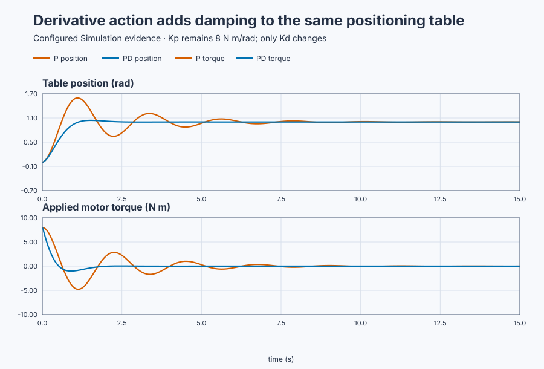

# Position-table proportional-derivative control

Course position: Lesson 20 of 84. Previous lesson:
[Position-table proportional control](../19-servo-position-p/README.md).
Next lesson: [Loaded position-table PID control](../21-underdamped-pid/README.md).

**Lesson objective:** Add derivative action to the position controller, then
explain from the mechanics why velocity feedback reduces overshoot without
changing the proportional stiffness.

This lesson uses simulation. Its results are not physical-axis evidence.

**Equipment:** Motor-driven industrial positioning table.

## The problem

The motor-driven industrial positioning table from Lesson 19 still carries one
rigid payload. Its encoder measures table angle and angular velocity, and its
drive can apply between -10 and +10 newton metres (N m) of motor torque. The
plant, initial state, 20 ms controller cycle, and 1 radian move are unchanged.
Keeping those conditions fixed matters: if the response changes, derivative
gain is the only intended cause.

Lesson 19 showed why merely raising proportional gain is not a complete answer.
The larger gain made the table stiffer and faster, but the moving payload stored
kinetic energy. It passed the target and oscillated because the fixed mechanical
friction did not remove that energy quickly enough. Lowering proportional gain
would reduce the oscillation only by giving up the stiffness we wanted.

We need a separate controller term that responds to motion. The safe state is
Manual mode with zero motor torque. The encoder is noise-free in this lesson so
we can isolate the damping effect; Lesson 23 adds encoder noise and exposes the
price paid for differentiating a measurement.

## What we need

We need a torque contribution that opposes measured motion without weakening
the proportional restoring torque. To isolate that capability, keep
proportional gain at 8 N m/rad and compare two fresh runs:

- the Lesson 19 P controller with derivative gain zero; and
- a PD controller with derivative gain 3 N m s/rad.

Before operating the project, we need to understand what the new term does, why
its sign is negative, why it changes damping but not stiffness, and exactly how
the comparison will be judged.

## The new idea

The **setpoint** ($SP$) is the desired table angle and the **process value**
($PV$) is the measured angle. Both are measured in radians. Their difference is
the position error $e$:

$e = SP - PV$

The proportional gain $K_p$ tells us how many newton metres of restoring torque
to request for each radian of error. Therefore the proportional contribution is

$T_P = K_p e$

This is the controller's positional stiffness: doubling the error doubles the
requested restoring torque.

### Deriving the derivative torque

Angular velocity $\omega$ is the rate at which the measured position changes,
in radians per second. A positive $\omega$ means the table is moving toward
increasing angle. To slow that motion, the controller must request torque in the
opposite direction. That requirement determines the minus sign:

$T_D = -K_d \omega$

Here $K_d$ is derivative gain. Its unit is N m s/rad. Multiplying it by rad/s
cancels seconds and radians, leaving N m, so $T_D$ really is a torque. When the
table moves positively, $T_D$ is negative; when it moves negatively, $T_D$ is
positive. In either case it opposes motion.

The derivative setpoint weight is zero, so this lesson differentiates measured
position, not the setpoint. A step in the requested angle is instantaneous and
would have an unbounded ideal derivative. Measuring physical velocity instead
lets derivative action respond to motion that the table actually makes.

Before the drive limit, the requested torque is the sum of the two controller
contributions:

$T_{requested} = T_P + T_D = K_p e - K_d \omega$

The drive then limits that request to its physical range:

$T_{applied} = \operatorname{clamp}(T_{requested}, -10\,\text{N m}, +10\,\text{N m})$

Requested and applied torque are different quantities. A controller may ask for
more torque than the drive can provide, so the evidence must use applied torque
when checking the actuator limit.

### Deriving the closed-loop motion

Lesson 19 began with the rotational torque balance

$J\ddot{\theta} + B\dot{\theta} = T$

where $\theta$ is table angle, $J$ is rotational inertia, $B$ is viscous
friction, and $T$ is motor torque. For PD control, substitute
$T=K_p(r-\theta)-K_d\dot{\theta}$, where $r$ is the fixed target angle:

$J\ddot{\theta}+B\dot{\theta}=K_p(r-\theta)-K_d\dot{\theta}$

Move all motion terms to the left:

$J\ddot{\theta}+(B+K_d)\dot{\theta}+K_p(\theta-r)=0$

Let $x=\theta-r$ be displacement from the target. Because $r$ is constant after
the step, $\dot{x}=\dot{\theta}$ and $\ddot{x}=\ddot{\theta}$. The error-motion
equation is therefore

$J\ddot{x}+(B+K_d)\dot{x}+K_p x=0$

Divide by $J$ and compare it with the standard second-order form
$\ddot{x}+2\zeta\omega_n\dot{x}+\omega_n^2x=0$. Matching the coefficient of
$x$ gives

$\omega_n^2=K_p/J$, so $\omega_n=\sqrt{K_p/J}$

The natural frequency $\omega_n$ describes the undamped speed of the response.
It contains $K_p$ and $J$, but not $K_d$, so adding derivative action does not
change the proportional stiffness. Matching the coefficient of $\dot{x}$ gives

$2\zeta\omega_n=(B+K_d)/J$

Substituting $\omega_n=\sqrt{K_p/J}$ and simplifying produces

$\zeta=(B+K_d)/(2\sqrt{JK_p})$

The damping ratio $\zeta$ compares actual damping with the critical amount that
separates oscillatory and non-oscillatory response. Derivative gain appears in
the numerator, added to mechanical friction. It can therefore raise damping
while the stiffness term $K_p$ remains unchanged.

### Phase lead and energy removal

For a sinusoidal displacement $x=A\sin(\omega t)$, differentiation gives
$\dot{x}=A\omega\cos(\omega t)$. Cosine reaches each corresponding point one
quarter cycle before sine. This is the meaning of **phase lead** here: the
velocity path reacts while the table is moving, before displacement reaches its
later peak.

We can also prove that the derivative term removes stored mechanical energy.
For displacement $x$ and velocity $\omega=\dot{x}$, define

$E=\tfrac{1}{2}J\omega^2+\tfrac{1}{2}K_px^2$

The first term is kinetic energy and the second is the energy associated with
the proportional restoring action. Differentiate with respect to time:

$\frac{dE}{dt}=J\omega\dot{\omega}+K_px\dot{x}$

From the closed-loop equation,
$J\dot{\omega}=-(B+K_d)\omega-K_px$, and $\dot{x}=\omega$. Substitution gives

$\frac{dE}{dt}=\omega[-(B+K_d)\omega-K_px]+K_px\omega$

The two $K_px\omega$ cross terms cancel: one represents energy leaving the
position-error store and the other represents the same energy entering motion.
Their cancellation leaves

$\frac{dE}{dt}=-(B+K_d)\omega^2$

Because $\omega^2$ cannot be negative, positive $B+K_d$ makes energy decrease
whenever the table moves. This is the physical reason overshoot and ringing
shrink: derivative feedback removes motion energy; it does not merely alter the
shape of a graph.

A limitation follows immediately. At the target, $e=0$ and $\omega=0$, so both
$T_P$ and $T_D$ are zero. PD control cannot supply a nonzero equilibrium torque
against a constant load unless a separate bias does so. Lesson 21 will make
that missing capability visible.

### Measures and decision rules

We freeze the measures before seeing the result:

- **Position overshoot** is $\max(PV-SP)$ over the complete run, in radians.
- **Late position span** is $\max(PV)-\min(PV)$ from 5 to 15 seconds, in radians.
  This measures residual movement after the initial transient.
- **Overshoot ratio** is PD overshoot divided by P overshoot.
- **Late-span ratio** is PD late span divided by P late span.
- **Absolute applied-torque maximum** is the largest $|T_{applied}|$ over the
  complete run, in N m.

The ratios are dimensionless because radians cancel. They are meaningful only
because both fresh runs use the same plant, initial state, setpoint, sampling,
limits, seed, and measurement windows.

Accept the PD result only if its overshoot is at most 0.100 rad with a 0.001 rad
tolerance, its overshoot ratio is at most 0.25 with a 0.01 tolerance, its late-
span ratio is at most 0.20 with a 0.01 tolerance, and applied torque remains
within 10 N m with a 0.01 N m tolerance. All samples must be finite. These rules
are declared now so the graph cannot persuade us to move the goalposts later.

## Prediction

For this table, $J=1$ kg m², $B=1$ N m s/rad, and $K_p=8$ N m/rad. Both cases
therefore have the same natural frequency:

$\omega_n=\sqrt{8/1}=2.828\,\text{rad/s}$

With no derivative action,

$\zeta_P=(1+0)/(2\sqrt{1\times8})=0.177$

With $K_d=3$ N m s/rad,

$\zeta_{PD}=(1+3)/(2\sqrt{1\times8})=0.707$

Thus both controllers have natural frequency 2.828 rad/s, while derivative
action raises damping ratio from 0.177 to 0.707.

At the instant of the 1 rad step, velocity is still zero. Both cases initially
request $8\times1=8$ N m, so derivative action has not weakened the initial
position restoring torque. Later, if the error is still 1 rad while velocity
is +1 rad/s, the derivative contribution is

$T_D=-3\times1=-3\,\text{N m}$

and the combined request is $8-3=5$ N m. Predict the same initial stiffness but
far less overshoot and late oscillation in the PD run.

## Implementation

The project starts safely with $K_d=0$, setpoint zero, Manual mode, and zero
torque. The Test surface does not write the setpoint or gain directly. Its sole
reviewed write is the Boolean authority `P1.ExperimentEnabled`.

On that Boolean's rising edge, the project selects $K_d=3$, sets the 1 rad
target, reconfigures the controller from the measured state, and enters Auto.
While authority remains true, the project owns the move. When authority returns
false, the project restores $K_d=0$, setpoint zero, Manual mode, and zero torque.
Invalid position or velocity and `SafetyAbort` also fail closed to Manual zero.

```st
IF ExperimentEnabled AND NOT ExperimentWasEnabled THEN
    DerivativeGain := LREAL#3.0;
    Setpoint := LREAL#1.0;
    AutoMode := TRUE;
    ReconfigureRequested := TRUE;
ELSIF ExperimentWasEnabled THEN
    DerivativeGain := LREAL#0.0;
    Setpoint := LREAL#0.0;
    AutoMode := FALSE;
    ReconfigureRequested := TRUE;
END_IF;

Parameters.ProportionalGain := LREAL#8.0;
Parameters.DerivativeGain := DerivativeGain;
Parameters.DerivativeSetpointWeight := LREAL#0.0;
MotorTorque := Controller.Update(Input := Input);
```

One running UI project produces the selected PD run. The native test owns the
P-versus-PD comparison by creating two fresh runtimes and applying the same
initial conditions and measurement plan to both; the lesson never pretends one
already-configured controller produced two independent traces.

## Experiment in Control Studio

The learner workflow is exactly **Monitor → Test**. There is no separate
Validate screen for this project-owned comparison.

### Control Studio actions

1. **Monitor** — Start the **Simulator**, then open **truST sidebar → Control
   Studio → Monitor → Response**.
   - **Baseline check:** Confirm the header shows **Simulation**, **Running**,
     and current data. Table-position setpoint, measured position, measured
     velocity, and applied motor torque must all be zero, with Manual mode
     visible. Confirm the displayed units and the position ±4 rad, velocity
     ±20 rad/s, and torque ±10 N m limits.
   - **Decision before action:** Predict that the run will begin with positive
     restoring torque, after which velocity-opposing torque will reduce
     overshoot and late motion without exceeding the drive limit.
   - **Successful evidence:** The Response plot advances with finite current
     SP, PV, velocity, and MV samples, and **Start recording** is enabled. Start
     recording only after those conditions are visible.
   - **Recovery:** If data is stale, nonfinite, or unavailable, stop the
     Simulator, correct the displayed runtime or binding problem, restart it,
     and repeat the baseline check.
   - **Record:** Write down the initial SP, PV, velocity, applied MV, controller
     mode, and predicted sequence before opening Test.

2. **Test** — Open **truST sidebar → Control Studio → Test**.
   - **Baseline check:** Confirm **Experiment** = **Observe without
     excitation**, **Amplitude** = **0** (disabled), and
     **Maximum duration (s)** = **15.02**. The reviewed authority is **Experiment authority** (`P1.ExperimentEnabled`).
   - **Decision before action:** Confirm that the zero-amplitude observation
     will not inject a second setpoint change. The reviewed Boolean must start
     the complete project-owned gain selection, move, and restoration. Then
     select **Review test** and verify the authority write, limits, duration,
     restoration, and stop conditions.
   - **Successful evidence:** Select **Confirm and start**. The state changes to
     **Running**, **Abort test** remains available, and Response shows the
     SP/PV/velocity/MV sequence. Completion is valid only when Test reports
     restoration and Monitor shows authority false, setpoint zero, Manual mode,
     and zero motor torque.
   - **Recovery:** If the test is rejected, stale, unsafe, failed, or aborted,
     read the displayed reason, restore the safe baseline, wait for current
     data, and review a new test.
   - **Record:** Retain the terminal state, restoration result, seed 20260828,
     and observed response. Do not use a retained table as proof of a newly
     executed run.

## Evidence and decision

The retained plot places P and PD position on the same scale and aligns their
applied-torque traces. The P baseline overshoot is 0.595806 rad; with derivative
gain 3, PD overshoot is 0.040406 rad. The resulting overshoot ratio is 0.0678,
well below the 0.25 limit.

From 5 to 15 seconds, the P position span is 0.119873 rad and the PD span is
0.0000429 rad. Their ratio is 0.000358, well below the 0.20 limit. Applied motor
torque remains within ±10 N m. The result passes the declared simulation
criteria: damping improved while proportional gain, natural frequency, plant,
move, and limits remained fixed.



[Retained samples](figures/position-pd-trace.csv) ·
[Decision summary](figures/position-pd-summary.csv)

These artifacts are retained evidence from the native fresh-runtime comparison,
not a substitute for running the Monitor → Test workflow. They validate the
ideal rigid-table model only. They do not qualify encoder noise, flexible
resonance, drive current, payload variation, or a physical emergency stop.

## Conclusion

The proportional term still turns position error into restoring torque with
the same $K_p=8$ stiffness. The derivative term turns measured velocity into an
opposing torque. The closed-loop derivation shows that $K_d$ adds to damping but
not stiffness, and the energy derivation shows why: the new torque removes
kinetic energy whenever the table moves.

The evidence agrees with that explanation. Initial restoring torque is
unchanged, while overshoot and late motion fall sharply without violating the
actuator limit. This does not mean that more derivative gain is always better;
real measurement noise and unmodelled resonance constrain it.

## Reason for the next lesson

PD control can stop motion effectively, but at zero position error and zero
velocity it requests zero torque. It therefore cannot hold the target against a
constant load torque by itself.

Lesson 21 adds a constant load to this same positioning table. The resulting
steady position offset creates a clear need for integral action, while the
derivative damping learned here must be preserved.
