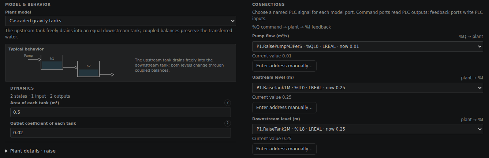
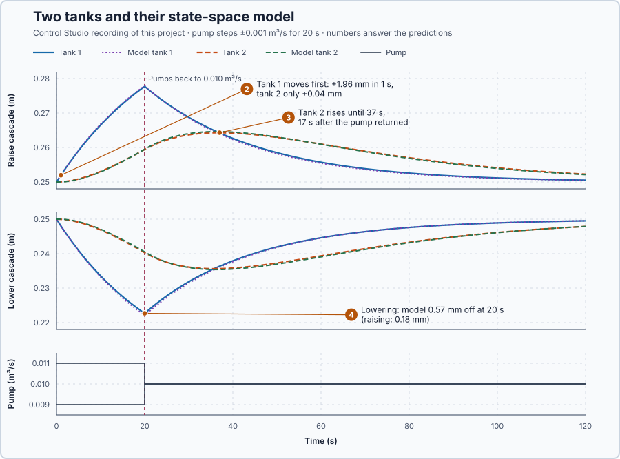

# 74. State-space models

In this lesson, you will describe two connected tanks with one model that keeps track of the water stored in both, and test the model against the tanks. You will see why the downstream level alone cannot tell what happens next.

## The problem

Lesson 73 tested the coupled vessels' designs at couplings of 6, 8 and 10 kW/°C; none passed all three. Both designs rested on a steady gain matrix: how far each heater finally moves each temperature. A gain matrix says nothing about what is stored inside a process on its way, or about what fewer sensors could reveal.

Two tanks in a row with one pump make that visible: tank 1 feeds tank 2 by gravity, and only tank 2 is measured. We will model both stored levels and test the model against the tanks.

## What we need

We need to:

1. keep track of the water stored in both tanks, not only a final gain;
2. describe how each level changes with the pump, with the other level, and what the sensor sees; and
3. check that description against the tanks.

## The new idea

A **state-space model** keeps track of every store inside the process, here the levels of two tanks, and says how each store changes with the inputs and the other stores, and what the sensors see. Each stored quantity is a **state**: the states are the smallest set of quantities that, together with the inputs from now on, completely determine how the process behaves.

**In words.** The states are what the process remembers: the water in a tank, the heat in a vessel, the speed of a shaft. In PLC terms they are like the values a program must keep from one scan to the next. The model has two parts:

1. **How the states change.** Each state changes because of the inputs you command and because of the other states.
2. **What you measure.** The sensor readings are calculated from the states. A sensor may show only some of them.

If you know the states now and the inputs from now on, you can calculate everything that follows. Nothing else from the past is needed.

**The formula.** Near an operating point, every rate is a weighted sum of the states and the inputs, and every reading a weighted sum of the states:

$$
\dot x = A\,x + B\,u, \qquad y = C\,x + D\,u .
$$

- $x$ is the list of states and $\dot x$ how fast each one changes;
- $u$ is the list of inputs you command, and $y$ the list of sensor readings;
- $A$ says how each state affects the changes, $B$ how each input does;
- $C$ says which states the sensors see, and $D$ how an input reaches a sensor directly, usually not at all ($D = 0$).

> **Math you need: state vector and matrix product.** A **state vector** lists the states as a column, $x = [x_1, x_2]^T$ (T turns the row into a column). A matrix times a vector gives one weighted sum per row: $\begin{bmatrix}-0.04&0\\0.04&-0.04\end{bmatrix}\begin{bmatrix}0.02\\0\end{bmatrix} = \begin{bmatrix}-0.0008\\0.0008\end{bmatrix}$, since $-0.04 \cdot 0.02 + 0 \cdot 0 = -0.0008$ and $0.04 \cdot 0.02 - 0.04 \cdot 0 = 0.0008$.

**Example: two tanks in a row.** A pump fills tank 1; tank 1 drains through a bottom outlet into tank 2, which drains out the same way; only tank 2 has a level sensor. Each tank is 0.5 m² in area. At rest both levels are 0.25 m and the pump delivers 0.010 m³/s, which each outlet lets out. Let:

- $x_1$ and $x_2$ be the levels' deviations from 0.25 m, in metres;
- $v$ be the pump's deviation from 0.010 m³/s, in cubic metres per second; and
- $y$ be what the sensor reads: tank 2's deviation, in metres.

Each tank's volume changes by what flows in minus what flows out. An outlet lets out $c\sqrt h$, with $c = 0.020$ m$^{5/2}$/s; near 0.25 m its tangent slope is $c/(2\sqrt{0.25}) = 0.020$ m²/s, so 1 cm more level lets out 0.0002 m³/s more. Dividing by the area, $0.020/0.5 = 0.04$ per second and $1/0.5 = 2$ per square metre:

$$
\dot x_1 = -0.04\,x_1 + 2\,v, \qquad \dot x_2 = 0.04\,x_1 - 0.04\,x_2, \qquad y = x_2 .
$$

Tank 1 fills from the pump and drains at 4 % of its extra level per second; tank 2 gets what tank 1 drains and drains itself. In matrix form, $A = \begin{bmatrix}-0.04&0\\0.04&-0.04\end{bmatrix}$, $B = \begin{bmatrix}2\\0\end{bmatrix}$, $C = \begin{bmatrix}0&1\end{bmatrix}$ and $D = 0$.

Follow the numbers:

1. Both tanks at rest, the pump 0.001 m³/s higher: $\dot x_1 = 2 \times 0.001 = 0.002$ m/s, so tank 1 rises 2 mm per second, and $\dot x_2 = 0$: the sensor sees nothing at first.
2. After 1 s, $x_1 \approx 0.002$ m, so $\dot x_2 = 0.04 \times 0.002 = 0.00008$ m/s: tank 2 starts to follow.
3. Tank 1 starts 2 cm high, tank 2 at rest, the pump unchanged, $x = [0.02, 0]^T$: the rates are $-0.0008$ and $+0.0008$ m/s. Tank 2 reads exactly 0.25 m yet rises, because its future depends on the water stored in tank 1, which its own level does not show. That is why the model needs two states.

**The limitation.** The model is local: the outlet's flow curve bends away from its tangent, so the model's error grows away from 0.25 m; the ±0.001 m³/s pulse below is a teaching choice that stays near it. The program advances the model once per second with the old state's rates, which overshoots slightly: 2.0 mm in the first step against the equations' 1.96 mm.

## Prediction

Before running, answer these questions:

1. Tank 1 starts 2 cm high, tank 2 at rest, the pump unchanged. Tank 2 peaks when both levels are equal: when, and how high?
2. When the pump rises by 0.001 m³/s, which level moves first?
3. After the pump returns at 20 s, what does tank 2 do?
4. Is the model error the same size when the pump falls by 0.001 m³/s instead?

| From the model | Value |
| --- | ---: |
| First second after the pump rises 0.001 m³/s | tank 1 +1.96 mm, tank 2 +0.04 mm |
| Tank 2's peak, tank 1 starting 2 cm high | 7.4 mm at 25 s |

## Implementation

Open [`src/Main.st`](src/Main.st). Two tank pairs run side by side: in the experiment one pump steps up 0.001 m³/s and the other down 0.001 m³/s for 20 s. Beside each pair, `CascadeModel` starts from the measured levels and advances once per second with `CascadeUpstreamRate` and `CascadeDownstreamRate`. A wrong clock interval or a level outside 0.05–0.45 m stops the pumps.

**Exercise.** Work the model's first two steps from rest with $v = +0.001$: step 1 gives $x_1 = 0.002$ (0.252 m) and $x_2 = 0$; step 2 gives $x_1 = 0.002 + (-0.04 \cdot 0.002 + 0.002) = 0.00392$ and $x_2 = 0.04 \cdot 0.002 = 0.00008$. Then run [`src/tests.st`](src/tests.st) from the **Testing** view; it checks these steps.

## Experiment in Control Studio

1. Open this lesson's project and start **Simulator**. First look at the new plant: in the **truST** side bar, select **Devices & Connections**, then the **SIMULATED PLANT** box **raise**; **Configure plant** shows **Cascaded gravity tanks**. Under **CONNECTIONS**, **Pump flow (m³/s)** is `P1.RaisePumpM3PerS`, which your program writes; **Upstream level (m)** `P1.RaiseTank1M` and **Downstream level (m)** `P1.RaiseTank2M` are the levels it reads. The box **lower** is the second pair. Close the panel with **Cancel**.

   

2. In the **truST** side bar, select **Control Studio**. On **Identify**, choose **Supplied plant model** from **Method** and open `provided-model.json`. Studio shows `dx/dt = [-0.04, 0; 0.04, -0.04] x + [2; 0] u`, the matrices above.
3. On **Tune**, choose **Initial-state response**, enter **Step (s)** 1, **Duration (s)** 120, **Initial state** `0.02,0` and **Held input** `0`, and press **Calculate initial-state response**. Open **Calculation details** and read 1, 25 and 120 s. Repeat with **Held input** `0.001`.
4. On **Identify**, choose **Project experiment**. **Signals** shows `P1.RaiseTank2M · Process value (m)` and `P1.RaisePumpM3PerS · Applied output (m3/s)`; add `P1.RaiseTank1M · state (m)`, `P1.RaiseModel1M · state (m)` and `P1.RaiseModel2M · state (m)`.
5. Answer the predictions, select **Review project test** and check the declared **123 s**.
6. Select **Confirm and start**. The pumps step at the program's next one-second update, about 2 s later; times below count from that step.
7. After the run, hover 1 s and 20 s after the step and tank 2's peak; then show the second cascade's levels.
8. At completion Control Studio shows **Project test completed. Outputs restored.**

Select **Abort test** to stop early; to repeat, restart **Simulator** so both cascades start at rest.

## Evidence and decision

The numbered marks answer predictions 2–4. **Initial-state response** answers prediction 1: tank 2's deviation from 0.25 m, with tank 1 starting 2 cm high:

| Held input | At 1 s | At 25 s | At 120 s |
| --- | ---: | ---: | ---: |
| 0 | 0.000769 m | 0.007358 m, the peak | 0.00079 m |
| 0.001 m³/s | 0.000808 m | 0.02057 m | 0.048403 m |

The input's part, **Zero state**, added only 0.000039 m in the first second: the pump acts through tank 1.

From Control Studio's recording, times after the pump step:

| | Raise, +0.001 m³/s | Lower, −0.001 m³/s |
| --- | ---: | ---: |
| Tank 1 / tank 2 after 1 s | 0.25196 / 0.25004 m | 0.24804 / 0.24996 m |
| Tank 1 / tank 2 at 20 s | 0.2777 / 0.2594 m | 0.2227 / 0.2403 m |
| Tank 2 turns | 0.2643 m at 37 s | 0.2356 m at 36 s |

2. Tank 1 moved first: 1.96 mm in the first second, as the equations predict (the program's one-second step gives 2.0 mm); tank 2 only 0.04 mm.
3. After the pump returned at 20 s, tank 2 kept rising for 17 s, until tank 1 had fallen to its level at 37 s. A model of tank 2 alone would have turned at 20 s.
4. No: at 20 s the model was 0.18 mm off when raising and 0.57 mm when lowering. The overshooting one-second steps and the bent outflow partly cancel when raising and add when lowering.

The second state costs one equation and predicted the 17 s of further rise that no gain shows. The model is accepted for ±0.001 m³/s changes around 0.25 m. These are simulation results.

## Conclusion

A state-space model keeps one state per store and writes how each changes with the inputs and the other stores, and what the sensors see.

For the two tanks, tank 2's level alone could not predict what followed: the water stored in tank 1 had to be a state, and the model followed both levels within 0.57 mm.

## Check yourself

1. **At $x = [0.01, 0]^T$ with $v = 0$, what are the two rates?**
   $\dot x_1 = -0.04 \cdot 0.01 = -0.0004$ m/s and $\dot x_2 = 0.04 \cdot 0.01 - 0 = +0.0004$ m/s.
2. **Why did tank 2 keep rising after the pump returned at 20 s?**
   Tank 1 still held extra water and fed tank 2 more than tank 2 let out, until tank 1 had fallen to tank 2's level
   at 37 s.
3. **With $v$ held at 0.002 m³/s, where would both levels settle in the model?**
   $x_1 = x_2 = 2 \cdot 0.002/0.04 = 0.1$ m above rest, 0.35 m, far enough from 0.25 m that the local model is less
   accurate there.

## Reason for the next lesson

There is only one pump, and it reaches tank 2 only through tank 1: the equations do not tell whether it can steer both levels.

[Controllability](../../11-state-space-estimation-and-predictive-control/66-controllability/README.md) gives the test that tells whether one input can move every state.
