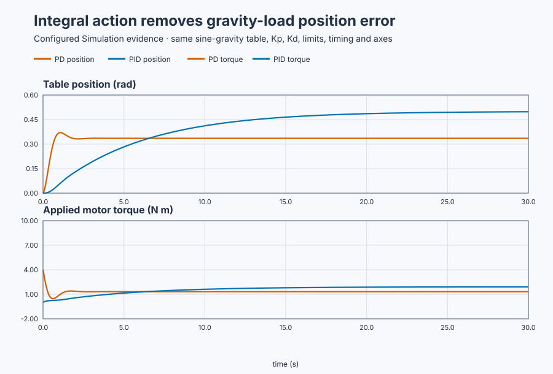
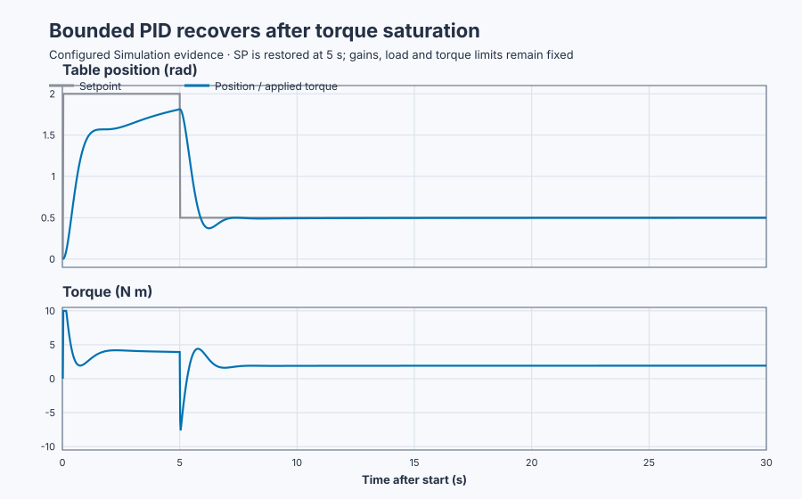

# Loaded position-table PID control

Course position: Lesson 21 of 84. Previous lesson:
[Position-table proportional-derivative control](../20-servo-position-pd/README.md).
Next lesson: [Derivative kick and setpoint weighting](../22-servo-derivative-kick/README.md).

**Lesson objective:** Add integral action to the gravity-loaded position
controller, then explain why stored error can supply the holding torque that PD
cannot produce at zero current error.

This lesson uses simulation. Its results are not physical-axis evidence.

**Equipment:** Payload-loaded industrial positioning table.

## The problem

The payload-loaded industrial positioning table is the same rigid table used in
Lessons 19 and 20, but its payload is now off-centre. Gravity therefore creates
an opposing torque that changes with table angle. The simulated joint uses

$T_g=G\sin(\theta)$

where $\theta$ is table angle and $G=4$ N m is the **peak gravity-torque
coefficient**. This does not mean that gravity always applies 4 N m. At zero
angle the torque is zero; at the 0.5 rad target it is
$4\sin(0.5)=1.918$ N m. Making that distinction is essential because it
explains the retained response.

The encoder measures position and velocity, and the drive applies at most ±10
N m. Inertia, viscous friction, the 20 ms cycle, proportional gain 8, and
derivative gain 3 remain unchanged. Backlash, dry friction, and encoder noise
remain absent so this lesson isolates the equilibrium problem.

Lesson 20 showed that derivative feedback removes motion energy. At rest,
however, velocity is zero, so derivative torque is zero. If position error were
also zero, proportional torque would be zero. PD must therefore stop short of
the target so that a remaining proportional error supplies the gravity torque.

A real gravity-loaded axis can fall when drive torque is removed. It must be
mechanically supported or held by a reviewed brake. Zero torque is a valid
restored state here only because simulated gravity torque is also zero at the
restored zero-radian position.

## What we need

We need the controller to remember enough correction to balance gravity after
the current position error has returned almost to zero. That memory must be
added without changing the proportional stiffness or derivative damping, and
we must still check stability, torque limits, saturation recovery, and the
validity of the final measurement window.

## The new idea

The setpoint $SP=r$ is the desired angle and the process value $PV=\theta$ is
the measured angle, both in radians. Position error is

$e=r-\theta$

Proportional torque is $T_P=K_pe$. Derivative-on-measurement torque is
$T_D=-K_d\omega$, where $\omega=\dot{\theta}$ is angular velocity. The new
quantity is the **integral state** $I$: accumulated error over time.

### Deriving integral accumulation

In continuous time, accumulation is defined by

$I(t)=\int_0^t e(\tau)\,d\tau$

The integration variable $\tau$ simply represents time inside the integral. In
the digital controller we approximate the area under the error curve one cycle
at a time. A rectangle with height $e[k]$ and width $\Delta t$ has area
$e[k]\Delta t$, so the state update is

$I[k]=I[k-1]+e[k]\Delta t$

Error has unit rad and time has unit s, so $I$ has unit rad s. Integral gain
$K_i$ has unit N m/(rad s). Their product therefore has unit N m:

$T_I=K_iI$

The requested controller torque before the drive limit is

$T_{requested}=T_P+T_I+T_D=K_pe+K_iI-K_d\omega$

The applied plant input is

$T_{applied}=\operatorname{clamp}(T_{requested},-10\,\text{N m},+10\,\text{N m})$

The clamp is why requested and applied torque must not be confused. Integral
state can continue changing when the drive cannot deliver the requested
torque. That unwanted accumulation is **integral windup**. The configured
combined anti-windup feeds the unavailable-output difference back toward the
integral state, but protection does not make saturation or an excessive
$K_i$ harmless.

### Why PD retains an offset

At rest, acceleration and velocity are zero. Rotational balance requires motor
torque to equal gravity torque at the actual angle:

$T_{controller}=G\sin(\theta_{ss})$

The subscript $ss$ means steady state. For PD, derivative torque is zero at rest
and controller torque is only $K_p(r-\theta_{ss})$. Therefore

$K_p(r-\theta_{ss})=G\sin(\theta_{ss})$

This nonlinear equation has no elementary algebraic solution. For a useful
prediction at modest angles, use the small-angle approximation
$\sin(\theta)\approx\theta$:

$K_p(r-\theta_{ss})\approx G\theta_{ss}$

Expand and collect the angle terms:

$K_pr\approx(K_p+G)\theta_{ss}$

so

$\theta_{ss}\approx\frac{K_pr}{K_p+G}$

and the remaining error is

$e_{ss}=r-\theta_{ss}\approx\frac{Gr}{K_p+G}$

The numerator contains the gravity coefficient because more load needs more
error; the denominator contains proportional stiffness plus local gravity
stiffness because both relate torque to angle.

### Why PID can reach zero error

At PID equilibrium, current error and velocity may both be zero while the
integral state remains nonzero. Then $T_P=T_D=0$, $\theta_{ss}=r$, and balance
requires

$K_iI_{ss}=G\sin(r)$

Therefore

$I_{ss}=\frac{G\sin(r)}{K_i}$

The controller is not creating torque from nothing. Earlier error changed the
stored state; that state now retains the angle-dependent holding torque required
at the target.

### Why integral gain cannot be increased without limit

Integral action adds a dynamic state and phase lag. We can see that in the
local closed-loop equation. Let $x=\theta-r$ be a small displacement about the
target. Linearize gravity with

$\sin(r+x)\approx\sin(r)+\cos(r)x$

The constant $G\sin(r)$ term is cancelled by equilibrium integral torque. For
small deviations, the remaining motion equation and integral-state equation
are

$J\ddot{x}+(B+K_d)\dot{x}+(K_p+G\cos r)x-K_ii=0$

$\dot{i}=-x$

Differentiate the motion equation and substitute $\dot{i}=-x$:

$J\dddot{x}+(B+K_d)\ddot{x}+(K_p+G\cos r)\dot{x}+K_ix=0$

The associated characteristic polynomial is

$Js^3+(B+K_d)s^2+(K_p+G\cos r)s+K_i=0$

The $s^3$ term reveals the added third state. For a cubic
$a_3s^3+a_2s^2+a_1s+a_0$, the Routh table's first column is
$a_3$, $a_2$, $(a_2a_1-a_3a_0)/a_2$, and $a_0$. All must be positive for the
linearized response to be stable. Substituting this lesson's coefficients gives

$(B+K_d)(K_p+G\cos r)>JK_i$

This condition does not tune the controller by itself, but it explains the
danger: increasing $K_i$ increases the right-hand side and can remove stability
margin even while it improves steady error.

### Measures and decision rules

The **final-window mean absolute error** uses retained samples from 28 to 30
seconds:

$MAE=\frac{1}{N}\sum_{k=1}^{N}|SP[k]-PV[k]|$

Absolute value prevents positive and negative errors from cancelling; division
by sample count makes this an average in radians. We report it only if that
same window is settled: PV range must be at most 0.010 rad and applied-torque
range at most 0.050 N m. A quiet final sample alone is not enough.

The PID-to-PD error ratio is PID MAE divided by PD MAE under the same plan, so
radians cancel. Conventional overshoot is
$\max(0,\max(PV-SP))$ over the complete run. The leading zero means a response
that remains below SP has zero overshoot, not a negative overshoot.

For the separate saturation-recovery case, saturation exposure equals the
number of samples at the torque limit times 0.02 s. Recovery time starts when
SP returns from 2.0 to 0.5 rad at 5 seconds and ends at the first block of 50
consecutive samples—one full second—within 0.02 rad of SP with torque below
9.9 N m.

Before practice, require PD MAE at least 0.100 rad, PID MAE at most 0.010 rad
and no more than one tenth of PD MAE, PID overshoot at most 0.150 rad, finite
samples, and $|T_{applied}|\le10$ N m. Numerical comparison tolerances are
0.001 rad for error, range, and overshoot; 0.01 for the dimensionless ratio;
and 0.01 N m for torque.

## Prediction

With $K_p=8$ N m/rad, $G=4$ N m, and $r=0.5$ rad, the small-angle PD prediction
is

$\theta_{ss}\approx\frac{8\times0.5}{8+4}=0.3333\,\text{rad}$

$e_{ss}\approx\frac{4\times0.5}{8+4}=0.1667\,\text{rad}$

Solving the exact sine equation numerically gives about 0.3354 rad position and
0.1646 rad error. Those values, rather than 0.5 rad error, are what the actual
robot-joint gravity model predicts.

With $K_i=2$ N m/(rad s), PID needs at the target

$T_I=4\sin(0.5)=1.9177\,\text{N m}$

$I_{ss}=1.9177/2=0.9589\,\text{rad s}$

In words, the small-angle prediction is 0.3333 rad position and 0.1667 rad
error, while PID needs about 0.9589 rad s of stored error at the target.

For the local stability check,
$(B+K_d)(K_p+G\cos0.5)=4(8+3.510)=46.04$, while $JK_i=2$. The inequality is
satisfied with substantial margin. Predict that PID will remove nearly all of
the gravity-dependent offset while retaining the damping from Lesson 20.

## Implementation

The project begins at zero angle in Manual mode with $K_i=0$ and zero torque.
Control Studio Test writes only the reviewed Boolean authority
`P1.ExperimentEnabled`.

```st
IF ExperimentEnabled AND NOT ExperimentWasEnabled THEN
    IntegralGain := LREAL#2.0;
    Setpoint := LREAL#0.5;
    AutoMode := TRUE;
    ReconfigureRequested := TRUE;
ELSIF ExperimentWasEnabled THEN
    IntegralGain := LREAL#0.0;
    Setpoint := LREAL#0.0;
    AutoMode := FALSE;
    ReconfigureRequested := TRUE;
END_IF;

Parameters.ProportionalGain := LREAL#8.0;
Parameters.IntegralGain := IntegralGain;
Parameters.DerivativeGain := LREAL#3.0;
MotorTorque := Controller.Update(Input := Input);
```

The rising edge selects $K_i=2$, SP 0.5 rad, and Auto, then initializes from
the measured state for a bumpless start. The falling edge restores $K_i=0$, SP
zero, Manual mode, and zero torque. Invalid position or velocity and
`SafetyAbort` leave automatic control. On physical equipment, mechanical
support must be established before relying on a zero-torque state.

The selected UI run demonstrates PID. The native comparison creates separate
fresh PD and PID runtimes and a third fresh saturation-recovery runtime. One
running controller is never presented as three independent experiments.

## Experiment in Control Studio

The complete learner workflow is exactly **Monitor → Test**. There is no
separate Validate screen for this project-owned comparison.

### Control Studio actions

1. **Monitor** — Start the **Simulator**, then open **truST sidebar → Control
   Studio → Monitor → Response**.
   - **Baseline check:** Confirm **Simulation**, **Running**, and current finite
     data. At the restored zero-angle point, SP, PV, velocity, and applied motor
     torque must be zero and mode must be Manual. Confirm position ±4 rad,
     velocity ±20 rad/s, and torque ±10 N m limits.
   - **Decision before action:** Predict that gravity torque will grow as the
     table moves, integral state will build the holding torque, and final error
     will fall below 0.010 rad without losing the Lesson 20 damping.
   - **Successful evidence:** Response advances with current SP, PV, velocity,
     and MV samples and **Start recording** is enabled. Start recording only
     after the safe baseline is visible.
   - **Recovery:** If samples are stale, nonfinite, or unavailable, stop the
     Simulator, correct the displayed runtime or binding problem, restart it,
     and repeat the baseline check.
   - **Record:** Write down initial SP, PV, velocity, applied MV, mode, and the
     gravity/response prediction before opening Test.

2. **Test** — Open **truST sidebar → Control Studio → Test**.
   - **Baseline check:** Confirm **Experiment** = **Observe without
     excitation**, **Amplitude** = **0** (disabled), and
     **Maximum duration (s)** = **30.02**. The reviewed authority is **Experiment authority** (`P1.ExperimentEnabled`).
   - **Decision before action:** Confirm that Test will not inject a second
     setpoint. The sole Boolean must authorize the project's complete gain
     selection, 0.5 rad move, and safe restoration. Select **Review test** and
     verify authority, limits, duration, restoration, and stop conditions.
   - **Successful evidence:** Select **Confirm and start**. The state changes to
     **Running**, **Abort test** remains available, and Response shows the
     SP/PV/velocity/MV sequence. Completion counts only when Test reports
     restoration and Monitor shows authority false, SP zero, Manual mode, and
     zero torque.
   - **Recovery:** If the test is rejected, stale, unsafe, failed, or aborted,
     read the displayed reason, establish the safe zero-angle baseline, wait
     for current data, and review a new test.
   - **Record:** Retain the terminal state, restoration result, seed 20260828,
     and observed response. Do not present retained artifacts as a new run.

## Evidence and decision

In the fresh-runtime comparison, PD final-window MAE is 0.164582 rad. This
agrees closely with the 0.1667 rad small-angle prediction. PID MAE is 0.002689
rad, giving an error ratio of 0.0163. The PID final-window position range is
0.000984 rad and applied-torque range is 0.003316 N m, so the window qualifies
as settled. The peak remains 0.002227 rad below SP, so conventional overshoot
is 0.000000 rad. Applied torque remains within ±10 N m.



[Retained samples](figures/loaded-position-pid-trace.csv) ·
[Decision summary](figures/loaded-position-pid-summary.csv)

The separate native recovery experiment deliberately requests an unreachable
2.0 rad position and restores SP to 0.5 rad at 5 seconds. Torque is saturated
for 7 samples, or $7\times0.02=0.14$ s. The first qualifying 50-sample recovery
block begins 1.94 seconds after restoration, and final position error is
0.000166 rad.



[Recovery samples](figures/loaded-position-recovery-trace.csv) ·
[Recovery summary](figures/loaded-position-recovery-summary.csv)

Both comparisons pass the declared Simulation criteria. They validate the
configured rigid joint, sine gravity model, ideal encoder, clamp, and
anti-windup only. They do not qualify a physical payload, brake, drive,
mechanical support, or emergency stop.

## Conclusion

PD needs a position offset because current proportional error is its only
source of holding torque at rest. Integral action changes that equilibrium: it
stores earlier error and retains the gravity-balancing torque after current
error approaches zero.

The result does not replace the earlier controller terms. $K_p$ still provides
positional stiffness and $K_d$ still removes motion energy. Integral action
adds the missing equilibrium memory, together with phase lag and windup risk
that must be managed explicitly.

## Reason for the next lesson

This lesson keeps derivative action on measured motion, so the setpoint step
does not enter the derivative path. Other PID forms differentiate all or part
of the error, and an abrupt setpoint can then request a large torque before the
table has moved.

Lesson 22 compares derivative setpoint weights on the same loaded table. That
creates the reason to distinguish command motion from physical measurement
motion and to prevent derivative kick.
