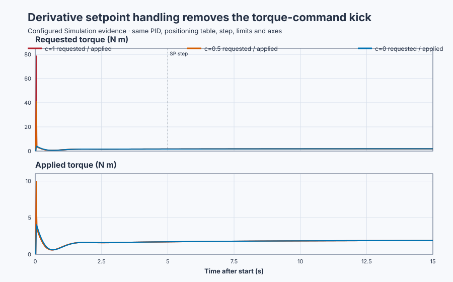

# Derivative kick and setpoint weighting

Course position: Lesson 22 of 84. Previous lesson:
[Loaded position-table PID control](../21-underdamped-pid/README.md).
Next lesson: [Filtered derivative](../23-servo-filtered-derivative/README.md).

**Lesson objective:** Expose derivative kick, distinguish requested from applied
torque, and select derivative on measurement without removing motion damping.

This lesson uses simulation. Its results are not physical-axis evidence.

**Equipment:** Payload-loaded industrial positioning table.

## The problem

The payload-loaded industrial positioning table keeps the controller and plant
from Lesson 21: $K_p=8$ N m/rad, $K_i=2$ N m/(rad s), $K_d=3$ N m s/rad, and
payload gravity $T_g=4\sin(\theta)$ N m. The number 4 is the peak gravity
coefficient, not a constant load. At the initial zero angle, gravity torque is
zero.

The requested position now changes from 0 to 0.5 rad in one 20 ms controller
cycle. Position commands can change instantly in software even though a
physical table cannot. If derivative action sees that command jump, it can
calculate a very large torque before the encoder has measured any motion.

The controller's diagnostic output range is deliberately widened to ±100 N m
so that request remains visible. A separate simulated drive clamp limits the
torque reaching the plant to ±10 N m. This separation is important: seeing only
the applied value would hide how extreme the controller calculation was.

An abrupt setpoint is useful for this Simulation diagnosis, but it is not an
approved physical motion profile. A physical gravity-loaded axis also needs a
reviewed brake or mechanical support before torque is removed.

## What we need

We need derivative action to oppose measured table motion without mistaking a
software command discontinuity for physical velocity. We also need requested
and applied torque on separate traces so actuator saturation cannot conceal the
kick, and we need a common experiment that changes only derivative setpoint
weight.

## The new idea

The setpoint $SP$ is commanded angle and the process value $PV$ is measured
angle. Both are in radians. The ordinary control error is $e=SP-PV$.

Derivative setpoint weight $c$ is a dimensionless number from 0 to 1. It chooses
how much setpoint enters the derivative path. Define the weighted derivative
input

$x_D=c\,SP-PV$

The controller estimates its rate from two successive samples:

$v_D[k]=\frac{x_D[k]-x_D[k-1]}{\Delta t}$

Here $\Delta t$ is elapsed cycle time in seconds, so $v_D$ has unit rad/s.
Multiplying by derivative gain produces derivative torque:

$T_D[k]=K_dv_D[k]$

The sign is already contained in $x_D$. When $c=0$, $x_D=-PV$, so positive
measured velocity produces negative derivative torque, exactly the damping
action derived in Lesson 20.

### Deriving the command kick

Subtract the old weighted input from the new one:

$\Delta x_D=c\,\Delta SP-\Delta PV$

On the first update after a setpoint step, the command has changed but the
physical table has not yet moved. Therefore $\Delta PV=0$, and

$v_D=\frac{c\,\Delta SP}{\Delta t}$

so the command-dependent derivative torque is

$T_D=K_d\frac{c\,\Delta SP}{\Delta t}$

The ideal continuous derivative of a perfect step is an impulse. A sampled
controller cannot represent an infinite impulse; it represents the change over
one finite cycle. The formula shows why the resulting number can still be huge:
it is inversely proportional to $\Delta t$. Halving cycle time while keeping
the same one-sample command jump would double the calculated kick.

When $c=1$, $x_D=SP-PV=e$, so this is **derivative on full error**. When $c=0$,
$x_D=-PV$, so this is **derivative on measurement**. A setpoint step then adds
no derivative torque, but later physical PV motion still produces damping. At
$c=0.5$, half of the command jump enters the derivative path.

Because the proportional/integral command paths and derivative command path can
be shaped separately, this is a **two-degree-of-freedom PID**. The feedback
response to actual PV motion does not disappear when command weighting changes.

### Deriving the complete first request

The first request contains more than derivative torque. At the first 0.5 rad
error, proportional torque is

$T_P=K_pe=8\times0.5=4.00\ N\,m$

The first integral-state increment is error times cycle time:

$\Delta I=e\Delta t=0.5\times0.02=0.01\ rad\,s$

so its torque contribution is

$T_I=K_i\Delta I=2\times0.01=0.02\ N\,m$

Before the external drive clamp, the complete first request is

$T_{requested}=T_P+T_I+T_D$

The applied torque is a separate quantity:

$T_{applied}=\operatorname{clamp}(T_{requested},-10\ N\,m,+10\ N\,m)$

This external clamp does not feed its ±10 N m result back into the controller's
wide ±100 N m internal output limit. The lesson therefore proves request
visibility and plant-input bounding; it does not claim that this arrangement
provides anti-windup against the external drive clamp.

### Measures and decision rules

The **first post-step request** is the controller result from the first update
after SP changes. The **first applied torque** is that sample after the separate
drive clamp. Both are measured in N m and must be retained together.

The **final-sample position error** is $|SP-PV|$ at 15 seconds. Absolute value
reports distance from target regardless of direction. It is only an endpoint
tracking check: without a settled-window qualification, it is not steady-state
evidence.

Before practice, require the $c=1$ first request to be at least 70 N m, the
$c=0.5$ request to exceed the $c=0$ request by at least 30 N m, the $c=0$
request to be at most 5 N m, every applied sample to remain within ±10 N m, and
the $c=0$ final-sample error to be at most 0.020 rad. Use 0.01 N m torque
tolerance and 0.001 rad error tolerance.

## Prediction

For $\Delta SP=0.5$ rad and $\Delta t=0.02$ s, the full apparent command rate is

$\Delta SP/\Delta t=0.5/0.02=25\ rad/s$

With $K_d=3$ N m s/rad, the derivative contributions for $c=1$, 0.5, and 0 are

$T_D=75.00,\ 37.50,\ 0.00\ N\,m$

Adding the common 4.00 N m proportional term and 0.02 N m first integral term
gives complete requests

$T_{requested}=79.02,\ 41.52,\ 4.02\ N\,m$

The separate drive clamp should make the first applied torques 10.00, 10.00,
and 4.02 N m. Predict that $c=0$ removes command kick while still damping the
motion that follows.

## Implementation

The project starts at zero angle in Manual mode with rejected diagnostic
baseline $c=1$. Control Studio Test writes only `P1.ExperimentEnabled`.

```st
IF ExperimentEnabled AND NOT ExperimentWasEnabled THEN
    DerivativeSetpointWeight := LREAL#0.0;
    AutoMode := TRUE;
    ReconfigureRequested := TRUE;
ELSIF ExperimentWasEnabled THEN
    DerivativeSetpointWeight := LREAL#1.0;
    Setpoint := LREAL#0.0;
    AutoMode := FALSE;
    ReconfigureRequested := TRUE;
END_IF;

Parameters.DerivativeSetpointWeight := DerivativeSetpointWeight;
RequestedTorque := Controller.Update(Input := Input);
AppliedTorque := MAX(MIN(RequestedTorque, LREAL#10.0), LREAL#-10.0);
```

On the rising edge, the project selects $c=0$ and initializes the controller at
the still-zero setpoint and measured state. It then applies SP 0.5 rad in Auto,
preserving the comparable 4.02 N m first selected request. On the falling edge,
it restores $c=1$, SP zero, Manual mode, and zero requested and applied torque.
Invalid position or velocity and `SafetyAbort` fail closed to Manual zero.

The UI run demonstrates the selected measurement-derivative case. The native
test creates three fresh runtimes for $c=1$, 0.5, and 0; one running controller
does not claim to have produced all three independent traces.

## Experiment in Control Studio

The complete learner workflow is exactly **Monitor → Test**. There is no
separate Validate screen for this project-owned comparison.

### Control Studio actions

1. **Monitor** — Start the **Simulator**, then open **truST sidebar → Control
   Studio → Monitor → Response**.
   - **Baseline check:** Confirm **Simulation**, **Running**, and finite current
     data. SP, PV, velocity, requested torque, and applied torque must be zero,
     and mode must be Manual. Confirm the ±100 N m request range, ±10 N m drive
     range, position ±4 rad, and velocity ±20 rad/s.
   - **Decision before action:** Predict a selected first request of 4.02 N m,
     no drive saturation on that first sample, and final endpoint error below
     0.020 rad while measured-motion damping remains active.
   - **Successful evidence:** Response advances with separate current requested
     and applied torque traces and **Start recording** is enabled. Start only
     after the safe baseline is visible.
   - **Recovery:** If data is stale, nonfinite, unavailable, or the torque
     traces are not distinct signals, stop the Simulator, correct the runtime
     or binding problem, restart it, and repeat the baseline check.
   - **Record:** Write down initial SP, PV, velocity, requested/applied torque,
     mode, and the predicted first request before opening Test.

2. **Test** — Open **truST sidebar → Control Studio → Test**.
   - **Baseline check:** Choose **Observe without excitation**, set
     **Amplitude** to **0**, and set **Maximum duration (s)** to **15.02**.
     Verify that the sole affected signal is `P1.ExperimentEnabled`, changing
     false to true and restoring false.
   - **Decision before action:** Confirm that Test will not inject a second
     setpoint. The Boolean must authorize the project's selected $c=0$ setup,
     0.5 rad move, and restoration. Select **Review test** and verify authority,
     limits, duration, restoration, and stop conditions.
   - **Successful evidence:** Select **Confirm and start**. The state changes to
     **Running**, **Abort test** remains available, and Response shows SP, PV,
     velocity, requested torque, and applied torque. Completion counts only
     when Test reports restoration and Monitor shows authority false, SP zero,
     $c=1$, Manual mode, and both torques zero.
   - **Recovery:** If the test is rejected, stale, unsafe, failed, or aborted,
     read the displayed reason, establish the safe zero-angle baseline, wait
     for current data, and review a new test.
   - **Record:** Retain the terminal state, restoration result, seed 20260828,
     selected first requested/applied samples, and final endpoint error.

## Evidence and decision

The fresh-runtime evidence matches the complete prediction. First requested
torques for $c=1$, 0.5, and 0 are 79.02, 41.52, and 4.02 N m. First applied
torques are 10.00, 10.00, and 4.02 N m. Thus the drive clamp hides 69.02 N m of
the full-error request and 31.52 N m of the intermediate request, while the
selected measurement-derivative case does not saturate on its first sample.

At 15 seconds the selected $c=0$ position is 0.490191 rad, so endpoint error is
$|0.5-0.490191|=0.009809$ rad. This passes the endpoint limit but is not called
steady state. All applied samples remain within ±10 N m.



[Retained samples](figures/derivative-kick-trace.csv) ·
[Decision summary](figures/derivative-kick-summary.csv)

The artifacts show why both torque signals matter. Requested torque reveals
the control-law consequence of the command discontinuity; applied torque shows
what the bounded simulated plant received. These are Simulation results, not
approval for an abrupt command on physical machinery.

## Conclusion

Derivative kick is not physical table motion. It comes from dividing a finite
setpoint jump by a short controller interval. Derivative setpoint weight
controls how much of that software command enters the derivative calculation.

With $c=0$, setpoint motion is absent from the derivative input. Proportional
and integral action still respond to the command, while measured PV motion
still creates the velocity-opposing torque that supplies damping. The selected
case therefore removes command kick without removing derivative feedback.

## Reason for the next lesson

Derivative on measurement avoids command kick, but it now depends entirely on
the measured signal. An encoder cannot distinguish real high-frequency motion
from quantization and electrical noise without additional engineering.

Lesson 23 adds deterministic encoder noise and derives a filtered derivative.
The next decision is no longer whether setpoint enters derivative action, but
how much measurement noise can be rejected without giving away needed damping.
