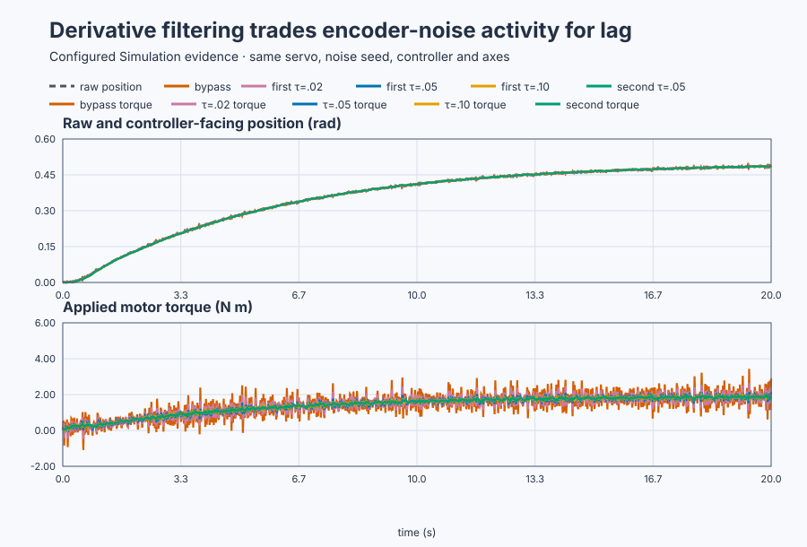

# Filtered derivative for an encoder servo

Course position: Lesson 23 of 84. Previous lesson: [Derivative kick and setpoint weighting](../22-servo-derivative-kick/README.md). Next lesson: [Diagnose mechanical nonidealities before retuning a servo](../24-servo-mechanical-nonidealities/README.md).

**Lesson objective:** Select a derivative-filter cutoff from measured noise
attenuation and lag, then decide whether a second filter stage is justified.

**Evidence class:** Simulation evidence. Deterministic simulated encoder
noise does not qualify a physical encoder, drive, or positioning axis.

## The problem

The equipment is the encoder-based industrial positioning table from
Lessons 19 through 22. Lesson 22 moved derivative action from complete
control error to measured position, so a setpoint step no longer produces a
kick, while real table motion still produces damping torque: a command-path
fix, not a measurement-path fix, since derivative action cannot tell real
encoder motion from encoder noise.

The plant is still the same rotary table. Its simulated dynamics are

$J\ddot\theta=T_{applied}-B\dot\theta-G\sin(\theta),$

where $\theta$ is table angle, $J=1\,\mathrm{kg\,m^2}$ is inertia,
$B=1\,\mathrm{N\,m\,s/rad}$ is viscous friction, and $G=4\,\mathrm{N\,m}$
is the peak gravity-torque coefficient, all inherited unchanged from Lessons
19 and 21 as configured teaching values. Gravity is $4\sin(\theta)$, zero at
the initial angle $\theta=0$, not a constant 4 N·m load.

The simulated encoder reports the **raw encoder position ($PV_{raw}$)**, the
sensor's own reading in radians before any filtering. It adds **measurement
noise ($n$)**, unwanted variation, zero-mean, from the true angle:

$PV_{raw,k}=\theta_k+n_k.$

The noise **standard deviation (σ)** is $\sigma=0.002\,\mathrm{rad}$, a
configured teaching value; on real equipment it would be found by recording
the encoder at standstill and computing the standard deviation of its
readings. Standard deviation describes the typical distance of samples from
their mean, not that every sample is exactly that far wrong. Seed 20260828
makes the noise sequence repeatable so every filter sees the same
experiment. The **controller-facing position ($PV_{control}$)**
is the copy the PID actually receives; with filtering bypassed,
$PV_{control}=PV_{raw}$.

## What we need

We need to reduce encoder-noise torque without delaying real table motion so
much that the controller reacts to stale position.

## The new idea

With derivative setpoint weight $c=0$, the PID differentiates
$-PV_{control}$. Over one controller cycle, its derivative contribution is

$T_{D,k}=-K_d\frac{PV_{control,k}-PV_{control,k-1}}{\Delta t}.$

This follows directly from the definition of a derivative: rate of change is
change divided by elapsed time. $K_d=3\,\mathrm{N\,m\,s/rad}$ converts
estimated angular velocity into torque, and $\Delta t=0.02\,\mathrm{s}$ is
scan time. The minus sign matters: increasing measured position produces
opposing torque, the Lesson 20 damping.

If the table is motionless, substituting $PV_{raw}=\theta+n$ and cancelling
the true angle gives $T_{D,k}=-K_d(n_k-n_{k-1})/\Delta t$: halving scan time
doubles this noise-driven torque. Independent random contributions add in
variance, not directly, so a combination with coefficients $c_i$ has spread
$\sigma\sqrt{\sum c_i^2}$; for $n_k-n_{k-1}$ (coefficients 1 and $-1$) that
spread is $\sqrt{2}\sigma$, giving a scale estimate of
$T_{D,noise,rms}\approx K_d\sqrt{2}\sigma/\Delta t\approx0.424\,\mathrm{N\,m}$,
not a replacement for the retained experiment.

### Deriving the low-pass filter

A low-pass filter shapes $PV_{control}$: slow changes pass through, rapid
changes are reduced, and the raw encoder stays visible so filtering cannot
hide sensor evidence.

For one continuous first-order filter, the defining equation is

$\tau\frac{dy}{dt}=x-y.$

Here $x$ is the raw input, $y$ is the filtered output, and the **filter time
constant ($\tau$)** controls its cutoff, measured in seconds. The equation
says that the output changes faster when the input-output gap is large. A
larger $\tau$ spreads that response over more time, so it smooths more
strongly but follows real motion more slowly.

The shipped `Control.LowPass` evaluates this equation once per scan. Let
$y_{k-1}$ be the old output and $y_k=y_{k-1}+\Delta y$ the new output.
Approximating the rate by $\Delta y/\Delta t$ and the output during the scan
by its midpoint gives

$\tau\frac{\Delta y}{\Delta t} =x_k-\left(y_{k-1}+\frac{\Delta y}{2}\right).$

Move the half-increment to the left and solve for $\Delta y$:

$\left(\frac{\tau}{\Delta t}+\frac12\right)\Delta y=x_k-y_{k-1},$

$\Delta y= \frac{\Delta t}{\tau+\tfrac12\Delta t}(x_k-y_{k-1}).$

Defining the **filter coefficient ($a$)**, dimensionless, as

$a=\frac{\Delta t}{\tau+\tfrac12\Delta t}$

— written in code terms as `a = dt / (τ + 0.5 × dt)` — gives the implemented
update

$y_k=y_{k-1}+a(x_k-y_{k-1}).$

This form makes the behavior readable: each scan moves the output by the
fraction $a$ of the remaining input-output gap, not all of it at once. With
$\Delta t=0.02\,\mathrm{s}$ and $\tau=0.05\,\mathrm{s}$,

$a=\frac{0.02}{0.05+0.5(0.02)}=0.3333,$

so each scan closes one third of the remaining gap, and later scans close
the rest if the input stays there.

### First order, second order, and phase lag

**Filter order** is the number of identical stages in series. A first-order
filter applies the update once. The second-order choice sends the first
stage's output through the same update again:

$y_{1,k}=y_{1,k-1}+a(x_k-y_{1,k-1}),$

$y_{2,k}=y_{2,k-1}+a(y_{1,k}-y_{2,k-1}).$

The second stage sees an already smoothed signal, so it removes more rapid
variation, but it also waits for the first stage to move before following.
That extra delay is **phase lag**: the controller-facing position lags the
physical motion, so the PID reacts to old information. Filtering therefore
trades noise attenuation for feedback delay.

The characteristic cutoff of one continuous first-order stage is

$f_c=\frac{1}{2\pi\tau}.$

This follows, as derived in Lesson 13 from $|H(f)|=1/\sqrt{1+(2\pi f\tau)^2}$,
by setting the stage's frequency ratio $2\pi f\tau$ to one, the point where
the magnitude has fallen to $1/\sqrt2$ of its low-frequency value. For
$\tau=0.05\,\mathrm{s}$, $f_c\approx3.18\,\mathrm{Hz}$. This
gives physical meaning to the time constant, but the actual selection must use
the sampled implementation and measured closed-loop response.

### What the two measures mean

The **torque-increment root-mean-square value ($RMS_{\Delta T}$)** is measured
from 15 to 20 seconds, after the large setpoint transient, in $\mathrm{N\,m}$.
For $N$ samples in that window, define each applied-torque change as
$\Delta T_k=T_{applied,k}-T_{applied,k-1}$. Then

$RMS_{\Delta T}=\sqrt{\frac{1}{N}\sum_{k=1}^{N}(\Delta T_k)^2},$

written in code terms as `RMS(ΔT) = sqrt(mean((T_applied,k -
T_applied,k-1)^2))`. Squaring prevents cancellation, averaging makes runs
comparable, and the square root returns N m; a smaller value means less
drive activity.

The **positive position-lag area ($A_{lag}$)** is measured from 0 to 5
seconds, in radian-seconds:

$A_{lag}=\sum_k \max(PV_{raw,k}-PV_{control,k},0)\Delta t,$

written in code terms as `A_lag = sum max(PV_raw,k - PV_control,k, 0) × dt`.
The `max` keeps only periods when controller-facing position trails raw
position, so differences cannot cancel and hide delay; because raw includes
noise, this is an experiment-specific comparison, not a universal delay
estimate.

Tracking is checked separately using the mean controller-facing position from
18 to 20 seconds:

$e_{final}=\left|0.5-\operatorname{mean}(PV_{control})\right|.$

A small final error does not prove transient lag was acceptable, which is
why tracking, activity, and lag remain separate measures.

## Prediction

Before running the project, predict this ordering:

1. Bypass filtering will have the greatest torque activity and least added lag.
2. Increasing $\tau$ from 0.02 to 0.05 to 0.10 seconds will reduce activity
   but increase lag.
3. Two 0.05-second stages will reduce activity more than one stage and add more
   lag.

Freeze the decision rule before looking at the results: accept a filter only
if it keeps activity at or below 0.250 N m, well below the 0.875 N m bypass
activity, and lag at or below 0.020 rad s, small next to the table's
roughly 1-second response. In symbols, require
$RMS_{\Delta T}\le0.250\,\mathrm{N\,m}$ and
$A_{lag}\le0.020\,\mathrm{rad\,s}$. If several choices qualify, choose the
simplest order and then the smallest time constant. This prevents choosing a
visually smooth trace after seeing it.

## Implementation

The raw encoder is never overwritten. The selected filter changes only the
copy passed to PID:

```st
IF FilterSelection = 1 THEN
    ControllerPosition := FirstFilter.Update(
        Input := RawPosition, CycleTime := LREAL#0.02);
ELSIF FilterSelection = 2 THEN
    ControllerPosition := SecondFilter.Update(
        Input := RawPosition, CycleTime := LREAL#0.02);
ELSE
    ControllerPosition := RawPosition;
END_IF;

Input.ProcessValue := ControllerPosition;
MotorTorque := Controller.Update(Input := Input);
```

The Control Studio run owns one selected case: first order with
$\tau=0.05\,\mathrm{s}$. Fresh native runtimes own the bypass, all three
first-order time constants, and the second-order comparison. A single UI run
must not be presented as if it executed that full matrix.

## Experiment in Control Studio

Test writes one reviewed Boolean authority, `P1.ExperimentEnabled`, for 20.02
seconds. The project owns the setpoint, mode, filter selection, and safe
restoration. The false state is Filter bypass, SP 0 rad, Manual mode, and zero
torque. The rising edge initializes the filters at the measured zero-angle
state, selects first order with $\tau=0.05\,\mathrm{s}$, enters Auto, and
applies SP 0.5 rad. The falling edge restores the complete false state. The
deterministic Simulation seed is 20260828.

### Control Studio actions

1. **Monitor** — Start the **Simulator**, then open **truST sidebar → Control Studio → Monitor → Response**.
   - **Baseline check:** Wait for **Simulation**, **Running**, current samples, and good quality. Confirm SP = 0 rad, raw PV near 0 rad with visible seeded noise, controller-facing PV equal to raw PV, applied torque = 0 N·m, Manual mode, Filter bypass, and experiment authority false. Add raw PV, controller-facing PV, applied torque, mode, and authority to **Signals**; `P1.FilterSelection` and `P1.FilterTimeConstant` are not bound Monitor signals, so the selected filter is known from the design above, not read back here.
   - **Decision before action:** Write the predicted activity/lag ordering and the two numerical limits above. Confirm that filtering only the controller-facing copy preserves the raw evidence.
   - **Successful evidence:** The Response plot advances, all values are finite and current, and **Start recording** is enabled. Select **Start recording**.
   - **Recovery:** If samples are stale, unavailable, nonfinite, or poor quality, stop the Simulator, correct the displayed binding or runtime fault, restart, and repeat the baseline check.
   - **Record:** Note the initial SP, both PV signals, applied torque, mode, authority, and your written prediction.

2. **Test** — Open **truST sidebar → Control Studio → Test**.
   - **Baseline check:** Confirm **Experiment** = **Observe without excitation**, **Amplitude** = **0** (disabled), and **Maximum duration (s)** = **20.02**. The reviewed authority is **Experiment authority** (`P1.ExperimentEnabled`). The project, not the generic Test form, owns the 0.5-rad setpoint step and filter selection.
   - **Decision before action:** Confirm that the plan writes only the Boolean authority, restores it false, and keeps raw/controller PV inside -4 to 4 rad and applied torque inside -10 to 10 N·m. Expect less late torque activity than bypass, but a positive separation between raw and controller-facing PV during motion.
   - **Successful evidence:** Select **Review test**, verify the authority, timeout, stop conditions, and false restoration, then select **Confirm and start**. Keep **Abort test** available. Response must show authority true, SP rising to 0.5 rad, Auto response, distinct raw and filtered PV consistent with the selected first-order 0.05 s filter, and the complete safe restoration.
   - **Recovery:** Select **Abort test** if a value becomes nonfinite, either PV leaves -4 to 4 rad, torque leaves -10 to 10 N·m, or data becomes stale. Confirm authority false, SP 0 rad, Filter bypass, Manual mode, and zero applied torque before retrying.
   - **Record:** Retain terminal state, false restoration, selected-case SP/raw PV/controller PV/torque traces, late torque-increment RMS, early lag area, final mean error, and seed.

There is no separate disabled Validate stage. The runnable project and its
native test own the declared comparison; Monitor and Test expose the selected
case honestly.

## Evidence and decision



[Retained samples](figures/filtered-derivative-trace.csv) ·
[Decision summary](figures/filtered-derivative-summary.csv)

The retained deterministic simulation produced:

| Filter | $\tau$ | $RMS_{\Delta T}$ | $A_{lag}$ | Decision |
| --- | ---: | ---: | ---: | --- |
| Bypass | — | 0.875 N·m | 0.009053 rad·s | Reject: activity |
| First order | 0.020 s | 0.466 N·m | 0.010424 rad·s | Reject: activity |
| First order | 0.050 s | 0.192 N·m | 0.017473 rad·s | Select |
| First order | 0.100 s | 0.097 N·m | 0.031202 rad·s | Reject: lag |
| Second order | 0.050 s | 0.046 N·m | 0.028451 rad·s | Reject: lag |

For the selected case, the activity reduction relative to bypass is

$1-\frac{0.192292}{0.874919}=0.780,$

or 78.0%. The 0.10-second and second-order choices look smoother but violate
the predeclared lag limit. The 0.05-second first-order filter is the only
candidate meeting both limits, so it is selected.

## Conclusion

A derivative term is an engineered dynamic element, not an unfiltered
subtraction of two samples. Filtering the measurement reduces the rapid
changes that derivative action turns into torque, but it also delays real
feedback: the rejected 0.10-second and second-order candidates prove that
more filtering is therefore not automatically better. Filter order and time
constant must therefore be selected from both attenuation and lag evidence,
for this rigid table, white zero-mean noise, and fixed 20 ms scan; a
different plant or noise spectrum would need re-measuring both traces.

## Reason for the next lesson

Lesson 24 keeps this filtered servo and adds Coulomb friction, deadband,
backlash, stiction, and motion limits. Those effects leave different patterns
in SP, PV, and torque. More filtering or more PID gain cannot repair a
mechanical transmission defect, so the next task is diagnosis rather than
automatic retuning.
