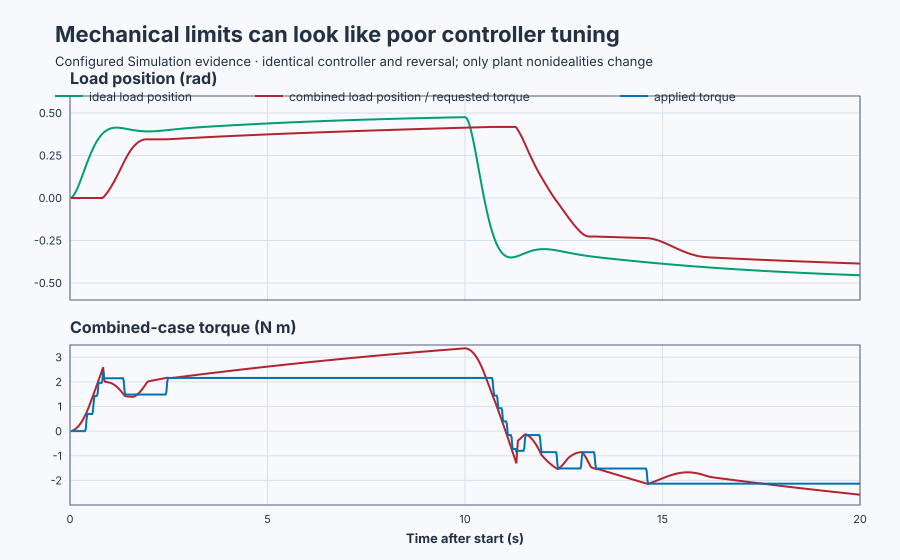

# Diagnose mechanical nonidealities before retuning a servo

Course position: Lesson 24 of 84. Previous lesson:
[Filtered derivative for an encoder servo](../23-servo-filtered-derivative/README.md).
Next lesson: [Digital motion realization](../25-servo-digital-realization/README.md).

**Lesson objective:** Distinguish an intentional trajectory limit, a drive
constraint, friction, command deadband, backlash, and stiction from synchronized
evidence before deciding whether to change PID or repair the mechanism.

This simulation cannot prove a physical defect, safe dither, wear, or a
maintenance interval.

**Equipment:** Geared industrial positioning table.

## The problem

Lesson 23 showed that a noisy torque trace can come from the measurement path,
and that filtering has a measurable cost. This lesson keeps the same PID and
asks a wider diagnostic question: when a real axis moves badly, is the cause
the reference, the drive, or the mechanism?

A geared table reverses between +0.5 and -0.5 rad. We first establish an ideal
reference case. We then introduce trajectory profiling, a torque constraint,
Coulomb friction, command deadband, backlash, and stiction one at a time. The
signals are synchronized so a student can identify cause from a signature
instead of responding to every large error by increasing PID gains. Blindly
raising gains can increase current, heating, impacts, and wear without removing
the defect.

## What we need

We need separate command, drive, and mechanism signals so a learner can tell a
controller request from torque limiting and from lost mechanical motion.

## The new idea

The **target position ($SP_{\mathrm{target}}$)** is the desired final table angle in radians
(rad). The **profiled position ($SP_{\mathrm{profile}}$)** is the acceleration- and
velocity-limited position command sent to PID, also in radians. The **load
position ($PV_{\mathrm{load}}$)** is the load-side encoder angle in radians.

The **profiled velocity** $v_p=dSP_{\mathrm{profile}}/dt$ is the rate of
change of that command in rad/s. Its magnitude is limited to 0.5 rad/s. The
**profiled acceleration** $a_p=dv_p/dt$ is limited to 1.0 rad/s². These
limits deliberately shape what is requested. They are neither drive
saturation nor gearbox damage.

The **requested motor torque ($T_{\mathrm{requested}}$)** is the controller's calculation in
newton metres (N m). The **applied motor torque ($T_{\mathrm{applied}}$)** is the simulated
drive output after amplitude, slew, deadband, and stiction behavior, measured in
newton metres. Their difference is diagnostic evidence.

The **rotational inertia** $J$ describes resistance to angular acceleration
in kg·m². Newton's rotational law is

$\sum T=J\alpha.$

Solving for acceleration gives $\alpha=\sum T/J$. At zero angle and zero
speed, gravity $4\sin(\theta)$ and viscous friction $B\dot\theta$ are both
zero. If the 2.5 N·m drive limit were the only torque, the initial ideal
acceleration would therefore be $2.5/1.0=2.5\,\mathrm{rad/s^2}$. Away from
that instant, gravity and friction must be subtracted; 2.5 rad/s² is a local
upper-bound calculation, not the acceleration of the whole move.

**Coulomb friction** opposes motion with nearly constant magnitude. A
simplified moving model is

$T_f=-T_c\operatorname{sign}(\dot\theta).$

The sign changes when velocity reverses. The controller must request extra
torque in either direction, but motor and load can still move together.

**Command deadband** means the actuator ignores commands inside a band around
its accepted command. Requested torque can change while applied torque stays
unchanged. This is a command-path effect, not lost mechanical travel.

The **backlash width ($w_{\mathrm{backlash}}$)** is the total reversal travel through
mechanical clearance, measured in radians. After direction reverses, motor-side
motion crosses the gap before $PV_{\mathrm{load}}$ moves. This kinematic model cannot
reproduce tooth impact or compliance.

**Stiction**, or static friction, holds the actuator until demand exceeds a
breakaway band. Motion can then begin with a slip jump. The hold is tied to
being stuck; backlash is tied specifically to taking up clearance after a
direction reversal. Similar delayed PV traces therefore need torque and state
signals to distinguish them.

### Deriving the motion profile

At zero angle and speed, the maximum ideal acceleration is:

$\alpha_{\mathrm{ideal}}=\frac{T_{\mathrm{limit}}}{J} =\frac{2.5\,\mathrm{N\,m}}{1.0\,\mathrm{kg\,m^2}} =2.5\,\mathrm{rad/s^2}.$

The profile is deliberately slower. The **cycle time ($\Delta t$)** is 0.02 s. Its
maximum velocity change per scan is:

$|\Delta v_p|_{\mathrm{max}}=a_{\mathrm{profile}}\Delta t =1.0(0.02)=0.02\,\mathrm{rad/s}.$

This is why the program clamps each scan's velocity change to ±0.02 rad/s.

At maximum profile speed, its maximum position change per scan is:

$|\Delta SP_{\mathrm{profile}}|_{\mathrm{max}} =v_{\mathrm{profile}}\Delta t=0.5(0.02)=0.01\,\mathrm{rad}.$

To stop at the target without exceeding acceleration, use the
constant-acceleration relation

$v_f^2=v_i^2+2a\Delta\theta.$

At the target $v_f=0$. With remaining distance
$d=|SP_{\mathrm{target}}-SP_{\mathrm{profile}}|$ and braking acceleration
opposite the motion, solving for the largest current speed that can still stop
gives

$v_{\mathrm{stop}}=\sqrt{2a_{\mathrm{profile}}d}.$

The program chooses the smaller of this stopping speed and the 0.5 rad/s
cruise limit. Far from the target it cruises; near the target the square-root
bound starts deceleration.

## Prediction

The configured $w_{\mathrm{backlash}}$ is 0.05 rad. Predict that a reversal
can consume 0.05 rad of motor-side travel before the load follows. The time is
not fixed: at constant speed $|v|$, the simple estimate is
$t_{\mathrm{gap}}=0.05/|v|$, so it depends on the reversal trajectory.

## Implementation

The real Structured Text first calculates a stopping speed, limits the profile
change per scan, and then gives $SP_{\mathrm{profile}}$ to PID:

```st
StoppingVelocity := SQRT(LREAL#2.0 * LREAL#1.0 * ABS(PositionRemaining));
VelocityChange := DesiredVelocity - ProfiledVelocity;
VelocityChange := MAX(MIN(VelocityChange, LREAL#0.02), LREAL#-0.02);
ProfiledVelocity := ProfiledVelocity + VelocityChange;
ProfiledPosition := ProfiledPosition + ProfiledVelocity * LREAL#0.02;

Input.Setpoint := ProfiledPosition;
Input.ProcessValue := LoadPosition;
RequestedTorque := Controller.Update(Input := Input);
```

The ordinary output carries $T_{\mathrm{requested}}$; the simulator produces $T_{\mathrm{applied}}$ and
the actuator-state flags.

## Experiment in Control Studio

Control Studio executes the checked-in combined diagnostic case. Test writes
one reviewed Boolean authority, $\mathtt{P1.ExperimentEnabled}$, for 20.02
seconds. The project owns the complete motion: safe Manual zero first, +0.5 rad
in Auto, reversal to -0.5 rad at 10 seconds, and restoration to target 0 rad,
Manual mode, and zero request when authority returns false.

Fresh native runtimes own the ideal baseline and six one-effect comparisons.
That separation matters: changing simulator configuration during one UI run
would not be the controlled comparison reported in the evidence table. The
deterministic Simulation seed is 20260828.

### Control Studio actions

1. **Monitor** — Start the **Simulator**, then open **truST sidebar → Control Studio → Monitor → Response**.
   - **Baseline check:** Wait for **Simulation**, **Running**, current samples, and good quality. Confirm target and profiled position = 0 rad, profiled velocity = 0 rad/s, load position = 0 rad, requested/applied torque = 0 N·m, Manual mode, and experiment authority false. Add target, profiled position/velocity, load position, motor velocity, requested/applied torque, actuator-state flags, mode, and authority to **Signals**.
   - **Decision before action:** Write the calculated 0.02 rad/s velocity increment, 0.01 rad position increment, and expected reversal signatures. Commit to classifying the evidence before proposing PID changes.
   - **Successful evidence:** The plot advances, values are finite and current, quality is good, and **Start recording** is enabled. Select **Start recording**.
   - **Recovery:** If samples are stale, unavailable, nonfinite, or poor quality, stop the Simulator, correct the displayed runtime or binding fault, restart, and repeat the baseline check.
   - **Record:** Note every initial signal above and your predicted command-, drive-, and mechanism-path signatures.

2. **Test** — Open **truST sidebar → Control Studio → Test**.
   - **Baseline check:** Confirm **Experiment** = **Observe without excitation**, **Amplitude** = **0** (disabled), and **Maximum duration (s)** = **20.02**. The reviewed authority is **Experiment authority** (`P1.ExperimentEnabled`). The project owns both target changes and their timing.
   - **Decision before action:** Confirm the plan writes only that Boolean and restores it false. Require load position within ±4 rad, motor velocity within ±20 rad/s, and applied torque within ±2.5 N·m. Predict which trace changes first at the 10-second reversal.
   - **Successful evidence:** Select **Review test**, verify authority, timeout, stop conditions, and false restoration, then select **Confirm and start**. Keep **Abort test** available. Response must show the profiled move to +0.5 rad, the -0.5 rad reversal, requested/applied separation and state flags, followed by complete safe restoration.
   - **Recovery:** Abort for nonfinite, stale, or out-of-limit data. Confirm authority false, target/profile state reset to 0 rad, Manual mode, and zero requested torque before retrying.
   - **Record:** Retain the synchronized reversal traces, terminal state, restoration, seed, reversal delay, peak following error, torque gap and variation, state durations, and settling disposition.

There is no separate disabled Validate stage. The native test owns the
one-effect matrix; Monitor and Test expose the checked-in combined case.

## Evidence and decision

### Measures and comparison

Align traces at the 10 s reversal and use equal axes. **Reversal delay** is the
elapsed time from the commanded reversal to the first sample where load motion
in the new direction reaches 0.020 rad. Calculate that delay, peak absolute
$SP_{\mathrm{profile}}$ minus $PV_{\mathrm{load}}$, requested-to-applied torque gap, and
requested and applied torque total variation. Total variation is the sum of
absolute successive changes and is measured in accumulated N m, not
instantaneous torque.

Peak following error is

$e_{\mathrm{peak}}=\max_k|SP_{\mathrm{profile},k}-PV_{\mathrm{load},k}|.$

The absolute value measures error size in either direction; the maximum keeps
the worst sample. The requested-to-applied torque gap is

$g_T=\max_k|T_{\mathrm{requested},k}-T_{\mathrm{applied},k}|.$

It is near zero when the drive follows the request and grows when amplitude,
slew, deadband, or stiction prevents that. Torque total variation is

$TV(T)=\sum_{k=1}^{N}|T_k-T_{k-1}|.$

Each absolute increment is added, so repeated oscillation cannot cancel.
Its unit is accumulated N·m; it describes how much the command moved over the
record, not the torque at one instant.

For each actuator flag, calculate
$t_{\mathrm{active}}=N_{\mathrm{active}}\Delta t$. Counting active samples and
multiplying by 0.02 s converts scan count into elapsed time. A duration of zero
is evidence too: backlash should not be renamed deadband merely because both
can delay motion.



[Retained samples](figures/mechanical-nonidealities-trace.csv) ·
[Decision summary](figures/mechanical-nonidealities-summary.csv)

The samples let every movement, active-time, and limit result be recalculated.

### Validation

$SP_{\mathrm{profile}}$ shall stay within ±0.5 rad/s and successive velocity changes shall
stay within ±0.02 rad/s, proving the 1.0 rad/s^{2} acceleration bound. In the
isolated torque case, $T_{\mathrm{applied}}$ shall stay within ±1.0 N m. In the combined
checked-in case, $T_{\mathrm{applied}}$ shall stay within ±2.5 N m. Other cases use ±10 N m.
Values must remain finite.

Report final-window position error only if both $PV_{\mathrm{load}}$ and $T_{\mathrm{applied}}$ satisfy
declared settling spans over the final two seconds. Otherwise report **Not
settled**. Never use the last oscillation sample as steady-state evidence.

The retained isolated cases produced these signatures:

| Case | Reversal delay | Peak following error | Settled? | Distinguishing evidence |
| --- | ---: | ---: | :---: | --- |
| Unprofiled ideal | 0.06 s | 0.974 rad | No | abrupt reference produces high following error |
| Trajectory profile | 0.52 s | 0.326 rad | No | bounded velocity and acceleration |
| Torque constraint | 1.88 s | 0.611 rad | Yes | 14.88 s at the amplitude limit |
| Coulomb friction | 0.88 s | 0.425 rad | No | additional motion-opposing torque |
| Command deadband | 0.56 s | 0.334 rad | No | deadband state active for 19.12 s |
| Backlash | 0.68 s | 0.339 rad | No | reversal-dependent lost travel |
| Stiction | 0.82 s | 0.346 rad | No | stiction state active for 19.40 s |
| Combined | 1.34 s | 0.487 rad | No | overlapping actuator and transmission states |

“Settled” does not mean acceptable: the torque-limited case settled with a
0.250 rad error because the actuator lacked torque. These are simulation results.

## Conclusion

A rounded $SP_{\mathrm{profile}}$ with bounded v identifies intentional motion profiling.
Requested/applied separation plus saturation or slew flags identifies a drive
constraint. Extra nearly constant torque during motion suggests Coulomb
friction. A held accepted command identifies command deadband. Lost travel only
after reversal suggests backlash. Hold followed by breakaway suggests stiction.

Effects can coexist. Change one factor and diagnose from synchronized evidence,
not controller error alone.

## Reason for the next lesson

Profiles protect healthy mechanisms. Dither or friction compensation requires
separate safety, wear, and process-quality review.

Retuning shall not be presented as mechanical repair. Excessive clearance,
wear, or sticking requires inspection or maintenance. Lesson 25 keeps this
positioning table and tests whether the discrete controller remains faithful as
sample time and numerical realization change.
