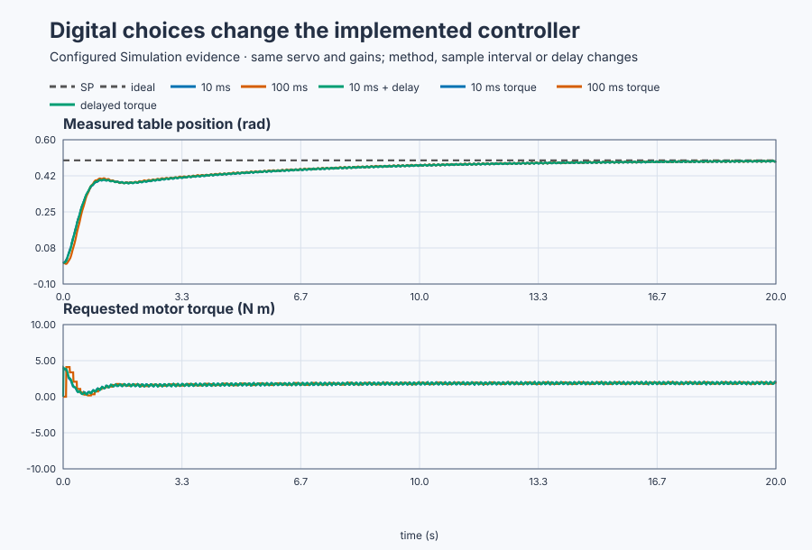
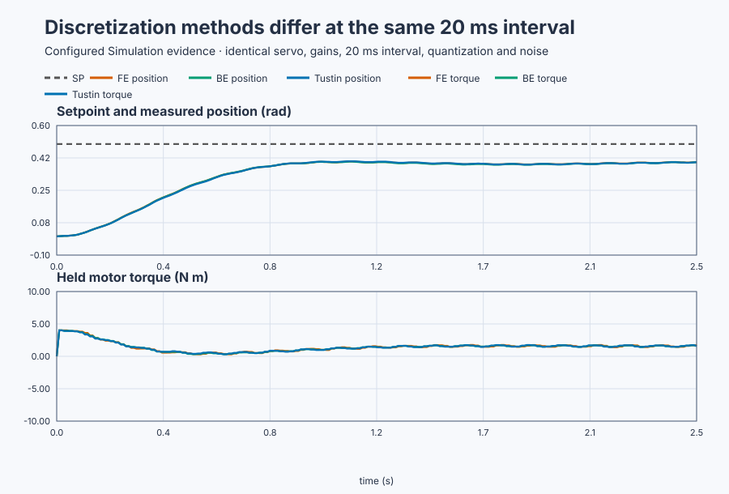
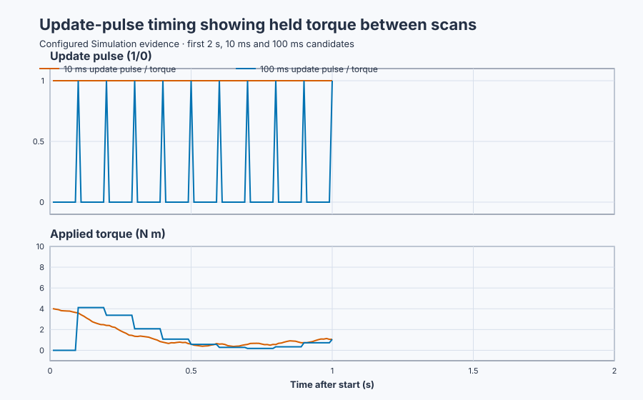
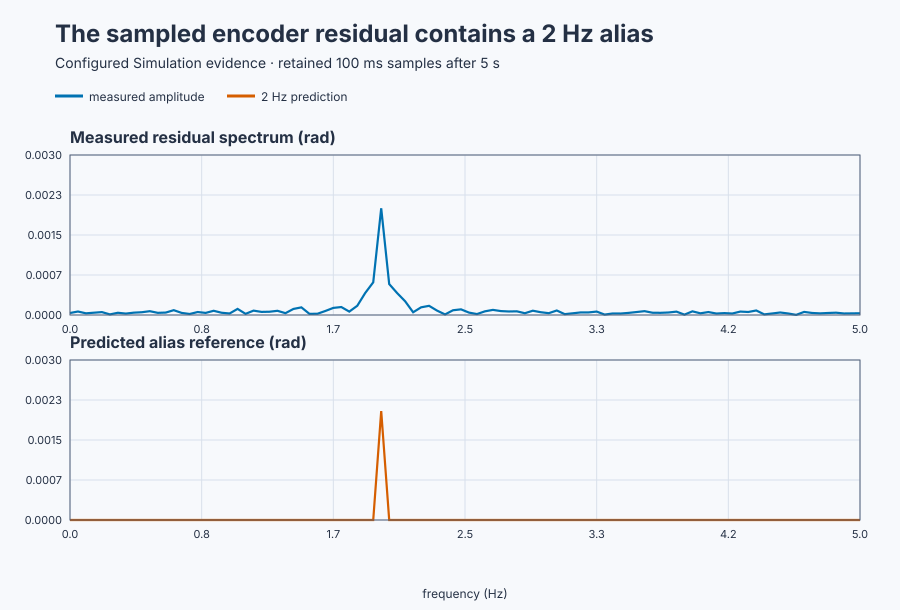

# Qualify a digital PID realization on the positioning table

Course position: Lesson 25 of 84. Previous lesson:
[Mechanical nonidealities](../24-servo-mechanical-nonidealities/README.md).
Next lesson:
[Positional, incremental, and combined PID forms](../../03-production-quality-digital-pid/26-pid-forms/README.md).

**Lesson objective:** Calculate and execute forward-Euler, backward-Euler, and
Tustin realizations at several controller intervals, then decide which cases
remain credible from actual sampling, held torque, tracking, quantization,
aliasing, precision, and computation-delay evidence.

This simulation does not qualify physical timing, drive latency, or an encoder.

**Equipment:** Encoder-controlled industrial positioning table.

## The problem

Lesson 24 separated intentional command shaping from drive and mechanical
effects. This lesson looks inside the controller itself. A continuous PID law
does not say which samples a computer uses, how it approximates an integral or
derivative, or when a calculated torque reaches the drive.

The positioning plant advances every 10 ms. Its controller updates every one,
two, or ten plant scans and holds the last torque between updates.

The gains remain 8 N m/rad, 2 N m/(rad s), and 3 N m s/rad with a 0.05 s
derivative filter. Only realization, interval, resolution, and delay change.

The task is to derive the actual recurrences, then qualify the method and
interval from timing, tracking, held output, quantization, aliasing, and delay.

## What we need

We need a sampled controller whose update interval, held output, coefficient
calculation, and aliasing limit are explicit rather than hidden by continuous-
time notation.

## The new idea

A **continuous signal** exists at every modelled instant. A **sampled signal**
contains values only at controller updates.
The **controller sample interval ($\Delta t$)** is the elapsed time in seconds between
controller updates.

The **sampling frequency ($f_{s}$)** is the number of updates per second, measured
in hertz (Hz):

$f_s=\frac{1}{\Delta t}.$

This is a unit conversion: one update occupies $\Delta t$ seconds, so one
second contains $1/\Delta t$ updates.

The **Nyquist frequency ($f_{N}$)** is half the sampling frequency. Frequencies
above it cannot be distinguished uniquely:

$f_N=\frac{f_s}{2}.$

Two samples per cycle are the minimum needed to distinguish alternating high
and low values. A component above this limit can produce the same samples as a
lower-frequency component and therefore appears under a false frequency.

A **zero-order hold** retains the last motor torque between updates. Faster
plant simulation does not create new controller decisions during that hold.

The **setpoint ($SP$)** is desired angle, the **process value ($PV$)** is sampled
angle, and the **error ($e$)** is SP minus PV. Index **k** is the current update;
`k-1` is the previous update.

The **integral torque** remembers the area under error:

$T_I(t_k)=T_I(t_{k-1})+K_i\int_{t_{k-1}}^{t_k}e(t)\,dt.$

The three methods differ only in how they approximate that small area. Forward
Euler uses a rectangle with the old error,

$T_{I,k}=T_{I,k-1}+K_i\Delta t\,e_{k-1}.$

Backward Euler uses a rectangle with the new error,

$T_{I,k}=T_{I,k-1}+K_i\Delta t\,e_k.$

Tustin, or the trapezoidal rule, uses the average height of the two ends,

$T_{I,k}=T_{I,k-1} +K_i\frac{\Delta t}{2}(e_k+e_{k-1}).$

All three multiply error by elapsed time, which creates error area, and then
by $K_i$, which converts that area to N·m.

The **filtered derivative state** $D$ estimates $K_d\,dPV/dt$ and is
subtracted from torque to provide damping. Its continuous equation is

$\tau_D\frac{dD}{dt}+D=K_d\frac{dPV}{dt}.$

Forward Euler evaluates the right-hand side from retained old values. With
$r_{k-1}$ the previous measured position rate,

$D_k=D_{k-1} +\frac{\Delta t}{\tau_D}(K_dr_{k-1}-D_{k-1}).$

Backward Euler uses the current position change. Replacing both derivatives
with backward differences gives

$\tau_D\frac{D_k-D_{k-1}}{\Delta t}+D_k =K_d\frac{PV_k-PV_{k-1}}{\Delta t}.$

Multiplying by $\Delta t/\tau_D$, collecting the $D_k$ terms, and solving
produces the implemented recurrence

$D_k=\frac{D_{k-1}+(K_d/\tau_D)(PV_k-PV_{k-1})} {1+\Delta t/\tau_D}.$

For Tustin, integrate the continuous equation over one interval and approximate
the area under $D$ by a trapezoid:

$\tau_D(D_k-D_{k-1}) +\frac{\Delta t}{2}(D_k+D_{k-1}) =K_d(PV_k-PV_{k-1}).$

Collecting and solving gives

$D_k= \frac{(2\tau_D-\Delta t)D_{k-1} +2K_d(PV_k-PV_{k-1})} {2\tau_D+\Delta t}.$

These are different executable state updates, not three labels for the same
calculation.

The **quantization step ($q$)** is the 0.001 rad spacing between encoder values.

The **alias frequency ($f_{\mathrm{alias}}$)** is the false lower frequency produced when a
sampled disturbance exceeds $f_{N}$. For 8 Hz interference sampled at 10 Hz:

$f_{\mathrm{alias}}=|f_{\mathrm{signal}}-m f_s|,$

where integer $m$ is chosen so the result lies between zero and $f_N$. For
8 Hz sampled at 10 Hz, $m=1$, so

$f_{\mathrm{alias}}=|8-10|=2\,\mathrm{Hz}.$

The **computation delay ($T_{\mathrm{delay}}$)** is one update: calculated torque is applied
at the next update.

`LREAL` improves coefficient and state precision; it cannot prevent aliasing,
quantization, stale samples, or a poor interval.

## Prediction

The joint's 1 kg m^{2} inertia and 1 N m s/rad friction give a 1 s velocity time
constant. **Samples per time constant** is 1 s divided by $\Delta t$.

| $\Delta t$ | $f_{s}$ | $f_{N}$ | Samples per 1 s | Integral weight $K_i$ × $\Delta t$ | 8 Hz interference |
| ---: | ---: | ---: | ---: | ---: | --- |
| 0.01 s | 100 Hz | 50 Hz | 100 | 0.02 N m/rad | below Nyquist |
| 0.02 s | 50 Hz | 25 Hz | 50 | 0.04 N m/rad | below Nyquist |
| 0.10 s | 10 Hz | 5 Hz | 10 | 0.20 N m/rad | aliases to 2 Hz |

Calculate the 0.05 s derivative-filter coefficients before execution:

| $\Delta t$ | Forward coefficient $\Delta t$/τ | Backward denominator 1 + $\Delta t$/τ | Tustin retained-state coefficient | Tustin position-change coefficient |
| ---: | ---: | ---: | ---: | ---: |
| 0.01 s | 0.200 | 1.200 | 0.818 | 54.545 N m/rad |
| 0.02 s | 0.400 | 1.400 | 0.667 | 50.000 N m/rad |
| 0.10 s | 2.000 | 3.000 | 0.000 | 30.000 N m/rad |

The forward coefficient is $\Delta t/\tau_D$. The backward denominator is
$1+\Delta t/\tau_D$. Dividing the Tustin recurrence by
$2\tau_D+\Delta t$ identifies its retained-state coefficient
$(2\tau_D-\Delta t)/(2\tau_D+\Delta t)$ and position-change coefficient
$2K_d/(2\tau_D+\Delta t)$. For example, at 20 ms the retained coefficient is
$(0.10-0.02)/(0.10+0.02)=0.667$, and the position coefficient is
$6/0.12=50\,\mathrm{N\,m/rad}$.

Thus $dt = 0.10 s$, $f_{s} = 10 Hz$, $f_{N} = 5 Hz$, and the forward coefficient is
2.0. One-update delay is 0.01, 0.02, or 0.10 s.

Predict different torque recurrences, longer holds at slower updates, a 2 Hz
alias at 100 ms, and a one-update shift with delay.

## Implementation

The lesson executes the alternatives directly:

```st
CASE MethodSelection OF
    0: IntegralTorque := IntegralTorque + LREAL#2.0 * CycleTime * PreviousError;
    1: IntegralTorque := IntegralTorque + LREAL#2.0 * CycleTime * Error;
ELSE
    IntegralTorque := IntegralTorque
        + LREAL#0.5 * LREAL#2.0 * CycleTime * (Error + PreviousError);
END_CASE;

RequestedTorque := Controller.Update(
    Setpoint := Setpoint,
    ProcessValue := MeasuredPosition,
    CycleTime := ControllerCycleTime,
    MethodSelection := MethodSelection,
    DelayEnabled := DelayEnabled
);
```

Between updates `RequestedTorque` is unchanged, implementing the hold.

## Experiment in Control Studio

Control Studio exposes the most diagnostic selected case: Tustin at 100 ms,
where the 8 Hz encoder component lies above the 5 Hz Nyquist limit. Test writes
one reviewed Boolean authority, $\mathtt{P1.ExperimentEnabled}$, for 20.01
seconds. The project selects the method and interval, enables control, and
applies SP 0.5 rad. Returning authority false restores SP 0 rad, disables
control, and commands zero torque.

Fresh native runtimes own the three-method 20 ms comparison, the 10/20/100 ms
interval comparison, and the delayed 10 ms case. One selected UI run must not
claim that full matrix. The deterministic Simulation seed is 20260828.

### Control Studio actions

1. **Monitor** — Start the **Simulator**, then open **truST sidebar → Control Studio → Monitor → Response**.
   - **Baseline check:** Wait for **Simulation**, **Running**, current samples, and good quality. Confirm SP = 0 rad, measured PV = 0 rad, held torque = 0 N·m, control disabled, update pulse false, and experiment authority false. Add method, interval, delay state, update pulse, SP, PV, velocity, held torque, encoder interference, and authority to **Signals**.
   - **Decision before action:** Write the 100 ms values $f_s=10$ Hz, $f_N=5$ Hz, integral weight 0.20, Tustin coefficients 0 and 30 N·m/rad, and predicted 2 Hz alias. Require torque to change only at update pulses.
   - **Successful evidence:** The plot advances, values are finite/current, quality is good, and **Start recording** is enabled. Select **Start recording**.
   - **Recovery:** For stale, unavailable, nonfinite, or poor-quality samples, stop the Simulator, correct the displayed runtime or binding fault, restart, and repeat the baseline check.
   - **Record:** Note all initial signals and your calculated timing, coefficient, hold, and alias predictions.

2. **Test** — Open **truST sidebar → Control Studio → Test**.
   - **Baseline check:** Confirm **Experiment** = **Observe without excitation**, **Amplitude** = **0** (disabled), and **Maximum duration (s)** = **20.01**. The reviewed authority is **Experiment authority** (`P1.ExperimentEnabled`). The project owns SP, method, interval, delay selection, and control enable.
   - **Decision before action:** Confirm that the plan writes only that Boolean and restores it false. Require PV within ±4 rad, velocity within ±20 rad/s, and torque within ±10 N·m. Expect one torque update followed by nine held 10 ms plant scans.
   - **Successful evidence:** Select **Review test**, verify authority, timeout, stop conditions, and false restoration, then select **Confirm and start**. Keep **Abort test** available. Response must show Tustin/100 ms selected, SP 0.5 rad, update pulses 100 ms apart, unchanged torque between pulses, sampled interference near 2 Hz, and safe restoration.
   - **Recovery:** Abort for nonfinite, stale, out-of-limit, or incorrectly timed data. Confirm authority false, SP zero, control disabled, and held torque zero before retrying.
   - **Record:** Retain terminal state, restoration, actual update timestamps, maximum interval/jitter, hold duration, SP/PV/torque, sampled spectrum, estimated alias, and seed.

There is no separate disabled Validate stage. The native comparison owns the
method, interval, and delay matrix; Monitor and Test expose one declared case.

## Evidence and decision

### Measures and comparison

Plot SP, PV, held torque, and update pulses together. Compare error, overshoot,
settling, torque travel, interval, jitter, and hold duration.

**Maximum absolute position error** is

$e_{\max}=\max_k|SP_k-PV_k|.$

The absolute value measures error in either direction and the maximum keeps the
worst sampled value. It is not the final error and not the largest signed error.

**Applied-torque total variation** is

$TV(T)=\sum_k|T_k-T_{k-1}|.$

Absolute increments prevent alternating movement from cancelling. Final-window
position span is $\max(PV)-\min(PV)$, and torque span is
$\max(T)-\min(T)$, each over the final two seconds. A span measures remaining
variation, which a small final sample alone could hide.

Inspect the sampled measurement residual spectrum. At 100 ms it should show a
2 Hz alias from the configured 8 Hz interference.

A case settles only when PV remains within 0.020 rad of SP and final 2 s spans
are at most 0.010 rad PV and 0.500 N m torque. Otherwise report no settling time.
Classify that case as **not settled**; if its sampled response grows rather than
remaining bounded, classify it as **unstable** and stop the run.

Evidence measured 0.210 N m separation between 20 ms candidates, a 0.0020 rad
2 Hz alias at 100 ms, and first torque at 0.010 s or 0.020 s with delay.



[Retained samples](figures/digital-realization-trace.csv) ·
[Decision summary](figures/digital-realization-summary.csv) ·
[Method-comparison samples](figures/digital-method-comparison-trace.csv) ·
[Update-timing samples](figures/digital-update-timing-trace.csv) ·
[Alias-spectrum samples](figures/digital-alias-spectrum-trace.csv)

Plots expose recurrences, update pulses, and holds. The
retained 100 ms samples give an estimated alias frequency of 2.00 Hz.







Every tested case remained finite and bounded:

| Case | Settling time | Torque total variation | Longest hold | Actual interval |
| --- | ---: | ---: | ---: | ---: |
| Forward Euler, 20 ms | 11.73 s | 101.34 N m | 0.02 s | 0.02 s |
| Backward Euler, 20 ms | 11.74 s | 77.65 N m | 0.02 s | 0.02 s |
| Tustin, 20 ms | 11.73 s | 89.11 N m | 0.02 s | 0.02 s |
| Tustin, 10 ms | 11.73 s | 94.46 N m | 0.01 s | 0.01 s |
| Tustin, 100 ms | 11.61 s | 24.33 N m | 0.10 s | 0.10 s |
| Tustin, 10 ms plus delay | 11.73 s | 98.25 N m | 0.01 s | 0.01 s |

Lower movement at 100 ms is not automatically better: the command is held
longer and 8 Hz interference appears as 2 Hz. Judge timing, tracking, alias,
and delay together.

### Validation

Torque shall change only on update pulses and remain held between them. Actual
update spacing shall be 10, 20, or 100 ms as selected. PV shall remain on the
0.001 rad grid. The spectrum estimated from the retained 100 ms samples shall
place the dominant alias between 1.9 and 2.1 Hz with at least 0.001 rad
amplitude. The delayed case shall shift first torque by one complete update.

State, PV, velocity, and torque must remain finite; torque stays within ±10 N m.

## Conclusion

Each recurrence approximates the same continuous terms with different samples
and coefficients. Increasing $\Delta t$ lengthens holds and delays, and can make an
8 Hz encoder component look like 2 Hz.

Numerical precision cannot reconstruct unsampled measurements. Timing,
sampling, and resolution are controller behavior.

## Reason for the next lesson

Choose from bandwidth, noise, phase margin, timing, numerical range, and
closed-loop evidence. Requalify after timing, filtering, delay, or hardware changes.

Lesson 26 builds on this result by comparing positional, incremental, and
combined production PID forms without pretending that their retained states
are interchangeable.
