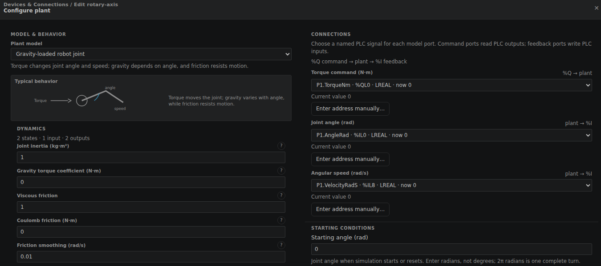
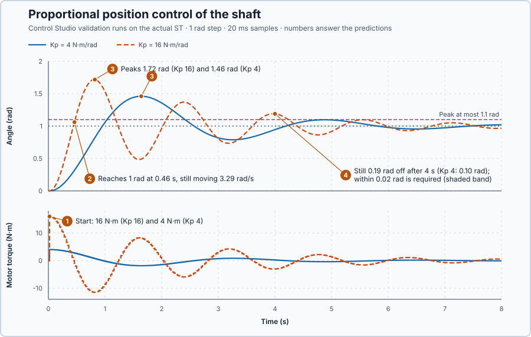

# 34. Position control

In this lesson, you will turn a shaft to a target angle with proportional control. You will see why the shaft is still moving when it reaches the target, and why a stronger controller makes it swing further.

## The problem

Lesson 33 diagnosed a valve stem that stuck at 75 % while the push on it grew to 55 N, then jumped to 78.5 %. In every valve lesson the stem position was a result we watched: we never asked how a motor produces a position, or how feedback makes it stop at a chosen place.

A motor turns a shaft by applying torque. We will model how torque moves the shaft and try the simplest feedback, torque in proportion to the angle error.

## What we need

We need to:

1. describe how torque, inertia and friction move the shaft;
2. turn the angle error into a motor torque; and
3. predict whether that torque brings the shaft to rest at the target.

## The new idea

**Position control** turns a shaft to a target angle by applying torque in proportion to the angle error. Because the shaft has inertia, it is still moving when it reaches the target, so stronger P makes it overshoot and swing.

**In words.** A position loop has two parts: the shaft, which turns torque into motion, and the controller, which chooses the torque.

1. **How torque moves the shaft.** A torque does not set the angle. It changes the shaft's speed, and only the speed changes the angle. The shaft's mass resists every change of speed; this resistance is its **inertia**. Friction in the bearings brakes the shaft in proportion to its speed: the faster it turns, the harder friction holds it back. In PLC terms, the shaft is like two totalizers in a row: in every scan the torque adds a little to the speed, and the speed adds a little to the angle. A steady torque therefore gives a steady speed, never a fixed position.
2. **How the controller chooses the torque.** **Proportional position control** pulls the shaft towards the target with a torque in proportion to the angle error, like a spring stretched between the shaft and the target: the further away the shaft is, the harder it pulls. Past the target the error changes sign, so the torque pulls back.

Together, the shaft and the controller behave like a weight on a spring. The spring speeds the shaft up all the way to the target. At the target the error and the torque are zero, but the shaft is moving, and nothing in the rule brakes it, so it carries on past the target until the spring has stopped it and pulled it back. An axis whose drive is simply switched off at its position switch does the same: it coasts past. Only friction takes energy out, so friction alone decides how fast the swing dies away. A stiffer spring, that is a larger gain, pulls harder: the shaft arrives sooner, but faster, and swings further.

For this lesson's shaft, the bearings brake only lightly, so after a step the shaft swings around the target for several seconds.

**The formula.** Newton's law for rotation says that the torques on the shaft change its speed: the inertia times the angular acceleration equals the motor torque minus the friction and load torques. The speed in turn changes the angle:

$$
J\dot\omega = u - B\omega - \tau_L, \qquad \dot\theta = \omega .
$$

P control requests the torque

$$
u = K_p(r - \theta) .
$$

Substituting $u$, and writing $\ddot\theta$ for $\dot\omega$, gives one equation for the angle:

$$
J\ddot\theta + B\dot\theta + K_p\theta = K_p r .
$$

- $\theta$ is the shaft angle, in radians, and $\omega$ its speed, in radians per second;
- $\dot\theta$ is how fast the angle changes, which is the speed $\omega$;
- $\dot\omega$, also written $\ddot\theta$, is how fast the speed changes, the angular acceleration, in radians per second squared;
- $J$ is the inertia, in kg·m²;
- $u$ is the motor torque, in newton-metres (N·m);
- $B$ is the viscous friction, the braking torque per unit of speed, in N·m per rad/s (N·m·s/rad);
- $\tau_L$ is a load torque from outside, such as a weight on the shaft, in N·m; it is zero in this lesson;
- $r$ is the target angle, in radians; and
- $K_p$ is the proportional gain, the torque per radian of error, in N·m/rad.

The last equation is the weight on a spring with a damper: $K_p\theta$ is the spring pulling the shaft towards $r$, $B\dot\theta$ is the damper, and $J\ddot\theta$ is the inertia.

> **Math you need: a decaying swing.** The equation $J\ddot x + B\dot x + K x = 0$, with $x$ the distance from the target, has the solution $x = x_0 e^{-\sigma t}\cos\omega_d t$ when friction is small, with $\sigma = B/(2J)$ and $\omega_d^2 = K/J - \sigma^2$. Differentiate twice and substitute: the sine and cosine terms both cancel for exactly these values. The swing repeats every $2\pi/\omega_d$ seconds, and its size shrinks by the factor $e^{-\sigma t}$.

For the position loop the spring is $K = K_p$, and three numbers describe the swing:

- the decay rate $\sigma = B/(2J)$, in 1/s: how fast the swing shrinks;
- the **natural frequency** $\omega_n = \sqrt{K_p/J}$, in rad/s: how fast the shaft would swing without friction; and
- the **damping ratio** $\zeta = B/(2\sqrt{JK_p})$, without unit: how strongly friction brakes the swing. 0 is no braking; 1 is just enough to stop without passing the target.

The first peak comes half a swing after the step, at $t = \pi/\omega_d$. The overshoot, the distance past the target as a fraction of the step, is then

$$
\frac{\theta_{peak} - r}{r} = e^{-\zeta\pi/\sqrt{1-\zeta^2}} ,
$$

with $\theta_{peak}$ the highest angle, in radians.

**Example: this lesson's shaft.** The shaft has $J = 1$ kg·m² and $B = 1$ N·m·s/rad and carries no load. It rests at 0 rad, and the target steps to $r = 1$ rad with $K_p = 16$ N·m/rad. Follow the numbers:

1. **Torque makes speed, not position.** A constant 1 N·m from rest accelerates the shaft at $\dot\omega = 1/1 = 1$ rad/s², so its speed grows by 1 rad/s every second. Friction grows with the speed until $B\omega = 1$ N·m balances the torque at $\omega = 1/1 = 1$ rad/s. From then on the shaft turns at a steady 1 rad/s: a torque on its own never holds a position.
2. **P sets the torque from the error.** At 0.9 rad the error is $1 - 0.9 = 0.1$ rad, so $u = 16 \times 0.1 = 1.6$ N·m pushes the shaft forward. At 1.2 rad, $u = 16 \times (1 - 1.2) = -3.2$ N·m pulls it back.
3. **The spring's energy becomes speed.** At the step, the stretched spring stores $\tfrac12 K_p e^2 = \tfrac12 \times 16 \times 1^2 = 8$ J. On the way to the target this energy turns into motion. Without friction, all 8 J would be speed at the target: $\tfrac12 J\omega^2 = 8$ J gives $\omega = 4$ rad/s, which is $r\sqrt{K_p/J}$. Friction removes only part of the energy on the way, so the shaft crosses the target fast.
4. **The swing dies away slowly.** $\sigma = 1/(2 \times 1) = 0.5$ per second, and $K_p$ does not appear in it: 4 s after the step the swing is still $e^{-0.5 \times 4} = e^{-2} = 14$ % of its start, whatever the gain.
5. **The first peak.** $\omega_n = \sqrt{16/1} = 4$ rad/s and $\zeta = 1/(2\sqrt{1 \times 16}) = 0.125$. The overshoot is $e^{-0.125\pi/\sqrt{1-0.125^2}} = e^{-0.40} = 0.67$, so the shaft swings to about $1 + 0.67 = 1.67$ rad.

A stiffer spring swings faster and further, but not shorter.

**The limitation.** P cannot brake. It stores energy in the spring and gives it back, and only friction removes it. Because $\sigma = B/(2J)$ does not contain $K_p$, no gain makes the swing die out sooner; a larger gain only lowers $\zeta$ (four times the gain halves it) and so raises the peak. The formulas also assume that the torque changes continuously, while the program updates it every 20 ms: at 4 rad/s the shaft turns $4 \times 0.02 = 0.08$ rad between two updates while the torque keeps its old value, so a run peaks a little higher than calculated. Both gains, 4 and 16 N·m/rad, are teaching values, not tuned values for a physical drive.

## Prediction

Before running, answer these questions for a 1 rad step from rest. The example worked through $K_p = 16$; apply the same steps to $K_p = 4$ and compare:

1. What torque does each gain request at the start?
2. Which gain reaches the target first, and which is moving faster when it gets there?
3. How high will each peak be?
4. Can any $K_p$ keep the peak at or below 1.1 rad and the error within 0.02 rad from 4 s on?

| | $K_p = 4$ | $K_p = 16$ |
| --- | ---: | ---: |
| Starting torque | 4 N·m | 16 N·m |
| Speed at the target without friction | 2 rad/s | 4 rad/s |
| $\omega_n$, $\zeta$ | 2 rad/s, 0.25 | 4 rad/s, 0.125 |
| Predicted peak | 1.44 rad | 1.67 rad |

## Implementation

Open [`src/Main.st`](src/Main.st). `Control.PID` with zero integral and derivative gains is a P controller: it computes $u = K_p(r - \theta)$, limited to the drive's ±20 N·m. Leaving ±2 rad or ±10 rad/s sets `SafetyAbort`, which holds the torque at zero until a restart.

**ST practice.** `ArrivalVelocityRadS` keeps the measured speed at the first sample that reaches a new target:

```st
IF NOT Arrived AND ApproachRad * (SetpointRad - AngleRad) <= LREAL#0.0 THEN
    Arrived := TRUE;
    ArrivalVelocityRadS := VelocityRadS;
END_IF;
```

Explain why the product turns zero or negative exactly when the target is reached. Then open [`src/tests.st`](src/tests.st) and run its tests from the **Testing** view: they check the 1.6, 0 and −3.2 N·m requests at 0.9, 1.0 and 1.2 rad with $K_p = 16$, and the 20 N·m limit.

## Experiment in Control Studio

The requirements, fixed before any result: a 0 → 1 rad step, the peak at most 1.1 rad, the error within ±0.02 rad from 4 s to 8 s, and the torque within ±20 N·m.

1. Open this lesson's project and start **Simulator**; the shaft rests at 0 rad. First look at the new plant: in the **truST** side bar, select **Devices & Connections**, then **rotary-axis**. In **Configure plant**, **Plant model** is **Gravity-loaded robot joint** with **Joint inertia (kg·m²)** 1, **Viscous friction** 1 and **Gravity torque coefficient (N·m)** 0. Under **CONNECTIONS**, **Torque command (N·m)** reads `P1.TorqueNm`; **Joint angle (rad)** and **Angular speed (rad/s)** write `P1.AngleRad` and `P1.VelocityRadS`. Close with **Cancel**.

   

2. In the **truST** side bar, select **Control Studio**. On **Identify**, set **Method** to **Supplied plant model**, select **Open model…** and choose `shaft-model.json`. Control Studio shows the model's equations, with the shaft's values $J = 1$ and $B = 1$.
3. On **Tune**, check **Controller** shows `P1.Controller · P`, set **Tuning method** to **Manual** and enter 4 in **Proportional gain (Kp)**. Select **Requirements…** and enter **Setpoint change (rad)** 1, **Maximum steady-state error (rad)** 0.02, **Maximum settling time (s)** 4, **Settling band (±rad)** 0.01 and **Validation duration (s)** 8; select **Done**. Select **Tune controller** and read the **Predicted response**.
4. On **Validate**, select **Validate controller**. Control Studio runs the step on the actual ST and reports **Recorded target error 0.0973 rad exceeds 0.02 rad. Next: Tune again.** Read the table and the **Measured response**.
5. Repeat steps 3 and 4 with 16 in **Proportional gain (Kp)**.
6. On **Tune**, set **Tuning method** to **Automatic** and select **Tune controller**.

Neither gain is applied: **Apply** stays unavailable while a requirement fails. To repeat, start again from step 3; each validation runs from the same resting state.

## Evidence and decision



The numbered marks answer the predictions with the same numbers. From the two validation runs:

| Result | $K_p = 4$ | $K_p = 16$ |
| --- | ---: | ---: |
| Torque range | −1.84 to 4 N·m | −11.48 to 16 N·m |
| First at the target | 0.96 s | 0.46 s |
| Speed at the target | 1.27 rad/s | 3.29 rad/s |
| Peak | 1.46 rad | 1.72 rad |
| Largest error, 4–8 s | 0.097 rad | 0.189 rad |

1. The first torques were 4 and 16 N·m, as calculated.
2. The stiffer spring reached the target at 0.46 s instead of 0.96 s, but moving at 3.29 instead of 1.27 rad/s: it still carried $\tfrac12 \times 3.29^2 = 5.4$ J of its 8 J, against 0.81 J of 2 J.
3. The peaks were 1.46 and 1.72 rad, a little above the predicted 1.44 and 1.67 rad because each torque is held for 20 ms between updates.
4. Both swings were still 0.10 and 0.19 rad off after 4 s. Automatic tuning reports **Tuning failed: P leaves the error's decay rate at 0.5 1/s whatever Kp, and settling by 4 s needs at least 1 1/s. Compare PD or PID.** No P gain meets the requirements.

A stiffer gain buys speed at the cost of a faster arrival, a higher peak and a larger remaining swing. We apply neither gain. These are simulation results.

## Conclusion

Proportional position control behaves like a spring: the angle error creates a pulling torque, inertia turns torque into speed, and the speed carries the shaft through zero error. A stiffer spring moves the shaft sooner but delivers it faster and swings it further, while the decay rate $B/(2J)$ is set by friction alone.

For this shaft, neither $K_p = 4$ nor $K_p = 16$ keeps the peak below 1.1 rad or settles within 0.02 rad by 4 s, and no other P gain can.

## Check yourself

1. **With $K_p = 9$ N·m/rad on this shaft, what are $\omega_n$, $\zeta$ and the predicted peak?**
   $\omega_n = 3$ rad/s, $\zeta = 1/(2 \times 3) = 0.167$, overshoot $e^{-0.167\pi/0.986} = e^{-0.53} = 59$ %, so the peak is
   about 1.59 rad.
2. **The error is zero at the target, so the torque is zero. Why does the shaft not stop there?**
   It is still moving. Zero torque does not stop a moving mass; only friction, or a torque against the motion, can
   remove its speed.
3. **Why does a stiffer P not make the swing die out sooner?**
   The swing shrinks by $e^{-\sigma t}$ with $\sigma = B/(2J) = 0.5$ per second, which does not contain $K_p$. P stores
   energy and gives it back; only friction removes it.

## Reason for the next lesson

P does not oppose the shaft's speed, so it cannot stop the overshoot: the shaft needs a torque that brakes it in proportion to how fast it moves.

[PD control](../33-derivative-motion-damping/README.md) adds that braking torque.
