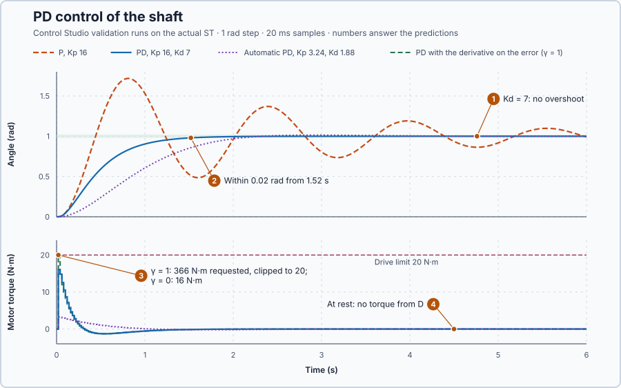

# 35. PD control

In this lesson, you will add a braking torque to the position controller, in proportion to the shaft's speed. You will see it stop the swing, and why it must act on the measured angle rather than on the error.

## The problem

Lesson 34's P controller left the shaft swinging. At $K_p = 16$ it reached the target still moving at 3.29 rad/s, peaked at 1.72 rad and was still 0.19 rad off after 4 s. The swing shrinks only as $e^{-0.5t}$, a rate set by friction alone, whatever $K_p$ is.

Nothing in the controller opposes the shaft's motion. We will add a torque that brakes the shaft while it moves.

## What we need

We need to:

1. remove energy from the shaft while it moves, not only when it is off target;
2. choose how strongly to brake, so the shaft stops at the target without passing it; and
3. keep that braking from reacting to sudden changes of the target.

## The new idea

The **derivative part** brakes the shaft in proportion to how fast it moves, like a shock absorber. Taking the speed from the measured angle avoids a kick when the target jumps. A controller with a proportional and a derivative part is a **PD controller**.

**In words.** P is a spring: it pulls the shaft towards the target, but it does nothing about the shaft's speed. The derivative part adds a second torque that depends only on the speed and always acts against the motion:

1. **The braking torque.** The faster the shaft turns, the harder the derivative part brakes; when the shaft stands still, it gives nothing. Like the shock absorber of a car, it does not care where the shaft is, only how fast it moves. The bearing friction brakes in the same way, so the derivative part simply adds the braking that the bearings do not supply. Braking in proportion to speed is called **damping**.
2. **How much braking.** Too little braking leaves a swing, only a smaller one. Too much makes the shaft creep slowly towards the target. In between lies the amount that brings the shaft to the target as fast as possible without passing it.
3. **Where the speed comes from.** The speed is taken from the measured angle. If it were taken from the error instead, a jump of the target, such as a new position typed in at the HMI, would look like an enormous speed for one update. The controller would hit the motor with a huge torque, a kick, although the shaft has not moved and there is nothing to brake.

An operator jogging a heavy axis by hand does the same: they ease off before the mark, and the faster the axis approaches, the earlier and harder they brake.

For this lesson's shaft, the bearings alone brake so weakly that the P-controlled shaft swings for seconds; the derivative part lets the controller supply the missing braking.

**The formula.** The derivative part turns the speed $\omega$, the rate of change of the measured angle, into a braking torque. The PD torque is

$$
u = K_p(r - \theta) - K_d\,\omega .
$$

Putting this torque into Lesson 34's shaft equation without load, $J\dot\omega = u - B\omega$, gives

$$
J\ddot\theta + (B + K_d)\dot\theta + K_p\theta = K_p r .
$$

- $K_d$ is the **derivative gain**, the braking torque per unit of speed, in newton-metres per radian per second (N·m·s/rad);
- $\omega = \dot\theta$ is the measured speed, in radians per second; and
- $u$, $K_p$, $r$, $\theta$, $J$ and $B$ are Lesson 34's torque, proportional gain, target, angle, inertia and friction.

The derivative gain adds to the bearing friction $B$, because both brake in proportion to speed. Lesson 34's decaying swing therefore holds with $B + K_d$ in place of $B$: the shrink rate, the swing frequency and the damping ratio become

$$
\sigma = \frac{B + K_d}{2J}, \qquad \omega_d^2 = \frac{K_p}{J} - \sigma^2, \qquad \zeta = \frac{B + K_d}{2\sqrt{JK_p}} .
$$

Follow what more damping does:

1. A little more damping raises $\sigma$, so the swing shrinks faster.
2. When $\sigma^2$ reaches $K_p/J$, $\omega_d$ is zero: there is no swing left. This is **critical damping**, damping ratio $\zeta = 1$, the fastest response that does not pass the target. It needs $(B + K_d)^2 = 4JK_p$, so

   $$
   K_d = 2\sqrt{JK_p} - B .
   $$

   From rest, the critically damped response to a target step $r$ is $\theta = r\,[1 - (1 + \sigma t)\,e^{-\sigma t}]$, as differentiating confirms. The bracket stays below 1, so the shaft never passes $r$.
3. Even more damping makes the shaft creep towards the target more and more slowly.

In energy terms, the braking torque removes the power $K_d\omega^2$, in watts, while the shaft moves.

**Derivative kick.** The rate of the error, $d(r - \theta)/dt$, contains the rate of the target. A target step $\Delta r$ inside one update of $\Delta t$ seconds looks like the rate $\Delta r/\Delta t$, and the derivative part answers it with a torque spike, a **derivative kick**. Taking the derivative of the measurement only, **derivative on measurement**, avoids it. `Control.PID` weights the target's rate with $\gamma$:

$$
D = K_d\left(\gamma\,\frac{dr}{dt} - \frac{d\theta}{dt}\right),
$$

- $D$ is the derivative torque, in N·m; and
- $\gamma$ is the derivative setpoint weight, without unit, between 0 and 1: $\gamma = 0$ is derivative on measurement and $\gamma = 1$ is derivative on the error.

**Example: braking the shaft of Lesson 34.** The shaft has $J = 1$ kg·m² and $B = 1$ N·m·s/rad, and P keeps $K_p = 16$ N·m/rad. Add a derivative gain of $K_d = 3$ N·m·s/rad and follow the numbers:

1. **The braking torque.** At 2 rad/s, D gives $-3 \times 2 = -6$ N·m against the motion, and removes $3 \times 2^2 = 12$ W. At rest it gives $-3 \times 0 = 0$ N·m.
2. **The damping adds up.** $B + K_d = 1 + 3 = 4$ N·m·s/rad, four times the bearings' braking. The swing now shrinks at $\sigma = 4/(2 \times 1) = 2$ per second instead of 0.5: after 1 s it is down to $e^{-2} = 14$ % of its start, a point P reached only after 4 s.
3. **Still a swing.** $\omega_d^2 = 16 - 2^2 = 12$ is positive, so the shaft still passes the target. The damping ratio is $\zeta = 4/(2\sqrt{1 \times 16}) = 0.5$, and Lesson 34's overshoot formula gives $e^{-0.5\pi/\sqrt{1-0.5^2}} = e^{-1.81} = 16$ %: a peak near 1.16 rad instead of 1.67 rad. Better, but still above 1.1 rad.
4. **The critical gain depends on the spring.** For Lesson 34's softer spring, $K_p = 4$, critical damping needs $K_d = 2\sqrt{1 \times 4} - 1 = 3$ N·m·s/rad: the same $K_d = 3$ is exactly enough there. Then $\sigma = 2$ per second, $\theta = r\,[1 - (1 + 2t)\,e^{-2t}]$, and the error of a 1 rad step falls below 0.02 rad when $(1 + 2t)\,e^{-2t} = 0.02$, at about 2.92 s. A stiffer spring needs more braking.
5. **The kick.** With $K_d = 3$ on the error, a 1 rad target step inside one 20 ms update looks like $1/0.02 = 50$ rad/s, and D requests $3 \times 50 = 150$ N·m for that update, before the shaft has moved. The drive can deliver only 20 N·m, so it sits at its limit. On the measurement, D requests $-3 \times 0 = 0$ N·m, since the shaft has not moved yet.

**The limitation.** The formulas assume a torque that changes continuously, while the program updates it every 20 ms: at 2 rad/s the shaft turns $2 \times 0.02 = 0.04$ rad between two updates while the torque keeps its old value, so a run settles a little later than calculated. Critical damping holds only for the $K_p$ it was calculated for: step 4 shows the same $K_d$ critical at $K_p = 4$ and too weak at 16. The derivative needs the speed; here the simulated angle is clean, and a noisy measurement is Lesson 37's subject. The gains are teaching values for this simulated axis.

## Prediction

Before running, with $J = 1$, $B = 1$ and $K_p = 16$, answer these questions by repeating the example's steps for this stiffer spring:

1. Which $K_d$ brakes just enough to avoid passing the target?
2. With that $K_d$, when does the shaft stay within 0.02 rad of the target?
3. What torque is requested at the first update after a 0 → 1 rad step, with $\gamma = 0$ and with $\gamma = 1$?
4. What torque does D give when the shaft is at rest?

| | Value |
| --- | ---: |
| Critical $K_d$ | 7 N·m·s/rad |
| Within 0.02 rad (continuous model) | about 1.46 s |
| First torque, $\gamma = 0$ | 16 N·m |
| First torque, $\gamma = 1$ | 366 N·m requested, 20 N·m applied |
| D at rest | 0 N·m |

## Implementation

Open [`src/Main.st`](src/Main.st). It is Lesson 34's program with D enabled in the controller's parameter record: `ProportionalGain` 16, `DerivativeGain` 7 and `DerivativeSetpointWeight` 0. `Control.PID` then computes $u = K_p(r - \theta) + K_d(\gamma\,\dot r - \dot\theta)$ with $\gamma = 0$, limited to ±20 N·m.

**ST practice.** Write the braking torque from the measured speed, `BrakingTorque := -Parameters.DerivativeGain * VelocityRadS;`, and check −1.4 N·m at 0.2 rad/s and 0 N·m at rest. Then open [`src/tests.st`](src/tests.st) and run its tests from the **Testing** view: they check the same braking, 16 N·m at a target step with $\gamma = 0$, and the 20 N·m clipped kick with $\gamma = 1$.

## Experiment in Control Studio

The requirements are Lesson 34's, plus one: the torque must not sit at its ±20 N·m limit.

1. Open this lesson's project and start **Simulator**; the shaft rests at 0 rad. In the **truST** side bar, select **Control Studio**. On **Identify**, set **Method** to **Supplied plant model**, select **Open model…** and choose `shaft-model.json`.
2. On **Tune**, choose **Controller** `P1.Controller · P`, **Tuning method** **Manual**, and 16 in **Proportional gain (Kp)**. Select **Requirements…**, enter **Setpoint change (rad)** 1, **Maximum steady-state error (rad)** 0.02, **Maximum settling time (s)** 4, **Settling band (±rad)** 0.01 and **Validation duration (s)** 8, and select **Done**. Select **Tune controller**; on **Validate**, select **Validate controller**.
3. On **Tune**, choose `P1.Controller · PD — recommended` with **Manual**: 16 in **Proportional gain (Kp)**, 7 in **Derivative gain (Kd)** and 1 in **Derivative setpoint weight (γ)**. Tune and validate, and read the torque rows.
4. Repeat with 0 in **Derivative setpoint weight (γ)**. When every row passes, select **Apply**; Control Studio reports **Applied** and offers **Restore previous settings**.
5. Set **Tuning method** to **Automatic**, select **Tune controller**, and validate the result.

Control Studio counts the shaft as settled when it stays within the 0.02 rad error limit. To repeat, start again from step 2.

## Evidence and decision

The numbered marks answer the predictions with the same numbers. From the four validation runs:

| Result | P | PD, $\gamma = 1$ | PD, $\gamma = 0$ | Automatic PD |
| --- | ---: | ---: | ---: | ---: |
| Gains | $K_p$ 16 | $K_p$ 16, $K_d$ 7 | $K_p$ 16, $K_d$ 7 | $K_p$ 3.24, $K_d$ 1.88 |
| Overshoot | 0.72 rad | 0 | 0 | 0.014 rad |
| Largest error, 4–8 s | 0.19 rad | < 0.0001 rad | < 0.0001 rad | 0.0046 rad |
| Settled within 0.02 rad | no | 1.52 s | 1.52 s | 2.10 s |
| Torque range | −11.48 to 16 N·m | −1.29 to 20 N·m | −1.28 to 16 N·m | −0.19 to 3.24 N·m |
| Time at the torque limit | 0 s | 0.02 s | 0 s | 0 s |

1. With $K_d = 7$ the shaft reached 1 rad without passing it, and its speed never turned negative: it was braked to rest instead of reversing.
2. It stayed within 0.02 rad from 1.52 s, a little later than the continuous 1.46 s because each torque is held for 20 ms.
3. With $\gamma = 1$ the first update requested 366 N·m and the drive sat at its 20 N·m limit, failing **Maximum saturation time**: a kick that loads the drive and improves nothing. With $\gamma = 0$ the first torque was 16 N·m.
4. Once at rest, D gave no torque.

Automatic tuning meets the same requirements with $K_p = 3.24$ and $K_d = 1.88$: it settles at 2.10 s with at most 3.24 N·m, a fifth of the torque. The requirements, not the fastest possible response, decide the gains. We keep the applied $K_p = 16$, $K_d = 7$. These are simulation results.

## Conclusion

The derivative part feeds the measured speed back as a braking torque. It adds to the physical damping, $B + K_d$, and so sets how fast the swing dies, while P sets the stiffness; $K_d = 2\sqrt{JK_p} - B$ gives the fastest response without overshoot. The derivative belongs on the measurement: differentiating the error turns every target step into a torque kick.

For this shaft, $K_p = 16$ with $K_d = 7$ moves to the target without overshoot in 1.52 s and passes every requirement.

## Check yourself

1. **With $K_p = 25$ on this shaft, which $K_d$ gives critical damping?**
   $K_d = 2\sqrt{1 \times 25} - 1 = 9$ N·m·s/rad.
2. **Why does differentiating the error give a torque kick when the target jumps?**
   The error jumps by the whole step within one update, so its rate is huge: 1 rad in 0.02 s is 50 rad/s, and
   $K_d \times 50 = 350$ N·m.
3. **At rest on target, P and D both give zero torque. When would that be a problem?**
   When something pushes on the shaft at rest, such as a weight. Holding it needs torque, and PD gives torque only
   from an error or a speed.

## Reason for the next lesson

A constant load needs torque while the shaft stands still, and PD gives that torque only from a remaining position error, so the shaft must sag away from its target.

[PID load rejection](../34-servo-pid-holding-torque/README.md) adds the part that keeps up the holding torque at zero error.
