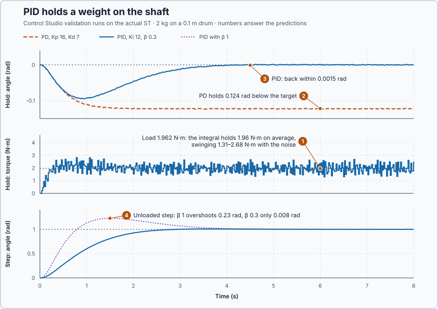

# 36. PID load rejection

In this lesson, you will hang a weight on the shaft and make the position controller hold it exactly on target by adding integral action. You will also see what measurement noise does to the derivative.

## The problem

Lesson 35's PD controller moved the shaft to its target without overshoot in 1.52 s. At rest on target, both of its parts are zero: P because the error is zero, D because the speed is zero. That is fine while nothing pushes on the shaft.

Now the shaft lifts a weight on a drum. The weight pulls the shaft down all the time, so holding it needs torque even when the shaft stands still on target. PD makes that torque only from an error, so a constant load leaves PD with an error. We will add a part that keeps up the torque at zero error.

## What we need

We need to:

1. calculate the torque the weight needs;
2. predict how far PD lets the shaft sag; and
3. supply the holding torque without leaving an error.

## The new idea

**PID control** adds the integral to PD. The controller then keeps up the holding torque that a constant load needs, even with the shaft exactly at its target.

**In words.** A weight hanging from a drum on the shaft pulls all the time, also while the shaft stands still. Its steady pull is a **load torque**. A hoist drive knows the problem: unless a brake holds the load, the motor must keep pushing at standstill, or the load sinks.

1. **Why PD sags.** At rest on target, PD gives no torque: P because the error is zero, D because the speed is zero. The weight therefore pulls the shaft down until the error is large enough for P to push back as hard as the weight pulls. There the shaft stays, permanently below its target.
2. **What the integral adds.** The integral works as in the heater lessons: it adds up the error over time. As long as the shaft hangs below its target, the integral keeps growing and takes over more of the holding torque. P then needs less error, so the shaft climbs back. When the error is zero, the integral stops changing and keeps the torque it has reached, exactly what the weight needs. In PLC terms, the integral is a value kept from scan to scan and nudged by the error in every scan, like an operator who trims a manual output until the reading is right and then leaves it alone.
3. **Three parts, three jobs.** P is the spring that pulls towards the target, D is the brake that stops the swing, and I is the patient part that supplies whatever steady torque the load needs.

The integral has a side effect. During a fast move to a new target, the error is large for a while, so the integral builds up a torque that the shaft does not need when it gets there. Lesson 23's setpoint weight decides how hard P pushes when the target changes, and so how fast the shaft approaches. A second side effect comes from D: it uses a speed calculated from angle readings, and the readings carry noise.

For this lesson's shaft, a weight on the drum needs a steady torque at the target, which only the integral can supply without an error.

**The formula.** A weight on a drum pulls with its weight force times the drum radius:

$$
\tau_L = m\,g\,r_d .
$$

At rest the speed and its change are zero, so Lesson 34's shaft equation $J\dot\omega = u - B\omega - \tau_L$ requires

$$
u = \tau_L :
$$

the motor must push exactly as hard as the weight pulls. PD at rest gives only $u = K_p e$, so the shaft must sag until

$$
e = \frac{\tau_L}{K_p} .
$$

The integral changes at each update by

$$
I_{new} = I_{old} + K_i\, e\, \Delta t ,
$$

and the PID torque is $u = K_p e + I - K_d\,\omega$. With Lesson 23's setpoint weight the P part becomes $K_p(\beta\,r - \theta)$, while the integral still adds up the full error $e = r - \theta$.

- $\tau_L$ is the load torque, in newton-metres;
- $m$ is the mass of the weight, in kilograms, and $g = 9.81$ m/s² the acceleration due to gravity;
- $r_d$ is the drum radius, in metres;
- $e = r - \theta$ is the angle error, in radians;
- $I$ is the integral, the torque it supplies, in newton-metres;
- $K_i$ is the integral gain, in newton-metres per radian per second;
- $\Delta t = 0.02$ s is the update interval;
- $\beta$ is the setpoint weight, between 0 and 1, without unit; and
- $u$, $K_p$, $K_d$, $\omega$, $r$ and $\theta$ are Lessons 34 and 35's torque, gains, speed, target and angle.

**Example: a 1 kg weight on the 0.1 m drum.** The lesson's controller has $K_p = 16$, $K_i = 12$ and $K_d = 7$, and the target stays at 0 rad. Follow the numbers:

1. **The load.** $\tau_L = 1 \times 9.81 \times 0.1 = 0.981$ N·m: the weight pulls the shaft down with almost 1 N·m.
2. **PD sags.** At rest PD must make 0.981 N·m from the error alone: $e = 0.981/16 = 0.0613$ rad, about 3.5°. PD holds the weight there for good.
3. **The integral grows.** While the shaft is still 0.05 rad low, each update adds $12 \times 0.05 \times 0.02 = 0.012$ N·m to the integral; at 50 updates per second that is 0.6 N·m per second. The more the integral supplies, the less error P needs, so the shaft climbs back.
4. **The integral holds.** At zero error each update adds $12 \times 0 \times 0.02 = 0$: the integral stays where it is. It now supplies $I = 0.981$ N·m, P and D are zero, and the shaft stands exactly on target while the motor pushes 0.981 N·m.
5. **A target step.** Without the weight, the target steps from 0 to 1 rad. With $\beta = 1$, P's first torque is $16 \times (1 \times 1 - 0) = 16$ N·m; with $\beta = 0.3$ it is $16 \times (0.3 \times 1 - 0) = 4.8$ N·m. The integral uses the full 1 rad error either way and adds $12 \times 1 \times 0.02 = 0.24$ N·m in the first update.
6. **Noise in D.** The angle measurement carries noise of up to ±0.001 rad, so two readings of a still shaft can differ by 0.002 rad. D sees $0.002/0.02 = 0.1$ rad/s and turns it into $7 \times 0.1 = 0.7$ N·m: the holding torque flickers by about ±0.7 N·m.

**The limitation.** The integral needs time: it grows only while an error remains, so a weight hung on suddenly first pulls the shaft down before the integral catches up. The derivative passes the angle noise to the motor as a torque flicker of about ±0.7 N·m, calculated in step 6. At the drive's ±20 N·m limits, `Control.PID` stops the integral from winding up, as in Lesson 8. The gains $K_p = 16$, $K_i = 12$, $K_d = 7$ and the setpoint weight $\beta = 0.3$ are teaching values for this simulated axis.

## Prediction

Before running, answer these questions:

1. What load torque does the 2 kg weight on the 0.1 m drum produce, and what torque must the integral hold?
2. How far below its target does PD with $K_p = 16$ hold the weight?
3. Does PID bring the shaft back to its target?
4. On an unloaded step, which setpoint weight overshoots: $\beta = 1$ or $\beta = 0.3$?

| | PD | PID |
| --- | ---: | ---: |
| Holding torque at rest | 1.962 N·m from the error | 1.962 N·m from the integral |
| Error at rest | 0.1226 rad | 0 |
| Integral change per update at 0.01 rad | — | 0.0024 N·m |

## Implementation

Open [`src/Main.st`](src/Main.st). It is Lesson 35's program with integral action: `Parameters` sets `IntegralGain` 12 and `ProportionalSetpointWeight` 0.3. With $K_i > 0$, `Control.PID` runs its integral with anti-windup at the ±20 N·m limits. The simulated axis has a second input, the drum's load torque `LoadTorqueNm`, which couples the weight in the loaded trial; the controller does not read it.

**ST practice.** Write one integral update with your own variables, `Integral := Integral + Ki * ErrorRad * 0.02;`, and check that 50 updates at 0.01 rad with `Ki` = 12 add 0.12 N·m. Then open [`src/tests.st`](src/tests.st) and run its tests from the **Testing** view: they check the 1.962 N·m load, PD holding it at 0.122625 rad, and the integral keeping 1.962 N·m at zero error.

## Experiment in Control Studio

Two trials, fixed before any result. **Loaded hold:** the target stays at 0 rad and the weight is coupled at time zero; the error must be within ±0.02 rad from 4 s to 8 s and the torque must not sit at its limit. **Unloaded step:** 0 → 1 rad without the weight; the peak at most 1.1 rad and the error within ±0.02 rad from 4 s to 8 s. Control Studio runs both on the actual ST at every validation.

1. Open this lesson's project and start **Simulator**. In the **truST** side bar, select **Control Studio**. On **Identify**, set **Method** to **Supplied plant model**, select **Open model…** and choose `shaft-model.json`.
2. On **Tune**, choose **Controller** `P1.Controller · PD — recommended` with **Manual**: 16 in **Proportional gain (Kp)**, 7 in **Derivative gain (Kd)**, 0 in **Derivative setpoint weight (γ)**. Select **Requirements…**, enter **Setpoint change (rad)** 1, **Maximum steady-state error (rad)** 0.02, **Maximum settling time (s)** 4, **Settling band (±rad)** 0.01 and **Validation duration (s)** 8, and select **Done**. Select **Tune controller**; on **Validate**, select **Validate controller**.
3. Choose `P1.Controller · PID` with **Manual**: 16 in **Proportional gain (Kp)**, 12 in **Integral gain (Ki)**, 7 in **Derivative gain (Kd)**, 1 in **Setpoint weight (β)** and 0 in **Derivative setpoint weight (γ)**. Tune and validate.
4. Repeat with 0.3 in **Setpoint weight (β)**. When every row passes, select **Apply**; Control Studio reports **Applied**.
5. Set **Tuning method** to **Automatic**, select **Tune controller**, and validate the result.

To repeat, start again from step 2; each validation runs both trials from the same starting state.

## Evidence and decision

The numbered marks answer the predictions with the same numbers. From the validation runs:

| Result | PD | PID, $\beta = 1$ | PID, $\beta = 0.3$ | Automatic PID |
| --- | ---: | ---: | ---: | ---: |
| Gains | $K_p$ 16, $K_d$ 7 | $K_p$ 16, $K_i$ 12, $K_d$ 7 | $K_p$ 16, $K_i$ 12, $K_d$ 7 | $K_p$ 18.77, $K_i$ 17.46, $K_d$ 7.27 |
| Hold: lowest angle | −0.124 rad | −0.095 rad | −0.095 rad | −0.081 rad |
| Hold: largest error, 4–8 s | 0.124 rad | 0.0015 rad | 0.0015 rad | 0.0020 rad |
| Hold: torque | 0 to 2.71 N·m | 0 to 2.82 N·m | 0 to 2.82 N·m | 0 to 2.86 N·m |
| Step: overshoot | 0.001 rad | 0.228 rad | 0.008 rad | 0.253 rad |
| Step: largest error, 4–8 s | 0.0013 rad | 0.014 rad | 0.0075 rad | 0.0042 rad |

1. With the shaft at rest, the PID torque averaged 1.96 N·m, the calculated 1.962 N·m load, held by the integral.
2. PD held the weight 0.124 rad below its target: the predicted 0.1226 rad plus the measurement noise.
3. PID let the weight pull the shaft down 0.095 rad, then brought it back to within 0.0015 rad of the target.
4. On the unloaded step, $\beta = 1$ overshot 0.23 rad and failed the 1.1 rad peak limit; $\beta = 0.3$ overshot only 0.008 rad and settled within 0.02 rad at 2.52 s, with the same loaded hold. That candidate passed every row and was applied.

The cost is in the torque: while standing still it flickered between 1.31 and 2.68 N·m, the derivative passing on the angle noise. Automatic tuning proposed gains that hold the weight well but, calculated with $\beta = 1$, overshoot the unloaded step by 0.25 rad, and validation rejected them. These are simulation results.

## Conclusion

A load that needs torque at rest leaves PD off target by $\tau_L/K_p$. The integral keeps adding up the error until it is zero, and then holds exactly the torque the load needs; a setpoint weight keeps the same integral from pushing an unloaded step past its target.

For this shaft, PID with $K_p = 16$, $K_i = 12$, $K_d = 7$ and $\beta = 0.3$ holds the 2 kg weight on target and passes both trials, but its torque flickers by about ±0.7 N·m.

## Check yourself

1. **A 3 kg weight hangs on the same 0.1 m drum. What torque must the integral hold, and how far would PD with $K_p = 16$ sag?**
   $\tau_L = 3 \times 9.81 \times 0.1 = 2.943$ N·m; PD would sag $2.943/16 = 0.184$ rad.
2. **Why does the integral stop growing exactly at the target?**
   Each update adds $K_i\,e\,\Delta t$. At zero error nothing is added, so the integral keeps the torque it has reached.
3. **Why does the holding torque flicker although the shaft stands still?**
   D computes the speed from two noisy angle readings 0.02 s apart; tiny angle noise becomes a large apparent speed,
   which $K_d$ turns into torque.

## Reason for the next lesson

The derivative uses a speed calculated from noisy angle readings: ±0.001 rad of angle noise became about ±0.7 N·m of torque.

[Derivative filtering](../36-filtered-derivative/README.md) smooths that speed before D uses it.
