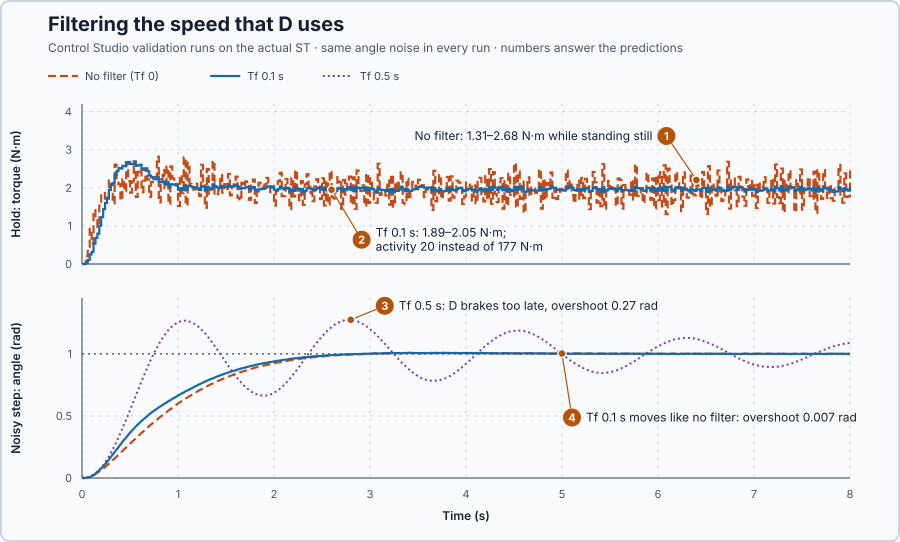

# 37. Derivative filtering

In this lesson, you will smooth the speed that the derivative part uses, so that D still brakes real motion but no longer turns sensor noise into torque noise. You will also see what too much smoothing costs.

## The problem

Lesson 36's PID held the 2 kg weight on target, but while the shaft stood still its torque flickered between 1.31 and 2.68 N·m around the 1.962 N·m it needed. D turned ±0.001 rad of angle noise into about ±0.7 N·m of torque. The motor heats and the gearing wears for nothing.

We will give D a speed estimate that follows the shaft's real motion but not the rapid noise.

## What we need

We need to:

1. see why a speed calculated from readings is so noisy;
2. smooth that speed before D uses it; and
3. choose how much smoothing D can tolerate without braking too late.

## The new idea

A **derivative filter** smooths the speed that D uses, at the cost of braking a little later. That speed is calculated from two noisy angle readings, and it is very noisy, because the noise is divided by a tiny time step.

**In words.** The controller has no speed sensor for D. It calculates the speed from the angle: how far the shaft turned since the last update, divided by the time between updates.

1. **Why the calculated speed is noisy.** Between two updates the real angle changes very little; for a shaft standing still, not at all. But every reading carries a small random error. Dividing the difference by a tiny time step makes that small error into a large apparent speed, and D turns it into torque. Anyone who has calculated a flow from two level readings taken one scan apart knows the result: a slight flicker of the level becomes a wild flow value.
2. **What the filter does.** The filter moves its speed estimate only part of the way towards each new calculated value. Noise jumps up and down from one update to the next, so each jump is mostly undone by the next one. A real motion keeps pushing in the same direction, so the estimate follows it after a short delay. It is the same first-order filter that smoothed the heater's measurement in Lesson 24, now placed in front of D.
3. **What it costs.** The estimate lags behind the real speed, so D brakes later. A little lag does not matter; too much, and D brakes after the shaft has already passed the target, so the swing that D was meant to stop comes back.

For this lesson's shaft, the angle reading flickers by up to ±0.001 rad. The filter must be slow enough to ignore that flicker, yet fast compared with the time over which the approach to a target has to be braked.

**The formula.** The calculated, or raw, speed at update $k$ is

$$
\omega_{raw,k} = \frac{\theta_k - \theta_{k-1}}{\Delta t} .
$$

The filter moves its estimate the fraction $\alpha$ of the way towards it, and D uses the estimate:

$$
\omega_{f,k} = \omega_{f,k-1} + \frac{\Delta t}{T_f + \Delta t}\,(\omega_{raw,k} - \omega_{f,k-1}), \qquad D_k = -K_d\,\omega_{f,k} .
$$

- $k$ counts the updates, and $\theta_k$ and $\theta_{k-1}$ are the measured angles at this update and the one before, in radians;
- $\Delta t = 0.02$ s is the update interval;
- $\omega_{raw,k}$ is the raw speed, in radians per second;
- $\omega_{f,k}$ is the filtered speed, in radians per second;
- $T_f$ is the **filter time**, in seconds: roughly how long the estimate takes to follow a change;
- $\alpha = \Delta t/(T_f + \Delta t)$ is the fraction of the way the estimate moves at each update, without unit; and
- $D_k$ is the derivative torque, in newton-metres, with $K_d$ Lesson 35's derivative gain.

The program filters the angle rather than the speed, $\theta_{f,k} = \theta_{f,k-1} + \alpha(\theta_k - \theta_{f,k-1})$, and `Control.PID` takes the difference of the filtered angle. Subtracting this update from the one before shows that the filtered angle changes by exactly $\omega_{f,k}\,\Delta t$, so D uses $\omega_f$. P and I see the filtered angle too.

**Example: the shaft standing still on target.** The angle noise reaches ±0.001 rad, $\Delta t = 0.02$ s and $K_d = 7$ N·m·s/rad. Follow the numbers:

1. **The raw speed.** Two readings of the still shaft can be $0.001 - (-0.001) = 0.002$ rad apart, so the raw speed is $0.002/0.02 = 0.1$ rad/s and D requests $7 \times 0.1 = 0.7$ N·m: Lesson 36's flicker.
2. **A filter with $T_f = 0.04$ s.** $\alpha = 0.02/(0.04 + 0.02) = 1/3$. A raw jump from 0 to 0.1 rad/s moves the estimate to $0 + \tfrac13 \times 0.1 = 0.033$ rad/s, and D requests $7 \times 0.033 = 0.23$ N·m, a third of the unfiltered torque.
3. **The next jump undoes it.** At the next update the noise reverses and the raw speed is $-0.1$ rad/s: the estimate becomes $0.033 + \tfrac13(-0.1 - 0.033) = -0.011$ rad/s, close to zero again.
4. **A real motion comes through.** The shaft now turns at a steady 1 rad/s, so every raw value is 1 rad/s. The estimate reads 0.33, 0.56, 0.70 rad/s after 1, 2 and 3 updates, and 0.91 rad/s after 6 updates, 0.12 s. With a filter time of 0.04 s, D brakes at more than half strength after 0.04 s and at nine tenths after 0.12 s: the price of the smoothing.
5. **P and I barely notice.** On the filtered angle, P's share of the noise is at most $K_p \times 0.001 = 16 \times 0.001 = 0.016$ N·m.

**The limitation.** The delay sets the limit. Lesson 35's critically damped approach has $\sigma = 4$ per second, so it is braked over about $1/4 = 0.25$ s, the time scale of its $e^{-4t}$. The filter time must stay well below 0.25 s for D to brake in time, and above the 0.02 s update to smooth anything at all. The program's default, $T_f = 0.1$ s, is a teaching choice for this simulated axis.

## Prediction

Before running, with 0.001 rad of noise, $\Delta t = 0.02$ s and $K_d = 7$, answer these questions:

1. How large can the raw speed noise and its derivative torque become?
2. What fraction of a noise jump reaches D with $T_f = 0.1$ s, and what happens to the holding torque?
3. Which filter time weakens the braking noticeably, and how does the step response show it?
4. Does $T_f = 0.1$ s change the shaft's motion?

| $T_f$ | $\alpha$ | Torque from one noise jump |
| ---: | ---: | ---: |
| 0 | 1 | 0.7 N·m |
| 0.1 s | 1/6 | 0.12 N·m |
| 0.5 s | 1/26 | 0.03 N·m, but 0.5 s late |

## Implementation

Open [`src/Main.st`](src/Main.st). It is Lesson 36's program with a filter in front of `Control.PID`. `FilterTimeS` is $T_f$, 0.1 s by default; $T_f = 0$ bypasses the filter. The filter runs in Auto and restarts from the measurement in Manual and at the switch to Auto, so entering Auto stays bumpless.

**ST practice.** Write one filter update for the angle, `FilteredAngleRad := FilteredAngleRad + FilterAlpha * (AngleRad - FilteredAngleRad);` with `FilterAlpha := 0.02 / (FilterTimeS + 0.02);`, and check that 0.001 rad of noise moves `FilteredAngleRad` by 0.000167 rad at $T_f = 0.1$ s. Then open [`src/tests.st`](src/tests.st) and run its tests from the **Testing** view: they check the 0.1 rad/s and 0.7 N·m of the raw estimate, $\alpha = 1/6$, and that the filtered angle's difference is the filtered speed.

## Experiment in Control Studio

The requirements add Lesson 21's command activity, here the sum of all torque changes during a trial: at most 50 N·m in a noisy step and in the loaded hold. The step and hold limits are Lesson 36's.

1. Open this lesson's project and start **Simulator**. In the **truST** side bar, select **Control Studio**. On **Identify**, set **Method** to **Supplied plant model**, select **Open model…** and choose `shaft-model.json`.
2. On **Tune**, choose **Controller** `P1.Controller · PID` with **Manual**: 16 in **Proportional gain (Kp)**, 12 in **Integral gain (Ki)**, 7 in **Derivative gain (Kd)**, 0.3 in **Setpoint weight (β)**, 0 in **Derivative setpoint weight (γ)** and 0 in **Measurement filter time (Tf)**. Select **Requirements…**, enter **Setpoint change (rad)** 1, **Maximum steady-state error (rad)** 0.02, **Maximum settling time (s)** 4, **Settling band (±rad)** 0.01 and **Validation duration (s)** 8, and select **Done**. Select **Tune controller**; on **Validate**, select **Validate controller**.
3. Repeat with 0.5 in **Measurement filter time (Tf)**, then with 0.1. When every row passes, select **Apply**; Control Studio reports **Applied**.
4. Set **Tuning method** to **Automatic**, select **Tune controller**, and validate the result.

To repeat, start again from step 2.

## Evidence and decision

The numbered marks answer the predictions with the same numbers. From the validation runs, all with the same angle noise:

| Result | $T_f = 0$ | $T_f = 0.5$ s | $T_f = 0.1$ s | Automatic |
| --- | ---: | ---: | ---: | ---: |
| Command activity, step / hold | 183 / 177 N·m | 59 / 19 N·m | 29 / 20 N·m | 218 / 185 N·m |
| Step overshoot | 0.008 rad | 0.27 rad | 0.007 rad | 0.25 rad |
| Step settled within 0.02 rad | 2.52 s | no | 2.42 s | 3.12 s |
| Hold: largest error, 4–8 s | 0.0015 rad | 0.066 rad | 0.0014 rad | 0.0020 rad |

1. Without the filter, the holding torque flickered between 1.31 and 2.68 N·m, and the torque changed by 177 N·m in total during the 8 s hold, far above the 50 N·m limit, although the motion was fine.
2. With $T_f = 0.1$ s, the holding torque stayed between 1.89 and 2.05 N·m and the activity fell to 20 N·m in the hold and 29 N·m in the step.
3. With $T_f = 0.5$ s, D braked too late: the step overshot 0.27 rad and the shaft swung through the whole trial.
4. With $T_f = 0.1$ s, the shaft moved as without the filter: 0.007 rad of overshoot, settled at 2.42 s. This candidate passed every row and was applied.

Automatic tuning designs its gains without a filter ($T_f = 0$) and with $\beta = 1$; its candidate failed on activity and overshoot, so choosing the filter time is left to the engineer here. These are simulation results.

## Conclusion

Taking the difference of sampled angles divides their noise by the update time. A first-order filter gives D a smoothed speed and removes most of the noise-driven torque; its delay is the price, so $T_f$ must stay well below the time scale of the motion D has to brake.

For this shaft, $T_f = 0.1$ s cut the torque activity from 177 to 20 N·m while standing still and left the motion unchanged, while $T_f = 0.5$ s made the shaft swing.

## Check yourself

1. **With $T_f = 0.05$ s and $\Delta t = 0.02$ s, what fraction of a noise jump reaches D?**
   $\alpha = 0.02/(0.05 + 0.02) = 0.29$, about two sevenths.
2. **Why does the filter remove noise but not the real motion?**
   Noise reverses at almost every update, so each jump is mostly undone by the next. A real motion keeps pushing the
   same way, so the estimate catches up within about $T_f$.
3. **Why did $T_f = 0.5$ s make the step overshoot?**
   D saw the speed half a second late, longer than the quarter second over which the approach must be braked, so the
   braking torque came after the shaft had already passed the target.

## Reason for the next lesson

P, I and D, the setpoint weight, the limits and the filter now all work in one sampled update, but each part was added separately: knowing the separate terms does not give a correctly ordered complete update.

[Discrete PID](../../03-production-quality-digital-pid/37-discrete-integral-derivative/README.md) writes all the terms as one update in a fixed order.
