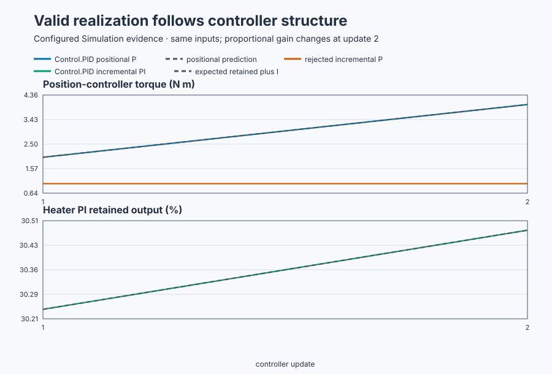

# Positional, incremental, and combined PID realization

Course position: Lesson 26 of 84. Previous lesson:
[Digital realization](../../02-derivative-action-and-dynamic-response/25-servo-digital-realization/README.md).
Next lesson: [Initialization and operating modes](../27-booster-pump-modes/README.md).

**Lesson objective:** Explain and verify why Control.PID uses positional
realization without integral action and incremental realization with integral
action.

**Evidence class:** Simulation evidence. Its results are not physical-plant
evidence.

**Equipment:** Industrial positioning table and recirculating water heater.

## The problem

Lesson 25 turned continuous equations into recurrences with retained state.
Now we must decide which kind of recurrence preserves the intended controller
behavior. The encoder-controlled positioning table needs proportional control, while the
recirculating water heater needs proportional-integral control. Both use the
same shipped `Control.PID` function block. The choice examined here is how that
block updates its output state; it is not a choice between two product
controllers.

Lesson 25 showed that a digital controller executes equations at individual
updates and retains values between them. We cannot safely reuse one update
equation for P, PI, PD, and PID without checking what happens when error or a
gain remains constant.

## What we need

We need to distinguish positional and incremental PID equations so gain edits,
stored state, and the resulting actuator request have one unambiguous meaning.

## The new idea

The **setpoint ($SP$)** is the desired table position in radians or desired water
temperature in degrees Celsius. The **process value ($PV$)** is the corresponding
measured position or temperature. The **error ($e$)** is the setpoint minus the
process value, in the same physical unit as that setpoint.

The **controller output ($u$)** is the actuator request: motor torque in newton
metres for the table or heater power in percent for the heater. The **sample
index ($k$)** identifies the current controller update. The current controller
output is `u[k]`; the retained output from the preceding update is `u[k-1]`.

The **current error ($e_{k}$)** is the current setpoint minus the current process
value. The **previous error ($e_{k-1}$)** is the error retained from the preceding
update. The **error change (Δe[k])** is the current error minus the previous
error.

$\Delta e_{k} = e_{k} - e_{k-1}$

The **sample interval ($T_{s}$)** is 0.02 seconds between updates. The **output bias
($u_{0}$)** is the actuator request at zero error when integral action is disabled.
The **proportional gain ($K_p$)** states how much output is requested per unit of
error. The **integral gain ($K_i$)** states how much output is added per unit of
error per second. The 0.02 s sample interval and the 4, 8, and 0.8 gain values
are configured teaching values carried from Lessons 19–25's positioning table
and Lessons 6–18's water heater, not values measured on new equipment here.

The **positional form** calculates the complete output from the present terms.
For the P controller in this lesson:

$u_{k} = u_{0} + K_{p} \times e_{k}.$

This follows directly from proportional action: multiply the present error by
output-per-error gain and add the zero-error bias. No previous output is needed.

The **incremental form**, also called the **velocity form**, adds calculated
increments to the previous output. It needs one more retained quantity: the
**retained integral contribution ($T_{I,k}$)** is the part of controller
output accumulated from past error up to update $k$, in the same unit as $u$;
Lessons 6 and 7 called this same accumulated quantity $u_I$. Start with a
positional PI equation at two successive samples:

$u_{k} = u_{0} + K_{p}e_{k} + T_{I,k},$

$u_{k-1} = u_{0} + K_{p}e_{k-1} + T_{I,k-1}.$

Subtract the second equation from the first. The unchanged bias cancels,
the proportional difference becomes $K_p(e_k-e_{k-1})=K_p\Delta e_k$, and
backward-Euler integration gives
$T_{I,k}-T_{I,k-1}=K_iT_se_k$. Therefore

$u_{k} = u_{k-1} + K_{p} \times \Delta e_{k} + K_{i} \times T_s \times e_{k}.$

At constant nonzero error, $e_{k} = e_{k-1}$, so $\Delta e_{k} = 0$. An incremental P
calculation with $K_i = 0$ then adds nothing. It can remain stuck at an arbitrary
retained output even when $K_p$ changes. Positional P instead recalculates the
complete output immediately.

There is a second problem during a gain change. The exact proportional
difference would be $K_{p,k}e_k-K_{p,k-1}e_{k-1}$, not
$K_{p,k}(e_k-e_{k-1})$. At unchanged error, the latter is zero and misses the
new proportional demand. Positional P has no such ambiguity because it
recalculates the complete present term.

When $K_i$ is nonzero, the integral increment keeps changing output while error
remains. In the shipped PI/PID contract, retaining output is also intentional:
tracking and anti-windup can correct that state, and changing $K_p$ need not
create a sudden full proportional-output jump. This is a chosen bumpless gain
semantics, not a claim that every arbitrary retained state is valid.

The **combined form** is the shipped design: `Control.PID` uses positional form
when $K_i = 0$ and incremental form when $K_i$ is nonzero. There is no form switch
for the operator to set incorrectly. Positional and incremental describe the
update realization. Parallel, ideal, and series describe PID parameter forms;
they are a different subject and are not interchangeable names.

## Prediction

Hold table error at 0.5 rad. At 4 N m/rad, positional P requests:

$u = 4 N m/rad \times 0.5 rad = 2 N m$

Changing gain to 8 N m/rad predicts 4 N m. The rejected incremental-P
calculation starts at an arbitrary 1 N m. Because its error change is zero, it
adds zero and remains at 1 N m after the gain change.

For the heater, error is 15 °C, integral gain is 0.8 %/(°C s), and the sample
interval is 0.02 s. The expected integral increment is:

$K_i \times T_{s} \times e = 0.8 \%/({}^\circ\mathrm{C} s) \times 0.02 s \times 15 {}^\circ\mathrm{C} = 0.24\%$

Predict an immediate 2 N m positional-P gain response, no rejected
incremental-P response, and no PI output jump beyond the expected 0.24 percent
integral increment.

## Implementation

The actual lesson sets zero integral gain for the table and nonzero integral
gain for the heater once, at cold initialization. Every scan then reconfigures
both controllers with the current gains before calling the same product
function block:

```st
PositionParameters.ProportionalGain := PositionProportionalGain;
PositionController.Configure(Parameters := PositionParameters);
HeaterParameters.ProportionalGain := HeaterProportionalGain;
HeaterParameters.IntegralGain := HeaterIntegralGain;
HeaterController.Configure(Parameters := HeaterParameters);
```

The per-scan input assembly and Manual/Auto mode selection are omitted here;
both controllers then update from the same per-scan inputs:

```st
PositionTorque := PositionController.Update(Input := PositionInput);
HeaterPower := HeaterController.Update(Input := HeaterInput);
```

The rejected incremental-P calculation is retained only as a diagnostic. It is
never connected to a plant output and is not another controller implementation.

## Experiment in Control Studio

Test writes one reviewed Boolean authority, $\mathtt{P1.ExperimentEnabled}$,
for 30.02 seconds. The project owns a visible two-plant sequence: it begins from
Manual zero, applies the table and heater setpoints with both proportional
gains at 4, changes both gains to 8 after 5 seconds, and restores both plants to
Manual zero when authority returns false.

The live plants move, so their gain-change samples are useful operational
evidence but are not the exact unchanged-error proof. The native test uses
fresh controller states and frozen input samples to own the exact 2 N·m,
1 N·m, and 0.24% comparison. The deterministic Simulation seed is 20260829.

### Control Studio actions

1. **Monitor** — Select target **Simulator**, choose **Run**, then open **Control Studio → Monitor → Response**.
   - **Baseline check:** Wait for **Simulation**, **Running**, current samples, and good quality. Confirm table SP = 0 rad, heater SP = 20 °C, both outputs = 0, and Manual mode; gains and selected form are not bound signals and are confirmed from the written plan instead. Add both SP/PV/MV triples, the rejected diagnostic, positional prediction, and experiment authority to **Signals**.
   - **Decision before action:** Write the exact fixed-sample predictions: positional P 2→4 N·m, rejected incremental P 1→1 N·m, and PI integral increment 0.24%. State that moving-plant samples cannot substitute for the fixed-sample native proof because only the native comparison holds inputs exactly constant across the gain change.
   - **Successful evidence:** The plot advances, values are finite/current, quality is good, and **Start recording** is enabled. Select **Start recording**.
   - **Recovery:** For stale, unavailable, nonfinite, or poor-quality data, stop the Simulator, correct the displayed fault, restart, and repeat the baseline check.
   - **Record:** Note the complete initial state and the three written predictions.

2. **Test** — Open **truST sidebar → Control Studio → Test**.
   - **Baseline check:** Confirm **Experiment** = **Observe without excitation**, **Amplitude** = **0** (disabled), and **Maximum duration (s)** = **30.02**. The reviewed authority is **Experiment authority** (`P1.ExperimentEnabled`). The project owns both setpoints, both gain changes, and mode.
   - **Decision before action:** Confirm that the plan writes only the Boolean and restores it false. Require table position within ±4 rad, torque within ±10 N·m, temperature within 0–80 °C, and heater power within 0–100%.
   - **Successful evidence:** Select **Review test**, verify authority, timeout, stop conditions, and false restoration, then **Confirm and start**. Keep **Abort test** available. Observe both gain changes, the selected-form indicators, the rejected diagnostic remaining disconnected, and final Manual-zero restoration.
   - **Recovery:** Abort for nonfinite, stale, out-of-limit data or any indication that the rejected diagnostic drives an output. Confirm authority false, safe setpoints, Manual mode, and zero outputs before retrying.
   - **Record:** Retain the terminal state, restoration, gain-change timestamp, both plant traces, selected forms, diagnostic values, limit states, and seed.

There is no separate disabled Validate stage. The native test owns the exact
unchanged-error calculation; Monitor and Test expose the safe live sequence.

## Evidence and decision

Over the exact fixed-input native comparison, define the **immediate
gain-change output difference** as the change in output caused by one
controller update immediately after the gain edit:

$\Delta u_{\mathrm{gain}} = u_{\mathrm{after}} - u_{\mathrm{before}}.$

For positional P this must be $4-2=2$ N·m. Define rejected-state error as

$e_{\mathrm{state}}= |u_{\mathrm{positional,prediction}}-u_{\mathrm{rejected}}|.$

The absolute value measures disagreement regardless of sign; here it is
$|4-1|=3$ N·m. Finally define the **PI output discontinuity** by removing the
expected integral increment from the observed change:

$d_{\mathrm{PI}} = \Delta u_{\mathrm{observed}} - K_{i} \times T_s \times e.$

A value of zero means the gain edit introduced no extra jump beyond the
expected integral increment.

| Observation | Executable result | Required interpretation |
| --- | ---: | --- |
| Positional P torque | 2.000 → 4.000 N m | responds to changed $K_p$ |
| Rejected incremental-P output | 1.000 → 1.000 N m | stuck at arbitrary state |
| PI discontinuity after expected increment | 0.000% | retains prior output |



[Retained run](figures/pid-forms-run.csv) ·
[Plot data](figures/pid-forms-trace.csv) ·
[Decision summary](figures/pid-forms-summary.csv)

These measures are invalid if saturation or rate limiting is active; report the
limit state instead of attributing a bounded output to the unrestricted law.

Repeat from identical initial state. Require the positional P output difference
to equal 2 N m, its prediction error to be within 0.000000001 N m, the rejected
state error to be at least 3 N m, and the absolute PI discontinuity after the
expected integral increment to be at most 0.000000001 percent. Then let both
simulator plants advance for 5 seconds. The retained run must contain all 250
updates for each plant, and must show finite signals, the selected realization,
and the applied limit state on every update.

## Conclusion

The two realizations are related equations, but they do not preserve the same
behavior for every controller type and state transition. Pure incremental P has
no term that corrects an arbitrary retained output at constant error. PI has a
nonzero integral increment and benefits from retaining output for practical
tracking and anti-windup behavior.

The valid engineering choice is therefore automatic: positional for P or PD,
incremental for PI or PID.

## Reason for the next lesson

Use `Control.PID` for all four controller types and let $K_i$ select its internal
realization. Do not add a user-selectable form parameter. Initialization,
manual, tracking, disabled, and transition behavior are still unresolved;
Lesson 27 tests them on a booster pump.
