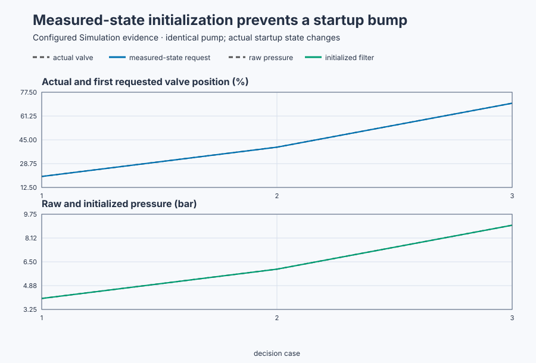

# Initialize a booster-pump controller before Auto

Course position: Lesson 27 of 84. Previous lesson:
[PID realization forms](../26-pid-forms/README.md). Next lesson: Bumpless transfer
and [external tracking](../28-booster-pump-bumpless-transfer/README.md).

**Lesson objective:** Initialize controller and filter histories from the
running booster pump, distinguish Disabled, Manual, Auto, and Track authority,
and block Auto until startup state is qualified.

This lesson uses simulation. Its results are not physical-plant evidence.

**Equipment:** Variable-speed booster pump with recirculation valve.

## The problem

Lesson 26 established that a production PI controller retains output and signal
history. This lesson asks where that history comes from when software joins a
process that is already running. A variable-speed booster pump is already running when its pressure controller
starts. A recirculation valve is 40 percent open and discharge pressure is
6 bar. Starting software does not make those physical values zero.

The station's declared Disabled action commands 30 percent recirculation. A
physical startup additionally requires reviewed piping, independent valve
feedback, pump protection, and explicit approval.

Lesson 26 showed that a digital controller retains output and previous signals.
If those histories or the pressure filter start at arbitrary zero values, the
first controller request can disagree sharply with the already-running valve.

The controller and filter histories must match that physical state before Auto
is allowed. Disabled, Manual, Auto, and Track must also have one explicit owner
of the applied valve command.

## What we need

We need explicit ownership and initialization rules for Disabled, Manual, and
Auto so enabling control cannot create an unexplained pressure or valve jump.

## The new idea

The **discharge-pressure setpoint ($SP$)** is the desired pump discharge pressure
in bar. The **raw discharge pressure ($PV_{\mathrm{raw}}$)** is the value received directly
from the pressure sensor in bar. The **filtered discharge pressure
($PV_{\mathrm{filtered}}$)** is the pressure supplied to the controller after the low-pass
filter, also in bar.

The **actual valve position ($MV_{\mathrm{actual}}$)** is independent position feedback from
the recirculation valve, measured in percent. The **requested valve command
($MV_{\mathrm{requested}}$)** is the controller result in percent. The **applied valve
command ($MV_{\mathrm{applied}}$)** is the value accepted by the simulated actuator after
its limits. These three values shall not be assumed equal.

The **nominal controller output ($u_{\mathrm{nominal}}$)** is the controller's retained
output before final amplitude and rate limits. The **previous setpoint
($SP_{\mathrm{previous}}$)** and **previous process value ($PV_{\mathrm{previous}}$)** are retained signal
histories used by the incremental controller.

**Initialization** copies known present conditions into these histories. It
performs no control calculation, integration, differentiation, limiting, or new
actuator command.

`Control.PID` implements three modes. **Manual** uses the supplied manual
output. **Auto** performs the feedback calculation. **Track** first aligns the
retained nominal output with an external tracking value and then executes the
normal nonmanual branch.

**Disabled** is station-level supervision and is not a `PIDMode`. Disabled does
not call `Control.PID`; the station applies its declared safe command. This
keeps plant safety policy outside the paper-compatible three-value enum.

The **filter-settled indication** becomes true only after filtered and raw
pressure differ by no more than 0.01 bar for three consecutive 100 ms updates.
Until initialization is complete and this indication is true, a request for
Auto remains under Manual authority at the actual valve position.

The simulator's local equilibrium says that discharge pressure rises by
0.1 bar for every percentage point of valve position, above a 2 bar base:

\[
PV_{\mathrm{eq}}=2\ \mathrm{bar}
+(0.1\ \mathrm{bar/\%})MV.
\]

This is a bounded first-order teaching model, not a pump curve.

## Prediction

The model has 2 bar at zero valve command. Each percentage point adds 0.1 bar,
so substitution gives \(2+0.1(20)=4\) bar,
\(2+0.1(40)=6\) bar, and \(2+0.1(70)=9\) bar. Set SP equal to the corresponding
PV in each startup case so initial feedback error is zero.

With measured-state initialization, error and signal differences are zero and
retained output equals $MV_{\mathrm{actual}}$. The first permitted Auto request should
therefore be 20, 40, or 70 percent respectively.

With zero histories at the 40% case, the filter begins at zero even though its
input is 6 bar. From Lesson 23, one stage uses
\(a=\Delta t/(\tau+0.5\Delta t)\). Here

\[
a=\frac{0.1}{0.5+0.5(0.1)}=0.181818.
\]

The first stage moves to \(0+a(6-0)=1.09091\) bar. The second identical stage
moves to

\[
0+a(1.09091-0)=0.19835\ \mathrm{bar}.
\]

That 0.198 bar is an invented startup transient, not a pressure the sensor
measured. The controller's retained applied output is also zero. Its rate limit
is 100 percentage points per second, so one 0.1-second update may move by only

\[
\Delta MV_{\max}=100(0.1)=10\%.
\]

The large false error asks for more, but limiting produces a first request of
10%, 30 percentage points away from the physical 40% valve position.

## Implementation

The conforming startup initializes the real product filter and controller:

```st
PressureFilter.Initialize(Input := RawPressure);
InitialState.Setpoint := Setpoint;
InitialState.ProcessValue := RawPressure;
InitialState.NominalOutput := ActualValvePosition;
InitialState.SaturatedOutput := ActualValvePosition;
Controller.Initialize(State := InitialState);
```

The mode supervisor then invokes this one `Control.PID` instance or performs
the external Disabled action. There is no parallel controller path.

## Experiment in Control Studio

Control Studio executes the measured-state 40% startup. Test writes one
reviewed Boolean authority, \(\mathtt{P1.ExperimentEnabled}\), for 10.1 seconds.
Its rising edge makes one atomic initialization request from SP 6 bar, raw
pressure 6 bar, and actual valve feedback 40%. The project requests Auto, but
the supervisor keeps Manual authority at the actual 40% position until the
filter has met its 0.01 bar condition for three consecutive 100 ms updates.
Returning authority false selects station Disabled and its declared safe 30%
recirculation command.

Fresh native runtimes own the deliberately unsafe zero-state baseline and the
20%, 40%, and 70% measured-state comparisons. One UI run must not claim those
four independent initial states. The deterministic Simulation seed is 20260829.

### Control Studio actions

1. **Monitor** — Start the **Simulator**, then open **truST sidebar → Control Studio → Monitor → Response**.
   - **Baseline check:** Wait for **Simulation**, **Running**, current samples, and good quality. Confirm SP/raw PV = 6 bar, actual valve = 40%, station Disabled, requested/applied safe command = 30%, controller not ready, filter not settled, and experiment authority false. Add raw/filtered pressure, actual/requested/applied valve, requested mode, active authority, ready/settled/blocked states, and experiment authority to **Signals**.
   - **Decision before action:** Write the measured-state prediction of zero initialization error and first Auto request 40%. Also write the rejected zero-state predictions 0.198 bar and 10%, but do not expect the UI run to execute that unsafe baseline.
   - **Successful evidence:** The plot advances, all values are finite/current, quality is good, and **Start recording** is enabled. Select **Start recording**.
   - **Recovery:** For stale, unavailable, nonfinite, or poor-quality data, stop the Simulator, correct the displayed fault, restart, and repeat the baseline check.
   - **Record:** Note the complete initial physical state, ownership state, and both prediction sets.

2. **Test** — Open **truST sidebar → Control Studio → Test**.
   - **Baseline check:** Confirm **Experiment** = **Observe without excitation**, **Amplitude** = **0** (disabled), and **Maximum duration (s)** = **10.1**. The reviewed authority is \(\mathtt{P1.ExperimentEnabled}\); the project owns initialization and requested mode.
   - **Decision before action:** Confirm the plan writes only that Boolean and restores it false. Require raw/filtered pressure within 0–12 bar and all valve values within 0–100%. Auto must not become active before ready and three settled samples.
   - **Successful evidence:** Select **Review test**, verify authority, timeout, stop conditions, and false restoration, then **Confirm and start**. Keep **Abort test** available. Observe one initialization, three Manual settling updates, Auto at 40%, stable 6 bar pressure, and final Disabled 30% restoration.
   - **Recovery:** Abort for nonfinite, stale, out-of-range data or premature Auto authority. Confirm authority false, station Disabled, and requested safe command 30% before retrying.
   - **Record:** Retain terminal state, false restoration, initialization sample, readiness/settling sequence, first Auto request, equilibrium drift, active authority, limits, and seed.

There is no separate disabled Validate stage. The native test owns the unsafe
baseline and all three equilibria; Monitor and Test expose the safe 40% start.

## Evidence and decision

### Measures and comparison

The **first-update valve mismatch** is

\[
e_{MV,1}=|MV_{\mathrm{requested},1}-MV_{\mathrm{actual}}|.
\]

The absolute value measures bump size regardless of direction, in percentage
points. The **filter initialization error** is

\[
e_{filter,0}=|PV_{\mathrm{filtered},0}-PV_{\mathrm{raw},0}|.
\]

It is evaluated immediately after initialization, before plant evolution can
hide an invented filter state.

| Initialization | Actual valve | First request | Filtered pressure | Result |
| --- | ---: | ---: | ---: | --- |
| Zero-state baseline | 40.0% | 10.000% | 0.198 bar | reject |
| Measured state | 20.0% | 20.000% | 4.000 bar | accept |
| Measured state | 40.0% | 40.000% | 6.000 bar | accept |
| Measured state | 70.0% | 70.000% | 9.000 bar | accept |



[Retained run](figures/booster-pump-startup-run.csv) ·
[Plot data](figures/booster-pump-startup-trace.csv) ·
[Decision summary](figures/booster-pump-startup-summary.csv)

If a valve limit or rate limit changes the request, report that state and do
not call the bounded result an initialization calculation.

### Validation

Require measured-state first-update mismatch and filter initialization error to
be at most `1e-9`. The deliberate zero-state mismatch must be at least
10 percentage points. After measured initialization at 40 percent, run the
real simulator for 10 seconds and require final pressure within 0.05 bar of
6 bar and valve request within 0.5 percentage points of 40 percent. Retain the
zero-state rejection, all three measured-state starts, Disabled, Manual, Track,
and the complete 10-second startup history so the result can be reproduced.

## Conclusion

The controller cannot infer the running valve position from its equations.
Likewise, a filter initialized to zero invents a pressure transient that the
plant never produced. Copying actual SP, PV, valve feedback, and filter input
creates histories that describe the physical starting condition.

Modes identify who owns the command. Initialization determines whether that
owner starts from truthful state. Both are observable controller behavior.

## Reason for the next lesson

Use independent actuator feedback and present measurements whenever a
controller joins an already-running process. Keep Auto blocked until state and
signal quality are qualified. Lesson 28 tests bumpless Manual, Track, and Auto
transitions after this safe startup foundation exists.
