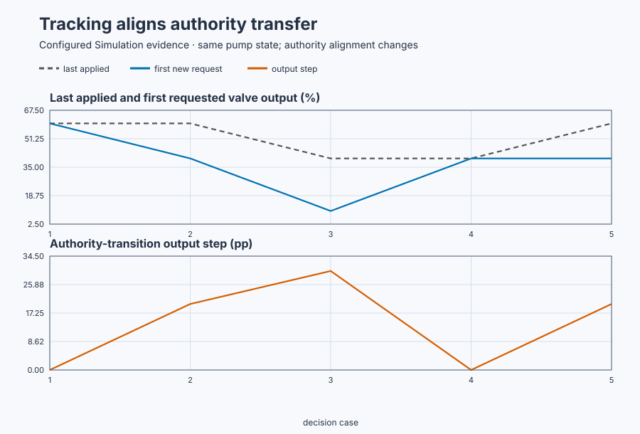

# Bumpless authority transfer on a booster pump

Course position: Lesson 28 of 84. Previous lesson:
[Booster-pump initialization and modes](../27-booster-pump-modes/README.md). Next
lesson: [Atomic parameter updates and signal ordering](../29-booster-pump-atomic-update/README.md).

**Lesson objective:** Transfer valve authority between an external station,
Auto, and Manual without an avoidable command step and identify boundaries
where exact bumpless transfer is infeasible.

**Evidence class:** Simulation evidence. Its results are not physical-plant
evidence.

**Equipment:** Variable-speed booster pump with external valve authority.

## The problem

The equipment is variable-speed booster pump with external valve authority.
Lesson 27 made the booster-pump controller truthful at startup, but that is
only the first handover. An external station can nevertheless take valve authority and move the valve
while the pressure controller is inactive. The controller must remain aligned
if it may take authority again.

Correct startup state becomes stale when another authority changes the physical
output. We now compare continuous tracking with an inactive controller that
receives no applied-output information.

An inactive controller must continue receiving the applied valve position from
the current owner, or its retained output becomes stale. The handover is judged
at the exact authority-change sample, including cases where matching is
physically impossible.

## What we need

We need the automatic controller to inherit the valve position already applied
in Manual so transferring authority does not itself disturb discharge pressure.

## The new idea

The **authority owner** is the station currently permitted to command the
recirculation valve. The **external applied valve output
($MV_{\mathrm{external\,applied}}$)** is the externally commanded and physically accepted
valve position in percent.

The **tracking input ($MV_{\mathrm{track}}$)** is the independently observed applied output
supplied to the inactive pressure controller, in percent. The **retained nominal
output ($u_{\mathrm{nominal}}$)** is the output held as controller state before final limits.
The **last applied output ($MV_{\mathrm{last}}$)** is the physical valve value immediately
before ownership changes. The **transition instant ($t_{\mathrm{transfer}}$)** is the exact
controller update at which the new authority begins.

**Bumpless transfer** means that the first requested output from the new
authority ($MV_{\mathrm{first}}$) equals the last physically applied output
($MV_{\mathrm{last}}$) within a declared tolerance. It does not mean pressure
is already at SP or that later feedback increments must be zero.

With integral action, Track first writes
$u_{\mathrm{nominal},k-1}=MV_{\mathrm{track}}$, then evaluates the incremental
law from Lesson 26:

$u_k=u_{k-1}+K_p\Delta e_k+K_iT_se_k.$

At the isolated handover, SP = PV, so $e_k=0$, and neither changes, so
$\Delta e_k=0$. Substitution gives

$u_k=MV_{\mathrm{track}}+K_p(0)+K_iT_s(0) =MV_{\mathrm{track}}.$

That is why a fresh, independently observed 60% tracking value predicts a 60%
first Auto request. An **inactive without tracking** controller receives no
update and retains stale state.

For Auto-to-Manual transfer, the external manual station must adopt the current
applied output before taking authority. `Control.PID` cannot make an unrelated
manual command bumpless after the supervisor has selected it.

There are boundaries. In P or PD positional control, tracking has no aligning
effect in the paper-compatible controller. Exact transfer is also infeasible
when applied-output feedback is stale, the desired value is outside limits, a
rate constraint is binding, or SP or PV changes without being included in the
prediction.

## Prediction

Start with controller and valve at 40 percent, SP at 6 bar, and PV at 6 bar.
External authority moves the valve to 60 percent while SP and PV are held for
the exact transition update.

With Track, $u_{\mathrm{nominal}}$ becomes 60%, so the first Auto request is
60%. The step is $|60-60|=0$ percentage points. Without Track,
$u_{\mathrm{nominal}}$ remains 40%, so the step from the last applied 60% is
$|40-60|=20$ points.

For Auto-to-Manual at 40%, a manual station still set to 10% produces
$|10-40|=30$ points. If it first adopts 40%, the predicted step is
$|40-40|=0$.

## Implementation

The same single product controller receives the external applied value in
Track, then changes to Auto:

```st
Input.Mode := PIDMode#Track;
Input.TrackingOutput := TrackingOutput;
ValveCommand := Controller.Update(Input := Input);
```

The simulation-only untracked baseline applies `ExternalOutput` while
deliberately not calling the controller. It is not another control law.

## Experiment in Control Studio

Control Studio executes the safe tracked external-to-Auto handover. Test writes
one reviewed Boolean authority, $\mathtt{P1.ExperimentEnabled}$, for 10.1
seconds. The project initializes controller and valve at 40% and 6 bar, calls
Track with independently observed applied output while external authority moves
to 60%, then changes only authority to Auto. Returning authority false selects
station Disabled and its safe 30% command.

Fresh native controller states own the untracked, stale-tracking, aligned
Manual, and unaligned Manual comparisons. One UI sequence must not claim those
independent counterfactuals. The deterministic Simulation seed is 20260829.

### Control Studio actions

1. **Monitor** — Select target **Simulator**, choose **Run**, then open **Control Studio → Monitor → Response**.
   - **Baseline check:** Wait for **Simulation**, **Running**, current samples, and good quality. Confirm pressure = SP = 6 bar, external/tracking values = 40%, station Disabled, and requested safe command = 30%. Add SP/PV, external applied output, tracking input, manual station output, requested authority, and experiment authority to **Signals**.
   - **Decision before action:** Write the tracked prediction $|60-60|=0$ and the untracked counterfactual $|40-60|=20$ percentage points. Confirm tracking comes from applied output, not an unconstrained request, because only the physically applied value describes what the new authority must match.
   - **Successful evidence:** The plot advances, values are finite/current, quality is good, and **Start recording** is enabled. Select **Start recording**.
   - **Recovery:** For stale, unavailable, nonfinite, or poor-quality data, stop the Simulator, correct the displayed fault, restart, and repeat the baseline check.
   - **Record:** Note the initial physical state, owner, tracking source, and both predictions.

2. **Test** — Open **truST sidebar → Control Studio → Test**.
   - **Baseline check:** Confirm **Experiment** = **Observe without excitation**, **Amplitude** = **0** (disabled), and **Maximum duration (s)** = **10.1**. The reviewed authority is **Experiment authority** (`P1.ExperimentEnabled`). The project owns initialization, external move, Track calls, and Auto handover.
   - **Decision before action:** Confirm the plan writes only that Boolean and restores it false. Require pressure within 0–12 bar and every valve value within 0–100%. Tracking quality must remain current through the handover.
   - **Successful evidence:** Select **Review test**, verify authority, timeout, stop conditions, and false restoration, then **Confirm and start**. Keep **Abort test** available. Observe external output and tracking move together to 60%, Track active before Auto, the transition sample, and final Disabled safe restoration.
   - **Recovery:** Abort for stale tracking, nonfinite/out-of-range data, a binding limit, or unexpected ownership. Confirm authority false, station Disabled, and safe 30% command before retrying.
   - **Record:** Retain terminal state, restoration, tracking source/quality, last applied output, first Auto
     request, transition step, authority states, subsequent recovery, limits, and seed. The
     deterministic seed is **20260829**. The inherited limitation under test is: The inactive controller remains at 40 percent while external authority moves the valve to 60 percent, creating a 20 percentage-point step when Auto takes authority. The decision this run supports
     is: Feed independently observed applied output to Track throughout external authority, then change only authority to Auto.

There is no separate disabled Validate stage. The native test owns all exact
aligned and unaligned comparisons; Monitor and Test expose the safe handover.

## Evidence and decision

The **authority-transition output step** is

$\Delta MV_{\mathrm{transfer}}= |MV_{\mathrm{first}}-MV_{\mathrm{last}}|.$

The absolute value measures bump size regardless of opening or closing
direction, in percentage points.

The **retained-state alignment error** is
$e_{\mathrm{align}}=u_{\mathrm{nominal}}-
MV_{\mathrm{external\,applied}}$ immediately before transfer. Its sign shows
which way controller state is stale; its magnitude gives the predicted bump
when the other incremental terms are zero. A zero PV error does not prove this
state is aligned.

| Transition | Last applied | First new request | Output step |
| --- | ---: | ---: | ---: |
| Tracked external → Auto | 60.000% | 60.000% | 0.000 pp |
| Untracked external → Auto | 60.000% | 40.000% | 20.000 pp |
| Unaligned Auto → Manual | 40.000% | 10.000% | 30.000 pp |
| Aligned Auto → Manual | 40.000% | 40.000% | 0.000 pp |
| Stale 40% tracking while actual output is 60% → Auto | 60.000% | 40.000% | 20.000 pp |



[Retained run](figures/bumpless-transfer-run.csv) ·
[Plot data](figures/bumpless-transfer-trace.csv) ·
[Decision summary](figures/bumpless-transfer-summary.csv)

Require the tracked and aligned steps to be at most 0.001 percentage points.
The diagnostic untracked and unaligned cases must expose at least 20 and
30 percentage points respectively. Reject the comparison if tracking quality
is invalid or an amplitude or rate limit masks the unrestricted request.

After the transition measurement, release the held PV and assess pressure
recovery separately; subsequent feedback action is not a transfer bump. In the
retained simulation, post-transition recovery reaches 6.266 bar after
10 seconds.

## Conclusion

The controller that may own the valve next needs the applied value from the
station that owns it now. Track provides that state alignment for PI and PID.
Likewise, the manual station owns its command and must align it before taking
authority.

Bumpless transfer is therefore a contract between controller and supervisor,
not a property the PID can guarantee in isolation. Stale tracking makes an exact
transfer infeasible. If tracking says 40 percent while independently measured
actuator output is 60 percent, the controller is missing 20 percentage points
of the physical state it must match.

## Reason for the next lesson

Apply the same tracking contract before selectors, cascade handover, parallel
gain schedules, and redundant controllers. Record infeasible limits rather than
promising a zero step. Lesson 29 tests atomic configuration and signal ordering
inside each authoritative update.
