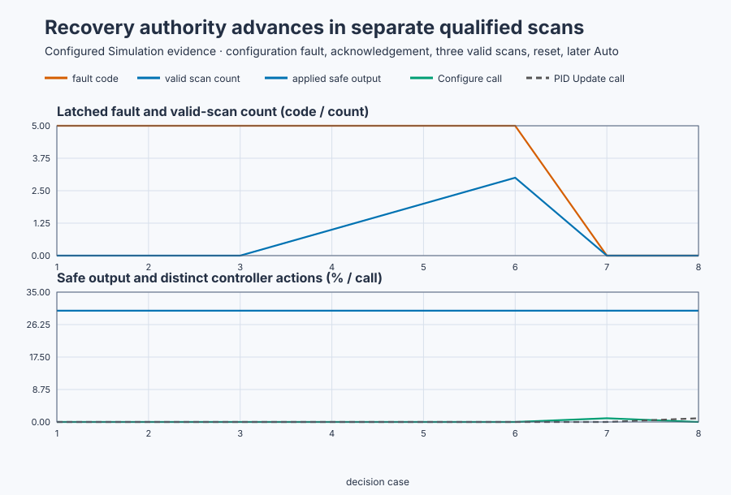

# Invalid data and safe recovery on a booster pump

Course position: Lesson 30 of 84. Previous lesson: [Atomic PID updates and
signal ordering](../29-booster-pump-atomic-update/README.md). Next lesson:
Controller selection.

**Lesson objective:** Map each invalid input class to a deterministic fault,
prove the invalid scan cannot update the PID, and restore Auto only after
acknowledgement, valid evidence, and state reinitialization.

This lesson uses simulation. Its fault injections are not physical-plant
evidence and shall not be reproduced on a running pump for training.

**Equipment:** Variable-speed booster pump with recirculation valve.

## The problem

The equipment in this lesson is Variable-speed booster pump with recirculation valve.

The booster pump depends on pressure, valve feedback, sensor quality, timing,
and configuration data every scan. A plausible number can be stale. A fresh
number can be outside the equipment range. A complete record can still contain
reversed limits.

The station must decide whether its inputs are trustworthy before calling the
controller.

Lesson 29 made valid configuration and signal ordering coherent. It did not
answer what happens when the coherent record or a live signal is invalid.
Allowing one bad scan into the PID could corrupt retained state and affect many
later scans.

## What we need

We need invalid measurements and invalid configuration values to be rejected before they can update retained controller state. Recovery must require a known safe output, acknowledgement, qualified data, reinitialization, and renewed authority.

## The new idea

The **valid numeric domain** contains finite numbers that arithmetic can use.
The **physical plausibility range** contains values the equipment can actually
produce safely. Both checks are required.

The **data quality** says whether the acquisition path considers a sample
usable. The **measurement age** is elapsed time since that sample was acquired.
The **freshness limit** is its maximum permitted age. Here good quality and age
from 0 through 0.5 seconds are both required.

The **measured cycle time ($\Delta t$)** is actual elapsed time between controller
updates. A **deadline** is the latest acceptable completion time. A
**watchdog** independently detects a missed deadline. This lesson accepts `dt`
above zero through 0.2 seconds and separately rejects a missed-deadline input.

A **fault cause** identifies the invalid class. The **first-fault latch** keeps
the first detected cause visible even if another fault appears later. The
**acknowledgement** records that an operator saw the fault; it does not clear
the latch.

A **hold-last output** preserves the previous actuator command. That can
preserve the action that created a hazard. The reviewed teaching topology
therefore chooses a **safe output** of 30 percent recirculation. A real plant
requires its own process-safety review.

Nonfinite data is rejected by the runtime's typed I/O boundary before the PLC
scan. The station guard then rejects finite but implausible values. Pressure
must be 0 through 12 bar and valve feedback must be 0 through 100 percent.

The stable diagnostic map is: code 1 means invalid numeric or physical range;
code 2 means stale or bad-quality measurement; code 3 means invalid cycle
time; code 4 means missed deadline; and code 5 means invalid configuration.
Code 0 means no active fault.

An invalid scan does not call the PID and does not call `Configure`. It cannot
advance the active revision. Recovery requires acknowledgement, three
consecutive valid scans after the acknowledgement scan, explicit reset, state
initialization, and a separate renewed Auto request on a later scan. The
acknowledgement scan clears no fault and leaves the recovery count at zero.

## Prediction

Begin at 6 bar and 40 percent with active revision 0. Apply a candidate with an
80 percent output minimum and a 20 percent output maximum.

The limits are reversed, so the prediction is code 5, revision 0, no PID or
configuration call, and 30 percent safe output. Correct values alone cannot
clear the latch.

After the acknowledgement scan leaves the count at zero, valid scan 1 advances
it to one, valid scan 2 advances it to two, and valid scan 3 advances it to
three. Reset then uses present setpoint, process value, and actual valve
feedback to initialize the controller. With actual feedback at 30 percent, the
reset scan predicts **30.000 percent**. It calls `Configure` and `Initialize`,
but it does not call the PID update. At zero error, the separate renewed Auto
scan calls the PID update and also predicts **30.000 percent**.

## Implementation

The station guard owns validity and authority. The same single `Control.PID`
from previous lessons is called only on a valid, authorized scan:

```st
IF FaultLatched THEN
    ValveCommand := LREAL#30.0;
ELSIF ControllerReady AND EnableAutoRequest THEN
    ValveCommand := Controller.Update(Input := Input);
END_IF;
```

Qualified reset configures the last accepted active record and calls
`Controller.Initialize` with current SP, PV, and actual valve output. It does
not call `Update` or grant Auto on that scan.

## Experiment in Control Studio

This procedure tests one declared lesson change under controlled conditions. Correct the data without reset, acknowledge, gather three consecutive valid scans, request reset with Auto false, then issue a separate renewed Auto request on the following scan. The declared event lasts 10 seconds. It restores Discharge pressure to 6 bar afterward. The deterministic Simulation seed is 20260829.

### Control Studio actions

1. **Monitor** — Start the **Simulator**, then open **truST sidebar → Control Studio → Monitor → Response**.
   - **Baseline check:** Wait until the header shows **Simulation**, **Running**, and current data. Confirm Discharge-pressure setpoint (SP, bar); Discharge pressure (PV, bar); Applied valve command (MV, %), including units, limits, mode, and quality. The initial operating point is Discharge-pressure setpoint = 6 bar, Discharge pressure = 6 bar, Applied valve command = 40 %, Sensor age = 0 s, Measured cycle time = 0.1 s. The unresolved baseline problem is: Without a guard, reversed output limits could reach configuration arithmetic or partially replace the active record.
   - **Decision before action:** Read **Prediction** above, then state what should move first and in which direction. Use this decision rule: Reject the scan before any PID call, latch the first cause, command the safe output, and require acknowledgement, qualified data, reset, state initialization, and renewed Auto authority.
   - **Successful evidence:** The Response plot advances, the displayed values are finite and current, and **Start recording** is enabled. Select **Start recording** only after those conditions are visible.
   - **Recovery:** If recording is disabled or the plot reports unavailable or stale samples, stop the Simulator, correct the displayed runtime or binding problem, restart it, and repeat the baseline check.
   - **Record:** Write down the initial SP, PV, requested/applied MV where available, controller mode, and your predicted response before opening Test.

2. **Test** — Restart the **Simulator** from the declared initial state, then open **truST sidebar → Control Studio → Test**.
   - **Baseline check:** Confirm **Experiment** = **Observe without excitation**, **Amplitude** = **0** (disabled), and **Maximum duration (s)** = **10**. The observed lesson signal is **Discharge pressure**. Control Studio observes the project's existing timed sequence and does not write a second process event.
   - **Decision before action:** Before selecting **Review test**, predict the response to 13 bar finite out-of-range pressure. Confirm the live values are current and the reviewed plan stays inside Discharge pressure 0 bar to 12 bar; Applied valve command 0 % to 100 %.
   - **Successful evidence:** Select **Review test**, verify the affected signal, bounds, stop conditions, and restoration, then select **Confirm and start**. The state changes to **Running**, **Abort test** remains available, and the terminal state reports completion and restoration.
   - **Recovery:** For a rejected, stale, unsafe, unavailable, failed, or aborted state, read the displayed reason, stop and restart the Simulator, correct that cause, restore the initial state, and review a new test.
   - **Record:** Compare the observed event with your prediction and retain the terminal state, restoration result, and deterministic seed **20260829**.

3. **Validate** — Open **truST sidebar → Control Studio → Validate**.
   - **Baseline check:** **Run required validation** is disabled because no shared Control.PID candidate exists. **Requirement details** and **Save result** cannot be used to claim a shared result; project-owned validation is executed by the runnable project's declared oracle.
   - **Decision before action:** Use the predeclared comparisons: diagnostic_code_accuracy <= 0 (dimensionless) (tolerance 0 (dimensionless)); invalid_scan_state_mutations <= 0 (dimensionless) (tolerance 0 (dimensionless)); latched_safe_output_error <= 0.001 % (tolerance 1e-9 %); recovery_qualification_count >= 3 (dimensionless) (tolerance 0 (dimensionless)).
   - **Successful evidence:** Correlate the unrounded project-owned results with the named live signals and events in Monitor. Each applicable requirement must have a value, unit, limit, tolerance, evidence class, and Pass, Conditional pass, Fail, or Inconclusive disposition.
   - **Recovery:** If the project run aborts, becomes stale, fails, or violates restoration, discard that run and repeat the declared Test. Never present a disabled button or retained README table as newly executed evidence.
   - **Record:** State the validation disposition and name every failed or inconclusive requirement before continuing.

## Evidence and decision

### Measures and comparison

**Diagnostic correctness** is exact equality between the injected fault class
and published code on the first fault scan.

**Invalid-scan state mutation** counts any PID call, Configure call, or active
revision change on the invalid scan. Its required value is zero.

The **safe-output error** is the absolute difference between applied output and
30 percent while latched, in percentage points. Smaller is better.

**Recovery qualification** requires exactly three consecutive valid scans.
**Reset acceptance** requires acknowledgement, qualification, and reset request
together.

The **recovery output step** is the absolute difference between the first
renewed-Auto output and the reset-scan applied output, in percentage points.

| Injection | Expected code | PID/configure calls | Applied output |
| --- | ---: | ---: | ---: |
| 13 bar pressure | 1 | 0 / 0 | 30.000% |
| 0.6 s age | 2 | 0 / 0 | 30.000% |
| 0 s cycle time | 3 | 0 / 0 | 30.000% |
| Missed deadline | 4 | 0 / 0 | 30.000% |
| Reversed limits | 5 | 0 / 0 | 30.000% |



[Retained run](figures/invalid-data-recovery-run.csv) ·
[Plot data](figures/invalid-data-recovery-trace.csv) ·
[Decision summary](figures/invalid-data-recovery-summary.csv)

### Validation

Require the exact code for every isolated injection, zero invalid-scan state
mutations, unchanged revision 0, and safe-output error at or below 0.001
percentage points. Acknowledgement alone must not clear the latch. Readiness
must require three subsequent consecutive valid scans. The acknowledgement scan
must leave the recovery count at zero; valid scans 1, 2, and 3 must advance it
exactly once each. Reset must call configuration and initialization without a
PID update and must leave Auto unauthorized. The later renewed-Auto scan must
call the PID update and introduce at most 0.001 percentage points of output
step.

## Conclusion

Detection, safe action, evidence, acknowledgement, recovery qualification,
state initialization, and renewed authority answer different engineering
questions. Combining them lets a momentarily good value or a button press
silently restore control.

The controller remains deterministic because invalid values never enter its
arithmetic and recovery rebuilds its state from current physical evidence.

## Reason for the next lesson

Use this guard pattern around any controller-facing workflow, with a safe state
reviewed for that equipment. Lesson 31 next uses valid evidence to select the
minimum sufficient controller rather than assuming every plant needs PID.
