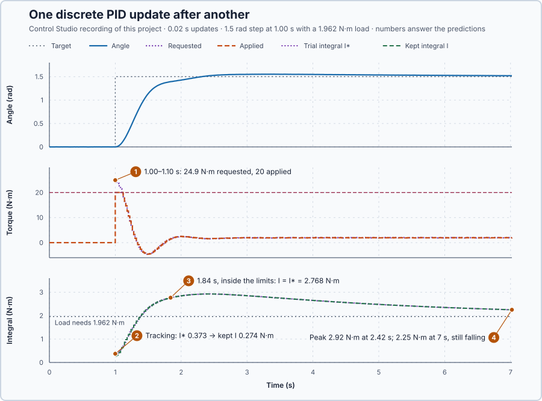

# 38. Discrete PID

In this lesson, you will write the PID as one sampled update in a fixed order, calculate an update by hand, and check every recorded update of the running controller against that arithmetic.

## The problem

Lesson 37 gave D a filtered speed: with a 0.1 s filter the torque changed by only 20 N·m in total during the loaded hold, instead of 177 N·m. P, the integral, the filtered D, the setpoint weight, the limit and the anti-windup tracking now all act on the shaft, but each was added on its own.

The controller does not act continuously: every 20 ms it reads the angle, calculates one torque and holds it until the next update. Done in the wrong order, or with the wrong value kept, the same terms give a different torque. We will write all of them as one update.

## What we need

We need to:

1. fix the order in which the terms are calculated at each update;
2. know which values are kept until the next update and which are recalculated; and
3. check the running controller against that update.

## The new idea

A **discrete PID** calculates its output once per update, in a fixed order: error, P, a trial integral, filtered D, the request, the limit, and finally the integral correction for the limit.

**In words.** "Discrete" means in steps. The controller does not act all the time: every 20 ms it reads the angle, calculates one torque, sends it to the drive and holds it until the next update, just as a PLC task with a fixed cycle reads its inputs, runs its program and writes its outputs. Within one update the controller works through seven steps, each using the results of the steps before:

1. **Error:** how far the shaft is from its target now.
2. **P:** the proportional part, from that error.
3. **Trial integral:** the integral kept from the last update plus this update's share, as in Lesson 8.
4. **Filtered D:** the braking torque from Lesson 37's filtered speed.
5. **Request:** the sum of P, the trial integral and D.
6. **Limit:** the drive gets the request, cut to its ±20 N·m.
7. **Correction:** if the drive got less than was requested, the kept integral is pulled back, Lesson 8's back-calculation; otherwise the trial integral is kept as it is.

The order matters for the same reason as the order of rungs in a PLC program: a rung that uses a value before another rung has updated it gets the old value. Only three values survive from one update to the next: the integral, the filter's state and the previous filtered angle. Everything else is calculated fresh. In PLC terms, the kept values are the function block's static variables, and the others are temporary variables. Change the order, or keep the wrong value, and the same gains give a different torque.

For this lesson's shaft, all seven steps run every 20 ms, and the program records each intermediate result so that every update can be checked by hand.

**The formula.** At update $k$:

$$
e_k = r_k - \theta_k, \qquad P_k = K_p e_k ,
$$
$$
I^*_k = I_{k-1} + K_i e_k \Delta t ,
$$
$$
u_{r,k} = P_k + I^*_k - K_d\,\omega_{f,k}, \qquad u_{a,k} = \mathrm{clamp}(u_{r,k}, -20, 20),
$$
$$
I_k = I^*_k + \frac{\Delta t}{T_t}\,(u_{a,k} - u_{r,k}).
$$

- $k$ numbers the updates, and $\Delta t = 0.02$ s is the time between them;
- $r_k$ is the target and $\theta_k$ the measured angle after Lesson 37's filter, in radians, and $e_k$ the error, in radians;
- $P_k$ is the proportional part, in newton-metres;
- $I_{k-1}$ is the integral kept from the previous update, and $I^*_k$ the **trial integral**: the kept integral plus this update's area $e_k\Delta t$ times $K_i$, both in newton-metres;
- $\omega_{f,k}$ is the filtered speed, in radians per second;
- $u_{r,k}$ is the requested and $u_{a,k}$ the applied torque, in newton-metres; clamp cuts the request to the drive's ±20 N·m;
- $T_t$ is Lesson 8's tracking time, 1 s here; and
- $I_k$ is the integral kept for the next update, in newton-metres.

The order carries meaning:

1. The trial integral adds the area $e_k\Delta t$ of the interval that ends now to the integral kept after the previous correction.
2. The request needs every term before the clamp can compare it with the limit.
3. Tracking uses this update's $u_a - u_r$: at the limit it pulls the kept integral back instead of letting it wind up; inside the limits $u_a = u_r$, so $I_k = I^*_k$.
4. Only $I_k$, the filter state and the previous filtered angle are kept. $P$, $I^*$, $D$ and $u_r$ are recalculated at every update.

**Example: one update of the shaft's controller.** The gains are $K_p = 16$, $K_i = 4$ and $K_d = 7$, teaching values for this simulated axis. At this update the error is 0.08 rad, the kept integral is 1.962 N·m, and the filtered angle has moved from 0.40 to 0.42 rad since the last update. Follow the seven steps:

1. **Error:** $e = 0.08$ rad; the shaft is still short of its target.
2. **P:** $P = 16 \times 0.08 = 1.28$ N·m, pushing towards the target.
3. **Trial integral:** $I^* = 1.962 + 4 \times 0.08 \times 0.02 = 1.9684$ N·m; the integral grows a little because an error remains.
4. **Filtered D:** the filtered speed is $(0.42 - 0.40)/0.02 = 1$ rad/s, so $D = -7 \times 1 = -7$ N·m, braking the approach.
5. **Request:** $u_r = 1.28 + 1.9684 - 7 = -3.7516$ N·m; the brake outweighs the push.
6. **Limit:** $-3.7516$ N·m lies inside ±20 N·m, so the drive gets $u_a = -3.7516$ N·m.
7. **Correction:** $u_a - u_r = 0$, so $I = I^* = 1.9684$ N·m is kept for the next update.

Now let the shaft approach faster, the filtered angle moving from 0.40 to 0.47 rad, with everything else the same. The filtered speed is $0.07/0.02 = 3.5$ rad/s, so $D = -7 \times 3.5 = -24.5$ N·m and the request is $1.28 + 1.9684 - 24.5 = -21.2516$ N·m. The drive gets only $-20$ N·m, and the correction is $\tfrac{0.02}{1} \times (-20 - (-21.2516)) = +0.0250$ N·m, so the kept integral becomes $1.9684 + 0.0250 = 1.9934$ N·m. Step 7 moves the integral in the direction that brings the next request back towards what the drive can deliver.

**The limitation.** The update fixes what is calculated at each sample, not what happens between samples: the torque is held for 20 ms, and a shaft moving at 1 rad/s turns $1 \times 0.02 = 0.02$ rad in that time without the controller seeing it. A correct update is not yet a well-tuned controller: the arithmetic can be exact while the gains still give a slow or swinging response.

## Prediction

The project steps the target from 0 to 1.5 rad with the 1.962 N·m load on the drum. Before running, answer these questions:

1. The first update after the step requests about $P = 16 \times 1.5 = 24$ N·m. Which torque does the drive get, and what brings the request back inside the limit?
2. How does tracking change the kept integral at that first update?
3. Once the request is back inside the limits, what does tracking do to the kept integral, and does the integral still change?
4. Will the integral have settled at the 1.962 N·m the load needs by the end of the 7 s test?

| First update after the step | Expected |
| --- | ---: |
| Requested torque | about 24 N·m |
| Applied torque | 20 N·m |
| Tracking correction of the integral | about $0.02 \times (20 - 24) = -0.08$ N·m |

## Implementation

Open [`src/Main.st`](src/Main.st). `Control.PID` drives the shaft with $K_p = 16$, $K_i = 4$, $K_d = 7$, the full target change in P, $T_t = 1$ s and the 0.1 s filter. After each update the program records the terms in the order above: `ErrorRad`, `ProportionalNm`, `TrialIntegralNm`, `DerivativeNm`, `RequestNm` and the kept `IntegralNm`. When the project test starts, the program waits 1 s, then couples the 1.962 N·m load and steps the target to 1.5 rad in Auto.

**ST practice.** Write the worked update in ST, line by line in the order above, and check the −3.7516 N·m request. Then open [`src/tests.st`](src/tests.st) and run its tests from the **Testing** view: they check the same update, `Control.PID` giving −3.7516 N·m from that kept state, and the clamp and tracking of the 1.5 rad step.

## Experiment in Control Studio

1. Open this lesson's project and start **Simulator**; the shaft rests at 0 rad. In the **truST** side bar, select **Control Studio**.
2. On **Identify**, choose **Project experiment** from **Method**. **Signals** already shows `P1.SetpointRad · Setpoint (rad)`, `P1.AngleRad · Process value (rad)` and `P1.TorqueNm · Applied output (N·m)`; add `P1.RequestNm · state (N·m)`, `P1.ProportionalNm · state (N·m)`, `P1.DerivativeNm · state (N·m)`, `P1.TrialIntegralNm · state (N·m)`, `P1.IntegralNm · state (N·m)` and `P1.ErrorRad · state (rad)`.
3. Answer the predictions. Select **Review project test**, check the declared **7.02 s** duration and select **Confirm and start**; the step comes 1 s later.
4. After the run, hover consecutive updates after the step and check one of them with the equations. The angle noise depends on when the test starts, so your numbers will differ slightly from the table below; the arithmetic must hold for every update.
5. At completion, Control Studio shows **Project test completed. Outputs restored.**

Select **Abort test** to stop early. To repeat, stop and restart **Simulator**.

## Evidence and decision

The numbered marks answer the predictions with the same numbers. Two updates from the recording:

| Update | $e$ (rad) | $P$ | $I_{k-1}$ | $I^*$ | $D$ | $u_r$ | $u_a$ | $I$ |
| --- | ---: | ---: | ---: | ---: | ---: | ---: | ---: | ---: |
| 1.00 s, first after the step | 1.50095 | 24.0151 | 0.25274 | 0.37282 | 0.5289 | 24.9169 | 20 | 0.27448 |
| 1.84 s | 0.16044 | 2.5670 | 2.75510 | 2.76793 | −3.7811 | 1.5539 | 1.5539 | 2.76793 |

All torques are in N·m. At 1.00 s: $I^* = 0.25274 + 4 \times 1.50095 \times 0.02 = 0.37282$, $u_r = 24.0151 + 0.37282 + 0.5289 = 24.9169$, the drive got 20, and tracking kept $I = 0.37282 + 0.02 \times (20 - 24.9169) = 0.27448$.

1. The drive got 20 N·m for six updates, from 1.00 to 1.10 s; P fell as the shaft moved and D braked, and at 1.12 s the request was 18.3 N·m, inside the limit. D was positive at the first update only because the filtered angle moved with the noise.
2. Tracking pulled the kept integral 0.098 N·m below the trial integral.
3. At 1.84 s the request was inside the limits, so $u_a = u_r$ and tracking left $I = I^*$. The integral still grew, from 2.75510 to 2.76793 N·m, because the shaft was 0.16 rad short of its target; D braked with −3.78 N·m and P still pushed.
4. No: the integral overshot to 2.92 N·m at 2.42 s, more than the load needs, and was still 2.25 N·m at 7.02 s, with the shaft 0.020 rad above its target.

All 302 recorded updates after the step follow the equations to within $10^{-14}$ N·m. The update is correct; the slow final approach is a matter of tuning, not of arithmetic. These are simulation results.

## Conclusion

A discrete PID calculates the error, P, the trial integral, D and the request; limits the request; and corrects only the kept integral with the difference between applied and requested torque. The order and the choice of kept values are part of the controller: change either and the same gains produce a different torque.

For this shaft, every recorded update of `Control.PID` matched the hand arithmetic, including the six clipped updates after the step.

## Check yourself

1. **The kept integral is 1.5 N·m, the error 0.05 rad, $K_i = 4$ and $\Delta t = 0.02$ s. What is the trial integral?**
   $I^* = 1.5 + 4 \times 0.05 \times 0.02 = 1.504$ N·m.
2. **Why must the clamp come after the request, and the tracking correction after the clamp?**
   The clamp can only compare a finished request with the limit, and tracking needs the difference between the
   applied and the requested torque of this update.
3. **The request is 25 N·m, the limit 20 N·m and $T_t = 1$ s. How much does tracking change the integral in one update?**
   $0.02 \times (20 - 25) = -0.1$ N·m.

## Reason for the next lesson

This update calculates the whole request every time. Code written in incremental form, which keeps the previous output and adds only a change to it, must be shown to behave the same.

[Positional and incremental PID](../38-positional-incremental-pid/README.md) derives that form and shows when the two agree.
