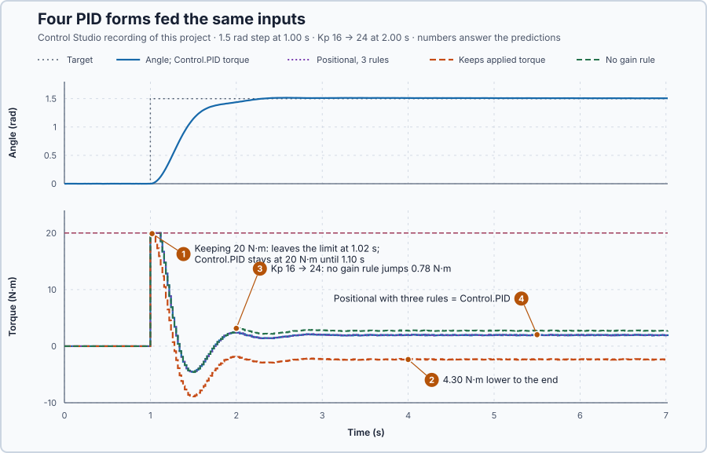

# 39. Positional and incremental PID

In this lesson, you will derive the incremental form of the PID update and show on the running shaft when it and the positional form are the same controller, and when they are not.

## The problem

Lesson 38's update calculated the whole torque request at every update, and all 302 recorded updates of `Control.PID` matched that arithmetic. But `Control.PID` with integral action is written a second way: it keeps its last request and adds a change to it, and that second way has not yet been shown to be equivalent.

Both ways use the same gains, yet at the torque limit, at the switch to Auto and at a gain change they can keep different values, and from then on give different torques. We will derive the change per update and find what each form must keep to stay equal.

## What we need

We need to:

1. calculate the change per update that reproduces the whole request exactly;
2. find which value the incremental form must keep for that; and
3. check both forms side by side through a limit and a gain change.

## The new idea

A **positional PID** calculates the whole output at every update; an **incremental PID** calculates only how much to change it. Both give the same output if they keep the same state.

**In words.** The two forms answer different questions at every update.

1. **Positional: "what should the torque be?"** It adds P, the integral and D and sends the total. Its memory is the integral, kept from update to update.
2. **Incremental: "how much should the torque change?"** It keeps its last request and adds a change to it. Many PLC engineers know this from a step controller driving a motorized valve: the controller sends only raise and lower commands, and the valve stands wherever the earlier changes have brought it.

Subtracting two consecutive positional calculations gives exactly the incremental change, so on paper both are one controller. In practice they stay one controller only if the incremental form keeps the right value: the full request it calculated, with Lesson 8's tracking correction, and not the torque the drive actually got. Three moments test this:

1. **At the limit.** The drive gets less than the request. The positional form pulls its integral back slowly, by Lesson 8's tracking. An incremental form that keeps the torque the drive got forgets the whole excess at once, which is a different anti-windup.
2. **At the switch to Auto.** The positional form needs Lesson 27's bumpless-transfer rule, so that the first Auto update continues from the manual torque.
3. **At a gain change.** The positional form needs Lesson 28's rule, which adjusts the integral so that the torque does not jump. The incremental form needs no rule: a new gain only scales the changes that follow.

For this lesson's shaft, `Control.PID` with an integral runs the incremental form. The program runs a positional function block beside it, from the same inputs, to show when the two agree.

**The formula.** The positional request is

$$
u_{r,k} = P_k + I^*_k + D_k, \qquad I^*_k = I_{k-1} + K_i e_k \Delta t ,
$$

and the kept integral already contains the previous tracking correction, $I_{k-1} = I^*_{k-1} + c_{k-1}$, with $c_{k-1} = \frac{\Delta t}{T_t}(u_{a,k-1} - u_{r,k-1})$. Subtract the previous request term by term, with fixed gains: P changes by $K_p\,\Delta e_k$, the trial integral by $K_i e_k \Delta t + c_{k-1}$, and D by $-K_d\,\Delta\omega_{f,k}$. The change is

$$
\Delta u_k = u_{r,k} - u_{r,k-1} = K_p\,\Delta e_k + K_i e_k \Delta t - K_d\,\Delta\omega_{f,k} + c_{k-1} .
$$

- $u_{r,k}$ and $u_{r,k-1}$ are the requested torques at this and the previous update, and $u_{a,k-1}$ the torque the drive got, in newton-metres;
- $\Delta u_k$ is the change of the request, in newton-metres;
- $e_k$ is the error and $\Delta e_k = e_k - e_{k-1}$ its change since the last update, in radians;
- $\omega_{f,k}$ is the filtered speed and $\Delta\omega_{f,k} = \omega_{f,k} - \omega_{f,k-1}$ its change, in radians per second;
- $c_{k-1}$ is the previous update's tracking correction, in newton-metres, and $T_t$ the tracking time, in seconds; and
- $K_p$, $K_i$, $K_d$ and $\Delta t = 0.02$ s are Lesson 38's gains and update interval.

So the incremental form must keep $u_{r,k-1} + c_{k-1}$: the unlimited request, corrected by tracking. `Control.PID` keeps exactly that value.

**Example: the shaft's controller, both ways.** $K_p = 16$, $K_i = 4$, $K_d = 7$, $\Delta t = 0.02$ s and $T_t = 1$ s. Follow the numbers:

1. **The previous update.** The error was 0.10 rad, the filtered speed 0.20 rad/s and the request 1.2 N·m, inside the limits. So $P = 16 \times 0.10 = 1.6$ N·m, $D = -7 \times 0.20 = -1.4$ N·m, and the integral was $1.2 - 1.6 + 1.4 = 1.0$ N·m.
2. **Positional, now.** The error is 0.096 rad and the filtered speed 0.22 rad/s: $P = 16 \times 0.096 = 1.536$ N·m, $I^* = 1.0 + 4 \times 0.096 \times 0.02 = 1.00768$ N·m and $D = -7 \times 0.22 = -1.54$ N·m. The request is $1.536 + 1.00768 - 1.54 = 1.00368$ N·m.
3. **Incremental, now.** $\Delta u = 16 \times (-0.004) + 4 \times 0.096 \times 0.02 - 7 \times 0.02 = -0.064 + 0.00768 - 0.14 = -0.19632$ N·m, and $1.2 - 0.19632 = 1.00368$ N·m: the same torque.
4. **At the limit.** A request of 23 N·m gives the drive 20 N·m. The correction is $0.02 \times (20 - 23) = -0.06$ N·m, so `Control.PID` keeps $23 - 0.06 = 22.94$ N·m. A form that keeps the applied 20 N·m has corrected by the whole $-3$ N·m at once: that is tracking with $T_t = \Delta t$, a different controller.
5. **At the switch to Auto.** In Manual the drive gets 2 N·m with the shaft at rest 0.05 rad from its target, so $P = 16 \times 0.05 = 0.8$ N·m and $D = 0$. Lesson 27's rule sets the positional integral to $I = 2 - 0.8 - 0 = 1.2$ N·m, and the first Auto update starts from $0.8 + 1.2 = 2$ N·m.
6. **At a gain change.** $K_p$ changes from 16 to 20 at an error of 0.05 rad. Without a rule, the positional P jumps by $(20 - 16) \times 0.05 = 0.2$ N·m. Lesson 28's rule moves $(16 - 20) \times 0.05 = -0.2$ N·m into the integral, so the total does not jump. The incremental form multiplies only the next error change by 20.

**The limitation.** The incremental form has no integral of its own to correct its memory. With $K_i = 0$, in P or PD, any offset in the kept request would stay for good: an offset of 0.5 N·m would hold the shaft $0.5/16 = 0.031$ rad from its target. `Control.PID` therefore uses the positional form when $K_i = 0$. The gains are teaching values for this simulated axis.

## Prediction

Before running, answer these questions:

1. At a request of 25 N·m and the 20 N·m limit, what does `Control.PID` keep, and what does a form that keeps the applied torque keep? Which leaves the limit first?
2. Once both are inside the limits again, do their torques come back together?
3. When $K_p$ changes from 16 to 24 with the shaft about 0.1 rad from its target, how much does the torque jump without the gain rule?
4. Does the positional form with all three rules give exactly `Control.PID`'s torque?

| Situation | `Control.PID` | Other form |
| --- | ---: | ---: |
| Kept at a 25 N·m request | 24.9 N·m | 20 N·m (keeps applied torque) |
| Torque jump at $K_p$ 16 → 24, 0.1 rad | 0 | 0.8 N·m (no gain rule) |

## Implementation

Open [`src/Main.st`](src/Main.st). `Control.PID` drives the shaft with $K_p = 16$, $K_i = 4$, $K_d = 7$, $T_t = 1$ s and the angle filter; with $K_i > 0$ it runs the incremental form. The function block `PositionalPid` is the positional form with the tracking, Manual and gain-change rules. From the same inputs, the program also runs, without driving the shaft:

- `Positional`, a `PositionalPid`: `PositionalTorqueNm`;
- `RetainedApplied`, a second `Control.PID` with $T_t = 0.02$ s, which keeps the applied torque: `RetainedAppliedTorqueNm`;
- `Unpreloaded`, a `PositionalPid` without the gain-change rule: `UnpreloadedTorqueNm`.

When the project test starts, the program waits 1 s, couples the 1.962 N·m load and steps the target from 0 to 1.5 rad in Auto, so the request exceeds the limit; 1 s later, while the shaft still moves, it changes $K_p$ to 24. With $K_i = 0$, in P and PD, `Control.PID` uses the positional form: without an integral, nothing would correct an offset in a kept request.

**ST practice.** Write the worked increment in ST and add it to a kept request of 1.2 N·m. Then open [`src/tests.st`](src/tests.st) and run its tests from the **Testing** view: they check the increment, `Control.PID` giving the same 1.00368 N·m, the 24.9 and 20 N·m kept at the limit, and the gain change at constant error.

## Experiment in Control Studio

1. Open this lesson's project and start **Simulator**; the shaft rests at 0 rad. In the **truST** side bar, select **Control Studio**.
2. On **Identify**, choose **Project experiment** from **Method**. **Signals** already shows `P1.SetpointRad · Setpoint (rad)`, `P1.AngleRad · Process value (rad)` and `P1.TorqueNm · Applied output (N·m)`; add `P1.PositionalTorqueNm · state (N·m)`, `P1.RetainedAppliedTorqueNm · state (N·m)`, `P1.UnpreloadedTorqueNm · state (N·m)` and `P1.RequestNm · state (N·m)`.
3. Answer the predictions. Select **Review project test**, check the declared **7.02 s** duration and select **Confirm and start**; the step comes 1 s later, the gain change after 2 s.
4. After the run, compare the four torques, and hover the updates at the limit and at the gain change. Your noise values will differ slightly from the numbers below; the comparisons will not.
5. At completion, Control Studio shows **Project test completed. Outputs restored.**

Select **Abort test** to stop early. To repeat, stop and restart **Simulator**.

## Evidence and decision

The numbered marks answer the predictions with the same numbers. From the recording, all forms calculated from the same inputs:

| Form | Torque compared with `Control.PID` |
| --- | --- |
| Positional, three rules | equal at every update; largest difference $4 \times 10^{-15}$ N·m over 302 updates |
| Keeps the applied torque | equal until the limit at 1.00 s; 4.30 N·m lower from 1.12 s to the end |
| Positional, no gain rule | equal until the gain change at 2.00 s; 0.78 N·m higher from then on |

1. At 1.00 s the request was 24.65 N·m and the drive got 20 N·m for six updates, until 1.10 s. `Control.PID` kept $24.65 + 0.02 \times (20 - 24.65) = 24.56$ N·m and stayed at the limit; the form that keeps the applied torque started its next update from 20 N·m and left the limit at once, with 19.90 N·m at 1.02 s.
2. From 1.12 s neither was at the limit and both added the same changes, so the 4.30 N·m difference stayed to the end: two different controllers.
3. At 2.00 s $K_p$ became 24: in the positional form P rose from 1.56 to 2.20 N·m while its integral dropped from 3.00 to 2.23 N·m, so the torque continued smoothly from 2.41 to 2.38 N·m. Without the gain rule the torque was $(24 - 16) \times 0.0974 = 0.78$ N·m higher, with the previous error of 0.0974 rad, and stayed so.
4. The positional form with its three rules matched `Control.PID` at every update, through the switch to Auto, the limit and the gain change.

On this record the two forms are one controller only with the right kept values and rules. These are simulation results.

## Conclusion

The incremental form follows from subtracting two consecutive positional requests. Both are one controller only if the incremental form keeps the unlimited request with its tracking correction, and the positional form sets its integral in Manual and at a gain change. Keep the applied torque, or skip the gain rule, and the same arithmetic gives a different controller.

For this shaft, keeping the applied torque left a permanent 4.30 N·m difference, and skipping the gain rule a permanent 0.78 N·m jump.

## Check yourself

1. **The error goes from 0.20 to 0.18 rad, the filtered speed stays the same, $K_p = 10$, $K_i = 5$, $\Delta t = 0.02$ s, no limit. What is the increment?**
   $\Delta u = 10 \times (-0.02) + 5 \times 0.18 \times 0.02 = -0.2 + 0.018 = -0.182$ N·m.
2. **Why does keeping the applied torque at the limit give a different controller?**
   It removes the whole difference between request and limit in one update, which is tracking with $T_t = \Delta t$,
   not the declared $T_t = 1$ s. After the limit the two keep different values for good.
3. **Why does the incremental form need no rule at a gain change?**
   It never multiplies the whole error by the new gain; the new gain only scales the next changes, so the output
   continues from the kept request.

## Reason for the next lesson

`PositionalPid` is a PID law the program computes itself. Control Studio tunes `Control.PID`, not a law it does not know, so it cannot yet design that law's gains.

[Your own PID law](../86-own-pid-law/README.md) tells Control Studio which variables are the law's gains and kept values, so it can design, validate and apply them.
