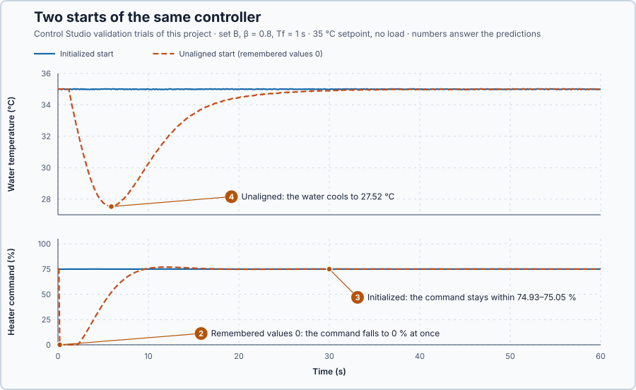

# 26. Controller initialization

In this lesson, you will give the controller's memory the right starting values before it takes over the heater, so its first command is the one the heater already has. You will compare that start with a start from wrong values.

## The problem

Lesson 25 made every update use the time that really passed: with the measured interval and the interval check, the 30 kW load trial dipped to 33.61 °C and settled in 19.2 s, while a wrongly assumed interval failed whatever the gains. Each update also continues from values the controller stored at the previous one: its last command, the last setpoint and measurement, the filtered temperature. When the controller first takes over, those values must come from somewhere, and the first command can jump because the controller's memory starts wrong.

`Control.PID` calculates each command as the previous command plus the change since the previous update. Left at 0, the first automatic update of set B with $\beta = 0.8$ compares 35 °C with a remembered 0 °C:

$$
u_1 = 0 + 5.79\,(0.8 \times 35 - 35) + 0 = -40.5\ \% \;\rightarrow\; 0\ \%,
$$

although the hot heater needs 75 % to hold 35 °C: a correct calculation from a wrong memory.

We will set the controller's memory from the running heater before it takes over.

## What we need

We need to:

1. know which values the controller remembers between updates;
2. set each of them from the heater's present state before automatic control starts; and
3. allow automatic control only after that has succeeded with a valid measurement.

## The new idea

**Initialization** sets the values a controller remembers between updates, such as its integral, to match the plant's present state, so the first command is the one the plant already has. The remembered values are called the controller's **retained state**. For this heater, holding 35 °C with 75 % in Manual, initialization makes the controller's memory say: the last command was 75 %, the setpoint and the measurement were 35 °C, and nothing was changing.

**In words.** `Control.PID` is a function block, and like every function block instance it keeps its internal variables from one call to the next, as a counter keeps its count between scans. It also works by changes: at each update it takes its previous command and adds the change that the new setpoint, the new measurement and the elapsed time call for. A correct change added to a wrong previous command gives a wrong command. Before the first update nothing has been calculated yet, so the memory holds the values it was declared with, typically 0.

Initialization fills the memory from the running plant before the controller takes over, as an operator who takes over a valve by hand first looks where it is and starts from there. Each remembered value has its source:

| Remembered value | Meaning | Initial value |
| --- | --- | --- |
| previous requested and applied command | where the next change starts | the applied command, 75 % |
| previous setpoint and measurement | the references for the next change | the present setpoint and measurement |
| previous rates of change | used by a derivative part | 0: the heater is steady |
| filtered temperature | the filter's memory | the present measurement |
| timing baseline | the start of the next interval | now |

Automatic control may start only after this has been done with a valid measurement, because a wrong reading would be remembered as the starting point.

**The formula.** `Control.PID` calculates each command from the previous one:

$$
u_k = u_{k-1} + K_p\,[\beta\,(SP_k - SP_{k-1}) - (PV_k - PV_{k-1})] + K_i\, e_k\,\Delta t .
$$

Initialization sets $u_0 = u_a$, $SP_0 = SP$ and $PV_0 = PV$, so the first update changes the command only by the integral step: $u_1 = u_a + K_i\,e\,\Delta t$. In the familiar form $u = P + I$, the same condition reads

$$
I_0 = u_a - P, \qquad P = K_p\,[\beta\,(SP - T_0) - (PV - T_0)] :
$$

the integral starts at the applied command minus the P part.

- $u_k$ is the command at update $k$ and $u_{k-1}$ the one before it, in percent; $u_a$ is the command applied when the controller takes over;
- $SP_k$ and $PV_k$ are the setpoint and the measurement at update $k$, in degrees Celsius, and $e_k = SP_k - PV_k$ is the error;
- $K_p$, $K_i$, $\beta$ and $\Delta t$ are the gains, the setpoint weight and the 0.1 s interval of the previous lessons;
- $T_0 = 35$ °C is the operating point about which P is calculated; and
- $I_0$ is the integral's starting value, in percent.

**Example: three starts with set B and $\beta = 0.8$.** Follow the numbers:

1. Initialized at 35 °C with 75 % applied: $SP = PV = T_0$, so $P = 0$ and $I_0 = 75 - 0 = 75$ %. The error is 0, so the first update adds nothing: the command stays exactly at 75 %.
2. Initialized while the setpoint already says 38 °C and the water is at 35 °C: $P = 5.79 \times 0.8 \times 3 = 13.9$ % and $I_0 = 75 - 13.9 = 61.1$ %. The command is still 75 %: the integral supplies only what P does not. The first update adds the integral step $1.14 \times 3 \times 0.1 = 0.34$ point, so the heating starts from 75 % and grows from there.
3. Unaligned, with the remembered command, setpoint and measurement at 0: $u_1 = 0 + 5.79 \times (0.8 \times 35 - 35) + 1.14 \times 0 \times 0.1 = -40.5$ %, limited to 0 %. The calculation is correct, but it starts from a memory that says the heater was off at 0 °C, so the heater is switched off.

The filter's memory matters as much. A filter started at 0 with $T_f = 1$ s shows $35/11 = 3.2$ °C at the first update and 6.1 °C at the second: a false rise of 2.89 °C in 0.1 s, which would cut P by $5.79 \times 2.89 = 16.7$ points. Initialization therefore starts the filter from the present measurement.

**The limitation.** Initialization matches the memory to the plant at one moment only. It needs a usable measurement, so Auto must wait until it has succeeded, and it does not keep the memory in step afterwards. Nor does it make the controller better: it only makes the start smooth.

## Prediction

Before running, answer these questions:

1. What are $P$ and $I_0$ at 35 °C with 75 % applied, and with the setpoint at 38 °C while the water is at 35 °C?
2. What is the first automatic command when all remembered values are 0?
3. In the initialized start, how far will the command and the temperature move from 75 % and 35 °C?
4. In the unaligned start, how far will the water cool before the controller has recovered?

| Start | $P$ | $I_0$ | First command |
| --- | ---: | ---: | ---: |
| Initialized, 35 °C | 0 % | 75 % | 75 % |
| Initialized, setpoint 38 °C | 13.9 % | 61.1 % | 75.34 %: 75 % plus the 0.34-point integral step |
| Unaligned, all values 0 | — | — | 0 % (−40.5 % limited) |

## Implementation

Open [`src/Main.st`](src/Main.st). Initialization runs at startup and on each rising edge of `InitializeRequest`, only while Manual commands the heater and the measurement is usable:

```st
IF (NOT Initialized OR (InitializeRequest AND NOT InitializeRequestWas))
        AND NOT AutoActive AND NOT SafetyAbort AND DataUsable THEN
    ...
    FilteredC := SafeProcessValueC;
    InitialState.Setpoint := SetpointC;
    InitialState.ProcessValue := FilteredC;
    InitialState.NominalOutput := AppliedPowerPct;
    InitialState.SaturatedOutput := AppliedPowerPct;
    InitialState.SetpointRate := LREAL#0.0;
    InitialState.ProcessValueRate := LREAL#0.0;
    InitialState.FeedForward := LREAL#0.0;
    Controller.Initialize(State := InitialState);
    ProportionalPct := WeightedProportional(...);
    IntegralPct := InitialIntegral(AppliedOutput := AppliedPowerPct, Proportional := ProportionalPct);
    ...
    Initialized := TRUE;
END_IF;
```

`IntegralPct` shows $I_0 = u_a - P$. `AutoActive` requires `Initialized`, so until this block has run, Manual alone commands the heater and the controller is not updated.

**Exercise.** Open [`src/tests.st`](src/tests.st). Its first test uses other gains, $K_p = 13$ and $\beta = 0.3$, and checks $P = 11.7$ % and $I_0 = 63.3$ % with the setpoint at 38 °C. Change the gain to 5.79 and the weight to 0.8; the expected values become 13.896 % and 61.104 %. The second test runs the real `Control.PID`: 75 % from the heater's values, 0 % from zeros. Run the tests from the **Testing** view, then restore the file.

## Experiment in Control Studio

Besides the setpoint and load trials, the project validates two **start trials** at a 35 °C setpoint with no load for 60 s: the **initialized start** begins from the heater's values, and the **unaligned start** begins with the remembered setpoint, measurement and commands at 0. They carry only the operating limits, so their rows show how far the command and the temperature moved.

1. Open this lesson's project and start **Simulator**. The program initializes at once: `Initialized` is TRUE, `ProportionalPct` is about 0 and `IntegralPct` about 75 %. In the **truST** side bar, select **Control Studio**.
2. On **Identify**, keep **Method** at **Automatic** and select **Identify plant**; the model is G(s) = (0.2) / (5.1s +1) · e^(−1s).
3. On **Tune**, choose **P1.Controller · PI** and **Manual**. Enter **Proportional gain (Kp)** 5.79, **Integral gain (Ki)** 1.14, **Setpoint weight (β)** 0.8 and **Measurement filter time (Tf)** 1.
4. Select **Requirements…** and enter **Setpoint change (°C)** 3, **Maximum steady-state error (°C)** 0.2, **Maximum settling time (s)** 15, **Settling band (±°C)** 0.1 and **Validation duration (s)** 60. Select **Done**, then **Tune controller**.
5. On **Validate**, select **Validate controller**. Compare the command and temperature ranges of the two start trials.
6. Select **Apply**. Control Studio initializes `P1.Controller` from the running heater, switches to Auto at one task boundary and shows **Applied**.

## Evidence and decision



The numbered marks answer predictions 2–4; the table above and the tests answer 1. From the validation:

| Start trial | Heater command | Water temperature | Within ±0.1 °C of 35 °C |
| --- | ---: | ---: | --- |
| Initialized | 74.93–75.05 % | 34.98–35.02 °C | throughout |
| Unaligned, remembered values 0 | 0–76.98 % | 27.52–35.02 °C | from 30 s |

The setpoint and load trials passed, settling in 8.5 s and 19.5 s.

2. With all remembered values 0, the first update requested −40.5 % and the heater received 0 %. The command stayed at 0 % from 0.2 s to 2.2 s, until the anti-windup and the cooling water had brought the request back above 0 %.
3. The initialized start moved the command only within 74.93–75.05 % and the temperature within 34.98–35.02 °C: only the sensor noise.
4. The unaligned start let the water cool to 27.52 °C, 7.5 °C below the setpoint, at 5.9 s. The command then rose to 76.98 % while the integral climbed back, and the water was within ±0.1 °C again only after 30 s.

Initialization costs nothing in performance: the initialized start cannot be told apart from the heater holding in Manual. Its price is a rule: Auto must wait until initialization has succeeded with a usable measurement. We keep the initialization and apply set B; Control Studio reports **Applied**. These are simulation results for this heater.

## Conclusion

A digital controller continues from what it remembers: the previous command, setpoint and measurement, the filter's value and the time of the last update. Initialization writes all of them from the plant's present state, so the first automatic command is the one the plant already has, with $I_0 = u_a - P$.

For this heater, the initialized start held 75 % and 35 °C without any visible change, while a start from zeros switched the heater off and cooled the water by 7.5 °C for half a minute.

## Check yourself

1. **The operator holds 80 % with the setpoint at 37 °C and the water at 35 °C. With set B, $\beta = 0.8$ and $T_0 = 35$ °C, what are P and $I_0$?**
   $P = 5.79 \times 0.8 \times 2 = 9.26$ %, so $I_0 = 80 - 9.26 = 70.74$ %.
2. **Why must the measurement be valid before initialization runs?**
   Initialization stores the measurement as the previous measurement and as the filter's value. A wrong reading
   would be remembered, and the first real reading would then look like a sudden change that P reacts to.
3. **Why did the unaligned start need 30 s to recover, although only its first update used the wrong memory?**
   That update switched the heater off. The command stayed at 0 % for 2 s, the water kept cooling through the
   heater's delay and time constant, and the controller then had to heat it 7.5 °C back.

## Reason for the next lesson

Initialization matches the memory to the heater at one moment. After a period of manual operation, the remembered values no longer match: when the operator has held 60 % for 3 s and the water has cooled to about 34 °C, the memory still says 75 % at 35 °C, and switching to Auto continues from there.

[Bumpless transfer](../40-bumpless-transfer/README.md) keeps the remembered values in step while the operator commands the heater.
