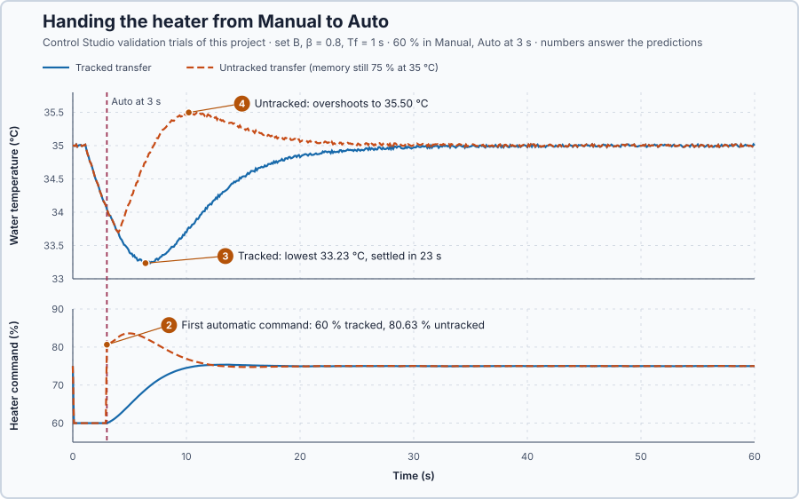

# 27. Bumpless transfer

In this lesson, you will hand the heater from the operator to the controller without a jump in the heater command. You will see what a jump does when the controller's memory is out of date, and that a smooth hand-over does not make the recovery itself faster.

## The problem

Lesson 26 initialized the controller's memory from the running heater: the initialized start held the command within 74.93–75.05 % and the water within 34.98–35.02 °C, while a start from zeros cooled the water to 27.52 °C. But initialization matches the memory to the heater at one moment only. Suppose the operator then holds 60 % in Manual for 3 s: the water cools to 34.046 °C, while the memory still says 75 % at 35 °C. Switching from manual to automatic makes the command jump, because the first automatic update continues from the remembered 75 %:

$$
u = 75 + 5.79 \times 0.954 + 1.14 \times 0.954 \times 0.1 = 80.63\ \%,
$$

instead of the operator's 60 %: a 20.6-point jump caused only by the change of mode.

We will keep the memory in step with the heater while the operator commands it, so that Auto starts exactly where the operator left.

## What we need

We need to:

1. keep the controller's memory in step with the heater while the operator commands it in Manual;
2. make the first automatic command equal to the command the operator left; and
3. let the controller continue its normal corrections from there.

## The new idea

**Bumpless transfer** means switching between manual and automatic without a sudden change in the heater command. While in manual, the integral is kept in step with the manual output. Keeping it in step is called **tracking**. For this heater, tracking means that while the operator holds 60 %, the controller keeps rewriting its memory as if it had produced that 60 % itself.

**In words.** In Manual the operator writes the heater command. If the controller is simply not updated meanwhile, its memory stands still at the moment Manual began, while the operator changes the command and the water changes temperature. When Auto takes over, the controller continues from that old memory, and the command jumps to what the controller would have done, not to what the operator did.

Tracking keeps the controller in step while it is not in charge. At every manual update it copies the operator's command into its memory and works out the integral that would have produced that command with the present setpoint and measurement. It is like a co-driver who keeps their hands lightly on a second steering wheel and follows every movement: when they take over, nothing changes at that moment, and they steer on from there.

The switch itself happens on one scan, the **transfer scan**: it reproduces the operator's command exactly, without any correction. From the next scan the controller makes its ordinary corrections, starting from a command and a memory that agree. For this heater, the water may still be too cold after the operator's period, so the command must still rise, but gradually, through the controller's corrections, not in one jump.

**The formula.** In manual, at every update,

$$
I = u_a - P, \qquad P = K_p\,[\beta\,(SP - T_0) - (PV - T_0)],
$$

so that $P + I = u_a$ at every moment.

- $u_a$ is the applied manual command, in percent;
- $P$ is the weighted P part at the present setpoint and measurement, and $I$ the integral part, both in percent; and
- $SP$, $PV$, $T_0$, $K_p$ and $\beta$ are the setpoint, the measurement, the 35 °C operating point, the proportional gain and the setpoint weight of Lesson 23.

`Control.PID` works with the previous command plus a change, so for it tracking simply means storing the applied command, the setpoint and the measurement at every manual update.

**Example: the operator holds 60 % for 3 s.** The setpoint stays at 35 °C, and the water cools to 34.046 °C. Set B has $K_p = 5.79$ %/°C, $K_i = 1.14$ %/(°C·s) and $\beta = 0.8$. Follow the numbers:

1. Tracking keeps $P = 5.79 \times [0.8 \times 0 - (34.046 - 35)] = 5.79 \times 0.954 = 5.52$ % and $I = 60 - 5.52 = 54.48$ %. Then $P + I = 60$ %: if Auto took over now, it would start exactly where the operator left.
2. Without tracking, the memory still says 75 % at 35 °C. The first automatic update adds the change since then: $u = 75 + 5.79 \times 0.954 + 1.14 \times 0.954 \times 0.1 = 80.63$ %, a jump of 20.6 points caused only by the change of mode.
3. With tracking, the transfer scan gives 60 %, and the next update adds only about the integral step, $1.14 \times 0.95 \times 0.1 = 0.11$ point: the correction begins smoothly.

**The limitation.** Bumpless transfer removes the jump caused by changing mode, not the need to correct. The water is 0.95 °C too cold, so the command must still rise over the following updates, and the heater's 1 s delivery delay still sets how fast the water recovers.

## Prediction

Before running, answer these questions:

1. While the operator holds 60 % and the water reads 34.046 °C, what integral does tracking keep?
2. What is the first automatic command with tracking, and without?
3. Which hand-over lets the water cool further?
4. Will either hand-over carry the water above 35 °C?

| Hand-over | P at the switch | Integral | First automatic command |
| --- | ---: | ---: | ---: |
| Tracked | 5.52 % | 54.48 % | 60 % |
| Untracked | 5.52 % | 75 % + 0.11 point | 80.63 % |

## Implementation

Open [`src/Main.st`](src/Main.st). In Manual and on the transfer scan, it runs `Control.PID` in its Manual mode with the applied command; otherwise it runs the ordinary PI update:

```st
IF AutoActive AND (AutoWasActive OR NOT TrackManual) THEN
    (* Ordinary PI update. *)
    Input.Mode := PIDMode#Auto;
    AppliedPowerPct := Controller.Update(Input := Input);
    AutoWasActive := TRUE;
ELSIF TrackManual THEN
    (* Tracking: in Manual and on the transfer scan, the stored values follow the applied command,
       the setpoint and the measurement, so I = u_a − P. The command stays u_a: no integral step. *)
    Input.Mode := PIDMode#Manual;
    AppliedPowerPct := Controller.Update(Input := Input);
    AutoWasActive := AutoActive;
END_IF;
```

`Input.ManualOutput` holds the applied command. The transfer scan is the first scan with `AutoActive` TRUE and `AutoWasActive` FALSE. `IntegralPct` shows $I = u_a - P$ while Manual commands the heater. `TrackManual` = FALSE switches tracking off: the untracked counterexample.

**Exercise.** Open [`src/tests.st`](src/tests.st). Its second test uses other gains, $K_p = 13$ and $K_i = 3.5$, with the water at 34.2 °C: 85.68 % untracked, 60 % tracked and 60.28 % on the next update. Change the gains to 5.79 and 1.14; the expected values become 79.7232 % and 60.0912 %. Run the tests from the **Testing** view, then restore the file.

## Experiment in Control Studio

Besides the setpoint and load trials, the project validates two hand-overs at a 35 °C setpoint: the operator holds 60 % in Manual and Auto takes over at 3 s. The **tracked transfer** must keep the command within 59.9–60.1 % across the switch, stay at or above 33 °C, be within ±0.2 °C from 30 s and settle within 30 s. The **untracked transfer**, with `TrackManual` = FALSE, carries only the operating limits: its rows show what happens.

1. Open this lesson's project and start **Simulator**. The heater holds 35 °C with 75 % in Manual. In the **truST** side bar, select **Control Studio**.
2. On **Identify**, keep **Method** at **Automatic** and select **Identify plant**; the model is G(s) = (0.2) / (5.1s +1) · e^(−1s).
3. On **Tune**, choose **P1.Controller · PI** and **Manual**. Enter **Proportional gain (Kp)** 5.79, **Integral gain (Ki)** 1.14, **Setpoint weight (β)** 0.8 and **Measurement filter time (Tf)** 1.
4. Select **Requirements…** and enter **Setpoint change (°C)** 3, **Maximum steady-state error (°C)** 0.2, **Maximum settling time (s)** 15, **Settling band (±°C)** 0.1 and **Validation duration (s)** 60. Select **Done**, then **Tune controller**.
5. On **Validate**, select **Validate controller** and compare the rows of the two transfers.
6. Select **Apply**. Control Studio switches to Auto at one task boundary, the program's transfer scan takes over from the manual command, and Control Studio shows **Applied**.

## Evidence and decision



The numbered marks answer predictions 2–4; the table above answers 1. From the validation:

| Hand-over | Command across the switch | Temperature range | Within ±0.1 °C of 35 °C |
| --- | ---: | ---: | --- |
| Tracked | 60 % → 60 % | 33.23–35.02 °C | settled in 23 s; error 0.035 °C from 30 s |
| Untracked | 60 % → 80.63 % | 33.70–35.50 °C | from 19.7 s |

The setpoint and load trials passed, settling in 8.6 s and 18.7 s.

2. The tracked hand-over started Auto at exactly 60 %, and the next update added 0.14 point. Without tracking, the command jumped from 60 % to 80.63 % in one scan.
3. The tracked hand-over let the water cool further, to 33.23 °C at 6.4 s, against 33.70 °C: the untracked jump happened to add 20.6 points of heat just when the cold water needed heat.
4. Only the untracked hand-over overshot, to 35.50 °C, because its extra heat came from the stale memory, not from the measurement. The tracked one never exceeded 35.02 °C.

The untracked jump helped the dip only by luck: the stale memory held more heat than the operator's 60 %. Had the operator held 90 % and warmed the water to 36 °C, the same memory would give $75 - 5.79 - 0.11 = 69.1$ %, a 21-point cut at the switch in the wrong direction. We keep tracking: the hand-over no longer depends on what happened in Manual, and the tracked recovery meets its requirements. Its slower recovery, 23 s instead of 19.7 s, belongs to the tuning, not to the transfer. We apply set B; Control Studio reports **Applied**. These are simulation results for this heater.

## Conclusion

Bumpless transfer keeps the controller's memory in step with the heater while Manual commands it, $I = u_a - P$ at every update, so the switch to Auto continues from the operator's command. It removes the jump caused by the change of mode, not the correction the process still needs.

For this heater, the tracked hand-over started at exactly 60 % and recovered in 23 s; without tracking, the command jumped 20.6 points and the water overshot by half a degree.

## Check yourself

1. **The operator holds 70 % with the setpoint at 35 °C and the water at 34.5 °C. With set B, what P and I does tracking keep?**
   $P = 5.79 \times 0.5 = 2.90$ %, so $I = 70 - 2.90 = 67.10$ %.
2. **Why is the untracked trial's smaller dip no argument against tracking?**
   Its jump came from a memory that described the heater before the operator acted. Here that memory held more heat
   than needed; after a different manual action it would cut the heat at the worst moment.
3. **Why is no integral step added on the transfer scan?**
   The transfer scan must reproduce the operator's command exactly. Corrections start with the next update, from a
   command and a memory that agree.

## Reason for the next lesson

Tracking keeps the command smooth when the mode changes. Changing gains or limits while running can still make the command jump: in the form $u = P + I$, a new $K_p$ changes P at once, although the measurement has not moved. Holding 38 °C at 90 %, raising $K_p$ from 5.79 to 6.95 would change P from −3.47 % to −4.17 %.

[Parameter updates](../41-atomic-parameter-update/README.md) changes the settings while the controller runs, without such a jump.
