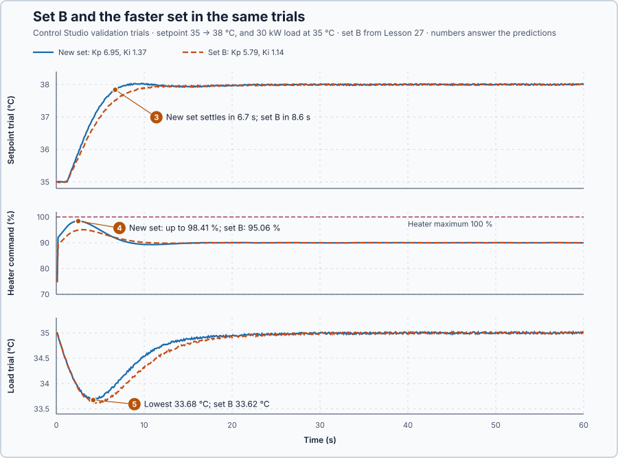

# 28. Parameter updates

In this lesson, you will change the controller's gains while it runs, without a jump in the heater command and without the controller ever running a mixture of old and new settings. You will also see a setting that is refused.

## The problem

Lesson 27 kept the controller's memory in step with the heater in Manual: the tracked hand-over started Auto at exactly 60 % and settled in 23 s, while the untracked one jumped from 60 % to 80.63 %. Mode changes are now smooth, and the operator wants a faster controller than set B. But changing settings while running is unsafe in three ways. A new gain used one update before the other gives a mixture nobody checked. In the form $u = P + I$, a new $K_p$ changes P at once, although the measurement has not moved. And values that are each in range can form an impossible set.

We will check a new set as a whole, switch all of it at one update, and keep the command continuous at that update.

## What we need

We need to:

1. check a new set of settings as a whole before the controller uses any of it;
2. switch all related settings together at one update; and
3. adjust the controller's memory so the command continues smoothly at that update.

## The new idea

A **parameter update** changes the controller's settings while it runs. All related settings change together at one update, and the integral is adjusted so the command does not jump. Changing everything at one update is called an **atomic** update. For this heater, the operator wants a slightly faster controller, $K_p = 6.95$ %/°C and $K_i = 1.37$ %/(°C·s), with the same integral time $T_i = K_p / K_i = 5.1$ s as set B.

**In words.** A controller's settings belong together like the values of a recipe: the two gains were chosen as a pair, the output limits as a pair, and a mixture of old and new values was never checked by anyone. PLC engineers know the same danger from data shared between tasks: if one task copies a structure field by field while another task reads it, the reader can see half old and half new values. The remedy is to prepare the complete new structure, check it, and switch to it in one step. An update that can never be seen half done is called atomic.

A safe parameter update therefore has three parts:

1. **Check the set as a whole.** Each value must be in its range, and the values must fit together: an output minimum of 80 % with a maximum of 20 % cannot both hold, although each value is in range.
2. **Switch it at one update.** Every setting changes in the same scan, so no update ever runs on a mixture. An invalid set changes nothing, and the controller keeps running on the active set.
3. **Keep the command continuous.** In the form $u = P + I$, a new $K_p$ multiplies the same error differently, so it changes P at once, although the measurement has not moved. The integral takes up that change, so the command is unchanged at the switch, and only the following corrections use the new gains.

A deliberate change of a limit is different: lowering the output maximum to 80 % while the heater runs at 90 % moves the command to 80 % at once. That is the purpose of the new limit, not an accidental jump.

**The formula.** At the switch, the integral takes up the change of P:

$$
I_{new} = I_{old} + P_{old} - P_{new}, \qquad\text{so}\qquad P_{new} + I_{new} = P_{old} + I_{old} .
$$

- $P_{old}$ and $P_{new}$ are the P parts with the old and the new gain, both calculated from the same setpoint and measurement, in percent; and
- $I_{old}$ and $I_{new}$ are the integral before and after the switch, in percent.

The command $u = P + I$ is therefore the same just before and just after the switch. `Control.PID` keeps its previous command and adds only changes, so for it a new $K_p$ affects only the next changes, and the command continues by itself. The program's `IntegralPct`, the command minus P, shows the adjustment.

**Example: a faster set while holding 38 °C.** Set B with $\beta = 0.8$ holds 38 °C with 90 %. Follow the numbers:

1. With set B, $P_{old} = 5.79 \times (0.8 \times 3 - 3) = 5.79 \times (-0.6) = -3.47$ %, so the integral is $I_{old} = 90 + 3.47 = 93.47$ %.
2. With the new gain, $P_{new} = 6.95 \times (-0.6) = -4.17$ %.
3. Without the adjustment, the command would drop to $-4.17 + 93.47 = 89.30$ %, 0.7 point lower, although nothing in the water has changed.
4. With the adjustment, $I_{new} = 93.47 - 3.47 + 4.17 = 94.17$ %, and the command stays at $-4.17 + 94.17 = 90$ %.

In the program, an update then runs like this:

1. Control Studio writes the complete new set at one task boundary.
2. The program checks it as a whole: gains not negative, weights between 0 and 1, output minimum below maximum, rate limits on both sides of 0, a positive tracking time and a filter time not negative.
3. A valid set is adopted in the same scan, all together, and `ParameterRevision` counts up; an invalid set changes nothing.

**The limitation.** The adjustment keeps the command continuous only at the switch. From the next update the new gains act, so a faster set moves the command more for the same error. The check refuses only sets that break a rule: a valid set can still be a poor controller, which is why it is validated before it is applied.

## Prediction

Before running, answer these questions:

1. Holding 38 °C at 90 %, what integral keeps the command at 90 % when $K_p$ changes from 5.79 to 6.95, and what would the command be without the adjustment?
2. What happens when you enter $K_p = 150$?
3. How will the faster set change the setpoint response?
4. How close will the heater command come to 100 %?
5. How deep will the water dip under the 30 kW load?

| At 38 °C, 90 % | Set B | New set |
| --- | ---: | ---: |
| $P$ | −3.47 % | −4.17 % |
| $I$ that keeps 90 % | 93.47 % | 94.17 % |
| Command without adjustment | — | 89.30 % |

## Implementation

Open [`src/Main.st`](src/Main.st). Every scan, the program compares the written set with the active one and adopts a changed set only whole and valid:

```st
IF NOT Initialized OR NOT SamePidParameters(Left := Parameters, Right := ConfiguredParameters)
        OR FilterTimeS <> ConfiguredFilterTimeS THEN
    IF ValidPidParameters(Candidate := Parameters, FilterTime := FilterTimeS) THEN
        ConfiguredParameters := Parameters;
        ConfiguredFilterTimeS := FilterTimeS;
        ParameterRevision := ParameterRevision + 1;
        ParametersRejected := FALSE;
    ELSE
        ParametersRejected := TRUE;
    END_IF;
ELSE
    ParametersRejected := FALSE;
END_IF;
Controller.Configure(Parameters := ConfiguredParameters);
```

`ValidPidParameters` makes the checks of step 2 above; `Controller.Configure` always receives the active set, never a half-written one.

**Exercise.** Open [`src/tests.st`](src/tests.st). Its third test holds 38 °C at 90 % with the real `Control.PID` and changes $K_p$ from 13 to 9; the command stays at 90 %. Change the gains to 5.79 and 6.95: both checks still expect 90 %, because only changes are added. Run the tests from the **Testing** view, then restore the file.

## Experiment in Control Studio

1. Open this lesson's project and start **Simulator**. The heater holds 35 °C with 75 % in Manual. In the **truST** side bar, select **Control Studio**.
2. On **Identify**, keep **Method** at **Automatic** and select **Identify plant**; the model is G(s) = (0.2) / (5.1s +1) · e^(−1s).
3. On **Tune**, choose **P1.Controller · PI** and **Manual**. Enter **Proportional gain (Kp)** 150, **Integral gain (Ki)** 1.14, **Setpoint weight (β)** 0.8 and **Measurement filter time (Tf)** 1. Select **Requirements…**, enter **Setpoint change (°C)** 3, **Maximum steady-state error (°C)** 0.2, **Maximum settling time (s)** 15, **Settling band (±°C)** 0.1 and **Validation duration (s)** 60, and select **Done**. Select **Tune controller** and read the answer.
4. Enter the new set: **Proportional gain (Kp)** 6.95 and **Integral gain (Ki)** 1.37, with β 0.8 and Tf 1. Select **Tune controller**.
5. On **Validate**, select **Validate controller** and read every row.
6. Select **Apply**. Control Studio writes the complete set at one task boundary and shows **Applied**.

## Evidence and decision



The numbered marks answer predictions 3–5; the table above and the tests answer 1. Control Studio refused $K_p = 150$ in Tune with **Enter proportional gain (Kp) between 0 and 100.**; **Validate controller** stayed unavailable and nothing was written to the controller: that answers prediction 2. The new set next to set B in the same trials, set B from Lesson 27:

| Result | Set B | New set |
| --- | ---: | ---: |
| Setpoint settling, limit 15 s | 8.6 s | 6.7 s |
| Rise above 38 °C | 0.020 °C | 0.036 °C |
| Heater command, setpoint trial | 75–95.06 % | 75–98.41 % |
| Command activity, setpoint trial | 27.89 points | 36.09 points |
| Load trial: lowest temperature / settling | 33.62 °C / 18.7 s | 33.68 °C / 16.6 s |

3. The new set settled in 6.7 s instead of 8.6 s and rose only 0.036 °C above 38 °C.
4. The heater command rose to 98.41 % instead of 95.06 %: 1.6 points below the heater's maximum.
5. The water dipped to 33.68 °C instead of 33.62 °C under the 30 kW load, nearly the same, and recovered 2.1 s sooner.

The faster set costs about 30 % more command movement and leaves little headroom below 100 %; it buys about 2 s in both trials and meets every requirement. We apply it; Control Studio reports **Applied**. Control Studio applies a validated set only from the operating point it was validated at: with the heater elsewhere, it refuses and asks to return the manual output to 75 %. These are simulation results for this heater.

## Conclusion

A parameter update is safe when the complete set is checked as a whole, adopted at one update, and the controller's memory is adjusted so the command continues: $I_{new} = I_{old} + P_{old} - P_{new}$. An invalid set changes nothing, and the controller keeps running on the active one.

For this heater, the set with $K_p = 150$ never reached the controller, and the faster set settled 1.9 s sooner at the price of more command movement.

## Check yourself

1. **Holding 38 °C at 90 % with set B, the gain is lowered to $K_p = 5$. What integral keeps the command at 90 %?**
   $P_{new} = 5 \times (-0.6) = -3$ %, so $I_{new} = 93.47 - 3.47 + 3 = 93.0$ %.
2. **Why is a set with an output minimum of 80 % and a maximum of 20 % refused, although each value is in range?**
   No command can be both at least 80 % and at most 20 %. Only a check of the set as a whole finds that.
3. **Why does a new $K_p$ not make `Control.PID`'s command jump?**
   It adds only changes to its previous command. The new gain multiplies the next changes of the setpoint and the
   measurement, not the whole difference between them.

## Reason for the next lesson

Every setting is now checked before it is used, but correct settings do not help if the measurement itself is wrong or old. A reading that jumps to 85 °C, or a frozen sensor that keeps reporting 35 °C while the water cools, would be used by the controller as if it were true.

[Measurement validity](../42-invalid-stale-data/README.md) checks every reading before the controller uses it.
