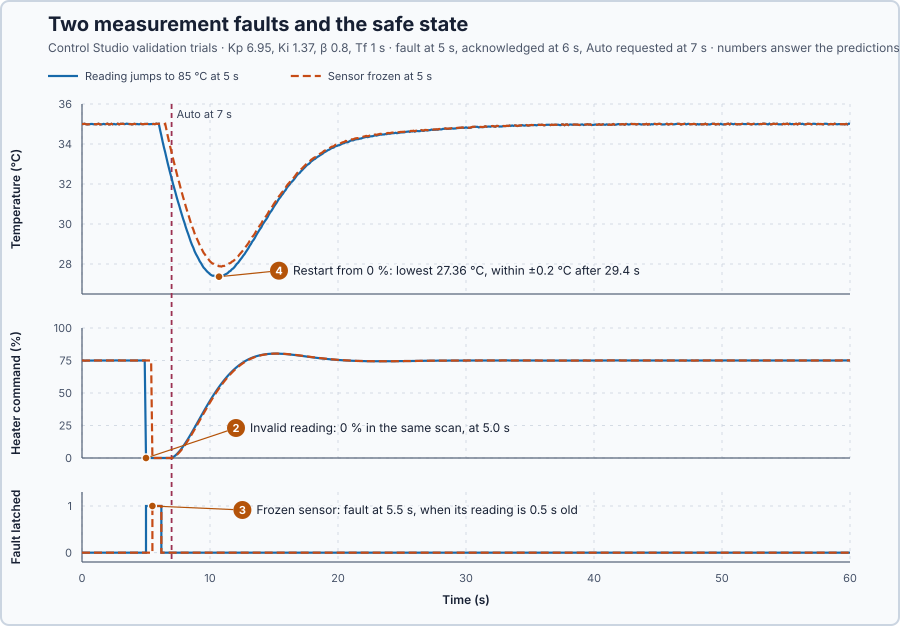

# 29. Measurement validity

In this lesson, you will make the controller check every reading before it uses it, switch the heater to a safe state when a reading cannot be trusted, and return to control only deliberately. You will test a reading that jumps out of range and a sensor that freezes.

## The problem

Lesson 28 applied the faster set, $K_p = 6.95$ and $K_i = 1.37$: the setpoint step settled in 6.7 s, the 30 kW load trial dipped to 33.68 °C, and a set with $K_p = 150$ never reached the controller. Every setting is now checked before it is used, but the measurement is not: the controller would use a wrong or old reading as if it were true. A reading that jumps to 85 °C makes it cut the heat. A sensor that freezes at 35 °C keeps the heater at 75 % while the water may be cooling unseen, and a reading stuck at 20 °C would drive the heater to 100 % while the water overheats.

We will check every reading before the controller uses it, hold a safe output while readings cannot be trusted, and return to control deliberately.

## What we need

We need to:

1. decide for every reading whether it can be trusted: in range, from a working sensor, and recent;
2. put the heater in a safe state at once when a reading cannot be trusted, without letting the bad reading change the controller's memory; and
3. return to control only after the fault is acknowledged and fresh, valid readings have come back.

## The new idea

**Measurement validity** means checking that a reading can be trusted before the controller uses it: is it within range, and is it recent? If not, the controller holds a safe output until fresh readings return. For this heater the safe output is 0 %: no heat.

**In words.** A controller believes every number it is given. A reading can be wrong in two ways that the number itself does not always show:

1. **Out of range.** A broken wire or a faulty transmitter can produce a value the sensor cannot measure, such as 85 °C from a 0–80 °C sensor.
2. **Old.** A sensor or its connection can stop while the last value stays on the input. A frozen 35 °C looks perfect while the water cools.

PLC engineers know both from fieldbus inputs: an analog module reports a wire break or an overrange in status bits, and a device's heartbeat counter shows whether its data are still being updated. The program therefore checks three things for every reading: the source reports good quality, the value is within the sensor's range, and the reading is recent. For the last check it records when each value was acquired and compares that with the present time.

When a check fails, the controller must not act on the bad reading. It switches to the safe output at once and freezes its memory, so the bad value leaves no trace in the integral or the filter. The failure stays active until it has been dealt with, like a latched alarm: a **latched fault**. Recovery is deliberate: an acknowledgement, then several fresh, valid readings in a row, then a new request for Auto, which takes over without a jump.

**The formula.** The **age** of a reading is

$$
a = t_{now} - t_{acquisition},
$$

and a reading is usable only when all three checks pass:

$$
\text{good quality}, \qquad 0 \le y \le 80, \qquad 0 \le a \le a_{max} .
$$

- $t_{now}$ is the present time and $t_{acquisition}$ the time the reading was taken, in seconds;
- $a$ is the reading's age, in seconds; a negative age means a time stamp from the future, so the clocks disagree;
- $y$ is the reading, in degrees Celsius, and 0–80 °C is the sensor's range; and
- $a_{max}$ is the largest accepted age, 0.5 s here, a teaching choice for this 0.1 s loop.

**Example: four readings and a fault.** Follow the numbers:

1. A reading taken at 12.30 s is used at 12.60 s: $a = 12.60 - 12.30 = 0.3$ s, within 0.5 s, so it is fresh.
2. The same reading at 12.90 s: $a = 0.6$ s, so it is refused, even though it still says 35 °C.
3. A reading stamped 12.40 s arrives at 12.30 s: $a = -0.1$ s, refused.
4. A reading of 85 °C, just taken: fresh, but outside 0–80 °C, so it is refused.

When a reading becomes unusable:

1. the heater command goes to 0 % in the same scan;
2. the controller is not updated, so the bad reading changes neither the integral nor the filter; and
3. the Auto request and the manual command are cleared, so neither can restart the heater by itself.

Recovery needs an acknowledgement and then three fresh, valid readings in a row, at least 0.3 s with a reading every 0.1 s. One good reading after a fault could be a coincidence; three in a row show that the sensor is acquiring again. The controller is then initialized from the actual condition, 0 % applied, and stays in Manual until Auto is requested again.

**The limitation.** The age limit decides how long a frozen value can still be used: a sensor that freezes is detected only when its last reading has become $a_{max}$ old, and until then the controller acts on that old value. A smaller limit detects sooner but refuses readings that are only slightly late. The safe state has a price too: without heat, the water at 35 °C loses $10 \times (35 - 20) = 150$ kW and, storing 50 kJ per °C, cools by $150/50 = 3$ °C per second until the heater is back.

## Prediction

Before running, answer these questions:

1. Which of the readings in the table can the controller use?
2. When the reading jumps to 85 °C at 5 s, when does the heater get 0 %?
3. When the sensor freezes at 5 s, when is the fault detected?
4. After the acknowledgement at 6 s and the Auto request at 7 s, how far does the water cool, and when is it back within ±0.2 °C?

| Reading | Age | Usable? |
| --- | ---: | --- |
| 35 °C | 0.3 s | yes |
| 35 °C | 0.6 s | no: older than 0.5 s |
| 85 °C | 0 s | no: outside 0–80 °C |
| 35 °C | −0.1 s | no: stamped in the future |

## Implementation

Open [`src/Main.st`](src/Main.st). `ReadingUsable` makes the three checks:

```st
ReadingUsable := QualityGood AND Value >= LREAL#0.0 AND Value <= LREAL#80.0
    AND Age >= LREAL#0.0 AND Age <= MaximumAge;
```

The first unusable reading latches the fault and clears both ways of restarting the heater:

```st
IF NOT MeasurementUsable AND NOT MeasurementFault THEN
    MeasurementFault := TRUE;
    AutoMode := FALSE;
    ManualOutput := LREAL#0.0;
    Acknowledged := FALSE;
    RecoveryCount := 0;
END_IF;
```

After `FaultAcknowledge`, `FreshSamplesRequired` = 3 consecutive new and valid acquisitions clear the fault; a repeated old reading does not count, and an invalid one restarts the count. `InjectedOffsetC` and `SensorFrozen` create the two faults of the experiment.

**Exercise.** Run the tests in [`src/tests.st`](src/tests.st) from the **Testing** view. They check the age limit (0.5 s passes; 0.6 s, 0.7 s and −0.1 s fail) and the range and quality checks (85 °C, −1 °C and bad quality fail).

## Experiment in Control Studio

Besides the setpoint and load trials, the project validates two fault trials at a 35 °C setpoint. In the **invalid value** trial the reading jumps by 50 °C at 5 s; in the **stale sensor** trial the sensor freezes at 5 s. In both, the fault is removed and acknowledged at 6 s and Auto is requested at 7 s. The heater must be at 0 % until 6.9 s and within ±0.2 °C of 35 °C from 40 s.

1. Open this lesson's project and start **Simulator**. The heater holds 35 °C with 75 % in Manual. In the **truST** side bar, select **Control Studio**.
2. On **Identify**, keep **Method** at **Automatic** and select **Identify plant**; the model is G(s) = (0.2) / (5.1s +1) · e^(−1s).
3. On **Tune**, choose **P1.Controller · PI** and **Manual**. Enter **Proportional gain (Kp)** 6.95, **Integral gain (Ki)** 1.37, **Setpoint weight (β)** 0.8 and **Measurement filter time (Tf)** 1.
4. Select **Requirements…** and enter **Setpoint change (°C)** 3, **Maximum steady-state error (°C)** 0.2, **Maximum settling time (s)** 15, **Settling band (±°C)** 0.1 and **Validation duration (s)** 60. Select **Done**, then **Tune controller**.
5. On **Validate**, select **Validate controller** and read the rows of the two fault trials.
6. Select **Apply**. Control Studio shows **Applied**.

## Evidence and decision



The numbered marks answer predictions 2–4; the tests answer 1. From the validation:

| Fault trial | Heater at 0 % | Lowest temperature | Within ±0.2 °C | Error from 40 s, limit 0.2 °C |
| --- | ---: | ---: | ---: | ---: |
| Reading jumps to 85 °C | 5.0–7.0 s | 27.36 °C | after 29.4 s | 0.043 °C |
| Sensor frozen | 5.5–7.0 s | 27.87 °C | after 29.2 s | 0.042 °C |

The setpoint and load trials passed, settling in 6.5 s and 17.1 s.

2. The invalid reading switched the heater to 0 % in the same scan, at 5.0 s. It changed neither the integral nor the filter: `IntegralPct` stayed at 75.00 % until the recovery.
3. The frozen sensor's last reading stayed usable until it was 0.5 s old: the fault came at 5.5 s, and until then the heater still received 75 %.
4. After the acknowledgement, three fresh readings cleared the fault by 6.3 s; the heater stayed at 0 % until Auto was requested at 7 s. The controller then started from the actual 0 %, and with the water cooling at up to 3 °C per second it fell to 27.36 °C (27.87 °C with the frozen sensor) before the integral had climbed back. The water was within ±0.2 °C again after about 29 s.

The safe state costs a dip of about 7.5 °C and half a minute of recovery, because nothing heats until the operator has acknowledged the fault and requested Auto. In return, the controller never acted on a reading it could not trust. We keep the checks and apply the set from Lesson 28; Control Studio reports **Applied**. These are simulation results for this heater.

## Conclusion

A controller must check every reading before using it: range, source quality and age, $a = t_{now} - t_{acquisition}$. An unusable reading latches a fault that removes heat at once and freezes the controller's memory, and only an acknowledgement followed by three fresh, valid readings and a new Auto request returns the heater to control.

For this heater, both faults switched the heater off within half a second, and the deliberate restart from 0 % cost a dip to about 27.4 °C.

## Check yourself

1. **A reading was acquired at 12.30 s, and the scan runs at 12.85 s. Can the controller use it, with $a_{max} = 0.5$ s?**
   $a = 12.85 - 12.30 = 0.55$ s, more than 0.5 s, so it is stale and refused.
2. **Why does recovery need three new readings in a row rather than one valid reading?**
   A frozen input can repeat a plausible value, and one good reading can be a coincidence. Three new acquisitions in
   a row show that the sensor is acquiring again.
3. **Why did the water cool by more than 7 °C, although the heater was off for only 2 s?**
   The controller restarted from the actual 0 %, and the integral needed seconds to climb back to 75 % while the
   water, without heat, kept cooling by up to 3 °C per second.

## Reason for the next lesson

Each mechanism works on its own: tuning, setpoint weighting, filtering, timing, initialization, transfer, parameter updates and measurement validity. But the complete heater controller has not been built and tested: one program that combines them all and is assessed against every requirement at once.

[Heater commissioning](../../14-integrated-capstones/81-water-heater/README.md) builds the complete controller and assesses it.
