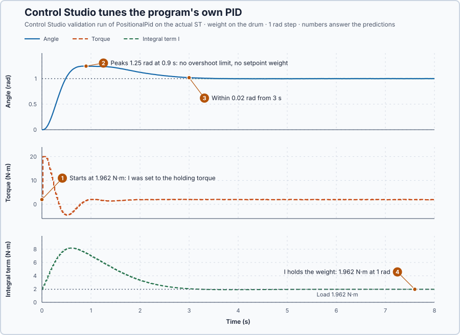

# 40. Your own PID law

In this lesson, you will let Control Studio design, validate and apply the gains of a PID your program computes itself, while the shaft holds a weight on the drum. You will see why the law's remembered values decide whether the weight is held when Control Studio takes over.

## The problem

Lesson 39 showed that the positional PID written in ST, `PositionalPid`, is the same controller as `Control.PID` once it keeps the right values: over 302 updates their torques differed by less than $10^{-14}$ N·m. Control Studio tunes `Control.PID` because it knows its parameter record and the values it keeps between updates.

The program's own law is ordinary ST. Control Studio does not know which variables hold its gains, nor which values it remembers. We will tell it, and let it design the gains.

## What we need

We need to:

1. name the law's gains, so Control Studio can design and apply them;
2. name the values the law remembers between updates; and
3. make every start of the law in Auto begin from the torque that already holds the weight.

## The new idea

An **own control law** is a controller your program computes itself, such as this lesson's PID written in ST. Control Studio can tune it once you tell it which variables are the gains and which values the law remembers between updates.

**In words.** Control Studio already knows `Control.PID`: where its gains are, which values it keeps between updates, and how to start it without a bump. A law written in ST is just code to Control Studio until you describe it. The description has three parts:

1. **The gains.** The variables that hold the proportional, integral and derivative gains. Control Studio designs values for them and, on **Apply**, writes them.
2. **The remembered values.** The values the law carries from one update to the next, here the integral term and the previous measurement. They are the law's memory, the static variables of its function block.
3. **The start.** Control Studio validates the actual ST by starting it in Auto at the operating point, and **Apply** switches to Auto there too. At that moment the target equals the measured angle, so the error is zero and P gives nothing. The first torque then comes only from the remembered values, so they must belong to the present state, or the start gives the shaft a jolt.

It is like connecting a faceplate to a function block written in-house: the faceplate works only once you have mapped which tags are its settings and which hold its state. In Manual, the law keeps its integral term in step with the manual torque itself, Lesson 27's bumpless transfer. A start by Control Studio has no Manual updates before it, so Control Studio sets the remembered values itself, from the present torque and angle.

For this lesson's shaft, the weight hangs on the drum the whole time. A wrong remembered value at the start does not just cause a bump: the weight starts to fall.

**The formula.** The law computes, at every update $k$,

$$
u_k = K_p e_k + I_k + D_k, \qquad D_k = -K_d\,\omega_k, \qquad \omega_k = \frac{\theta_k - \theta_{k-1}}{\Delta t} ,
$$

with the integral term growing by $K_i e_k \Delta t$ at each Auto update and Lesson 8's tracking at the limit. At the start the error is zero, so the first torque is

$$
u_{first} = I_{start} - K_d\,\frac{\theta - \theta_{k-1}}{\Delta t} ,
$$

and it equals the torque already applied only if Control Studio sets $I_{start}$ to that torque and $\theta_{k-1}$ to the present angle $\theta$.

- $u_k$ is the torque, in newton-metres;
- $e_k$ is the error, in radians;
- $I_k$ is the **integral term**, the torque the integral supplies, in newton-metres, and $I_{start}$ its value at the start;
- $D_k$ is the derivative torque, in newton-metres;
- $\theta_k$ is the measured angle and $\theta_{k-1}$ the **previous measurement**, from which D calculates the speed, in radians;
- $\omega_k$ is the speed D sees, in radians per second;
- $K_p$, $K_i$ and $K_d$ are the gains, and $\Delta t = 0.02$ s the update interval.

**Example: Control Studio starts the law on the shaft.** In Manual the drive holds the 2 kg weight at rest at 0 rad. The law still has Lesson 38's gains, $K_p = 16$, $K_i = 4$ and $K_d = 7$. Control Studio starts it in Auto with the target at the present angle. Follow the numbers:

1. **P gives nothing.** $e = 0 - 0 = 0$, so $P = 16 \times 0 = 0$ N·m. The first torque must come from $I$ and D.
2. **A wrong integral term.** Suppose $I = 1.0$ N·m was left over from an earlier run, with the previous measurement correct, so D is zero. The first torque is 1.0 N·m, 0.962 N·m short of the weight's 1.962 N·m, and the shaft starts to sink with $\dot\omega = (1.0 - 1.962)/1 = -0.96$ rad/s².
3. **A stale previous measurement.** Suppose instead that $I$ is right but $\theta_{k-1}$ is still $-0.05$ rad from the last time the law ran. D sees $\omega = (0 - (-0.05))/0.02 = 2.5$ rad/s, a speed that does not exist, and adds $D = -7 \times 2.5 = -17.5$ N·m. The first torque is $1.962 - 17.5 = -15.5$ N·m: it drives the shaft hard the wrong way, down with the weight.
4. **Both values set.** Control Studio sets $I$ to the present torque and $\theta_{k-1}$ to the present angle. Then P and D are both zero, and the first torque is exactly the torque that already holds the weight.

That is why the loop setup names the integral term and the previous measurement, together with the three gains. Control Studio then designs the gains on the model as it does for `Control.PID`.

**The limitation.** Control Studio sets only the values the setup names, and it designs for the law that the setup declares, **PID: u = Kp·e + I + D**. A law that computed something else, for example with a setpoint weight, would get gains designed for a different controller. The law also remembers its previous error and speed for Lesson 28's gain-change rule; at rest on target both are zero, so the rule adds $(K_{p,old} - K_{p,new}) \times 0 = 0$ N·m at the start. The starting gains are teaching values for this simulated axis.

## Prediction

Before running, answer these questions:

1. When Control Studio starts the law with $I = 1.962$ N·m, what is the first torque?
2. Will the automatically designed PID overshoot the 1 rad step? The law has no setpoint weight, and the requirements set no overshoot limit.
3. Will the shaft stay within 0.02 rad of the target by 4 s?
4. What will the integral term hold at the end of the step?

| Start of the law at rest | First torque |
| --- | ---: |
| $I = 0$ | 0 N·m: the weight falls |
| $\theta_{k-1}$ stale by 0.5 rad | −175 N·m, clipped to −20 N·m |
| $I = 1.962$ N·m, $\theta_{k-1} = \theta$ | 1.962 N·m: the weight is held |

## Implementation

Open [`src/Main.st`](src/Main.st). It is Lesson 39's shaft with one change: `Own`, a `PositionalPid`, drives the torque instead of `Control.PID`. Its settings are `OwnParameters`, with Lesson 38's gains until Control Studio applies its design. The weight hangs on the drum: in Manual the program holds it with 1.962 N·m, and an abort engages the brake.

```st
Own(Parameters := OwnParameters, Input := Input);
TorqueNm := Own.TorqueNm;
```

**ST practice.** Find `IntegralNm` and `PreviousAngleRad` inside `PositionalPid` and explain why each must survive from one update to the next. Then open [`src/tests.st`](src/tests.st) and run its tests from the **Testing** view: they check the three starts in the table on the law itself.

## Experiment in Control Studio

1. Open this lesson's project and start **Simulator**; the shaft holds the weight at 0 rad in Manual with 1.962 N·m.
2. Open the setup form with **Configure control loop**: run **truST: Configure control loop** from the Command Palette. In **Set up control loop**, enter **Loop name** `Axis`, choose **Structure** **Own P, PI or PID: the program computes the output from its gain variables**, then fill in:

   | Field | Choice |
   | --- | --- |
   | **Instance that computes the law** | `P1.Own` |
   | **Law** | **PID: u = Kp·e + I + D** |
   | **Measurement** | `P1.AngleRad`, **Unit** rad, **Minimum** −2, **Maximum** 2 |
   | **Setpoint** | `P1.SetpointRad` |
   | **Output** | `P1.TorqueNm`, **Unit** N·m, **Minimum** −20, **Maximum** 20 |
   | **Auto/Manual signal**, **TRUE means** | `P1.AutoMode`, **Auto** |
   | **Manual output** | `P1.ManualTorqueNm` |
   | **Proportional gain Kp** | `P1.OwnParameters.ProportionalGain`, 0 to 100 |
   | **Integral gain Ki** | `P1.OwnParameters.IntegralGain`, 0 to 100 |
   | **Integral term I, in the output's unit** | `P1.Own.IntegralNm` |
   | **Derivative gain Kd** | `P1.OwnParameters.DerivativeGain`, 0 to 50 |
   | **Previous value the derivative is taken from** | `P1.Own.PreviousAngleRad`; **That previous value is** **The measurement** |
   | **Identification step**, **Identification duration (s)** | 1, 8 |
   | **Startup-done flag** | `P1.Initialized` |

   The program sets the target itself at its start, so the form asks for the flag that marks that start as done. Select **Save loop**.
3. In the **truST** side bar, select **Control Studio**. On **Identify**, set **Method** to **Supplied plant model**, select **Open model…** and choose `shaft-model.json`.
4. On **Tune**, keep **Tuning method** **Automatic**. Select **Requirements…**, enter **Setpoint change (rad)** 1, **Maximum steady-state error (rad)** 0.02, **Maximum settling time (s)** 4, **Settling band (±rad)** 0.01 and **Validation duration (s)** 8, select **Done**, then **Tune controller**. Tune shows **PID controller · PositionalPid** with the designed gains.
5. On **Validate**, select **Validate controller**. When every row passes, select **Apply**; Control Studio reports **Applied**.

To repeat, select **Restore previous settings** on **Validate**, then start again from step 4.

## Evidence and decision



The numbered marks answer the predictions with the same numbers. From the validation run and the apply step:

| Result | Value |
| --- | ---: |
| Automatic PID | $K_p$ 18.77 N·m/rad, $K_i$ 17.46 N·m/(rad·s), $K_d$ 7.27 N·m·s/rad |
| First torque of the validation | 1.962 N·m, with $I = 1.962$ N·m |
| Peak | 1.25 rad at 0.9 s |
| Within 0.02 rad from | 3 s, limit 4 s |
| Largest error, 4–8 s | 0.0036 rad, limit 0.02 rad |
| After **Apply** at 1 rad | $I = 1.962$ N·m, torque 2.00 N·m |

1. Control Studio started the law with its integral term at the 1.962 N·m holding torque and its previous angle at the present angle, so the first torque held the weight.
2. The step overshot to 1.25 rad: with no setpoint weight and no overshoot limit, the design accepts a large peak.
3. The shaft stayed within 0.02 rad from 3 s, inside the 4 s requirement, and every validation row passed.
4. At the end the integral term held the weight with 1.962 N·m at 1 rad; after **Apply** the law kept holding it with $I = 1.962$ N·m.

The gains are exactly those Automatic designed for `Control.PID` in Lesson 36: the same model and requirements give the same design, whichever program computes the law. These are simulation results.

## Conclusion

Control Studio tunes a law it did not write once the setup names its gains and the values it remembers. It sets those values at the operating point for every start of the actual ST, so the validated response and the applied switch both begin from the torque that already holds the weight.

For this shaft, Control Studio designed, validated and applied the program's own PID, holding the 2 kg weight throughout.

## Check yourself

1. **At rest at 0.3 rad with a stale previous measurement of 0.2 rad and $K_d = 7$, what speed does D see, and what torque does it add?**
   $\omega = (0.3 - 0.2)/0.02 = 5$ rad/s, so $D = -7 \times 5 = -35$ N·m, clipped to the −20 N·m limit.
2. **Why must Control Studio set the integral term before the first Auto update?**
   At the operating point the error is zero, so P gives nothing; only the integral can supply the torque that holds
   the weight.
3. **Why did Automatic design the same gains as for `Control.PID`?**
   It designs from the model and the requirements, which were the same; how the program computes the law does not
   change the design.

## Reason for the next lesson

The tuned law moves to a target and holds a weight, but a tuned law is not yet a commissioned servo: its behaviour under load, at the torque limits, at startup, at mode changes and with faults has not been assessed together.

[Servo commissioning](../../14-integrated-capstones/82-servo/README.md) assesses the complete position controller against those requirements.
