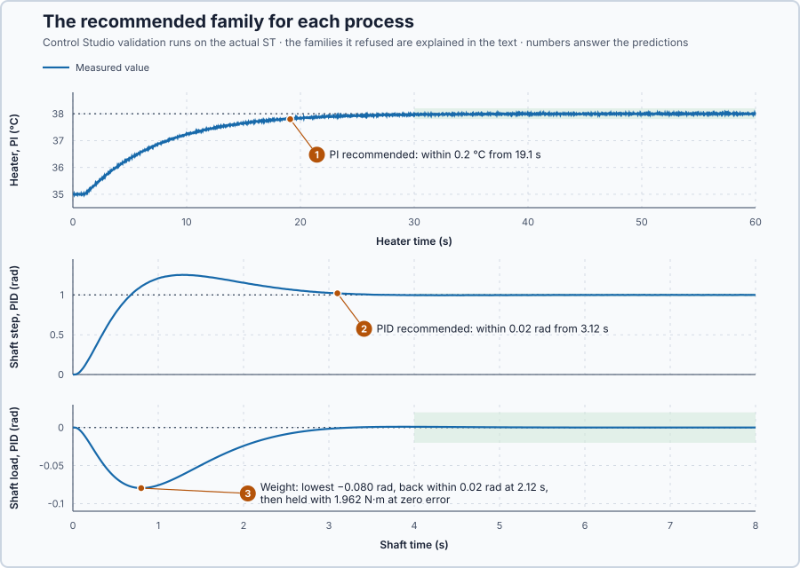

# 42. Controller families

In this lesson, you will let Control Studio design P, PI, PD and PID for the heater and for the drum shaft against one set of requirements each, and explain from each process why the families it refuses fail.

## The problem

Lesson 41 commissioned the shaft with PID — $K_p = 16$, $K_i = 12$, $K_d = 7$, $\beta = 0.3$ — and it passed all seven requirements. But the heater got PI and the shaft PID only because those were the lessons that introduced them. Neither choice was tested against the other families.

A new process will not come with its lesson attached. We will choose the controller from the process and the requirements, and read why the other choices fail.

## What we need

We need to:

1. design every family by the same method for the same requirements;
2. see which families meet the requirements and which is the simplest; and
3. explain each refusal from the physics of the process.

## The new idea

The **controller family** is which parts the controller uses: P, PI, PD or PID. The process decides:

- a process that settles by itself needs I to reach a new level without error;
- a shaft that keeps moving needs D to brake; and
- a constant load needs I to hold it.

**In words.** Most PLC PID function blocks have switches for their P, I and D parts. The controller family is the choice of which switches to turn on, and each part has one job:

1. **P** reacts to the error now: the bigger the error, the bigger the correction.
2. **I** remembers: it keeps adding up the error until it is gone, and then holds whatever steady output is needed at zero error.
3. **D** brakes: it opposes how fast the measurement changes.

To choose, ask three questions about the process:

1. **Does it settle by itself?** The heater does: a constant power gives a constant temperature. But a higher temperature needs more power for good, and P gives that extra power only from a remaining error. So the heater needs I to reach a new temperature without an error.
2. **Does it keep moving?** The shaft does: once moving, only friction stops it, and P cannot brake. So the shaft needs D.
3. **Is there a constant load?** The weight on the drum needs a steady torque at the target, and P and D give torque only from an error or a speed. So the loaded shaft needs I as well.

Extra parts are not free: I can wind up and overshoot, and D passes noise to the actuator. So the rule is to choose the simplest family that meets every requirement.

**Choose automatically** in Control Studio does exactly this. It designs every family for the same requirements, recommends the simplest that meets them, P before PI, PD and PID, and gives a reason for each family it refuses. It checks a load such as the weight as an **input disturbance**: a constant load added at the plant's input in its own trial, with the setpoint unchanged.

For this lesson's two processes, the heater and the loaded drum shaft, the three questions give different answers, and so different families.

**The formula.** Three calculations turn the questions into numbers.

The heater under P. At a steady temperature, the heater turns P's extra power $K_p e$ into the temperature rise $K K_p e$, which must equal the step minus the error that remains: $\Delta r - e = K K_p e$. So P settles with the error

$$
e = \frac{\Delta r}{1 + K K_p} .
$$

The shaft without enough braking. Lesson 35's damping sets how fast the error dies away, and falling from an error $e_0$ to $e_1$ takes at least

$$
\sigma = \frac{B + K_d}{2J}, \qquad t \ge \frac{\ln(e_0/e_1)}{\sigma} .
$$

The load under PD. At rest PD makes the holding torque only from the error, so, as in Lesson 36,

$$
e = \frac{\tau_L}{K_p} .
$$

- $e$ is the error that remains, in the measurement's unit (°C for the heater, rad for the shaft);
- $\Delta r$ is the setpoint change, in °C;
- $K$ is the heater's gain, in °C per % of power, and $K_p$ the proportional gain, in %/°C for the heater and N·m/rad for the shaft;
- $\sigma$ is the decay rate of the shaft's error, in 1/s, with $B$, $K_d$ and $J$ as in Lessons 34 and 35;
- $e_0$ and $e_1$ are the error at the start and the error to be reached, in radians, and $t$ the time in seconds; $\ln$ is Lesson 15's natural logarithm, which undoes $e^x$; and
- $\tau_L$ is the load torque, in N·m.

The weight pulls against the motor, so Control Studio enters it as an input disturbance of −1.962 N·m.

**Example: the heater and the shaft.** The heater's gain is $K = 0.2$ °C per %; the shaft has $J = 1$ kg·m² and $B = 1$ N·m·s/rad, and the weight pulls with 1.962 N·m. Follow the numbers:

1. **Heater, P.** A 3 °C step with $K_p = 10$ %/°C settles with $e = 3/(1 + 0.2 \times 10) = 1$ °C. The extra power is $10 \times 1 = 10$ %, which the heater turns into $0.2 \times 10 = 2$ °C, and $2 + 1 = 3$ °C: the step is split between the rise and the error that remains.
2. **Heater, the gain P would need.** For at most 0.5 °C of error, $1 + 0.2K_p \ge 3/0.5 = 6$, so $K_p \ge 25$ %/°C, more than three times the 7.14 %/°C of Lesson 19's faster design for this heater, which already meant a harder push. A tighter error needs even more.
3. **Heater, PD.** At a steady temperature the temperature does not change, so D is zero and PD leaves the same error as P. Only I holds the extra power at zero error.
4. **Shaft, P.** With $K_d = 0$, $\sigma = (1 + 0)/(2 \times 1) = 0.5$ per second whatever $K_p$, so falling from 1 rad to 0.02 rad takes at least $\ln(50)/0.5 = 3.91/0.5 = 7.8$ s.
5. **Shaft, with D.** With $K_d = 7$, $\sigma = (1 + 7)/2 = 4$ per second, and the same fall takes $3.91/4 = 0.98$ s. Only D raises $\sigma$.
6. **The weight under PD.** With $K_p = 16$ N·m/rad, PD sags $1.962/16 = 0.123$ rad. Holding within 0.05 rad would need $K_p \ge 1.962/0.05 = 39.2$ N·m/rad, and every tighter band more.

**The limitation.** The three questions point to the families that can work; whether one actually meets the requirements depends on its design, which Control Studio checks for each family. These calculations ignore the heater's delay and the drive's limits, which add their own reasons. The step sizes and error bands in the example are teaching values.

## Prediction

Before running, answer these questions:

1. Heater: 3 °C step, within 0.2 °C of the target from 30 s, settling band 0.1 °C. Which family will Control Studio recommend, and will it meet the requirements?
2. Shaft: 1 rad step, within 0.02 rad from 4 s, settling band 0.01 rad. Which family will it recommend, and why does each simpler family fail?
3. Under the weight, will the recommended shaft controller return to its target?

| Family | Heater | Shaft with the weight |
| --- | --- | --- |
| P | error stays ≥ 0.1 °C unless $K_p \ge 145$ %/°C | decays at 0.5/s: 9.2 s to 0.01 rad |
| PD | same error as P | needs $K_p = 196.2$ N·m/rad |
| PI | zero error | no braking |
| PID | zero error | brakes and holds the weight |

## Implementation

Open [`src/Main.st`](src/Main.st). The project runs both processes under `Control.PID` in one 20 ms task: `P1`, the heater, and `P2`, the drum shaft. Each has its own loop file in `control-loops/`.

**ST practice.** Find the three functions that compute the reasons above:

```st
ProportionalOffset := ReferenceChange / (LREAL#1.0 + ProcessGain * ProportionalGain);
ShaftDecayRate := (Friction + DerivativeGain) / (LREAL#2.0 * Inertia);
LoadOffset := LoadTorque / ProportionalGain;
```

Check 0.1 °C for a 3 °C step at $K_p = 145$, 0.5/s and 4/s for $K_d = 0$ and 7, and 0.123 rad at $K_p = 16$. Then open [`src/tests.st`](src/tests.st) and run its tests from the **Testing** view.

## Experiment in Control Studio

1. Open this lesson's project and start **Simulator**. In the **truST** side bar, select **Control Studio**; in **Choose a project loop**, choose **Heater**.
2. On **Identify**, select **Identify plant**. Control Studio fits a first-order model with delay.
3. On **Tune**, keep **Controller** at **Choose automatically** and **Tuning method** at **Automatic**. Select **Requirements…**, enter **Setpoint change (°C)** 3, **Maximum steady-state error (°C)** 0.2, **Maximum settling time (s)** 30, **Settling band (±°C)** 0.1 and **Validation duration (s)** 60, select **Done**, then **Tune controller**, and read the recommended family.
4. Choose `P1.Controller · P`, `P1.Controller · PD` and `P1.Controller · PID` in turn and select **Tune controller** each time, reading each message. Then choose `P1.Controller · PI — recommended`, tune, and on **Validate** select **Validate controller**.
5. Open **Control Studio** again and choose **Axis**. On **Identify**, set **Method** to **Supplied plant model**, select **Open model…** and choose `shaft-model.json`.
6. On **Tune**, enter **Setpoint change (rad)** 1, **Maximum steady-state error (rad)** 0.02, **Maximum settling time (s)** 4, **Settling band (±rad)** 0.01, **Validation duration (s)** 8 and **Input disturbance (N·m)** −1.962. Tune with **Choose automatically**, then with P, PI and PD. Choose `P2.Controller · PID — recommended`, tune, validate, and select **Apply**.

To repeat, start again from step 3 or step 6.

## Evidence and decision



The numbered marks answer the predictions with the same numbers. Control Studio identified the heater with a gain of 0.1999 °C per %, a time constant of 4.88 s and a delay of 1.08 s.

| Heater | Control Studio |
| --- | --- |
| Choose automatically | **PI, recommended**: $K_p$ 3.22 %/°C, $K_i$ 0.659 %/(°C·s) |
| P | refused: no P design rule for a process with delay; its error stays within 0.1 °C only with $K_p \ge 145$ %/°C |
| PD | refused: settles 6.4 °C from the target |
| PID | $K_p$ 3.22, $K_i$ 0.659, $K_d$ 3.47 %·s/°C: meets the requirements, but is not simpler than PI |
| PI, validated | within 0.2 °C from 19.1 s; largest error from 30 s 0.049 °C |

| Shaft | Control Studio |
| --- | --- |
| Choose automatically | **PID, recommended**: $K_p$ 18.77 N·m/rad, $K_i$ 17.46 N·m/(rad·s), $K_d$ 7.27 N·m·s/rad |
| P | refused: the decay rate stays at 0.5 1/s whatever $K_p$; settling by 4 s needs 1 1/s |
| PI | refused: its fixed damping cannot meet the response time |
| PD | refused: needs $K_p$ = 196.2 N·m/rad, above its declared maximum of 100 N·m/rad |
| PID, validated | step within 0.02 rad from 3.12 s; weight trial within 0.02 rad from 2.12 s; **Applied** |

1. For the heater, Control Studio recommended PI, which reached 0.2 °C of the target at 19.1 s and stayed within 0.049 °C from 30 s.
2. For the shaft it recommended PID, which settled within 0.02 rad at 3.12 s. P and PI failed because neither brakes the shaft, and PD because holding the weight needs more gain than allowed.
3. Under the weight the shaft dipped to −0.080 rad, was back within 0.02 rad at 2.12 s, and the integral then held the 1.962 N·m at zero error.

Each refusal is one of the calculations above. These are simulation results for these two processes.

## Conclusion

The process decides the family. A process that settles by itself needs integral action to reach a new level without an error; a shaft with little friction needs D to brake; a constant load needs a steady output, which only integral action gives at zero error. Choose the simplest family that meets every requirement, and read the refusals for why the others fail.

For these processes, Control Studio recommended PI for the heater and PID for the loaded shaft, each with its reasons.

## Check yourself

1. **The heater's gain is 0.2 °C per %. What error does P with $K_p = 20$ %/°C leave after a 3 °C step?**
   $e = 3/(1 + 0.2 \times 20) = 0.6$ °C.
2. **Why can no P gain make the shaft settle by 4 s?**
   P adds no braking; the swing dies at $B/(2J) = 0.5$ per second whatever $K_p$, too slow to fall from 1 rad to
   0.01 rad in 4 s.
3. **Why does PID hold the weight with zero error while PD cannot?**
   PD makes torque only from an error or a speed, so it must sag; the integral keeps the holding torque when both are
   zero.

## Reason for the next lesson

The next process is a tank: a pump changes how much water is stored, which neither settles like the heater nor needs braking like the shaft. It is a new kind of process, and we have no model of how pumping changes the level.

[Volume balance](../../01-feedback-foundations-and-temperature-control/14-conservation-and-accumulation/README.md) derives the tank's level from what flows in and out.
