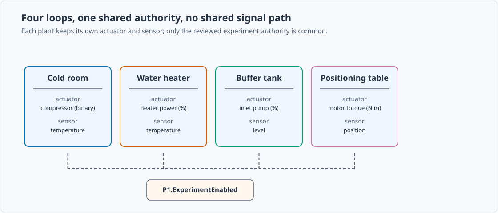
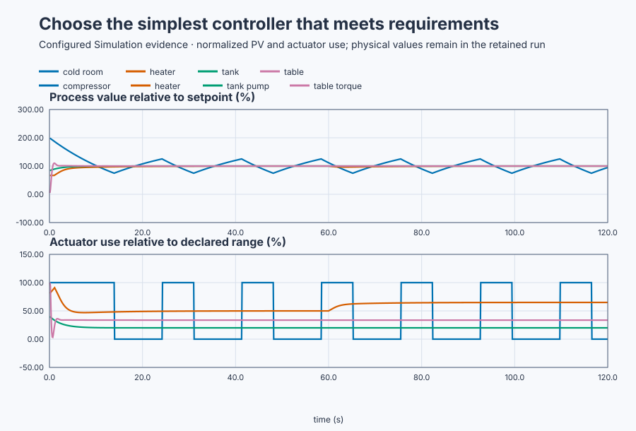

# Select the minimum sufficient controller

Course position: Lesson 31 of 84. Previous lesson: [Invalid data and safe
recovery](../../03-production-quality-digital-pid/30-booster-pump-invalid-data/README.md).
Next lesson: [Plant response classes](../32-plant-response-classes/README.md).

**Lesson objective:** Select and defend ON/OFF, P, PI, or PID for four different
real loops and prove each choice on executable plants.

**Evidence class:** Simulation evidence, not physical-plant commissioning
evidence. All four loops run in one shared simulator.

## The problem

Lessons 1–30 built controller mechanisms and made their implementation safe.
Now the student must choose which mechanisms a loop actually needs. The
equipment is a cold room, recirculating water heater, buffer tank, and loaded positioning table running together. They do not interact; their different
physics and actuators let us ask the same engineering question four times:
what mechanism is actually needed?

Earlier lessons developed ON/OFF, P, PI, PD, and PID individually. Selecting
PID everywhere would ignore the binary compressor and add tuning parameters,
dynamic state, and noise sensitivity where simpler control already meets the
requirement.

The correct choice is the simplest structure whose actuator and dynamic
mechanisms satisfy every declared requirement. Eligibility comes from
executable evidence, not from a habit of selecting PID.

## What we need

We need to select controller structure from each plant's actuator, dynamics,
disturbances, and performance requirement instead of applying PID by habit.

## The new idea

**Controlled-variable accuracy** states how close the measured result must be
to its target. An **acceptable band** permits the value to move inside explicit
limits. **Permanent load error** is an offset that remains after a sustained
disturbance.

A **self-regulating plant** reaches an equilibrium after a fixed input. An
**integrating plant** keeps changing while net input is nonzero. A **damping
requirement** limits oscillation in a plant that stores mechanical energy.

**Actuator resolution** is the smallest output change equipment can realize.
An actuator may be binary or continuous, and one-sided or bidirectional. A
heater is continuous and one-sided; motor torque is continuous and
bidirectional; this compressor is binary.

A **servo objective** concerns setpoint tracking. A **regulatory objective**
concerns disturbance rejection. **Noise sensitivity** describes how sensor
variation creates output activity. Constraints and safety requirements can
make an otherwise attractive structure ineligible.

The **minimum sufficient controller** is the least complex structure that
satisfies every declared requirement with margin. Simplicity never excuses a
failed requirement. Added mechanisms must answer measured needs:

- Integral action is justified by required removal of permanent error.
- Derivative action is justified by a demonstrated damping need.
- Plant integration can supply setpoint integration, but an unknown constant
  load can still create error.

## Prediction

The cold-storage room has a binary compressor and permits 1.5–2.5 °C. ON/OFF
with hysteresis directly matches that actuator. With SP 2 °C and half-width
0.5 °C, the switch thresholds are $2-0.5=1.5^\circ\mathrm{C}$ and
$2+0.5=2.5^\circ\mathrm{C}$. The 100 ms task requires
$5/0.1=50$ scans between transitions, which protects the compressor from
rapid cycling.

The water heater is self-regulating and must return to 30 °C after a constant
heat-loss change. Before that event its equilibrium is

$T_{\mathrm{eq}}=20^\circ\mathrm{C} +(0.2^\circ\mathrm{C}/\%)MV.$

Solving $30=20+0.2MV$ gives $MV=50\%$, that is, **50 percent**, holding the
heater at 30 degrees Celsius. At 60 seconds the modeled ambient
bias falls from 20 to 17 °C, so the new balance is
$30=17+0.2MV$, or 65%. PI can retain either nonzero equilibrium output at
zero error; proportional action alone cannot change output at zero error, and
derivative has no demonstrated purpose in this slow nonoscillatory plant.

The buffer tank is new equipment for this course. Its integrating gain
($K_t$) and 20% equilibrium pump bias are configured teaching values; a
learner would obtain $K_t$ from a bounded step test (Lesson 32's method) and
the bias from the steady pump output that holds level constant.

The buffer tank integrates net flow. Its known equilibrium pump bias is 20
percent (20%):

$\frac{dL}{dt}=K_t(MV-20),\qquad K_t=0.2\text{ cm/(\% s)}.$

Biased P control is $MV=20+K_p(SP-L)$, with
$K_p=2\text{ \%/cm}$. Substitution cancels the known 20% outflow balance:

$\frac{dL}{dt}=K_tK_p(SP-L)=0.4(SP-L).$

For error $e=SP-L$, $de/dt=-0.4e$, the standard first-order form
$de/dt=-e/\tau$. Therefore

$\tau=\frac{1}{K_tK_p}=\frac{1}{0.2(2)}=2.5\text{ s}.$

The closed loop therefore settles with a **2.5 seconds** time constant. P
control is sufficient for this setpoint case. An unknown changed outflow or
an exact regulatory requirement can justify PI; that boundary is not hidden.

The positioning table does not have a constant four newton-metre (4 N·m)
load. Its gravity torque is $4\sin(\theta)$ N·m, where 4 N·m is the peak
coefficient. PID is selected because derivative supplies damping and integral
action can supply the position-dependent equilibrium torque at zero final
error.

With the implemented $K_p=8\text{ N\,m/rad}$, PD equilibrium at
$SP=1$ rad must satisfy

$8(1-\theta)=4\sin(\theta).$

This nonlinear equation has $\theta\approx0.6840$ rad, so the predicted
offset is approximately **0.316 radian**
($1-0.6840\approx0.3160$ rad). PID can instead hold
$\theta=1$ rad with integral torque $4\sin(1)\approx3.366$ N·m while
derivative continues to damp motion.

## Implementation

The structure codes are ON/OFF 1, P 2, PI 3, PD 4, and PID 5. This project
publishes 1, 3, 2, and 5 for the four loops. It is **not an automatic
structure-selection algorithm**; the codes record decisions made from the
requirements above.

The heater, tank, and table each use one real `Control.PID` with only the
selected terms enabled. The cold room uses an explicit binary law:

```st
(* A binary compressor cannot realize a continuous PID output. Hysteresis and
   five-second dwell implement the declared temperature-band requirement. *)
IF DwellScans < 50 THEN
    DwellScans := DwellScans + 1;
END_IF;
IF AutoMode AND (ColdRoomTemperature >= ColdRoomSetpoint + LREAL#0.5)
    AND NOT CompressorOn AND (DwellScans >= 50) THEN
    CompressorOn := TRUE;
    DwellScans := 0;
ELSIF (ColdRoomTemperature <= ColdRoomSetpoint - LREAL#0.5)
    AND CompressorOn AND (DwellScans >= 50) THEN
    CompressorOn := FALSE;
    DwellScans := 0;
END_IF;
```

`DwellScans` counts 100 ms scans since the last transition; 50 scans is the
five-second dwell the Prediction relies on. `AutoMode` gates Manual, and the
`CompressorOn` checks select one switching direction at a time.

## Experiment in Control Studio

Test writes one reviewed Boolean authority,
$\mathtt{P1.ExperimentEnabled}$, for 120.1 seconds. The project owns all four
selected controllers and their setpoints: cold room ON/OFF at 2 °C, heater PI
at 30 °C, tank biased P at 60 cm, and table PID at 1 rad. The simulator owns
the declared heater-bias change at 60 seconds. Returning authority false puts
the continuous loops in Manual safe outputs, turns the compressor off, and
restores the initial setpoints.

Fresh native runs own the candidate rejection matrix and retained four-plant
comparison. The UI run demonstrates the selected structures; it is not an
automatic selector. The deterministic Simulation seed is 20260829.

### Control Studio actions

1. **Monitor** — Start the **Simulator**, then open **truST sidebar → Control Studio → Monitor → Response**.
   - **Baseline check:** Wait for **Simulation**, **Running**, current samples, and good quality. Confirm cold room 4 °C/compressor off, heater 20 °C/power 0%, tank 50 cm/pump 20%, table 0 rad/torque 0 N·m, continuous loops Manual, and experiment authority false. Add every SP/PV/MV triple, structure code, mode, limits, and authority to **Signals**.
   - **Decision before action:** Write one requirement that rejects PID or justifies the selected structure for each loop. Record the numerical predictions: cold thresholds and dwell, heater 50→65%, tank 2.5 s, and table PD offset 0.316 rad.
   - **Successful evidence:** The plot advances, values are finite/current, quality is good, and **Start recording** is enabled. Select **Start recording**.
   - **Recovery:** For stale, unavailable, nonfinite, or poor-quality data, stop the Simulator, correct the displayed fault, restart, and repeat the baseline check.
   - **Record:** Note all four initial states, selected codes, safety limits, and predictions.

2. **Test** — Open **truST sidebar → Control Studio → Test**.
   - **Baseline check:** Confirm **Experiment** = **Observe without excitation**, **Amplitude** = **0** (disabled), and **Maximum duration (s)** = **120.1**. The reviewed authority is **Experiment authority** (`P1.ExperimentEnabled`). The project owns the four setpoint and mode changes.
   - **Decision before action:** Confirm the plan writes only that Boolean and restores it false. Check every physical range and require compressor output exactly 0 or 100% with at least five seconds between changes.
   - **Successful evidence:** Select **Review test**, verify authority, timeout, all stop conditions, and false restoration, then **Confirm and start**. Keep **Abort test** available. Observe protected cold-room cycling, heater rejection of the 60-second loss event, tank convergence, table damping/tracking, and safe restoration.
   - **Recovery:** Abort for any nonfinite/out-of-limit signal, compressor dwell violation, unexpected mode, or structure code change. Confirm authority false and all four safe outputs before retrying.
   - **Record:** Retain terminal state, restoration, all SP/PV/MV traces, structure codes, compressor transitions, heater event, limits, final-window measures, and seed.

There is no separate disabled Validate stage. The native evidence owns the
candidate matrix; Monitor and Test expose the four selected structures.

## Evidence and decision

The four loops share one workshop but not one signal path; only the reviewed
experiment authority is common to all four.



**Requirement coverage** is the count of declared requirements passed. A
candidate is eligible only if it passes all of them.

**Complexity** counts enabled dynamic mechanisms and retained states. Use it
only to choose among eligible candidates; never use it to excuse failure.

The candidate matrix records all five structures for every plant. It rejects
structurally ineligible choices before tuning and then uses the executed run to
qualify the one selected structure.

[Candidate requirements and rejection matrix](figures/controller-selection-candidates.csv)

For the cold room, measure band-violation time after pull-down, transitions per
hour, and dwell compliance. For the heater and tank, first qualify settling,
then use final-window absolute error and output total variation. For the table,
also measure overshoot and torque total variation.

| Plant | Selection | Executable result | Reason |
| --- | --- | --- | --- |
| Cold room | ON/OFF | 1.492–2.502 °C | Binary actuator and acceptable band |
| Water heater | PI | 0.0159 °C final-window error | Zero load error, no damping need |
| Buffer tank | P | 0.0000 cm final-window error | Plant integrates the declared setpoint case |
| Loaded table | PID | 0.0000 rad final-window error | Damping plus zero constant-load error |

The plot expresses each process value relative to its own setpoint and each
actuator relative to its declared range. It supports comparison without
pretending the physical units are interchangeable. The retained run preserves
every physical value and unit.



The cold room shows protected square-wave cycling, the heater and tank settle
smoothly, and the table shows damped tracking rather than sustained
oscillation.

[Retained run](figures/controller-selection-run.csv) ·
[Plot data](figures/controller-selection-trace.csv) ·
[Decision summary](figures/controller-selection-summary.csv)

Require compressor commands of exactly 0 or 100 percent and at least five
seconds between transitions. After pull-down, allow only 0.15 °C numerical
tolerance outside the 1.5–2.5 °C thresholds. Require heater error no greater
than 0.10 °C, tank error no greater than 0.05 cm, and table error no greater
than 0.02 rad in the final 20 seconds. Reject any nonfinite or limited-state
result that invalidates its measure.

## Conclusion

ON/OFF, P, and PI are not incomplete versions of PID. They are correct choices
when actuator capability, plant dynamics, and requirements do not justify more
mechanisms. The loaded table selects PID because its evidence requires all
three terms, not because PID is considered inherently better.

## Reason for the next lesson

Apply the same worksheet to another loop, but do not assume its plant class.
Lesson 32 next teaches plant response classes through equal open-loop tests
before fitting models or selecting a controller.
