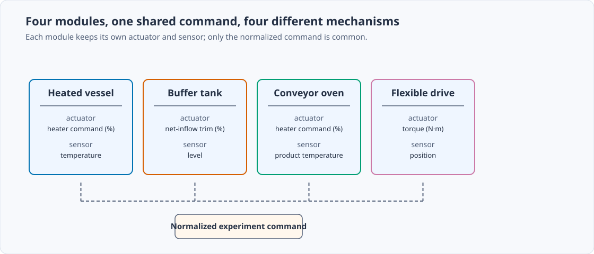
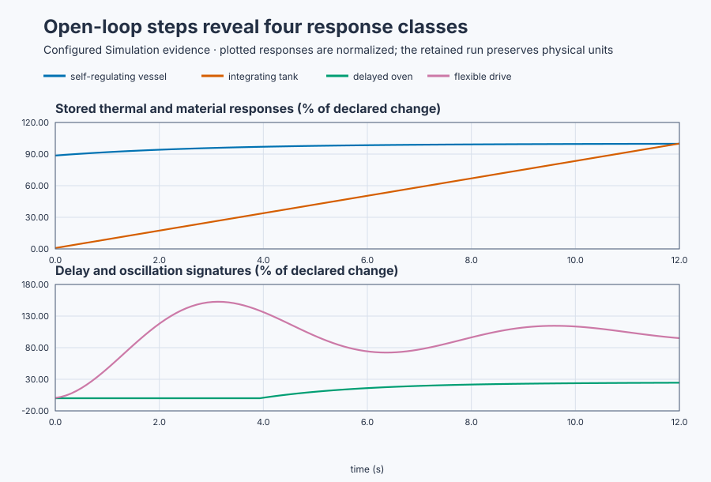

# Classify physical plant responses before modelling

Course position: Lesson 32 of 84. Previous lesson: [Controller
selection](../../04-controller-selection-and-plant-models/31-controller-selection/README.md). Next lesson:
[Conservation-law models](../33-tank-heater-conservation/README.md).

**Lesson objective:** Apply one normalized bounded experiment to four physical
modules and classify each response from measured signatures without fitting a
model.

**Evidence class:** Simulation evidence. Each physical plant would need its
own approved step, limits, and abort procedure.

## The problem

Lesson 31 selected controllers because each plant class was already known.
This lesson removes that prior knowledge. The equipment is a modular skid with
heated vessel, buffer tank, conveyor oven, and flexible drive. The first
seconds of their trends can all look like “a slow rise,” but the mechanisms
are different.

The configured model names remain hidden until the learner commits a
classification.

On unfamiliar equipment, choosing PI or fitting a stable first-order
model from a short trend can mistake delay, integration, or oscillation for an
ordinary slow process.

The experiment must distinguish equilibrium, continuing drift, delay, and
oscillation before fitting. Its window must be long enough that a delayed or
integrating response is not mistaken for a weak stable response.

## What we need

We need to recognize static, self-regulating, integrating, and underdamped
response signatures before choosing a model or controller.

## The new idea

The **operating point** is the steady or defined starting condition. A
**manipulated-input change** is the actuator move imposed by the experiment. A
**process-output change** is the resulting sensor movement. **Control direction**
states whether positive input moves output positively or negatively.

Plants respond dynamically because they store quantities. A tank stores mass,
a heated vessel stores energy, and a flexible drive stores momentum and elastic
energy. We therefore examine **stored mass**, **stored energy**, and **stored
momentum** before naming a curve shape.

A **time constant** describes how quickly a self-regulating response approaches
its steady value. A **continuing slope** means output still changes per second.
**Integration** occurs when unequal rates accumulate in a stored quantity. A
**response delay** is an interval after input changes but before output begins
to move.

The **natural frequency** describes the unforced exchange rate of stored energy.
**Damping** removes energy from that motion. **Resonance** is strong response
near a lightly damped natural frequency. The **observation window** is the time
range used to decide; a window can be too short to reveal the signature.

A self-regulating plant approaches a finite equilibrium and its late slope
approaches zero. An integrating plant retains a nonzero slope under constant
net input. A delayed plant shows no output response initially. An oscillatory
plant crosses its eventual value as stored energy exchanges between states.

## Prediction

One **normalized experiment command** moves from 0 to 1. Structured Text maps
it into a 20-percentage-point heater command, a 10-percentage-point tank
net-inflow trim, a 20-point oven command, and a one-newton-metre drive torque.
The plots retain those physical commands and PV units.

All four modules are configured teaching values for this skid, chosen to
isolate one response signature apiece. On real equipment a learner would
obtain the vessel and oven gain/time-constant/delay from a bounded step test,
the tank's integrating gain from a bounded step test relating commanded
net-inflow change to measured level-rise rate, and the drive's natural
frequency and damping ratio from a free-decay or frequency-response test on
the installed mechanism.

The heated vessel starts at 50 °C. A self-regulating first-order step follows

$T(t)=T_0+K\Delta MV(1-e^{-t/\tau}).$

The final change is $K\Delta MV=0.2(20)=4^\circ\mathrm{C}$, so equilibrium
is 54 degrees Celsius (54 °C). At 12 seconds, $t/\tau=12/3=4$:

$T(12)=50+4(1-e^{-4})=53.927^\circ\mathrm{C}.$

The vessel therefore reaches 53.93 degrees Celsius at twelve seconds. The
exponential term shrinks toward zero, explaining both the finite equilibrium
and the decreasing late slope.

This skid's buffer tank is distinct equipment from Lesson 31's workshop tank:
same name and same 50 cm starting level, but a different **tank integrating
gain ($K_t$)** — 0.1 here versus 0.2 cm/(%·s) there — because it is a separate
tank on this training skid. The tank starts at 50 cm. Its open-loop balance is

$dL/dt=K_t\Delta MV,\qquad K_t=0.1\text{ cm/(\% s)}.$

Thus $dL/dt=0.1(10)=1$ cm/s. Integrating the constant slope gives

$L(t)=L_0+(1\text{ cm/s})t,$

so $L(12)=50+12=62$ cm. The tank therefore reaches 62 centimetres after 12
seconds. No loss term appears to create an equilibrium.

The oven starts at 80 °C. Its 4-second transport delay means elapsed response
time is $t-L$, not $t$. Its final change is $0.25(20)=5^\circ\mathrm{C}$.
For $t>4$,

$T(t)=80+5(1-e^{-(t-4)/2}).$

At 12 seconds, the dynamic part has run for 8 seconds, or four time constants:
$T(12)=80+5(1-e^{-4})=84.908^\circ\mathrm{C}$. After a delay of four seconds
the oven begins to respond, reaching 84.91 degrees Celsius by twelve seconds.

The drive has unit static gain, natural frequency 1 rad/s, and damping ratio
$\zeta=0.2$. A standard underdamped second-order step has fractional
overshoot

$M_p=e^{-\zeta\pi/\sqrt{1-\zeta^2}}.$

This comes from evaluating the exponentially decaying oscillation envelope at
its first peak. Substitution gives
$M_p=e^{-0.2\pi/\sqrt{0.96}}=0.5266$, or 52.7 percent overshoot. A unit final
position therefore predicts a first peak near $1+0.5266=1.527$ rad.

<details>
<summary>Reveal the plant identities</summary>

- The response that approaches a new equilibrium is the heated vessel.
- The response that continues ramping is the integrating tank.
- The response that begins only after a quiet interval is the delayed oven.
- The response with decaying oscillation is the flexible drive.

Reveal this list only after recording the four predictions and classifications.
</details>

## Implementation

There is no feedback controller under test. The actual Structured Text clamps
the approved experiment and converts it into physical commands:

```st
BoundedExperimentInput := MAX(MIN(ExperimentInput, LREAL#1.0), LREAL#0.0);
HeaterCommand := LREAL#20.0 + LREAL#20.0 * BoundedExperimentInput;
TankInflowTrim := LREAL#10.0 * BoundedExperimentInput;
OvenCommand := LREAL#20.0 + LREAL#20.0 * BoundedExperimentInput;
DriveTorque := LREAL#1.0 * BoundedExperimentInput;
```

Do not fit a model and do not tune a controller in this lesson.

## Experiment in Control Studio

Test writes one reviewed Boolean authority,
$\mathtt{P1.ExperimentEnabled}$, for 12.1 seconds. The project maps authority
true to the normalized command 1 and then to all four physical actuator steps.
Authority false maps to normalized command 0 and restores the four baseline
commands. There is no feedback controller in either state. The deterministic
Simulation seed is 20260829.

### Control Studio actions

1. **Monitor** — Start the **Simulator**, then open **truST sidebar → Control Studio → Monitor → Response**.
   - **Baseline check:** Wait until the header shows **Simulation**, **Running**, and current data. Confirm Vessel temperature (PV, degC) and Tank level (PV, cm); Vessel heater command (MV, %) and Tank net-inflow trim (MV, %), including units, limits, mode, and quality. The initial operating point is Normalized experiment command = 0 (dimensionless), Vessel heater command = 20 %, Vessel temperature = 50 degC, Tank net-inflow trim = 0 %, Tank level = 50 cm, Oven heater command = 20 %, Oven product temperature = 80 degC, Drive torque = 0 N m. The unresolved baseline problem is: A short view makes slow, delayed, and integrating traces appear compatible with the same low-gain stable process assumption.
   - **Decision before action:** Read **Prediction** above, then state what should move first and in which direction. Use this decision rule: Observe long enough to measure equilibrium tendency, continuing slope, response delay, overshoot, and crossings before fitting or tuning.
   - **Successful evidence:** The Response plot advances, the displayed values are finite and current, and **Start recording** is enabled. Select **Start recording** only after those conditions are visible.
   - **Recovery:** If recording is disabled or the plot reports unavailable or stale samples, stop the Simulator, correct the displayed runtime or binding problem, restart it, and repeat the baseline check.
   - **Record:** Write down every initial physical command/PV, the four calculated responses, and the observable classification rule for each trace.

2. **Test** — Open **truST sidebar → Control Studio → Test**.
   - **Baseline check:** Confirm **Experiment** = **Observe without excitation**, **Amplitude** = **0** (disabled), and **Maximum duration (s)** = **12.1**. The reviewed authority is **Experiment authority** (`P1.ExperimentEnabled`). The project owns normalized and physical commands.
   - **Decision before action:** Confirm the plan writes only that Boolean and restores it false. Check vessel 0–100 °C, tank 0–100 cm, oven 0–150 °C, and drive ±5 rad. Keep model identities hidden until classifications are written.
   - **Successful evidence:** Select **Review test**, verify authority, timeout, all stop conditions, and false restoration, then **Confirm and start**. Keep **Abort test** available. Observe the common command edge, four physical commands, all response signatures, and restoration.
   - **Recovery:** Abort for nonfinite/out-of-range data, incorrect physical scaling, or any active feedback controller. Confirm authority false and all baseline commands before retrying.
   - **Record:** Retain terminal state, restoration, command/PV traces, first response times, late slopes, steady-value eligibility, overshoot, crossing count, classifications, and seed.

There is no separate disabled Validate stage. The project/native evidence owns
the measured classification; Monitor and Test expose the same open-loop step.

## Evidence and decision

The four modules share only the normalized command; each keeps its own
actuator, sensor, and physical units.



**Response delay ($L$)** is the elapsed time from the input step until the
first PV change larger than sensor resolution:
$L=t_{\text{first resolvable PV}}-t_{\text{input step}}$. Requiring a
change larger than sensor resolution prevents noise or rounding from being
called physical response.

**Late slope** is the rate of change over the final window,
$m_{\mathrm{late}}=(PV_{\mathrm{end}}-PV_{\mathrm{start}})/
(t_{\mathrm{end}}-t_{\mathrm{start}})$, in PV units per second. A steady value
is eligible only when this remaining rate is sufficiently close to zero.

**Overshoot** is
$M_p=100\frac{PV_{\mathrm{peak}}-PV_{\mathrm{steady}}} {PV_{\mathrm{steady}}-PV_0}.$
Dividing excess peak by the intended steady change makes the measure relative;
it is valid only when a steady value is eligible. **Crossing count** counts
sign changes relative to the steady value,
$PV-PV_{\mathrm{steady}}$, after first arrival, revealing oscillation rather
than one-sided approach.

| Module | Evidence | Classification |
| --- | --- | --- |
| Heated vessel | 53.927 °C and near-zero late slope | Self-regulating |
| Buffer tank | 62.000 cm and continuing 1 cm/s slope | Integrating |
| Conveyor oven | 84.908 °C after 4.0 s delay | Delayed self-regulating |
| Flexible drive | 1.527 rad peak and four crossings | Oscillatory |

The plot normalizes each response by its declared physical change so response
shapes can be compared without mixing unlike units. Classification uses the
physical values retained in the run, not the normalized plot alone.



The vessel curve bends smoothly toward a finite ceiling, the tank curve keeps
climbing at a constant slope, the oven curve stays flat before it moves at
all, and the drive curve overshoots and rings before settling.

[Retained run](figures/plant-response-classes-run.csv) ·
[Plot data](figures/plant-response-classes-trace.csv) ·
[Decision summary](figures/plant-response-classes-summary.csv)

Require vessel temperature within 0.10 °C of 53.93 °C and late-slope magnitude
below 0.08 °C/s. Require tank late slope within 0.03 cm/s of 1 cm/s. Require
oven response delay of at least 3.9 seconds and final value within 0.15 °C of
84.91 °C. Require drive peak at least 1.40 rad and at least two crossings.

Do not classify from final value alone. A measure is invalid if its input,
window, resolution, or expected steady value is not qualified.

## Conclusion

The vessel approaches balance between heat input and losses. The tank adds net
flow to stored mass. The oven hides heater action during transport. The drive
exchanges mechanical energy while damping removes it. Similar early slopes do
not imply the same dynamics.

## Reason for the next lesson

Real plants can combine these signatures. Classify only what the evidence
supports and extend the experiment safely when the window is ambiguous. Lesson
33 next derives the tank and heater behavior from conservation laws rather than
treating their curves as unexplained shapes.
