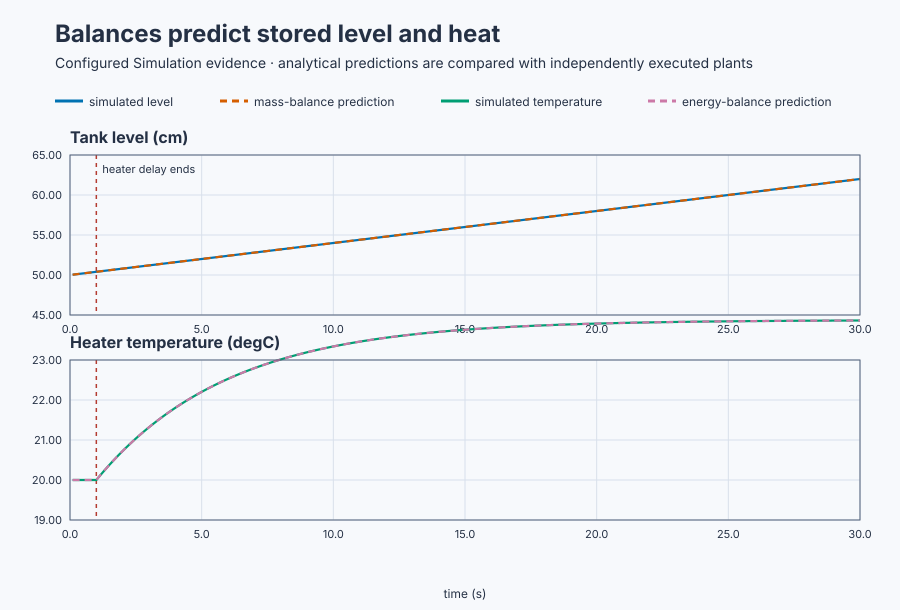

# Derive tank and heater models from conservation laws

Course position: Lesson 33 of 84. Previous lesson: [Physical plant-response
classification](../32-plant-response-classes/README.md). Next lesson: nonlinear
[gravity-tank linearisation](../34-gravity-tank-linearization/README.md).

**Lesson objective:** Derive an executable buffer tank and heated vessel model
from conservation laws, predict their responses with units, and decide whether
the simulator agrees.

You will not tune a controller or fit a curve here.

This is simulation evidence, not physical-plant evidence.

**Equipment:** Constant-area buffer tank and electrically heated vessel.

## The problem

Lesson 32 identified integrating and self-regulating shapes from data. Those
labels do not explain why the shapes occur. The workshop contains two independent real-world modules. A constant-area
buffer tank receives measured inlet flow, loses measured outlet flow, and
reports liquid level. An electrically heated, well-mixed vessel receives a
one-sided 0–100% heater command and reports temperature while losing heat to
the room.

The tank has constant area, constant liquid density, perfectly mixed contents,
and no overflow. Its two flows are independently specified. The heater has
constant thermal capacitance and linear heat loss in this operating region.
Sensor dynamics, evaporation, temperature-dependent properties, nonlinear
gravity outflow, and unmeasured disturbances are absent.

We now derive both responses from the quantities stored and transported. Every
term must have a physical meaning and compatible unit so the model predicts
parameter changes, not merely one curve.

## What we need

We need models derived from material and energy conservation so every state,
input, sign, unit, and predicted response has a physical explanation.

## The new idea

A **stored quantity** is material or energy retained by equipment. A **state
variable** is a quantity, such as level or temperature, whose present value is
needed to predict future behavior. The stored quantity accumulates when the
rate entering exceeds the rate leaving. A conservation balance says in words:

> Rate of accumulation = total rate entering − total rate leaving.

For the tank, define the tank cross-sectional area ($A$) in square metres, liquid
level ($h$) in metres, inlet volumetric flow ($q_{\mathrm{in}}$) in cubic metres per second,
and outlet volumetric flow ($q_{\mathrm{out}}$) in cubic metres per second. Only after those
physical meanings and units are known can we write the mass-volume balance.
The plant flowmeters display litres per second, so convert them first: one litre
is 0.001 cubic metres. The balance is:

Tank volume is \(V=Ah\). With constant area,
\(dV/dt=A\,dh/dt\). Combining this with
\(dV/dt=q_{\mathrm{in}}-q_{\mathrm{out}}\) gives

\[
A\frac{dh}{dt}=q_{\mathrm{in}}-q_{\mathrm{out}}.
\]

The liquid-level rate \(dh/dt\) is the change in level per second. On the left,
m² times m/s gives m³/s, matching both flow terms. Equal flows
give zero accumulation and therefore equilibrium. Unequal constant flows give
a continuing level slope when tank area is constant.

For the heater, define thermal capacitance ($C$) in kilojoules per degree
Celsius, vessel temperature ($T$) in degrees Celsius, ambient temperature
($T_{\mathrm{ambient}}$) in degrees Celsius, electrical heating power ($P_{\mathrm{heater}}$) in
kilowatts, and heat-loss coefficient ($H$) in kilowatts per degree Celsius. The
energy balance is:

Stored thermal energy relative to ambient is
\(E=C(T-T_{\mathrm{ambient}})\). With constant capacitance and ambient,
\(dE/dt=C\,dT/dt\). Linear heat loss is
\(H(T-T_{\mathrm{ambient}})\), so

\[
C\frac{dT}{dt}
=P_{\mathrm{heater}}-H(T-T_{\mathrm{ambient}}).
\]

Because kJ/°C times °C/s equals kJ/s = kW, every term is power. The temperature
rate \(dT/dt\) is zero at equilibrium. Equilibrium therefore
means zero accumulation of stored energy. Heat loss grows with the
temperature difference, so a fixed heater power reaches a finite equilibrium.
Thermal capacitance changes response speed, not that equilibrium. The static
gain relates steady temperature change to command. The time constant describes
response speed. Transport delay postpones the visible response without changing
the final balance.

## Prediction

The tank area is 0.5 square metres. It starts at 50 centimetres. Inlet flow is
12 litres per second and outlet flow is 10 litres per second. Net inflow is 2
litres per second, or **0.002 cubic metres per second**. Divide by area:

\[
\frac{dh}{dt}
=\frac{0.002\ \mathrm{m^3/s}}{0.5\ \mathrm{m^2}}
=0.004\ \mathrm{m/s}=0.4\ \mathrm{cm/s}.
\]

The predicted rate is therefore **0.4 centimetres per second**. Integrating a
constant rate gives \(h(t)=h_0+(dh/dt)t\), so
\[
h(20)=50+0.4(20)=58\ \mathrm{cm}.
\]
With
equal inlet and outlet flows of 10 litres per second, predict zero level slope.

The heater has 50 kilojoules per degree Celsius thermal capacitance, 10
kilowatts per degree Celsius heat-loss coefficient, and 200 kilowatts at full
output. Ambient and initial temperature are 20 °C. A 20-percent command gives
40 kilowatts. At equilibrium accumulation is zero:

$$
0=P-H(T_{eq}-T_{ambient}),
$$

$$
T_{eq}=T_{ambient}+P/H=20+40/10=24\ ^\circ\mathrm{C}.
$$

One percentage point produces $200/100=2$ kW, so static gain is
$2/10=0.2\ ^\circ\mathrm{C}/\%$. Dividing the balance by $C$ identifies the
decay coefficient $H/C$. Matching it to $1/\tau$ gives

$$
\tau=C/H=50/10=5\ \mathrm{s}.
$$

After delay $L=1$ s, the response is

$$
T(t)=T_{eq}+(T_0-T_{eq})e^{-(t-L)/\tau}.
$$

At $t=6$ s, it has evolved for one time constant, so
$1-e^{-1}=0.63212$ of its four-degree rise is complete:
$T(6)=20+0.63212(4)=22.528\ ^\circ\mathrm{C}$.

## Implementation

There is no feedback controller under test. The actual Structured Text makes
the unit conversion and physical predictions visible:

```st
TankNetFlowLitresPerSecond := TankInletFlow - TankOutletFlow;
TankNetFlowCubicMetresPerSecond := TankNetFlowLitresPerSecond * LREAL#0.001;
TankPredictedRate :=
    (TankNetFlowCubicMetresPerSecond / TankAreaSquareMetres) * LREAL#100.0;
TankNetFlowCommand := TankNetFlowLitresPerSecond;

HeaterPowerKilowatts :=
    HeaterFullScalePower * HeaterAppliedCommand / LREAL#100.0;
HeaterTimeConstant := HeaterThermalCapacitance / HeaterHeatLossCoefficient;
HeaterPredictedEquilibrium :=
    HeaterAmbientTemperature + HeaterPowerKilowatts / HeaterHeatLossCoefficient;
```

The tank simulator integrates net flow. The heater simulator uses the same
gain, time constant, delay, bias, and initial state derived above.

## Experiment in Control Studio

Control Studio executes the unequal-flow tank and 20% heater case. Test writes
one reviewed Boolean authority, \(\mathtt{P1.ExperimentEnabled}\), for 30.1
seconds. Authority true makes the project set tank inlet/outlet to 12/10 L/s
and heater request to 20%. Authority false restores equal 10/10 L/s flow and
zero heater command.

A fresh native run owns the independent equal-flow drift result so its tank
state begins again at 50 cm. The UI run must not claim that independent reset.
The deterministic Simulation seed is 20260829.

### Control Studio actions

1. **Monitor** — Start the **Simulator**, then open **truST sidebar → Control Studio → Monitor → Response**.
   - **Baseline check:** Wait for **Simulation**, **Running**, current samples, and good quality. Confirm inlet/outlet = 10/10 L/s, net flow = 0 L/s, tank level = 50 cm, heater request/applied = 0%, heater temperature = 20 °C, model valid, and experiment authority false. Add physical inputs, PVs, predictions, model-valid state, and authority to **Signals**.
   - **Decision before action:** Read **Prediction** above, then state what should move first and in which direction. Use this decision rule: Accept each model only when its unit-consistent first-principles prediction matches the independent simulator response within declared tolerances.
   - **Successful evidence:** The Response plot advances, the displayed values are finite and current, and **Start recording** is enabled. Select **Start recording** only after those conditions are visible.
   - **Recovery:** If recording is disabled or the plot reports unavailable or stale samples, stop the Simulator, correct the displayed runtime or binding problem, restart it, and repeat the baseline check.
   - **Record:** Write down both balances, unit conversions, numerical predictions, and the complete initial state.

2. **Test** — Open **truST sidebar → Control Studio → Test**.
   - **Baseline check:** Confirm **Experiment** = **Observe without excitation**, **Amplitude** = **0** (disabled), and **Maximum duration (s)** = **30.1**. The reviewed authority is \(\mathtt{P1.ExperimentEnabled}\); the project owns both physical input changes.
   - **Decision before action:** Confirm the plan writes only that Boolean and restores it false. Require tank level and heater temperature within 0–100 in their stated units. Use the run only to test the balances; do not Identify, Tune, or Apply.
   - **Successful evidence:** Select **Review test**, verify authority, timeout, stop conditions, and false restoration, then **Confirm and start**. Keep **Abort test** available. Observe net flow 2 L/s, heater 20%, tank ramp, delayed heater response, and restored zero inputs.
   - **Recovery:** Abort for nonfinite/out-of-range data, invalid parameters, or mismatched sampling. Confirm authority false, equal flow, and zero heater command before retrying.
   - **Record:** Retain terminal state, restoration, all physical inputs/PVs, 20-second tank level, late slope, six-second heater temperature, final slope/equilibrium, model parameters, and seed.

There is no separate disabled Validate stage. The native evidence owns the
independent equal-flow case; Monitor and Test expose the unequal-flow run.

## Evidence and decision

### Measures and comparison

With measured slope
\(m=(h_{29.9}-h_{28.0})/(29.9-28.0)\), **tank level-rate error** is
\(e_m=|m-0.4|\) cm/s. **Tank 20-second prediction error** is
\(e_{h,20}=|h_{\mathrm{measured}}(20)-58|\) cm. Absolute values compare size
without allowing opposite-sign errors to cancel.

**Equal-flow drift** is
\(\max(h)-\min(h)\) over the independent 20-second equal-flow run. Range is
used because an equal first and last sample could hide movement in between.

**Heater six-second prediction error** is the absolute measured-minus-predicted
temperature at six seconds. **Heater final-window equilibrium error** is the
absolute difference between 24 °C and the final sample after confirming that
the 28.0-to-29.9-second slope is below 0.01 °C/s. Both use degrees Celsius.



[Retained run](figures/tank-heater-conservation-run.csv) ·
[Plot data](figures/tank-heater-conservation-trace.csv) ·
[Decision summary](figures/tank-heater-conservation-summary.csv)

### Validation

The native executable run produced:

| Evidence | Result | Decision |
|---|---:|---|
| Tank late slope | 0.4000 cm/s | Matches balance |
| Tank level at 20 s | 58.000 cm | Matches prediction |
| Equal-flow drift | 0.000000 cm | Equilibrium held |
| Heater at 6 s | 22.528 °C | Matches prediction |
| Heater at 30 s | 23.988 °C | Approaching 24 °C equilibrium |

The heater remains at 20 °C during its declared one-second delay. A run with
different units, initial state, timing, or simulator parameters is invalid for
this comparison rather than contrary evidence for these balances.

## Conclusion

The tank integrates because every second of nonzero net flow changes stored
liquid volume. Larger tank area produces a smaller level slope for the same net
flow. The heater self-regulates because rising temperature increases heat loss
until loss equals heating power. Thermal capacitance sets how quickly it gets
there; heater power and heat-loss coefficient set the equilibrium; delay shifts
when the response becomes visible.

## Reason for the next lesson

First-principles models explain causal structure, units, equilibrium, and the
effect of physical parameters. Their conclusions are only as good as their
assumptions and equipment data. In Lesson 34, nonlinear gravity outflow makes
the tank slope depend on level, creating a reason to derive a local linear
model around an operating point.
