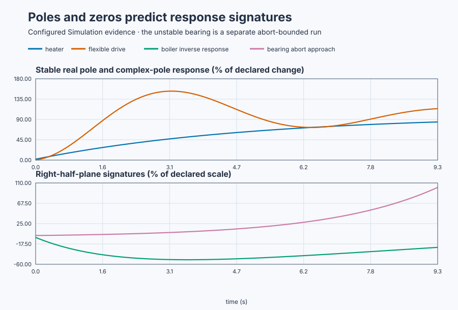

# Predict plant responses from poles and zeros

Course position: Lesson 35 of 84. Previous lesson: [Gravity-tank
linearization](../34-gravity-tank-linearization/README.md). Next lesson: state
space and interconnected tanks.

**Lesson objective:** Predict and justify six qualitative open-loop responses
from pole-zero locations and validate each match against executable evidence.

All results are simulation evidence, not physical-plant evidence.

## The problem

The equipment in this lesson is Heated vessel, storage tank, flexible drive, overhead crane, magnetic bearing, and boiler drum.

**Equipment:** Heated vessel, storage tank, flexible drive, overhead crane,
magnetic bearing, and boiler drum.

The workshop contains a heated vessel, storage tank, flexible motor drive,
overhead crane, magnetic bearing, and boiler drum. One normalized test request
is converted into physical heater command, net flow, torque, force, bearing
force, and feedwater change. Outputs retain temperature, level, position,
displacement, and drum-level units.

The models describe declared local operating regions. There is no feedback
controller or hidden stabilizing loop.

Lesson 34 derived one gravity-tank transfer function. Repeating coefficient-by-
coefficient reasoning for every new plant is slow and can hide general
limitations. Poles and zeros let us predict decay, integration, oscillation,
instability, inverse response, and dominant dynamics before selecting a model
or controller.

## What we need

We need a way to connect stored modes and input-output cancellations to response features an engineer can actually observe. Each qualitative prediction must be made before the executable response is revealed.

## The new idea

A transfer function relates an input deviation to an output deviation when the
initial deviations are zero. A **pole ($p$)** is a value of the complex frequency
variable that makes its denominator zero. A pole represents a plant's natural
mode. A **zero ($z$)** makes the numerator zero and shapes how an input appears at
the measured output.

The **complex plane** has a horizontal real part and vertical imaginary part.
Locations with negative real part occupy the **left half-plane**. Positive real
part is the **right half-plane**. Their intersection is the **origin**.

A negative-real pole produces exponential decay. A pole at the origin produces
integration, so a constant input creates a continuing ramp. A positive-real
pole produces exponential growth. A complex-conjugate pole pair produces
oscillation: its real part sets decay or growth, and its imaginary part sets
oscillation frequency.

The **natural frequency** describes the pair's unforced oscillation rate. The
**damping ratio** describes how rapidly that motion loses energy. **Dominant
poles** are the observable modes that decay most slowly and govern the late
response. A weakly excited or unobserved mode need not dominate merely because
it is close to the origin.

A left-half-plane zero can accelerate or reshape a response. A
right-half-plane zero can make the initial response move opposite the eventual
change. That is **inverse response**. It differs from **dead time**: inverse
response can move immediately in the wrong direction, while dead time produces
no response during its delay.

**Pole-zero cancellation** is physically fragile. An uncertain plant mode
remains internally present even when input-output algebra appears to cancel it.
Never try to cancel an unstable or lightly damped pole with an approximate
controller zero.

## Prediction

Predict each trace before opening it:

- The heater has one stable pole, $p = -0.2 1/s$, and no finite zero. It should
  rise monotonically and complete **63.2 percent** of its change in five
  seconds.
- The storage tank has a pole at the origin and no finite zero. It should retain
  a **0.2 centimetres per second** slope under the unit net-flow input.
- The flexible drive has poles near $p = -0.2 \pm j_{0}.980 1/s$, natural
  frequency 1 rad/s, and damping ratio 0.2. Predict about **52.7 percent**
  overshoot and repeated steady-value crossings.
- The overhead crane has a slow pole at $p = -0.1 1/s$ and a faster pair at
  $p = -1 \pm j_{4} 1/s$. Early payload motion contains decaying swing, but the
  slow pole dominates the late response.
- The magnetic bearing has an unstable pole at $p = +0.4 1/s$. Displacement
  should grow until the test aborts at **10 millimetres**.
- The boiler drum has stable poles at `-0.05` and `-0.5 1/s` and a
  right-half-plane zero at $z = +0.0625 1/s$. Feedwater should move level
  initially negative and eventually positive.

## Implementation

There is no controller under test. The actual Structured Text converts one
bounded request into the six physical inputs:

```st
HeaterCommand := LREAL#20.0 * BoundedExperiment;
TankNetFlow := LREAL#1.0 * BoundedExperiment;
DriveTorque := LREAL#1.0 * BoundedExperiment;
CraneForce := LREAL#1.0 * BoundedExperiment;
BoilerFeedwater := LREAL#1.0 * BoundedExperiment;

IF BearingExperimentEnabled THEN
    BearingForce := LREAL#0.0001 * BoundedExperiment;
ELSE
    BearingForce := LREAL#0.0;
END_IF;
```

The six simulator declarations use the same parameters as the pole-zero maps.

## Experiment in Control Studio

This procedure tests one declared lesson change under controlled conditions. Predict from hidden pole-zero maps, execute the five bounded plants, execute the unstable bearing separately, commit matches, then reveal identities. The declared event lasts 30 seconds. It restores Normalized experiment to 0 1 afterward. The deterministic Simulation seed is 20260829.

### Control Studio actions

1. **Monitor** — Start the **Simulator**, then open **truST sidebar → Control Studio → Monitor → Response**.
   - **Baseline check:** Wait until the header shows **Simulation**, **Running**, and current data. Confirm Heater temperature (PV, degC) and Tank level (PV, cm); Heater command (MV, %) and Tank net flow (MV, L/s), including units, limits, mode, and quality. The initial operating point is Normalized experiment = 0 (dimensionless), Heater command = 0 %, Heater temperature = 20 degC, Tank net flow = 0 L/s, Tank level = 50 cm, Drive torque = 0 N m, Drive position = 0 rad, Crane force = 0 N. The unresolved baseline problem is: Transfer-function coefficients do not by themselves teach which observable response signature follows from each mode.
   - **Decision before action:** Read **Prediction** above, then state what should move first and in which direction. Use this decision rule: Accept each map-to-response match only when the learner predicts and cites an observable causal signature.
   - **Successful evidence:** The Response plot advances, the displayed values are finite and current, and **Start recording** is enabled. Select **Start recording** only after those conditions are visible.
   - **Recovery:** If recording is disabled or the plot reports unavailable or stale samples, stop the Simulator, correct the displayed runtime or binding problem, restart it, and repeat the baseline check.
   - **Record:** Write down the initial SP, PV, requested/applied MV where available, controller mode, and your predicted response before opening Test.

2. **Test** — Open **truST sidebar → Control Studio → Test**.
   - **Baseline check:** Set **Experiment** = **Manual output step**, **Amplitude** = **1 (dimensionless)**, and **Maximum duration (s)** = **30**. The affected signal is **Normalized experiment**; it starts at 0 (dimensionless) and must restore to 0 (dimensionless).
   - **Decision before action:** Before selecting **Review test**, predict the response direction and confirm the requested change remains inside Bearing displacement -0.01 m to 0.01 m; Tank level 0 cm to 100 cm; Heater temperature 0 degC to 100 degC.
   - **Successful evidence:** Select **Review test**, verify the signal, requested bound, duration, restoration, and stop conditions, then select **Confirm and start**. The state changes to **Running**, **Abort test** remains available, and the terminal state confirms completion and restoration while Response shows the measured SP/PV/MV sequence.
   - **Recovery:** For a rejected, stale, unsafe, unavailable, failed, or aborted state, read the displayed reason, restore Normalized experiment to 0 (dimensionless), wait for current data, and review a new test. Run each response in a separate restored plant copy, keep the unstable bearing case abort-bounded, and never reuse its terminal state. Run each response in a separate restored plant copy, keep the unstable bearing case abort-bounded, and never reuse its terminal state. These are response-class experiments; do not Identify, Tune, or Apply.
   - **Record:** Compare the response with your prediction and retain the terminal state, restoration result, and deterministic seed **20260829**.

3. **Validate** — Open **truST sidebar → Control Studio → Validate**.
   - **Baseline check:** **Run required validation** is disabled because no shared Control.PID candidate exists. **Requirement details** and **Save result** cannot be used to claim a shared result; project-owned validation is executed by the runnable project's declared oracle.
   - **Decision before action:** Use the predeclared comparisons: heater_five_second_fraction >= 0.6 (dimensionless) (tolerance 0.03 (dimensionless)); tank_late_slope >= 0.19 cm/s (tolerance 0.01 cm/s); drive_peak >= 1.45 rad (tolerance 0.01 rad); bearing_abort_time <= 10 s (tolerance 0.1 s).
   - **Successful evidence:** Correlate the unrounded project-owned results with the named live signals and events in Monitor. Each applicable requirement must have a value, unit, limit, tolerance, evidence class, and Pass, Conditional pass, Fail, or Inconclusive disposition.
   - **Recovery:** If the project run aborts, becomes stale, fails, or violates restoration, discard that run and repeat the declared Test. Never present a disabled button or retained README table as newly executed evidence.
   - **Record:** State the validation disposition and name every failed or inconclusive requirement before continuing.

## Evidence and decision

### Measures and comparison

**Monotonicity** means successive output increments after the step all have the
expected signed direction. **Late slope** is output change divided by elapsed
time over a declared final window. **Overshoot** is peak excess above an
eligible steady value divided by total steady change. **Crossing count** counts
sign changes around that value.

**Dominant-tail decay rate** compares equal-duration late response increments.
**Unstable growth ratio** compares displacement magnitude at two declared
times. **Inverse-response minimum** is the most negative output, accompanied by
its time and the eventual final sign. First-response time above sensor
resolution distinguishes immediate wrong-direction movement from dead time.

Metrics requiring a steady value are **Not settled** for the tank and magnetic
bearing. Do not compute their overshoot or steady-state error.

The figure uses declared normalized scales only to compare response signatures.
The retained run preserves all six physical outputs and the separate
magnetic-bearing abort record.

First match these generated maps to the predicted signatures without revealing
the equipment names:


[Committed matches and revealed identities](figures/pole-zero-plant-classes-matches.csv)

<details>
<summary>Reveal the pole-zero map identities</summary>

| Map | Equipment |
|---|---|
| A | Heated vessel |
| B | Storage tank |
| C | Flexible drive |
| D | Overhead crane |
| E | Magnetic bearing |
| F | Boiler drum |

</details>

Now compare those committed matches with the executed responses:



[Retained run](figures/pole-zero-plant-classes-run.csv) ·
[Plot data](figures/pole-zero-plant-classes-trace.csv) ·
[Decision summary](figures/pole-zero-plant-classes-summary.csv)

### Validation

The native executable run measured:

| Plant | Evidence |
|---|---:|
| Heater | 0.632 five-second fraction |
| Tank | 0.200 cm/s late slope |
| Flexible drive | 1.527 peak, nine crossings |
| Crane | 0.607 dominant-tail ratio |
| Magnetic bearing | 9.3 s to abort |
| Boiler drum | -0.505 minimum, +0.554 final |

Accept a match only when both its map and measured signature justify it. The
pole-zero plot is invalid if generated from parameters different from the
executable plant.

## Conclusion

The heater's stable real mode decays monotonically. The tank's origin pole
retains slope. The flexible drive exchanges stored mechanical energy while its
negative real part damps it. The crane's fast swing fades before its slow mode.
The bearing's positive pole grows without feedback. The boiler's
right-half-plane zero produces immediate opposite movement despite stable
poles.

The boiler zero limits aggressive control, and uncertain unstable or flexible
modes must not be cancelled. These are model-based predictions that still need
operating-range validation.

## Reason for the next lesson

Pole-zero structure predicts important limitations before tuning. Lesson 36
introduces state space because a transfer function can hide internal stored
quantities; interconnected-tank internal levels must remain explicit.
