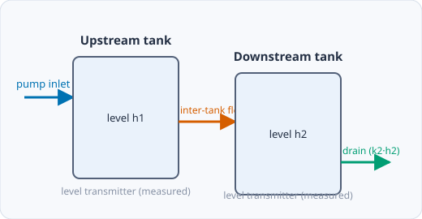
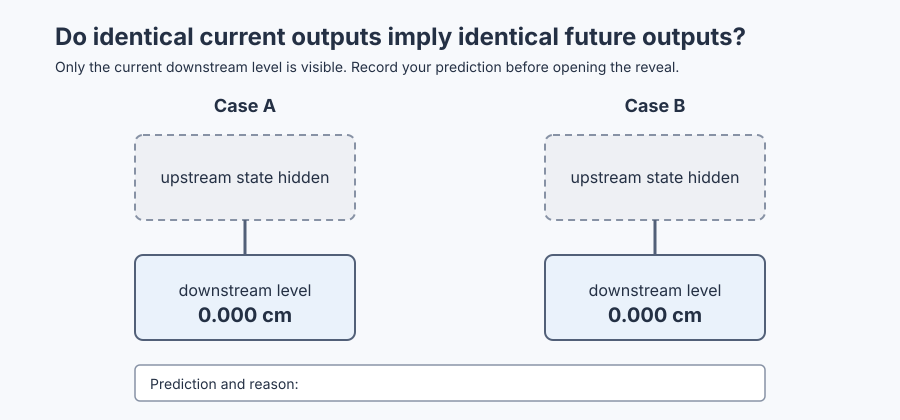
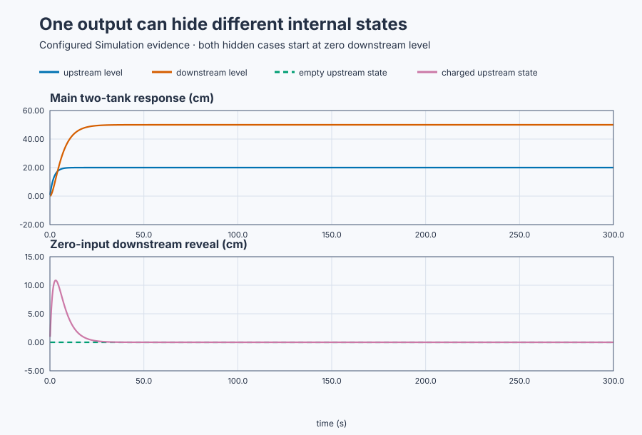

# Reveal hidden stored water with state space

Course position: Lesson 36 of 84. Previous lesson: [Poles and plant
responses](../35-pole-zero-plant-classes/README.md). Next lesson:
[safe experiment design](../../05-experiments-identification-and-validation/37-safe-heat-exchanger-experiment/README.md).

**Lesson objective:** Build an executable state-space model of two
interconnected water tanks, predict both internal levels, and demonstrate why
one downstream input-output reading cannot reveal all stored water.

**Evidence class:** Simulation evidence, not physical-plant evidence.

## The problem

The equipment is two interconnected water tanks with inlet pump and two level transmitters. An inlet pump feeds an upstream tank. Water then flows into a downstream tank
and finally to a drain. Both tanks have level transmitters, although the
hidden-state comparison initially reveals only downstream level.

The model uses metres for state calculations, centimetres for learner-facing
level plots, and cubic metres per second for pump flow. Tank areas and linear
flow coefficients remain constant in the declared operating region.

Lesson 35 used poles and zeros to predict external input-output behavior. That
view assumes an initial internal condition. Two installations can have the same
pump command and downstream-level reading now but different upstream stored
water and therefore a different future downstream response.

## What we need

We need one coupled model that retains both tank levels as states and shows how
each pump and inter-tank flow affects their future values.

## The new idea

A **state variable** is a physical quantity whose present value, together with
future input, is required to predict future behavior. Define upstream level
($h_{1}$) and downstream level ($h_{2}$), both in metres. Their ordered collection is the
**state vector ($x$)**.

Define pump inlet flow ($u$) in cubic metres per second. The measured upstream
and downstream levels form the **output vector ($y$)**. A vector is an ordered
collection of values. A matrix is a table of coefficients; its row meanings,
column meanings, and units must be declared.

Both tank areas, **tank 1 area ($A_1$)** and **tank 2 area ($A_2$)**, are
**1 square metre**. The **inter-tank flow coefficient ($k_{12}$)** is
**0.5 square metres per second**. The **downstream outlet coefficient
($k_2$)** is **0.2 square metres per second**. All three are configured
teaching values for this interconnected pair; on real equipment a learner
would obtain each tank area by measuring its cross-section (as in Lesson 33)
and would obtain $k_{12}$ and $k_2$ from a bounded step test relating a
commanded flow change to the resulting measured level-rise rate (as in
Lesson 32). First say the balances in
words:

- upstream accumulation equals pump inflow minus inter-tank outflow;
- downstream accumulation equals inter-tank inflow minus drain outflow.

The equations are then

$A_1\frac{dh_1}{dt}=u-k_{12}h_1, \qquad A_2\frac{dh_2}{dt}=k_{12}h_1-k_2h_2.$

Each term is a volume flow. For example,
$k_{12}\,[\mathrm{m^2/s}]$ times $h_1\,[\mathrm m]$ gives
$\mathrm{m^3/s}$. Divide each balance by its tank area to obtain the two state
rates. With $A_1=A_2=1\,\mathrm{m^2}$,

$\frac{dh_1}{dt}=-0.5h_1+1u, \qquad \frac{dh_2}{dt}=0.5h_1-0.2h_2.$

The **state equation** advances internal state: in rate-of-change form,
$dx/dt = A \cdot x + B \cdot u$. The **output equation** maps
state and any direct input effect into measurements. With the state order
already declared, write:

$\dot x=\mathbf A x+\mathbf B u, \qquad y=\mathbf Cx+\mathbf Du.$

The state matrix ($A$), input matrix ($B$), and output matrix ($C$) are:

$\mathbf{A}=\begin{bmatrix}-0.5&0\\0.5&-0.2\end{bmatrix}\,\mathrm{s}^{-1},\qquad \mathbf{B}=\begin{bmatrix}1\\0\end{bmatrix}\,\mathrm{m}^{-2},\qquad \mathbf{C}=\begin{bmatrix}1&0\\0&1\end{bmatrix}$

The output matrix is the two-by-two **identity matrix ($\mathbf I$)** — a
square matrix with 1s on its diagonal and 0s elsewhere that leaves any vector
it multiplies unchanged — and the
direct matrix ($D$) is zero. The first row advances upstream level. The second row
advances downstream level. The two output rows publish upstream and downstream
level respectively.

An **equilibrium** is a constant state under constant input and therefore means
zero accumulation. For a pump inlet flow of $u_0=0.1\,\mathrm{m^3/s}$ (**0.1
cubic metres per second**), the first row gives
$0=0.1-0.5h_1$, so $h_1=0.2$ m. The second then gives
$0=0.5(0.2)-0.2h_2$, so $h_2=0.5$ m. The prediction is therefore **20
centimetres upstream** and **50 centimetres downstream**.

An **eigenvalue** is a natural state-space mode. For a two-by-two matrix
$\begin{bmatrix}a&b\\c&d\end{bmatrix}$, the **determinant** is the single
number $ad-bc$ computed from its four entries; for a triangular matrix (all
zero entries above or below the diagonal, as $\mathbf A$ is here), that
product reduces to just the product of the diagonal entries. Eigenvalues solve
$\det(\lambda\mathbf I-\mathbf A)=0$. Because this matrix is triangular, its
determinant is $(\lambda+0.5)(\lambda+0.2)$, so the eigenvalues are
$-0.5$ and $-0.2\,\mathrm{s^{-1}}$; these are also poles of the
zero-initial-deviation transfer functions. Those transfer functions do not
contain the plant's current internal state.

## Prediction

For the inlet-step run, predict both levels rising toward 20 cm and 50 cm.

For the hidden-state comparison, the **Empty** plant begins with state
$x = [0.0, 0.0] m$. The **Upstream charged** plant begins with
$x = [0.2, 0.0] m$. Both have the same initial downstream reading and zero
input. Empty should remain at zero, while the charged case is predicted to
reach a downstream peak of 10.9 centimetres at 3.05 seconds before draining
away. In the charged case, the upstream state is
$h_1(t)=0.2e^{-0.5t}$. Substituting into the downstream balance gives the
forced linear equation $dh_2/dt+0.2h_2=0.1e^{-0.5t}$. Its solution is the sum
of a **particular solution** matching the forcing exponential's own shape,
$-\frac{1}{3}e^{-0.5t}$, and a **homogeneous solution** matching the
downstream tank's natural decay, $Ce^{-0.2t}$. The zero initial downstream
level, $h_2(0)=0$, fixes $C=\frac{1}{3}$, giving

$h_2(t)=\frac{1}{3}\left(e^{-0.2t}-e^{-0.5t}\right)\,\mathrm m.$

The peak occurs when its derivative is zero:
$-0.2e^{-0.2t}+0.5e^{-0.5t}=0$. Rearranging gives
$e^{0.3t}=2.5$, hence $t=\ln(2.5)/0.3=3.05$ s. Substitution predicts
$h_2=0.1086$ m, or about **10.9 cm**, before the stored water drains away.

Commit this prediction before revealing either upstream level.

## Implementation

There is no controller under test. The actual Structured Text clamps the one
active pump request and deliberately holds both hidden-state inputs equal:

```st
IF RequestedPumpFlow < LREAL#0.0 THEN
    MainPumpFlow := LREAL#0.0;
ELSIF RequestedPumpFlow > LREAL#0.2 THEN
    MainPumpFlow := LREAL#0.2;
ELSE
    MainPumpFlow := RequestedPumpFlow;
END_IF;

EmptyCasePumpFlow := LREAL#0.0;
ChargedCasePumpFlow := LREAL#0.0;
```

The simulator executes the same two-state matrices in all three cases. There is
no observer, estimator, state feedback, optimal controller, or MPC.

## Experiment in Control Studio

Control Studio exposes the full-state inlet step. Test writes one reviewed
Boolean, `P1.ExperimentEnabled`, for 300.1 seconds. Authority true makes the
project request $0.1\,\mathrm{m^3/s}$; authority false restores zero pump flow.
The hidden-state comparison belongs to a fresh native run because its meaning
depends on revealing two exact initial states at time zero. The deterministic
Simulation seed is 20260829.

### Control Studio actions

1. **Monitor** — Start the **Simulator**, then open **truST sidebar → Control Studio → Monitor → Response**.
   - **Baseline check:** Wait until the header shows **Simulation**, **Running**, and current data. Confirm Main upstream level (PV, m) and Main downstream level (PV, m); Main pump flow (MV, m3/s), including units, limits, mode, and quality. The initial operating point is Requested pump flow = 0 m3/s, Main pump flow = 0 m3/s, Main upstream level = 0 m, and Main downstream level = 0 m. Confirm experiment authority false. The unresolved baseline problem is: an external downstream reading does not reveal all internal stored-water state.
   - **Decision before action:** Read **Prediction** above, then state what should move first and in which direction. Use this decision rule: Use a state-space representation when internal stored quantities affect future behavior and must remain explicit.
   - **Successful evidence:** The Response plot advances, the displayed values are finite and current, and **Start recording** is enabled. Select **Start recording** only after those conditions are visible.
   - **Recovery:** If recording is disabled or the plot reports unavailable or stale samples, stop the Simulator, correct the displayed runtime or binding problem, restart it, and repeat the baseline check.
   - **Record:** Write down the initial requested and main pump flow and the
     main upstream and downstream levels, and your predicted equilibrium
     levels before opening Test.

2. **Test** — Open **truST sidebar → Control Studio → Test**.
   - **Baseline check:** Confirm **Experiment** = **Observe without excitation**, **Amplitude** = **0** (disabled), and **Maximum duration (s)** = **300.1**. The reviewed authority is **Experiment authority** (`P1.ExperimentEnabled`). It starts false and must restore false.
   - **Decision before action:** Before selecting **Review test**, predict both equilibrium levels and confirm they remain within 0–1 m. Use this run only to test the derived state model; do not Identify, Tune, or Apply. This run is made so that identical current downstream readings and inputs do not reveal different upstream stored-water states is measured rather than assumed.
   - **Successful evidence:** Select **Review test**, verify Boolean authority, timeout, false restoration, and stop conditions, then **Confirm and start**. Keep **Abort test** available. Response must show pump flow 0.1 m³/s, upstream level moving first, downstream level following, and pump flow returning to zero.
   - **Recovery:** Abort for stale, invalid, nonfinite, or out-of-range data. Confirm authority false and pump flow zero before reviewing another test.
   - **Record:** Retain terminal state, restoration, both main states, pump flow, matrices, equilibrium errors, and
     seed **20260829**. The inherited limitation under test is: Identical current downstream readings and inputs do not reveal different upstream stored-water states.

There is no separate disabled Validate stage. Native executable evidence owns
the fresh Empty-versus-Upstream-charged comparison and its peak calculation;
Monitor and Test expose the main inlet-step model.

## Evidence and decision

The cascade topology is the entire subject of this lesson: which tank
connects to which determines which state is hidden.



**Upstream equilibrium error** is
$100|h_{1,\mathrm{measured}}-0.2|$ cm and **downstream equilibrium error** is
$100|h_{2,\mathrm{measured}}-0.5|$ cm, after both late slopes meet the declared
settling limit. The factor 100 converts the model's metres to reportable
centimetres.

**Hidden-state downstream separation** is the absolute difference between the
two downstream levels at the same timestamp. **Charged-case peak level** is the
maximum retained downstream sample; **peak time** is its timestamp.

Matrix-to-balance consistency requires every executable sign, coefficient,
row, column, and unit to agree with the physical balances. A plausible curve is
not sufficient evidence.

The first figure deliberately shows only the two identical current downstream
measurements. It contains no future trace and no answer. Write your prediction
and reason in the editable record before opening the reveal.



[Blank pre-reveal prediction record](figures/two-tank-hidden-prediction-summary.csv)

<details>
<summary>Reveal the upstream states</summary>



The retained result shows that Case A remains at zero while Case B rises to a
10.857 cm downstream peak because its initially hidden upstream level was
20 cm. Compare this result with the prediction you wrote before opening the
reveal.

</details>

[Retained run](figures/two-tank-state-space-run.csv) ·
[Plot data](figures/two-tank-state-space-trace.csv) ·
[Decision summary](figures/two-tank-state-space-summary.csv)

The native executable run measured:

| Evidence | Result |
|---|---:|
| Main upstream equilibrium | 20.000 cm |
| Main downstream equilibrium | 50.000 cm |
| Hidden downstream initial readings | 0.000 / 0.000 cm |
| Charged downstream peak | 10.857 cm |
| Charged downstream peak time | 3.10 s |

The measured peak time (3.10 s) is 50 ms later than the analytically
predicted 3.05 s; the acceptance tolerance (±0.2 s) absorbs this small gap,
which is attributable to the simulator's forward-Euler sample interval rather
than to an error in the derived model. The empty case remains zero and the charged case eventually drains. The model
is invalid if states are transposed, units differ, a flow sign is wrong, or the
simulator matrices differ from the lesson—even if one output looks reasonable.

## Conclusion

The state vector preserves both stored-water quantities. A downstream-only
transfer relation describes how pump deviation affects downstream level under
its initial-state assumption. It does not reveal water already stored upstream.
State space separates internal evolution from measurement selection and extends
naturally to multiple inputs and outputs.

## Reason for the next lesson

State space exposes internal dynamics needed later for controllability,
observability, estimation, optimal control, and MPC. It does not automatically
make an unmeasured state known and does not replace model validation. Lesson 37
uses this need for trustworthy models to design a safe, informative experiment
before identification.
