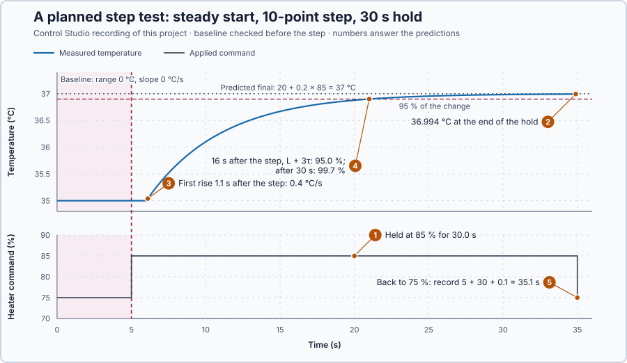

# 14. Identification experiments

In this lesson, you will plan a step test for the heater: a steady start, a step size and a hold time chosen so that the record reveals the heater's numbers while staying inside its limits. You will then check the plan against the record.

## The problem

Lesson 13 derived the heater's energy balance, $50\,dT/dt = 2u(t-1) - 10(T-20) - D$, and it predicted the measured step to three decimals: a gain of 0.2 °C per %, a time constant of 5 s and a delay of 1 s. But the heat capacity, the loss and the delay were given values. For a real heater the model's numbers are unknown and must be measured.

A recording reveals them only if the test is planned for it. A step that is too small is lost in the measurement uncertainty, a step that is too large leaves the safe temperature range, and a hold that is too short ends before the response is complete. We will plan a step test that is both safe and informative, and run it.

## What we need

We need to:

1. start from a steady temperature, so that the record shows the step's effect alone;
2. choose a step large enough to stand out from the measurement uncertainty, yet inside the limits; and
3. hold the step long enough for the record to show the final value.

## The new idea

An **identification experiment** changes the heater's power on purpose, safely and as planned, so that the recorded response reveals the heater's numbers. For this heater it is a **step test**: one held change of the command, from a steady start, with no controller acting.

**In words.** A record shows the heater's numbers only if the test was designed to contain them, so the plan comes before the run. In PLC terms, it is a test sequence with interlocks: preconditions checked before the step, a fixed action for a fixed time, and an abort if a limit is crossed. The plan makes four decisions:

1. **Where to start.** The test starts from a steady state and returns to it: here 35 °C with 75%. The model will describe changes around this operating point and is trusted only near it.
2. **A steady start.** The model describes the change from a steady state, so any drift already present adds to the response we measure and is mistaken for the heater's answer. The seconds before the step, the **baseline**, must show a steady temperature.
3. **The step size.** The step must stand out clearly from the measurement uncertainty, yet keep the temperature inside the safe range, here 33–39 °C, and close to the operating point. A bigger step is easier to see; a smaller one is safer and keeps the model local.
4. **The hold.** The step must be held until the temperature has nearly reached its final value, because the gain is read from that value.

**The formula.** Three rules turn these decisions into numbers: a steady baseline, the predicted change, and the shortest hold.

$$
T_{max} - T_{min} \le 0.05\ \text{°C}, \qquad \frac{|T_{last} - T_{first}|}{5\ \text{s}} \le 0.01\ \text{°C/s}, \qquad \Delta T = K\,\Delta u, \qquad t_{hold} \ge L + 3\tau .
$$

- $T_{max}$, $T_{min}$, $T_{first}$ and $T_{last}$ are the highest, lowest, first and last temperatures of the 5 s baseline, in °C; their difference is the **range**, the noise spread, and the change per second is the **slope**, the drift;
- $\Delta u$ is the step, in percentage points, $K$ = 0.2 °C per % the planning gain, and $\Delta T$ the predicted final change, in °C;
- $L$ = 1 s and $\tau$ = 5 s are the planning delay and time constant, and $t_{hold}$ is the hold, all in seconds.

The hold rule comes from the previous lesson's response: after the delay, the temperature covers the fraction $1 - e^{-(t-L)/\tau}$ of its final change. Since $1 - e^{-3} = 0.95$, three time constants after the delay give 95%.

**Example: a plan for a 5-point step held 20 s.** Calculated from the planning values, not run in this lesson:

1. **Baseline.** A rise from 35.00 to 35.06 °C over 5 s has a slope of $0.06 / 5 = 0.012$ °C/s and fails. Such a drift matters: 0.01 °C/s through a 20 s hold adds 0.2 °C, 20% of this step's response.
2. **Step size.** The command becomes $75 + 5 = 80\%$, and $\Delta T = 0.2 \times 5 = 1$ °C, ending at 36 °C: twenty times the ±0.05 °C uncertainty, so clearly visible. Just after the delay the water warms at $2 \times 5 / 50 = 0.2$ °C/s. The largest permitted step, 15 points, would give 3 °C and end near 38 °C: inside the range, but only 1 °C from its edge.
3. **Hold.** 20 s covers $(20 - 1)/5 = 3.8$ time constants, so $1 - e^{-3.8} = 97.8\%$ of the change. The remaining 2.2% of 1 °C is 0.022 °C, inside the uncertainty, so the record shows the final value.
4. **Record.** The 5 s baseline, the 20 s hold and one more sample showing the return to 75%: $5 + 20 + 0.1 = 25.1$ s.

**Teaching choice.** This lesson runs a 10-point step held 30 s, inside the program's limits of 5–15 points and 20–40 s.

**The limitation.** The plan rests on planning values for the delay and the time constant. If the real heater were slower, the hold could be too short: with a 10 s time constant, a 30 s hold would cover only $(30 - 1)/10 = 2.9$ time constants, $1 - e^{-2.9} = 94.5\%$ of the change. The record must therefore be checked before it is used.

## Prediction

Before running, answer these questions for a 10-point step held 30 s:

1. What command will the heater receive during the hold?
2. What final temperature does the planning model predict?
3. How fast should the temperature rise just after the delay?
4. What is the shortest hold for 95% of the change, and what share does a 30 s hold reach?
5. How long is the record?

| Quantity | Predicted |
| --- | ---: |
| Command during the hold | 85% |
| Final temperature, $20 + 0.2 \times 85$ | 37 °C |
| Rate after the delay, $2 \times 10 / 50$ | 0.4 °C/s |
| Shortest hold for 95%, $L + 3\tau$ | 16 s |
| Share reached in 30 s | 99.7% |
| Record length | 35.1 s |

## Implementation

Open [`src/Main.st`](src/Main.st). It owns the step and checks its plan:

```st
ProposedCommandPct := REAL#75.0 + SelectedStepPoints;
PredictedFinalC := REAL#20.0 + REAL#0.2 * ProposedCommandPct;
```

It starts the step only from a qualified baseline, with every chosen value inside its limits:

```st
StartRejected := NOT (BaselineQualified AND MeasurementValid AND NOT SafetyAbort
    AND SelectedStepPoints >= REAL#5.0 AND SelectedStepPoints <= REAL#15.0
    AND HoldSeconds >= REAL#20.0 AND HoldSeconds <= REAL#40.0
    AND ProposedCommandPct >= REAL#0.0 AND ProposedCommandPct <= REAL#100.0);
```

`BaselineQualified` applies the range and slope rules to the last 51 samples (5 s). The program holds `ProposedCommandPct` for `HoldSeconds`, then returns to 75%. `SafetyAbort` latches on an invalid measurement or a temperature outside 33–39 °C and commands 0%.

**Exercise.** Calculate `PredictedFinalC` for a 12-point step: $20 + 0.2 \times 87 = 37.4$ °C. Then decide whether `StartRejected` is TRUE for a 16-point step: yes, because 16 is outside 5–15.

## Experiment in Control Studio

1. Stop and restart **Simulator**: the heater holds 35 °C at 75%. In the **truST** side bar, select **Control Studio**.
2. On **Identify**, choose **Project experiment** from **Method**. **Signals** shows `P1.TemperatureC · Process value (°C)` and `P1.AppliedPowerPct · Applied output (%)`; add `P1.BaselineRangeC · state (°C)`, `P1.BaselineSlopeCPerS · state (°C/s)` and `P1.BaselineQualified · state (1)`.
3. Expand **Declared experiment settings** and select **Inspect experiment parameters**. Set **Selected Step Points** (5–15) to 10 and **Hold Seconds** (20–40) to 30. Select **Review parameter values**, then **Apply reviewed values**.
4. Wait until `P1.BaselineQualified` is 1, with the range at most 0.05 °C and the slope at most 0.01 °C/s.
5. Select **Review project test** and check the declared **35.1 s**: Control Studio plans the record from your applied hold. Answer the predictions, then select **Confirm and start**. The project holds 75% for 5 s, checks the baseline again, applies the step for the hold and returns to 75%.
6. After the run, hover the step, the first rise, 16 s after the step and the end of the hold.
7. Right-click the plot and choose **Save recording…**. Repeat the test with **12 points and a 40 s hold**, a **45.1 s** record, and save it too: the next lesson estimates the heater's numbers from it.

Select **Abort test** if the temperature leaves 33–39 °C or the signals stop updating. At completion, Control Studio shows **Project test completed. Outputs restored.**

## Evidence and decision



The numbered marks answer the predictions with the same numbers. From the two recorded runs:

| Quantity | 10 points, 30 s | 12 points, 40 s |
| --- | ---: | ---: |
| Baseline range and slope | 0 °C and 0 °C/s | 0 °C and 0 °C/s |
| Applied step and hold | 75 → 85%, 30.0 s | 75 → 87%, 40.0 s |
| First rise after the step | 1.1 s | 1.1 s |
| Share of the change 16 s after the step | 95.0% | 95.0% |
| Temperature at the end of the hold | 36.994 °C, 99.7% | 37.399 °C, 99.96% |
| Record | 35.1 s | 45.1 s |

1. The heater received 85% for exactly 30.0 s, then 75% again.
2. The temperature reached 36.994 °C, 0.006 °C below the predicted 37 °C: the remaining 0.3%.
3. It first rose 1.1 s after the step, one delay plus one sample, by 0.04 °C in 0.1 s: 0.4 °C/s.
4. 16 s after the step, $L + 3\tau$, it had covered 95.0% of the change; at the end of the 30 s hold, 99.7%.
5. The record lasted 35.1 s, as planned.

The record is informative: the baseline was steady, the step was applied as chosen, and the hold shows both the delay and the final value. The cost is 30 s at a higher temperature. A record can be safe but uninformative, for example after baseline drift or a hold that ends too early; then redesign the test instead of reinterpreting the record. These are simulation results.

## Conclusion

An identification experiment changes one input on purpose, from a checked steady start, with a step that stands out from the measurement uncertainty and a hold of at least $L + 3\tau$, so the record reveals the process's numbers safely.

For this heater, a 10-point step held 30 s gave a clean record: a 1.1 s first rise, 95% of the change after 16 s and 36.994 °C at the end.

## Check yourself

1. **For a heater with $L$ = 2 s and $\tau$ = 8 s, what is the shortest hold for 95% of the change?**
   $2 + 3 \times 8 = 26$ s.
2. **Why must the baseline be checked before the step?**
   Any drift already present adds to the measured response and would be mistaken for the heater's answer to the
   step.
3. **Why not use the largest permitted step, 15 points?**
   It would end near 38 °C, closer to the 39 °C limit, and the model is trusted only near its operating point. A step
   that is clearly visible, here 10 points, is enough.

## Reason for the next lesson

The record now shows the applied command and the temperature clearly, but it does not yet state the heater's gain, time constant and delay.

[Step-response identification](../23-step-response-identification/README.md) calculates those three numbers from the record.
