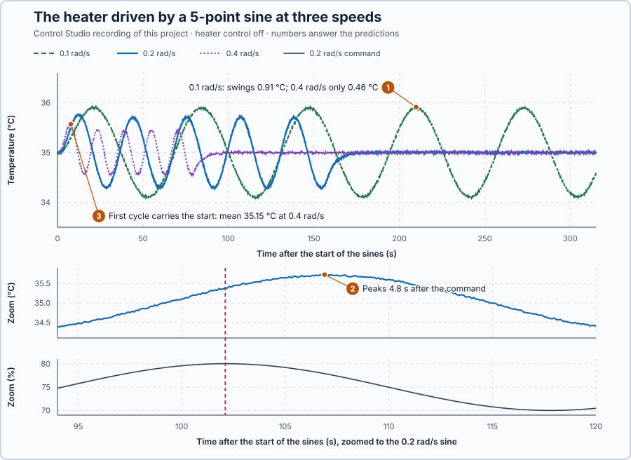

# 53. Periodic excitation

In this lesson, you will drive the heater with a sine command at three speeds, let the start die away, and record how the temperature follows a change that keeps repeating.

## The problem

Lesson 52 found that the shaft under P control is stable for every $K_p > 0$: at $K_p = 1$ a 0.01 rad step peaked at 0.01167 rad and settled. Stability tells us that a disturbance dies away. Many disturbances and commands do not stop, though: a load that follows a machine cycle, a supply that varies through the day. How strongly does a process answer a change that keeps repeating, and does that depend on how fast it repeats? A step shows the way to a new equilibrium, not that.

We return to the water heater, whose slow response makes repeating behaviour easy to see. We will drive it with a sine command at three speeds and record the settled response.

## What we need

We need to:

1. apply a repeating input of known size and speed while nothing else changes;
2. record the settled repeating response, with the start-up left out; and
3. keep the input within the heater's 0–100 % range.

## The new idea

**Periodic excitation** moves the input up and down in a sine wave at a chosen speed and watches how the output follows. The faster the wave, the smaller and the later the answer.

**In words.** A step test answers where a process ends up after one change. Periodic excitation asks a different question: how well does the process follow a change that keeps coming back? It has three parts:

1. **The sine.** The input swings evenly around its operating value, up for half a cycle and down for the other half. It has a size, how far it swings each way, and a speed, how long one cycle takes.
2. **The start-up.** When the sine begins, the output first carries an extra part that dies away with the process's own natural motion, as after any push.
3. **The steady periodic response.** Once the start-up has died away, the output repeats the same cycle at the same speed as the input. This is what we record.

Why smaller and later? The water stores heat. During the half-cycle with extra power it warms, during the other half it cools. A slow cycle gives the water time to warm almost fully before the power falls again; a fast cycle turns back before the water has moved far. And the water keeps warming for as long as the power is above what holds its present temperature, which is still true for a while after the command's peak: the temperature peaks later than the command. How much later is set by how fast the water can follow, its 5 s time constant and the 1 s delivery delay, so the lag lasts a few seconds at any speed.

A first-order filter in a PLC does the same to a noisy signal: slow changes pass almost unchanged, while fast flicker is smoothed out and comes through late.

For the heater, the command swings around its holding value of 75 %, and the stored heat smooths the temperature's answer.

**The formula.** The command is

$$
u(t) = u_0 + d\,\sin(\omega t), \qquad \omega = \frac{2\pi}{P} .
$$

Let:

- $u_0$ be the steady command, 75 %;
- $d$ be the command amplitude, how far it swings each way, in percentage points;
- $P$ be the **period**, the time of one full cycle, in seconds; and
- $\omega$ be the **angular frequency**, in radians per second: one cycle is $2\pi$ radians, so $\omega$ is how many radians of the cycle pass each second.

Two more facts bound what can happen:

- **The start-up part** dies away as the heater's natural motion, $e^{-t/5}$, with the heater's 5 s time constant.
- **The largest possible swing.** A very slow sine is a slow series of steady states, so the temperature then swings by the heater's steady gain times the amplitude, 0.2 °C per percentage point times $d$. A faster sine can only move it less.

**Example: making a record of the heater.** Follow the settings and the numbers:

1. **One cycle.** With $d = 5$ points and $\omega = 0.2$ rad/s, one cycle lasts $2\pi/0.2 = 31.4$ s. The command starts at 75 %, reaches $75 + 5\sin(0.2 \times 7.85) = 80$ % after a quarter cycle, 7.85 s, is back at 75 % after 15.7 s and at 70 % after 23.6 s. At 0.1 rad/s a cycle lasts 62.8 s; at 0.4 rad/s, 15.7 s.
2. **The start.** After one cycle at 0.2 rad/s, $e^{-31.4/5} = 0.0019$ of the start-up part is left, 0.2 %; after two cycles, practically nothing. We run five periods, leave out the first two and measure the last three, which is safe at every speed.
3. **The size of the swing.** The amplitude must stand well out of the ±0.02 °C measurement noise and keep the command inside 0–100 %. With $d = 10$ points, the largest the program accepts, even a very slow sine could move the water by at most $0.2 \times 10 = 2$ °C, a hundred times the noise. This lesson uses $d = 5$ points.
4. **The speeds.** The heater's own rate is $1/5 = 0.2$ per second. The three speeds lie below, at and above it: 0.1, 0.2 and 0.4 rad/s.
5. **What spoils a record.** A clipped sine is no longer a sine, so the command must stay inside 0–100 %. A load change during the record spoils it too, and so does feedback, which would change the command in answer to the temperature: the heater's control stays off.

The amplitude, the three speeds and the five periods are teaching choices.

**The limitation.** A record describes the process at one speed only, and only near its operating point. It also costs time: five periods of the slowest sine take $5 \times 62.8 = 314$ s, more than five minutes.

## Prediction

Before running, answer these questions:

1. Which speed gives the largest temperature swing, and can any of the three exceed 1 °C?
2. The temperature peaks after the command. At which speed is that lag the largest share of the cycle?
3. How much of the start-up part is left after the fastest sine's first cycle, and which cycles does the start disturb?

| $\omega$ | Period | Command | Largest possible swing |
| ---: | ---: | --- | ---: |
| 0.1 rad/s | 62.8 s | 70–80 % | 1 °C |
| 0.2 rad/s | 31.4 s | 70–80 % | 1 °C |
| 0.4 rad/s | 15.7 s | 70–80 % | 1 °C |

## Implementation

Open [`src/Main.st`](src/Main.st). The project runs three copies of the heater, each at rest at 35 °C with 75 %, with its 1 s delivery delay and ±0.02 °C noise. The function block `PeriodicExcitation` produces $u = 75 + d\,\sin(\omega t)$ for five periods from the start and then 75 % again. It rejects settings outside 5–10 points or 0.05–1 rad/s and keeps the command within 0–100 %. Three instances run at 0.1, 0.2 and 0.4 rad/s with $d = 5$ points.

**ST practice.** Calculate the command of the 0.2 rad/s instance by hand at 2.5, 5 and 7.5 s: $75 + 5\sin(0.5) = 77.40$ %, $75 + 5\sin(1.0) = 79.21$ % and $75 + 5\sin(1.5) = 79.99$ %. Then count the updates of 0.1 s in five periods at 0.4 rad/s: $5 \times 15.708/0.1 = 785.4$, so the sine ends after 786 updates. The tests in [`src/tests.st`](src/tests.st), run from the **Testing** view, check these values and a rejected setting.

## Experiment in Control Studio

1. Open this lesson's project and start **Simulator**. The three heaters rest at 35 °C. In the **truST** side bar, select **Control Studio**.
2. On **Identify**, choose **Project experiment** from **Method**. **Signals** already shows `P1.MiddleTemperatureC · Process value (°C)` and `P1.MiddleCommandPct · Applied output (%)`, the 0.2 rad/s heater; add `P1.SlowTemperatureC · state (°C)`, `P1.FastTemperatureC · state (°C)`, `P1.SlowCommandPct · state (%)` and `P1.FastCommandPct · state (%)`.
3. Answer the predictions before starting.
4. Select **Review project test** and check the declared **317.3 s** duration: 2 s at rest and five periods of the slowest sine.
5. Select **Confirm and start**. After 2 s all three sines start.
6. After the run, hover the peaks of the last cycles and compare each temperature peak with the command peak before it.
7. At completion, Control Studio shows **Project test completed. Outputs restored.**

Select **Abort test** to stop early. To repeat, stop and restart **Simulator**.

## Evidence and decision

The numbered marks answer the predictions with the same numbers. From the recorded run, per cycle: half the swing from highest to lowest temperature, and the cycle's mean.

| $\omega$ | Cycle 1 | Cycles 3–5 | Temperature peak after the command's |
| ---: | --- | --- | ---: |
| 0.1 rad/s | 0.916 °C, mean 35.038 °C | 0.911–0.912 °C, mean 35.000 °C | 5.6 s |
| 0.2 rad/s | 0.746 °C, mean 35.097 °C | 0.723–0.725 °C, mean 35.000 °C | 4.8 s |
| 0.4 rad/s | 0.502 °C, mean 35.147 °C | 0.458–0.464 °C, mean 35.000 °C | 3.9 s |

1. The slowest sine moved the water most: 0.91 °C at 0.1 rad/s, against 0.72 °C at 0.2 rad/s and only 0.46 °C at 0.4 rad/s; none reached the 1 °C limit. A slow swing gives the stored heat time to follow; a fast one is smoothed away.
2. The temperature peaked later than the command: about 5.6, 4.8 and 3.9 s, which is a growing share of each cycle, 9, 15 and 25 %.
3. After the fastest sine's first cycle, $e^{-15.7/5} = 0.043$ of the start-up part was left, 4 %. Only the first cycle carried the start: its mean was up to 0.15 °C high and its swing larger. From the second cycle on, every cycle repeated within the noise.

The commands stayed between 70 and 80 %, unclipped, and returned to 75 % after five periods. Each record is bounded, unclipped and free of load changes, with three settled cycles: usable for measurement. The cost is time: five periods of the slowest sine take more than five minutes. These are simulation results.

## Conclusion

A bounded sine around the operating point, with the controller off, is a known repeating input. Once the start has died away, the process repeats the same cycle, smaller and later the faster the sine.

For the heater, the same 5-point command moved the water by 0.91 °C at 0.1 rad/s but by only 0.46 °C at 0.4 rad/s, and the temperature always peaked after the command.

## Check yourself

1. **What is the period of a sine at 0.25 rad/s, and how many 0.1 s updates does one cycle take?**
   $2\pi/0.25 = 25.1$ s, so about 251 updates.
2. **Why must the heater's controller be off during the record?**
   Feedback would change the command in answer to the temperature, so the input would no longer be the known sine.
3. **Why are the first two cycles left out?**
   The start-up part of the answer dies away as $e^{-t/5}$; after two cycles it is gone, and only the repeating
   answer is measured.

## Reason for the next lesson

The traces show that the swing gets smaller and later as the speed rises, but not by how much, in a form we can calculate with or predict from the heater's model.

[Frequency response](../../07-classical-stability-and-frequency-design/46-bode-frequency-response/README.md) puts numbers on how much smaller and how much later, and derives both from the heater's transfer function.
