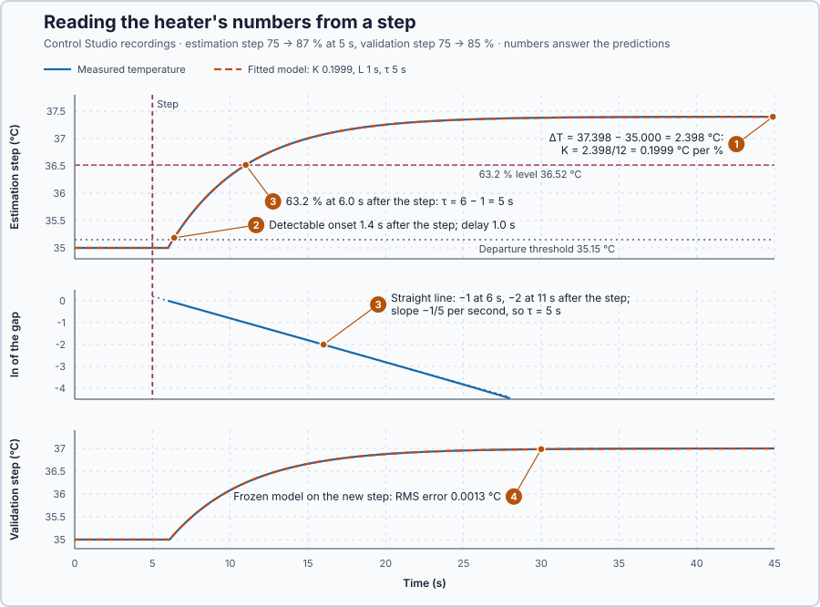

# 15. Step-response identification

In this lesson, you will calculate the heater's gain, delay and time constant from a recorded step, compare them with Control Studio's fit, and check the numbers on a different step.

## The problem

Lesson 14's 12-point step, held 40 s, gave a clean record: a steady baseline at 35.000 °C, a first rise 1.1 s after the step, and 37.399 °C at the end of the hold. The record shows the response, but it does not state the heater's gain, delay and time constant. Reading them off by eye is unreliable: noise can look like the first movement, and one point on the curve says nothing about precision.

We will calculate the three numbers from the whole record, compare them with Control Studio's fit, and check them on a step the calculation has not seen.

## What we need

We need to:

1. calculate the gain from the steady temperatures before and after the step;
2. calculate the delay and the time constant from the shape of the curve; and
3. check the result against a second, different step.

## The new idea

**Step-response identification** reads three numbers from the response to a step. The gain is how far the temperature finally moves per % of power. The delay is how long before it starts to move. The time constant is how quickly it gets there. For this heater, it turns the planned step record into the numbers of its first-order model with delay.

**In words.** The method has one part for each number, and a check:

1. **The gain from two steady windows.** It is found like an analog scaling factor in a PLC: take two steady points and divide the change of the output by the change of the input. Here the points are the average temperature over the 5 s before the step and over the last 5 s of the hold; averaging many samples reduces the effect of noise.
2. **The time constant and the delay from the whole curve.** After the delay, the remaining gap to the final temperature shrinks by the same fraction in every equal stretch of time. The logarithm turns that steady shrinking into a straight line: how steep the line is gives the time constant, and where it starts gives the delay. A line through many samples is more reliable than one point read off by eye.
3. **Visible is not the same as started.** Noise can look like the first movement, so a change counts as real only when it is clearly larger than the noise. The moment the response first passes that test is the **detectable onset**. The delay is found from the curve, not from that moment.
4. **A best fit as the check.** Control Studio tries many values of gain, delay and time constant, predicts the whole record with each set, and keeps the set that predicts it best: the **best fit**. It also lists the range of each value that still keeps every prediction within the measurement uncertainty. A range shows what the record cannot tell apart; it is not a statistical confidence interval.

**The formula.** The gain, then the gap to the final value after the delay:

$$
K = \frac{T_f - T_0}{\Delta u}, \qquad T_f - T(t) = (T_f - T_0)\,e^{-(t - L)/\tau}.
$$

- $T_0$ is the average temperature over the 5 s before the step, and $T_f$ over the last 5 s of the hold, in °C;
- $\Delta u$ is the step of the command, in percentage points, and $K$ the gain, in °C per %;
- $t$ is the time after the step, $L$ the delay and $\tau$ the time constant, all in seconds.

> **Math you need: the natural logarithm.** The **natural logarithm** $\ln$ undoes the exponential: if $y = e^x$, then $x = \ln y$. So $\ln 1 = 0$, $\ln e^{-1} = -1$ and $\ln e^{-2} = -2$; as numbers, $\ln 0.368 \approx -1$ and $\ln 0.135 \approx -2$.

Divide the gap by the initial gap and take the natural logarithm:

$$
q(t) = \ln\frac{T_f - T(t)}{T_f - T_0} = -\frac{t - L}{\tau}.
$$

- $q$ is the logarithm of the fraction of the gap still left, without a unit. Plotted against $t$ it is a straight line with slope $-1/\tau$ that crosses zero at $t = L$. From two points on it, $\tau = -(t_2 - t_1)/(q_2 - q_1)$, and rearranging gives $L = t + \tau\,q$.

The detectable onset is the first of three samples in a row that lie more than 0.15 °C beyond $T_0$ in the direction of the response, because two readings each uncertain by ±0.05 °C can differ by 0.1 °C. Control Studio's best fit is the set with the smallest sum of squared differences over all samples,

$$
S = \left(T_1 - \hat T_1\right)^2 + \left(T_2 - \hat T_2\right)^2 + \dots ,
$$

where $T_1, T_2, \dots$ are the measured and $\hat T_1, \hat T_2, \dots$ the predicted temperatures at the samples, in °C, and $S$ is in °C². Squaring makes every difference count as positive and weighs large misses most; this is a **least-squares fit**.

**Example: a step down from 75% to 70%.** Calculated from the heater's energy balance, without noise, not run in this lesson:

1. **Gain.** $T_0$ = 35.000 °C and $T_f$ = 34.000 °C, so $K = (34.000 - 35.000)/(-5) = 0.2$ °C per %.
2. **Two points on the log line.** At $t$ = 6 s, $T$ = 34.368 °C, so $q = \ln\frac{34.000 - 34.368}{34.000 - 35.000} = \ln 0.368 = -1.00$. At $t$ = 11 s, $T$ = 34.135 °C, so $q = \ln 0.135 = -2.00$.
3. **Time constant.** The slope is $(-2.00 - (-1.00))/(11 - 6) = -0.2$ per second, so $\tau = 5$ s.
4. **Delay.** $L = t + \tau q = 6 + 5 \times (-1.00) = 1$ s: the line crosses zero 1 s after the step.
5. **The 63.2% check.** The 63.2% level is $35.000 - 0.632 \times 1.000 = 34.368$ °C, reached at 6 s: one time constant after the 1 s delay.
6. **Detectable onset.** Just after the delay the water cools at its fastest, 0.2 °C/s, so it needs at least $0.15 / 0.2 = 0.75$ s to move 0.15 °C: this step becomes visible no earlier than 1.75 s after it starts.

**The limitation.** The log line is reliable only while the gap is large. Late in the hold the gap is small and the ±0.05 °C uncertainty swamps it: for the step down, a 0.10 °C gap read as 0.05 or 0.15 °C gives $q$ between $\ln 0.05 = -3.0$ and $\ln 0.15 = -1.9$, a spread of 1.1, which is 5.5 s on a line that falls 0.2 per second. Control Studio's fit compares temperatures, not logarithms, so it avoids this. Both share one limitation: a first-order model with delay can only bend in one way. If the real response has a feature this shape lacks, no choice of the three numbers fits it.

## Prediction

Before running, answer these questions for the 12-point record:

1. What temperature change and gain do you expect?
2. Will the detectable onset come earlier than, at, or later than the 1 s delay?
3. What time constant and delay do the log line and the 63.2% level give?
4. Will the unchanged model predict a separate 10-point step to within the 0.05 °C measurement uncertainty?

| Quantity | Predicted |
| --- | ---: |
| Temperature change, $0.2 \times 12$ | 2.4 °C |
| Gain | 0.2 °C per % |
| Detectable onset | later than 1 s |
| Time constant and delay | 5 s and 1 s |

## Implementation

Open [`src/Main.st`](src/Main.st). It holds 75% until the experiment starts, then applies 85% for 40 s in a 45.1 s record: the separate step that checks the estimate. `SafetyAbort` removes heat on an invalid measurement; restart the simulator after an abort.

The program also provides three helper functions: `Lesson23ProcessGain` returns $K$ from the two command and temperature values, `Lesson23Delay` returns the delay from the step and response-start times, and `Lesson23TimeConstant` returns $\tau$ from the response-start and 63% times. A zero command change would divide by zero, so `Lesson23ProcessGain` then returns 0 with `ENO = FALSE`.

**Exercise.** Write your own calculation of `ProcessGainCPerPoint` from your record, guard the division, and check it: $(37.398 - 35.000)/12 = 0.1999$. Then run the tests in the **Testing** view.

## Experiment in Control Studio

1. In Lesson 14's project, right-click the plot of the **12 points, 40 s** recording and choose **Save recording…**.
2. Open this lesson's project and start **Simulator**. In the **truST** side bar, select **Control Studio**. On **Identify**, choose **Recorded-data fit** from **Method**, check **Use held-step measurement and search**, and set **Model family** to **First order with dead time**.
3. Select **Open recording…** and choose the saved file. The plot shows the recorded temperature and command; nothing is fitted yet. **Measurement and search settings** holds the 5 s windows, the 0.15 °C departure threshold and the search ranges; keep them.
4. Select **Check recording** and read **Step-response measurements**: the two windows, the detectable onset and the 63.2% level.
5. Select **Fit plant model**. Read **Best gain**, **Transport delay** and **Time constant**, the **Consistent grid** ranges, and the model line, `G(s) = 0.199858 e^(-1s) / (5s + 1)`: Control Studio's compact way of writing gain 0.1999, delay 1 s and time constant 5 s.
6. Check the model on a new step. Choose **Project experiment** from **Method**, select **Review project test**, check the **45.1 s** plan and select **Confirm and start**. After the run, choose **Recorded-data fit** again, select **Check recording**, then **Compare with model**: the frozen model predicts the new record without refitting. Read **Prediction RMSE** and **Maximum absolute residual**.
7. If the prediction agrees, select **Use fitted model**; the button then shows **Model ready**.

Select **Abort test** to stop the project test early.

## Evidence and decision

The numbered marks answer the predictions with the same numbers. From Control Studio:

| Quantity | Result |
| --- | ---: |
| Baseline and final windows | 35.000 °C and 37.398 °C |
| Detectable onset | 1.4 s after the step |
| 63.2% level | 36.52 °C, reached at 6.0 s |
| Best fit | $K$ 0.1999 °C per %, $L$ 1 s, $\tau$ 5 s |
| Consistent ranges, ±0.05 °C | $K$ 0.1925–0.2075, $L$ 0.8–1.2 s, $\tau$ 4.5–5.5 s |
| New 10-point step: RMS and largest error | 0.0013 °C and 0.0014 °C |

1. The temperature changed by 2.398 °C: $K$ = 0.1999 °C per %, as predicted.
2. The detectable onset came 1.4 s after the step, 0.4 s after the true delay: the temperature needed that long to rise 0.15 °C. The whole-curve fit found the delay itself.
3. The log of the gap fell on a straight line through −1 at 6 s and −2 at 11 s: $\tau$ = 5 s and $L$ = 1 s, the same as Control Studio's best fit.
4. On the separate 75 → 85% step the frozen model predicted the temperature with an RMS error of 0.0013 °C, far inside the 0.05 °C uncertainty, so it was accepted.

The ranges show the cost of a finite measurement: any delay from 0.8 to 1.2 s still fits the record within ±0.05 °C. These are simulation results.

## Conclusion

Step-response identification turns a planned step record into three numbers: the gain from two steady windows, and the delay and time constant from the whole curve, through the straight line of the log of the gap or a least-squares fit. A threshold crossing only marks when the response became visible.

For this heater the record gave a gain of 0.1999 °C per %, a 1 s delay and a 5 s time constant, and the unchanged model predicted a new step to 0.0013 °C.

## Check yourself

1. **A 10-point step moves the temperature from 35.00 to 36.50 °C. What is the gain?**
   $1.50/10 = 0.15$ °C per %.
2. **Why does the detectable onset come later than the delay?**
   The temperature must rise 0.15 °C above the baseline before a change counts as real, and that takes time
   after the delayed heat arrives.
3. **On the log line, q is −1 at 4 s and −3 at 12 s after a step. What are the time constant and the delay?**
   The slope is −2/8 = −0.25 per second, so $\tau$ = 4 s; $L = 4 + 4 \times (-1) = 0$ s.

## Reason for the next lesson

The fit assumed one store of heat and a pure delay. A first-order model can miss a repeatable feature that this shape lacks, such as a temperature sensor that warms up more slowly than the water around it.

[Model structure](../24-choose-model-structure/README.md) asks whether the model needs a second store for the sensor.
