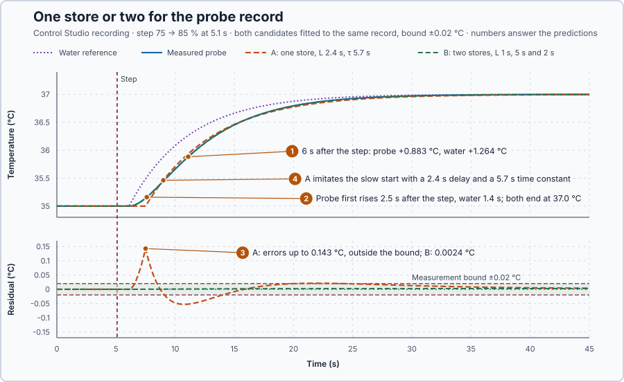

# 16. Model structure

In this lesson, you will fit a model with one heat store and a model with two to the same probe recording, and decide which physical parts the heater model must contain. You will then see that the fit alone cannot say which of the two lags belongs to the probe.

## The problem

Lesson 15's model, gain 0.1999 °C per %, delay 1 s and time constant 5 s, predicted a new step to 0.0013 °C. Its record came from a measurement that follows the water at once. This project measures the water with a probe that warms up more slowly than the water around it. The probe has its own lag, and Lesson 15's model misses it.

A model can still be made to fit such a record by stretching its numbers, but then the numbers no longer describe the heater. We will fit a one-store and a two-store model to the same recording and keep the structure that the physics and the data support.

## What we need

We need to:

1. describe the probe's lag with its own physical equation;
2. compare models with and without that part on the same recording; and
3. add the part only if the simpler model fails a limit declared before fitting.

## The new idea

**Model structure** is which physical parts the model contains. If the sensor itself warms up slowly, the model needs a second store for the sensor, not an extra number to make the curve fit. For this heater, the parts are the delayed heater power, the heat stored in the water and the small amount of heat stored in the probe.

**In words.** Each part of a model belongs to something physical, and each does one job:

1. **The delay** belongs to the heater's power delivery: power commanded now reaches the water 1 s later. It shifts the response in time without changing its shape.
2. **The water's store** sets how quickly the water itself approaches its new temperature.
3. **The probe's store.** A probe is a small body that the water around it must heat. Heat flows into it in proportion to the temperature difference, so it approaches the water temperature gradually. It stores so little heat that the water's own balance is unchanged.

In PLC terms, the probe acts like the filter on an analog input card: the reading lags the real signal, and a model of the loop must include that filter instead of pretending that the process itself is slower.

If a part is missing, a fit can still imitate its effect by changing the numbers of the parts that are there. Those numbers then describe neither the heater nor the probe: they are **fitting factors**. So the choice between structures is made by a rule declared before fitting. A structure must predict every sample within the measurement bound, because a larger, repeatable error cannot come from the measurement: it shows a missing part. Keep the simpler structure if it meets this limit; add a store only if it has a physical owner and lowers the typical error, its root-mean-square (RMS) value, by more than the bound.

**The formula.** Measure from the steady point, 35 °C with 75%. The water keeps the previous lesson's model, and the probe follows the water:

$$
5\dot x + x = 0.2\,v(t-1), \qquad \tau_s\,\dot m + m = x.
$$

- $x$ is the water temperature minus 35 °C, and $m$ the probe temperature minus 35 °C, in °C;
- $v$ is the heater command minus 75%, in percentage points;
- $\tau_s$ is the probe's time constant, in seconds;
- a dot marks a rate of change per second: $\dot m = (x - m)/\tau_s$ says the probe warms in proportion to how far it is below the water.

With $\tau_s$ = 2 s, a probe 1 °C below the water warms at $1/2 = 0.5$ °C/s. **Candidate A** has one store: the measured temperature is the water temperature, $m = x$. **Candidate B** adds the probe's equation: two stores. For a 10-point step, counting $t'$ in seconds from the moment the delayed heat arrives, the water rises as $x = 2(1 - e^{-t'/5})$, and solving the probe's equation for this water curve gives

$$
m(t') = 2\left[1 - \frac{5e^{-t'/5} - 2e^{-t'/2}}{3}\right].
$$

**Example: the first seconds of a 10-point step.** Calculated from the two equations:

1. At $t'$ = 0 the probe is at the water temperature, so no heat flows into it yet: $\dot m = (0 - 0)/2 = 0$. It starts to rise only once the water pulls ahead.
2. At $t'$ = 2 s, 3 s after the step, the water has risen $2(1 - e^{-0.4}) = 0.659$ °C and the probe $2[1 - (5e^{-0.4} - 2e^{-1})/3] = 0.256$ °C: it trails by 0.40 °C, and Candidate A would report 0.659 °C.
3. At $t'$ = 10 s, 11 s after the step, the water has risen $2(1 - e^{-2}) = 1.729$ °C and the probe $2[1 - (5e^{-2} - 2e^{-5})/3] = 1.558$ °C: it trails by 0.17 °C.

**Teaching choice.** This record's own windows show how repeatable the probe is: its baseline varied by 0 °C and its final window by 0.002 °C, so we declare a bound of ±0.02 °C.

**The limitation.** The fit can show that a second lag is needed, but not which part owns it. Exchanging the two lags, 2 s for the water and 5 s for the probe, leaves the formula for $m$ unchanged: $2[1 - (2e^{-1} - 5e^{-0.4})/(-3)] = 0.256$ °C at $t'$ = 2 s, exactly as before. The record alone cannot say which lag is the probe's.

## Prediction

Before running, answer these questions:

1. What do Candidate A, with Lesson 15's numbers, and Candidate B predict 6 s after the 75 → 85% step?
2. Does the probe mainly change the start of the response, the delay or the final value?
3. Which candidate will predict every sample within ±0.02 °C?
4. Fitted to the probe record, will Candidate A's delay and time constant be shorter than, equal to or longer than the water's 1 s and 5 s?

| Rise after the 10-point step | Candidate A | Candidate B |
| --- | ---: | ---: |
| 6 s after the step | 1.264 °C | 0.883 °C |
| Final | 2.000 °C | 2.000 °C |

## Implementation

[src/tests.st](src/tests.st) computes the two-store model with forward-Euler steps (Lesson 13). Both next states are calculated from the previous values before either is stored:

```st
NextWaterDeviationC := WaterDeviationC + ElapsedS
    * (ProcessGainCPerPoint * DelayedCommandChangePct - WaterDeviationC)
    / ProcessTimeS;
NextSensorDeviationC := SensorDeviationC + ElapsedS
    * (WaterDeviationC - SensorDeviationC) / SensorTimeS;
WaterDeviationC := NextWaterDeviationC;
SensorDeviationC := NextSensorDeviationC;
```

**Exercise.** From zero, with a 10-point delayed input and 0.1 s steps, calculate the first two updates: water 0.04 °C and probe 0, then 0.0792 °C and 0.002 °C. Run the tests from the **Testing** view: the first test checks these updates, the second the 6 s prediction. Then move the water assignment before the probe calculation and predict the first probe value: it becomes 0.002 °C instead of 0, because the probe now uses the new water value. Restore the order.

The simulated heater has a 2 s probe: the water temperature arrives on `%IL0` and the probe temperature on `%IL8`. `Main.st` applies 85% while `ExperimentEnabled` is TRUE and 75% otherwise. `SafetyAbort` removes heat when the measurement is invalid, below 0 °C or above 80 °C.

## Experiment in Control Studio

1. Start **Simulator**: the heater holds 35 °C at 75%. In the **truST** side bar, select **Control Studio**.
2. On **Identify**, choose **Project experiment** from **Method**. **Signals** shows `P1.TemperatureC · Process value (°C)`, the probe, and `P1.AppliedPowerPct · Applied output (%)`; add `P1.WaterTemperatureC · state (°C)`, the water itself.
3. Answer the predictions. Select **Review project test** and check the **45.1 s** plan: a 5 s steady start, then 85% from 5.1 s to 45.1 s after **Confirm and start**. Select **Confirm and start**. At the end, Control Studio shows **Project test completed. Outputs restored.**
4. Hover the plot 6 s after the step and compare the probe with the water. Then right-click the plot and choose **Save recording…**.
5. Choose **Recorded-data fit** from **Method**, check **Use held-step measurement and search**, and set **Model family** to **Compare additional lag**. Select **Open recording…**, open the saved file, and select **Check recording**.
6. Expand **Measurement and search settings**. Set **Measurement bound ± (°C)** and **Maximum model residual (°C)** to 0.02. Set **Delay maximum (s)** to 4 and **Delay grid step (s)** to 0.2: the first-order fit needs more than the default 2 s, and the coarser step keeps the search within its time budget. Select **Fit plant model**.
7. Read **Model comparison** and **Parameters and uncertainty**: A is the first-order model, B the model with the additional lag. Select **Keep additional-lag model**. Validation on a new record follows later in the course.

Select **Abort test** to stop the project test early.

## Evidence and decision



The numbered marks answer the predictions with the same numbers. From Control Studio:

| Quantity | A: one store | B: two stores |
| --- | ---: | ---: |
| Gain | 0.1998 °C per % | 0.1998 °C per % |
| Delay | 2.4 s | 1 s |
| Time constants | 5.7 s | 5 s and 2 s |
| Largest residual | 0.143 °C | 0.0024 °C |
| RMS residual | 0.024 °C | 0.0019 °C |
| Parameter sets within ±0.02 °C | 0 | 1,174 |

1. 6 s after the step the probe had risen 0.883 °C and the water 1.264 °C, as calculated for B and for A with Lesson 15's numbers.
2. The start: the probe first rose 2.5 s after the step, the water 1.4 s, and both ended at 37.0 °C.
3. Only B. A's largest residual was 0.143 °C, seven times the bound, and Control Studio found no first-order parameter set within ±0.02 °C.
4. Longer: A needed a 2.4 s delay and a 5.7 s time constant to imitate the probe.

B lowered the RMS error by 0.023 °C, more than the bound, and Control Studio reported **The additional lag meets the limits. Its physical origin remains unresolved.** B is kept with **Keep additional-lag model**: its extra store has a physical owner, and its delay and water time constant are the heater's own. The cost is a fourth parameter and an unresolved owner: among the 1,174 parameter sets within the bound, each of B's two time constants ranged from 1.2 to 5.7 s and the delay from 0.6 to 1.4 s. With the default 0.2 °C limit, Control Studio suggests A: enough for a design that needs only 0.2 °C. These are simulation results.

## Conclusion

Model structure decides which physical parts a model contains. A missing part shows as a repeatable error larger than the measurement uncertainty, and a simpler structure can hide it only by stretching its numbers until they lose their physical meaning. A part is added when its owner is physical and the simpler model fails a limit declared in advance.

For this heater, the probe's 2 s lag is such a part: two stores explained the record within 0.0024 °C with the heater's 1 s delay and 5 s time constant, while one store missed by 0.143 °C.

## Check yourself

1. **A probe with $\tau_s$ = 4 s is 2 °C below the water. How fast does it warm?**
   $2/4 = 0.5$ °C/s.
2. **Why did Candidate A fit a 2.4 s delay when the heater's delay is 1 s?**
   It has no part for the probe, so it imitated the probe's slow start with a longer delay and time constant.
3. **Why can the fit not tell which lag belongs to the probe?**
   Exchanging the 5 s and 2 s lags gives exactly the same probe curve, for example 0.883 °C at 6 s both ways.

## Reason for the next lesson

Different numbers can fit the same recording equally well: 1,174 parameter sets stayed within the bound, and the record cannot say which lag is the probe's.

[Identifiability](../25-parameter-identifiability/README.md) asks what an experiment can tell apart, and which second measurement separates the two lags.
