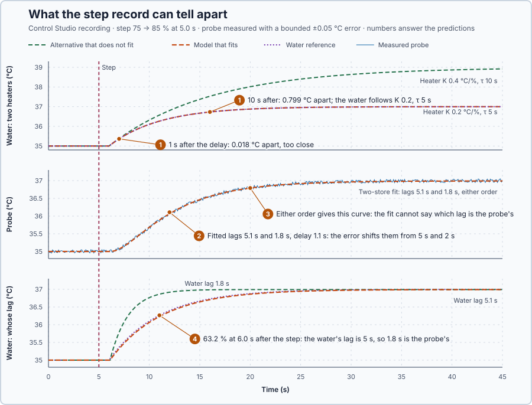

# 17. Identifiability

In this lesson, you will find out which of the heater's numbers a step record can tell apart and which it cannot, even with perfect data. You will then use a second measurement, the water temperature, to decide which lag belongs to the probe.

## The problem

Lesson 16's two-store model followed the probe within 0.0024 °C, but its parameters are ambiguous: 1,174 different parameter sets stayed within the ±0.02 °C bound. Each of the two time constants could lie anywhere from 1.2 to 5.7 s, and the record could not say which lag belonged to the probe. If many sets of numbers fit equally well, the numbers we report have not really been measured.

This project's probe also adds a measurement error of up to ±0.05 °C, as a real probe does. We will find out why the record cannot tell the numbers apart, and choose the experiment that can.

## What we need

We need to:

1. tell whether an ambiguity comes from the quality of the record or from what is measured;
2. calculate when two candidate heaters differ by more than the measurement can resolve; and
3. choose the measurement that removes the ambiguity.

## The new idea

**Identifiability** means that the experiment can tell a parameter's value apart from other values; such a parameter is identifiable. If two different heaters would give the same recording, the experiment cannot tell which one we have. For this heater, the question is whether one step record from the probe fixes the gain, the delay and both lags.

**In words.** It is the problem of two faults that raise the same alarm: from the alarm alone you cannot tell which fault you have, however often you look at it. Ambiguity comes in two kinds:

1. A **practical ambiguity** disappears with a better record: a longer one, a less noisy one or a larger step. The difference between the candidates is in the record, but too small to see yet.
2. A **structural ambiguity** remains even with perfect data from the same input and measurement. The difference never appears in what is measured, so only a different measurement or a different input can remove it.

For this heater both kinds occur. Early in a step, a strong but slow heater looks like a weak but fast one: both start rising at the same rate, and only later does one end higher. In the probe record, the water's lag and the probe's lag appear only together, so the record cannot say which is which.

**The formula.** Just after the delayed heat arrives, the water is hardly warmer than before, so it has not yet started to lose extra heat: it warms at the full rate the heater supplies. The early response and the full response are

$$
x(t') \approx \frac{K}{\tau}\,\Delta u\,t', \qquad x(t') = K\,\Delta u\left(1 - e^{-t'/\tau}\right).
$$

- $x$ is the water temperature minus its starting value, in °C;
- $K$ is the gain, in °C per %, and $\tau$ the water's time constant, in seconds;
- $\Delta u$ is the step size, in percentage points, and $t'$ the time after the delay, in seconds.

Early on, only the ratio $K/\tau$ shows. Two predictions are clearly separated only if they differ by more than the measurement can resolve: with each reading uncertain by ±0.05 °C, by more than $2 \times 0.05 = 0.1$ °C.

In the previous lesson's two-store model, the water lags with $\tau_p$ and the probe with $\tau_s$, in seconds, after the delay $L$:

$$
\tau_p\dot x+x=Kv(t-L),\qquad \tau_s\dot m+m=x .
$$

Here $v$ is the command change, in percentage points, and $m$ the probe reading's change, in °C. The second equation gives $x = \tau_s\dot m + m$, so $\dot x = \tau_s\ddot m + \dot m$, where $\ddot m$ is the rate of change of $\dot m$. Substituting both into the first equation removes the water:

$$
\tau_p\tau_s\ddot m+(\tau_p+\tau_s)\dot m+m=Kv(t-L).
$$

The probe reading depends on the two lags only through their product $\tau_p\tau_s$, in s², and their sum $\tau_p + \tau_s$, in s.

**Example: what a step record can and cannot separate.** Calculated for a 10-point step:

1. A heater with $K$ = 0.2 °C per % and $\tau$ = 5 s and one with $K$ = 0.4 and $\tau$ = 10 s have the same ratio, 0.04 °C per % per second, so both start rising at $0.04 \times 10 = 0.4$ °C/s.
2. 2 s after the delay they read $2(1 - e^{-0.4}) = 0.659$ °C and $4(1 - e^{-0.2}) = 0.725$ °C: 0.066 °C apart, less than 0.1 °C. The record cannot tell them apart yet.
3. 3 s after the delay they read 0.902 and 1.037 °C: 0.134 °C apart. Now they are clearly separated: a record long enough removes this practical ambiguity.
4. Lags of 5 s and 2 s have the product 10 s² and the sum 7 s. Swapped, 2 s and 5 s, they have the same product and sum, so they give the same probe record. A longer, cleaner record from the same probe cannot change this: the ambiguity is structural.
5. The remedy is a second measurement. A fast reference thermometer in the water sees only the water's lag, so it reaches 63.2% of its change at $L + \tau_p$. If it reached 63.2% 3 s after the step, the water's lag would be $3 - 1 = 2$ s and the probe's $7 - 2 = 5$ s: the swapped pair. The time the reference shows decides between the two pairs.

**Teaching choice.** The probe's ±0.05 °C error makes the noise visible.

**The limitation.** The reference must be fast. A reference with its own 0.5 s lag would reach 63.2% about 0.5 s later, so a 5 s water lag would be read as 5.5 s, and the probe's lag as $7 - 5.5 = 1.5$ s.

## Prediction

Before running, answer these questions:

1. Which differences between the two heaters in the table exceed 0.1 °C?
2. With the probe's ±0.05 °C error, will Control Studio's two-store fit return exactly 5 s and 2 s?
3. Will the fit say which lag belongs to the probe?
4. When will the water reference reach 63.2% of its change, and which lag is then the probe's?

| Quantity | Predicted |
| --- | ---: |
| Heaters 1 s after the delay | 0.018 °C apart: too close |
| Heaters 10 s after the delay | 0.799 °C apart: clear |
| Water reference at 63.2% | $L + \tau_p$ = 6 s after the step |
| Probe lag | $7 - 5 = 2$ s |

## Implementation

[src/tests.st](src/tests.st) holds two calculations. The first computes both heater candidates 1 s and `LateObservationS` = 10 s after the delay:

```st
SeparationC := ABS(CandidateAC - CandidateBC);
ClearlySeparated := SeparationC > LREAL#2.0 * MeasurementErrorBoundC;
```

The second checks that the swapped lags have the same product, the same sum and the same 6 s response.

**Exercise.** Run the tests from the **Testing** view; both pass. Then change `LateObservationS` to 1.0, predict the result and run again: the late check fails, because 1 s is also early. Restore 10.0.

In `Main.st`, the probe reading `TemperatureC` carries the simulated error, `IdealProbeC` is the same probe without it, and `MeasurementErrorC` is their difference; `WaterTemperatureC` is the water reference. The program applies 85% while `ExperimentEnabled` is TRUE; `SafetyAbort` removes heat on an invalid measurement.

## Experiment in Control Studio

1. Start **Simulator**: the heater holds 35 °C at 75%. In the **truST** side bar, select **Control Studio**.
2. On **Identify**, choose **Project experiment** from **Method**. **Signals** shows `P1.TemperatureC · Process value (°C)`, the probe with its error, and `P1.AppliedPowerPct · Applied output (%)`; add `P1.WaterTemperatureC · state (°C)`, `P1.IdealProbeC · state (°C)` and `P1.MeasurementErrorC · state (°C)`.
3. Answer the predictions. Select **Review project test**, check the **45.1 s** plan (a 5 s steady start, then 85% until 45.1 s) and select **Confirm and start**. At the end, Control Studio shows **Project test completed. Outputs restored.**
4. Hover `P1.MeasurementErrorC`: it stays within ±0.05 °C. Right-click the plot and choose **Save recording…**.
5. Choose **Recorded-data fit** from **Method**, check **Use held-step measurement and search** and set **Model family** to **Compare additional lag**. Select **Open recording…**, open the saved file and select **Check recording**.
6. Keep the default **Measurement and search settings** and select **Fit plant model**. In **Model comparison** and **Parameters and uncertainty**, read the B column's two lags and the note below the table.
7. Hover `P1.WaterTemperatureC`: find its first rise and the time it reaches 63.2% of its change, $35 + 0.632 \times 2 = 36.26$ °C.

Select **Abort test** to stop the project test early.

## Evidence and decision



The numbered marks answer the predictions with the same numbers. From the recording and Control Studio:

| Quantity | Result |
| --- | ---: |
| Probe measurement error | within ±0.05 °C |
| Two-store fit of the probe | lags 5.1 s and 1.8 s, delay 1.1 s, gain 0.1993 °C per % |
| Largest and RMS residual, two stores | 0.055 °C and 0.030 °C |
| Largest residual, one store | 0.138 °C |
| Water reference | first rise 1.1 s and 63.2% at 6.0 s after the step |

1. Only the 10 s difference. The measured water matched the $K$ 0.2, $\tau$ 5 s heater at both times; the other would have been 0.8 °C higher at 10 s.
2. No: 5.1 s and 1.8 s with a 1.1 s delay. The true heater misses the noisy record by the same RMS, 0.030 °C: the error hides the difference.
3. No. Control Studio noted: **Additional lag is a hypothesis; the recording alone cannot assign the two time constants to the process and the sensor.** Exchanging the two lags gives the same curve.
4. The water reference first rose 1.1 s after the step and reached 36.26 °C at 6.0 s, so $L$ = 1 s and $\tau_p$ = 5 s. The 5.1 s lag belongs to the water and the 1.8 s lag to the probe, whose true lag is 2 s. A 1.8 s water lag would have put the water 0.64 °C higher 3 s after the step.

The 40 s hold identifies the gain, and the water reference assigns 5 s to the water; the probe's error leaves its own lag uncertain by about 0.2 s. The cost is a second thermometer. These are simulation results.

## Conclusion

A parameter is identifiable only when the experiment can tell its value apart from others. A practical ambiguity, from a record that is too short, too noisy or too weak, is removed by a better record. A structural ambiguity, such as two lags seen only through their sum and product, needs a different measurement.

For this heater, early samples fixed only $K/\tau$, the probe record fixed only the sum and product of the two lags, and the water reference assigned 5 s to the water and about 2 s to the probe.

## Check yourself

1. **What is the initial rate after a 10-point step for a heater with $K$ = 0.3, $\tau$ = 6 s, and one with $K$ = 0.15, $\tau$ = 3 s?**
   Both $0.05 \times 10 = 0.5$ °C/s: the ratio $K/\tau$ is the same.
2. **Two lags have the sum 9 s and the product 20 s². What are they, and which is the probe's?**
   4 s and 5 s; the probe record cannot say which is the probe's.
3. **Why can a longer record from the same probe not assign the lags?**
   The probe record depends on the lags only through their sum and product, which a swap leaves unchanged.

## Reason for the next lesson

The parameters can now be told apart, but every check used the record they were fitted to. Being able to tell the parameters apart does not prove that the model predicts a different command or a disturbance.

[Model validation](../26-independent-model-validation/README.md) tests the unchanged model on new records.
