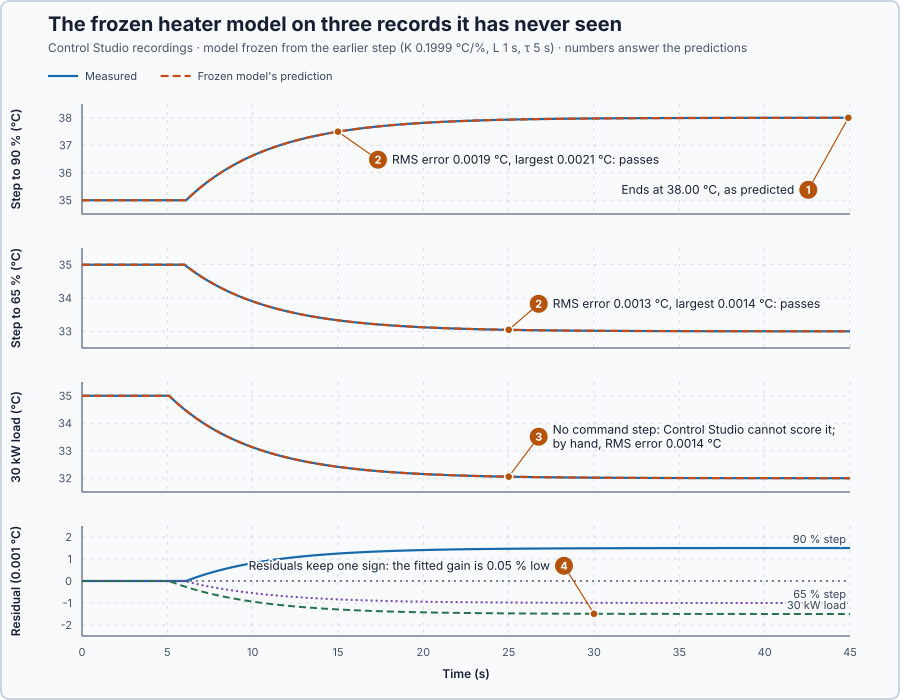

# 18. Model validation

In this lesson, you will test the heater model, unchanged, on three new records it has never seen: two command steps and an extra heat loss. You will decide from the prediction errors whether the model is good enough to design a controller with.

## The problem

Lesson 17 showed what the experiments can tell apart: early samples fix only the ratio of gain to time constant, and a water reference showed that the 5 s lag belongs to the water and the shorter one, about 2 s, to the probe. But every check so far used the record the model was fitted to. A model can fit its own record and still fail on a different command or a disturbance.

We will freeze the model and test it on new records, with requirements set before we look.

## What we need

We need to:

1. keep the model unchanged while it is tested;
2. measure how far its predictions are from new records; and
3. decide, against limits set in advance, whether it is good enough for designing the controller.

## The new idea

**Model validation** tests the unchanged model on a new recording it has never seen. If it predicts that recording well enough for our purpose, we can design with it. Here the model is the one fitted to the 12-point step: gain 0.1999 °C per %, delay 1 s, time constant 5 s.

**In words.** A model can fit its own record and still fail on a different command or a disturbance, just as a program can pass the test values used while writing it and still fail on site. In PLC terms, validation is the site acceptance test with new test cases. It has four parts:

1. **Freeze the model.** Changing it after seeing the new records would turn validation back into fitting.
2. **Use new records that test different parts of the model.** Here three records start from the same hot state, 35 °C with 75%: a step up to 90%, a step down to 65%, and an extra 30 kW heat loss at 75%. The steps test the heater's path, including its 1 s delay. The heat loss takes heat from the water directly, so it acts at once, without the heater's delay.
3. **Score the misses.** At every sample, compare the measurement with the prediction. Two numbers summarize the misses: how large they typically are, and whether they lean to one side. Measurement noise is as often positive as negative and averages out; an error in the model itself does not.
4. **Decide against limits set in advance.** "Good enough for our purpose" means limits taken from what the design needs, written down before anyone looks at the records.

**The formula.** The **residual** of one sample is the measured temperature minus the predicted one:

$$
r_i = T_{measured,i} - T_{predicted,i}.
$$

> **Math you need: mean and root mean square.** The **mean** of $N$ numbers is their sum divided by $N$. The **root mean square** squares each number, takes the mean of the squares, then the square root. For residuals +0.1 and −0.1 °C, the mean is 0, but the root mean square is $\sqrt{(0.01 + 0.01)/2} = 0.1$ °C: squaring stops positive and negative errors from cancelling.

Let $N$ be the number of samples scored. Then

$$
\bar r = \frac{1}{N}\sum_{i=1}^{N} r_i, \qquad \mathrm{RMSE} = \sqrt{\frac{1}{N}\sum_{i=1}^{N} r_i^2}.
$$

- $r_i$ is the residual of sample $i$, in °C, and $\sum_{i=1}^{N}$ means: add up the terms for $i = 1, 2, \dots, N$;
- $\bar r$ is the mean residual, in °C: it shows whether the errors lean to one side;
- the **RMSE**, root-mean-square error, in °C, measures the size of the errors.

The frozen model predicts a command step $\Delta u$ from the hot state, and an extra loss $D$, as

$$
T(t) = 35 + K\,\Delta u\left(1 - e^{-(t - L)/\tau}\right) \ \text{for } t \ge L, \qquad T(t) = 35 - K\,\frac{D}{a}\left(1 - e^{-t/\tau}\right).
$$

- $K$ = 0.1999 °C per %, $L$ = 1 s and $\tau$ = 5 s are the frozen model's numbers;
- $\Delta u$ is the command step, in percentage points, and $t$ the time since the change, in seconds;
- $D$ is the extra loss, in kW, and $a$ = 2 kW per % the heater's power per percentage point: a loss of $D$ kW counts like $D/a$ percentage points less heating, but without the delay.

**Example: scoring by hand.** Calculated, with invented measurements:

1. For an extra loss of 10 kW, not one of this lesson's records, the predicted final change is $-0.1999 \times 10/2 = -1.00$ °C, and 5 s after the loss starts the model predicts $35 - 1.00 \times (1 - e^{-1}) = 34.37$ °C.
2. Suppose the record read 34.42 °C at that moment. The residual is $34.42 - 34.37 = +0.05$ °C: the water is 0.05 °C warmer than predicted.
3. Suppose four samples give residuals of +0.05, +0.02, −0.01 and +0.06 °C. The mean is $(0.05 + 0.02 - 0.01 + 0.06)/4 = 0.03$ °C. The squares add up to $0.0025 + 0.0004 + 0.0001 + 0.0036 = 0.0066$, so the RMSE is $\sqrt{0.0066/4} = 0.041$ °C.
4. Against the limits below, these samples pass: the largest residual, 0.06 °C, is inside ±0.2 °C, and the RMSE is below 0.1 °C. Three of the four residuals are positive, and the mean is three-quarters of the RMSE: the misses lean to one side.

**Teaching choice.** The requirements, set before looking: every residual within ±0.2 °C, and an RMSE of at most 0.1 °C, on each record. They are teaching limits chosen from what a controller design for this heater needs.

**The limitation.** Passing shows that the model is good enough for conditions like these, not that it is exact or right everywhere. The limits themselves leave room: a model whose gain is 5% too high predicts a 10-point step's 2 °C rise 0.10 °C too high. Every residual stays inside ±0.2 °C, and over a 40 s record the RMSE is 0.089 °C (calculated), so that model passes too.

## Prediction

Before running, answer these questions:

1. What final temperatures does the frozen model predict for the three records?
2. Will every residual stay within ±0.2 °C, and the RMSE below 0.1 °C, for the two steps?
3. Control Studio compares a model with a recorded command step. Can it score the heat-loss record?
4. If the residuals of a record keep one sign, what does that suggest?

| Record | Predicted final temperature |
| --- | ---: |
| Step to 90% | 38.00 °C |
| Step to 65% | 33.00 °C |
| 30 kW extra loss | 32.00 °C |

## Implementation

Open [`src/Main.st`](src/Main.st). `TrialKind` selects the record: 0 steps the command to 90%, 1 to 65%, and 2 adds a 30 kW heat loss at 75%. Change it with the simulator stopped; a restart returns to 35 °C with 75%. `WaterTemperatureC` is a reference of the actual water temperature from the simulation, and `DisturbanceKw` the added loss. `SafetyAbort` removes heat and load on an invalid measurement.

**Exercise.** Find the `CASE TrialKind OF` block and write down the command and the load of each case. Then calculate the predicted temperature 5 s after the loss starts in case 2: $35 - 3.00 \times (1 - e^{-1}) = 33.10$ °C.

## Experiment in Control Studio

1. Save the study from the previous step identification: in its project, right-click the plot and choose **Save recording…**.
2. Open this lesson's project with `TrialKind := 0;` and start **Simulator**. In the **truST** side bar, select **Control Studio**. On **Identify**, choose **Recorded-data fit**, check **Use held-step measurement and search**, set **Model family** to **First order with dead time**, select **Open recording…** and open the saved study. Select **Check recording**, then **Fit plant model**: this restores the frozen model, gain 0.1999, delay 1 s, time constant 5 s.
3. Choose **Project experiment** from **Method**. **Signals** shows `P1.TemperatureC · Process value (°C)` and `P1.AppliedPowerPct · Applied output (%)`; add `P1.WaterTemperatureC · state (°C)` and `P1.DisturbanceKw · disturbance (kW)`. Answer the predictions, then select **Review project test**, check the **45.1 s** plan (5 s steady start and 40 s record) and select **Confirm and start**.
4. After the run, choose **Recorded-data fit** again, select **Check recording**, then **Compare with model**. Read **Prediction RMSE** and **Maximum absolute residual** under **Validation step measurements**. The model is not refitted.
5. Stop the simulator, set `TrialKind := 1;`, restart, and repeat steps 2–4.
6. Repeat with `TrialKind := 2;`. After **Check recording**, Control Studio reports **Step-response identification requires one nonzero input step.**: the heat-loss record has no command step to compare. Hover the record and compare it with the predicted curve by hand, using the formula above.
7. At the end of each project test, Control Studio shows **Project test completed. Outputs restored.**

Select **Abort test** to stop early.

## Evidence and decision

The numbered marks answer the predictions with the same numbers.

| Record | Final temperature | RMSE | Largest residual | Result |
| --- | ---: | ---: | ---: | --- |
| Step to 90% (Control Studio) | 38.00 °C | 0.0019 °C | 0.0021 °C | passes |
| Step to 65% (Control Studio) | 33.00 °C | 0.0013 °C | 0.0014 °C | passes |
| 30 kW extra loss (by hand) | 32.00 °C | 0.0014 °C | 0.0015 °C | passes |

1. The three records ended at the predicted 38.00, 33.00 and 32.00 °C.
2. Both steps stayed far inside the limits: the largest residual was 0.0021 °C against 0.2 °C, and the RMSE 0.0019 °C against 0.1 °C.
3. No. Control Studio refused the heat-loss record because it has no command step. Scored by hand over the 40 s after the loss started, its mean residual was −0.0013 °C and its RMSE 0.0014 °C.
4. Each record's residuals kept one sign: on the heat-loss record they were all slightly negative, because the fitted gain, 0.1999, is 0.05% below the heater's 0.2, so the model predicts a slightly smaller drop. The error is real but tiny.

The model is accepted for designing the controller near this operating point. The errors are this small because this simulated heater follows the same energy balance as the model; on real equipment, noise and model error make them larger. These are simulation results.

## Conclusion

Model validation keeps the model unchanged and scores it on new records with requirements set in advance. The RMSE measures the size of the errors, the mean residual shows whether they lean to one side, and records with different commands and disturbances test different parts of the model.

For this heater, the model frozen from one step predicted two new steps and an extra heat loss to within 0.002 °C, so it can be used for design.

## Check yourself

1. **Residuals of 0.3, −0.1 and 0.1 °C: what are the mean and the RMSE?**
   Mean = 0.3/3 = 0.1 °C; RMSE = $\sqrt{(0.09 + 0.01 + 0.01)/3}$ = 0.19 °C.
2. **Why must the model not be changed after looking at the validation records?**
   Then the new records would have been used to choose the model, and the test would only show how well the
   model fits data it was tuned to.
3. **Why does the heat-loss record start falling without the 1 s delay?**
   The delay belongs to the heater's power; the extra loss takes heat from the water directly.

## Reason for the next lesson

The validated model predicts the heater's temperature for new commands and disturbances, but it does not tell us which PI gains to use.

[Model-based PI tuning](../../06-pid-tuning-methods/30-model-based-pi-tuning/README.md) calculates the gains from the model and the response speed we want.
