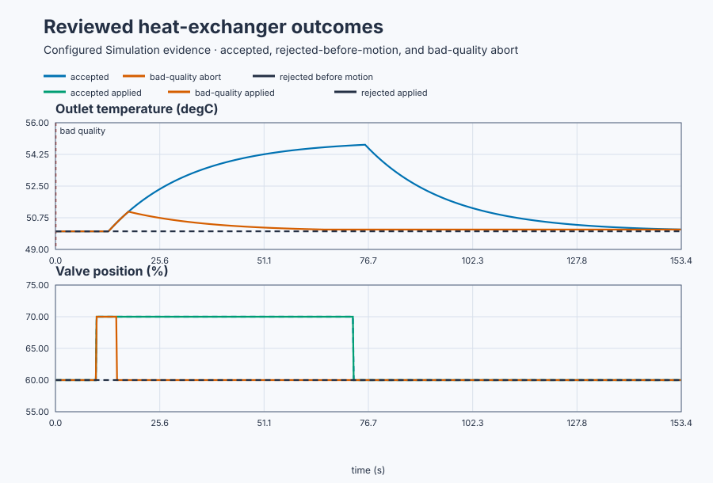

# Design a safe heat-exchanger experiment

Course position: Lesson 37 of 84. Previous lesson: [Interconnected-tank state
space](../two-tank-state-space/README.md). Next lesson: excitation methods.

**Lesson objective:** Design, review, execute, abort, and restore one bounded
heat-exchanger step experiment before accepting identification data.

**Equipment:** Plate heat exchanger with steam-side valve and product
outlet-temperature transmitter.

This lesson produces simulation evidence, not physical-plant evidence.

## The problem

The equipment in this lesson is Plate heat exchanger with steam-side valve and product outlet-temperature transmitter.

A plate heat exchanger uses steam to warm a flowing product. The actuator is a
steam-side control valve. The sensor measures product outlet temperature. The
normal operating point is 50 degrees Celsius at 60 percent valve position.

The valve may operate only from 40 to 80 percent during this experiment. The
product temperature must remain from 45 to 58 degrees Celsius. The executable
project is simulation-only and cannot authorise a physical steam-valve move.

Lesson 36 showed that a useful model must preserve the dynamics needed for a
prediction. A constant operating record does not reveal how much or how quickly
this exchanger responds to its valve. An arbitrary test is not the answer: it
can overheat product, exceed a valve bound, mix a load change into the response,
or stop before the dynamics become visible.

The experiment must therefore be designed before data are collected.

## What we need

We need an experiment plan that is informative, bounded, reviewable, abortable, and restorable before the steam valve is allowed to move. A rejected plan must leave the valve unchanged, and an invalid run must not become identification evidence.

## The new idea

The **engineering question** is the single relationship the experiment must
reveal: how much and how quickly outlet temperature changes after a small
steam-valve change near the normal operating point.

A **baseline** is the period before excitation used to prove that the input,
output, operating mode, and important disturbances are sufficiently steady.
**Excitation amplitude** is the intentional change from the baseline valve
position. **Excitation duration** is how long that change is held. A
**confounding disturbance** is another input change that prevents us from
attributing the measured temperature change to the planned valve change.

The baseline valve position ($MV_{0}$) is 60 percent. The planned valve change
($\Delta MV$) is measured in percentage points. The baseline outlet temperature
($PV_{0}$) is 50 degrees Celsius. The local process gain ($K$) is 0.5 degrees Celsius
per percentage point. The time constant ($T$) is 20 seconds. The dead time ($L$) is
3 seconds.

The predicted final temperature change ($\Delta PV_{\mathrm{final}}$) is the local process
gain multiplied by the planned valve change:

$\Delta PV_{\mathrm{final}} = K \cdot \Delta MV$

A 10-percentage-point step therefore predicts a 5-degree-Celsius change and a
55-degree-Celsius final temperature. After the 3-second dead time, three time
constants take 60 seconds and reveal about 95 percent of a first-order change.
The complete hold is therefore 63 seconds: 3 seconds of dead time plus 60
seconds of visible response.

A **soft experiment bound** is the stricter envelope used to review the plan. A
**hard limit** requires immediate abort. This lesson permits 40 to 80 percent
valve and 45 to 58 degrees Celsius. Bad or stale signal quality, a nonfinite
value, an undeclared disturbance, loss of the authorised mode, or a hard-limit
violation aborts the run. Both abort and normal completion restore 60 percent
valve. Restoration finishes only after temperature returns within 0.1 degrees
Celsius of the baseline.

Simulation approval permits only a simulated test. A physical experiment would
also require independently reviewed input/output topology, confirmed
interlocks and safe state, an authorised operator, and explicit approval
immediately before the physical action.

## Prediction

Evaluate two plans before pressing Start:

- **Plan A** moves the valve from 60 to 70 percent for 63 seconds. It predicts
  55 degrees Celsius and remains inside the declared envelope.
- **Plan B** moves the valve from 60 to 85 percent. It predicts 62.5 degrees
  Celsius and violates both the valve and temperature bounds. It must be
  rejected before the simulated valve moves.

Also predict what happens if Plan A loses signal quality: the run must abort
immediately and both requested and applied valve positions must return to 60
percent.

## Implementation

There is no feedback controller and no model fit in this lesson. The actual
Structured Text reviews the proposed physical result before accepting the plan:

```st
PredictedFinalTemperature := LREAL#50.0 + LREAL#0.5 * ProposedStep;

IF ((LREAL#60.0 + ProposedStep) > LREAL#80.0) OR
   (PredictedFinalTemperature > LREAL#58.0) THEN
    PlanRejectReason := 1;
ELSE
    LatchedStep := ProposedStep;
    PlanAccepted := TRUE;
END_IF;
```

Requested valve position and applied valve position are separate signals. The
current simulated actuator applies the clamped request directly; a later lesson
can add actuator dynamics without changing what either signal means.

## Experiment in Control Studio

This procedure tests one declared lesson change under controlled conditions. Review and execute the bounded 10-point simulation step, then repeat it with an injected quality failure. The declared event lasts 63 seconds. It restores Applied steam-valve position to 60 % afterward. The deterministic Simulation seed is 20260829.

### Control Studio actions

1. **Monitor** — Start the **Simulator**, then open **truST sidebar → Control Studio → Monitor → Response**.
   - **Baseline check:** Wait until the header shows **Simulation**, **Running**, and current data. Confirm Product outlet temperature (PV, degC); Requested steam-valve position (MV, %) and Applied steam-valve position (MV, %), including units, limits, mode, and quality. The initial operating point is Proposed valve change = 10 %, Product outlet temperature = 50 degC, Requested steam-valve position = 60 %, Applied steam-valve position = 60 %, Outlet-temperature signal quality = 1 (dimensionless), Confounding disturbance active = 0 (dimensionless). The unresolved baseline problem is: Constant data are uninformative and an unreviewed excitation may be unsafe or causally ambiguous.
   - **Decision before action:** Read **Prediction** above, then state what should move first and in which direction. Use this decision rule: Collect data only after plan bounds, baseline qualification, aborts, restoration, evidence class, and approval boundary are explicit.
   - **Successful evidence:** The Response plot advances, the displayed values are finite and current, and **Start recording** is enabled. Select **Start recording** only after those conditions are visible.
   - **Recovery:** If recording is disabled or the plot reports unavailable or stale samples, stop the Simulator, correct the displayed runtime or binding problem, restart it, and repeat the baseline check.
   - **Record:** Write down the initial SP, PV, requested/applied MV where available, controller mode, and your predicted response before opening Test.

2. **Test** — Open **truST sidebar → Control Studio → Test**.
   - **Baseline check:** Set **Experiment** = **Manual output step**, **Amplitude** = **10 %**, and **Maximum duration (s)** = **63**. The affected signal is **Applied steam-valve position**; it starts at 60 % and must restore to 60 %.
   - **Decision before action:** Before selecting **Review test**, predict the response direction and confirm the requested change remains inside Product outlet temperature 45 degC to 58 degC; Applied steam-valve position 40 % to 80 %. Execute only the approved bounded plan; do not use Identify, Tune, or Apply.
   - **Successful evidence:** Select **Review test**, verify the signal, requested bound, duration, restoration, and stop conditions, then select **Confirm and start**. The state changes to **Running**, **Abort test** remains available, and the terminal state confirms completion and restoration while Response shows the measured SP/PV/MV sequence.
   - **Recovery:** For a rejected, stale, unsafe, unavailable, failed, or aborted state, read the displayed reason, restore Applied steam-valve position to 60 %, wait for current data, and review a new test.
   - **Record:** Compare the response with your prediction and retain the terminal state, restoration result, and deterministic seed **20260829**.

3. **Validate** — Open **truST sidebar → Control Studio → Validate**.
   - **Baseline check:** **Run required validation** is disabled because no shared Control.PID candidate exists. **Requirement details** and **Save result** cannot be used to claim a shared result; project-owned validation is executed by the runnable project's declared oracle.
   - **Decision before action:** Use the predeclared comparisons: baseline_temperature_range <= 0.05 degC (tolerance 0.001 degC); baseline_absolute_slope <= 0.01 degC/s (tolerance 0.001 degC/s); late_window_prediction_error <= 0.35 degC (tolerance 0.01 degC); requested_valve_restoration_error == 0 % (tolerance 0.000001 %).
   - **Successful evidence:** Correlate the unrounded project-owned results with the named live signals and events in Monitor. Each applicable requirement must have a value, unit, limit, tolerance, evidence class, and Pass, Conditional pass, Fail, or Inconclusive disposition.
   - **Recovery:** If the project run aborts, becomes stale, fails, or violates restoration, discard that run and repeat the declared Test. Never present a disabled button or retained README table as newly executed evidence.
   - **Record:** State the validation disposition and name every failed or inconclusive requirement before continuing.

## Evidence and decision

### Measures and comparison

The retained plot overlays the reviewed prediction and measured temperature,
while keeping requested and applied valve position visible. The plan table also
retains the rejected and aborted decisions so they cannot be mistaken for
identification data.



[Retained samples](figures/safe-experiment-comparison-trace.csv) ·
[Decision summary](figures/safe-experiment-comparison-summary.csv) ·
[Reviewed plans](figures/safe-experiment-plans.csv) ·
[Complete rejected, accepted, aborted, and restored runs](figures/safe-experiment-evidence.json)

**Baseline temperature range** is the largest minus smallest outlet-temperature
sample in the 10-second baseline, in degrees Celsius. Smaller is better.

**Baseline slope** is the last minus first baseline temperature divided by 10
seconds, in degrees Celsius per second. Its absolute value must be small.

**Excitation size** is applied valve position minus the 60-percent baseline,
in percentage points. **Observed temperature change** is the final qualified-
window mean minus the baseline-window mean, in degrees Celsius. **Prediction
error** is the absolute difference between predicted and observed temperature
change, in degrees Celsius.

**Restoration error** is the absolute difference between restored requested
valve position and 60 percent, in percentage points. Report the response as
`Not qualified` instead of calculating identification measures when baseline,
quality, disturbance, duration, or limit requirements are not satisfied.

### Validation

The executable acceptance requirements are:

| Decision | Required evidence |
|---|---|
| Reject Plan B | Applied valve never leaves 60 percent |
| Qualify Plan A baseline | Range at most 0.05 degrees Celsius and absolute slope at most 0.01 degrees Celsius per second |
| Execute Plan A | Applied step exactly 10 percentage points for 63 seconds |
| Check prediction | Late-window result within 0.35 degrees Celsius of the 5-degree prediction |
| Respect constraints | Valve remains 40–80 percent and temperature remains 45–58 degrees Celsius |
| Restore | Requested valve restoration error is zero and temperature returns within 0.1 degrees Celsius of baseline |
| Abort bad quality | State is Aborted, reason code is retained, valve returns to 60 percent, and response is `Not qualified` |

The focused executable simulation measured:

| Run | Measured result |
|---|---:|
| Rejected Plan B | Reason code 1; requested and applied valve remained 60.000 percent |
| Accepted Plan A late-window mean | 54.676 degrees Celsius |
| Accepted Plan A prediction error | 0.324 degrees Celsius |
| Qualified restoration temperature | 50.099 degrees Celsius |
| Injected bad-quality run | Aborted with reason code 1; requested and applied valve restored to 60.000 percent |

These are simulation results from the shipped executable model. They are not
measurements from a physical heat exchanger.

Retain the plan, seed, sample interval, requested and applied valve traces,
temperature trace, quality, disturbance state, state transitions, reason codes,
and evidence class.

## Conclusion

Plan A asks one bounded question while holding the operating point and other
inputs fixed. Its delay and gradual rise are consistent with the assumed local
gain, dead time, and lag. Plan B is rejected because its predicted physical
result violates declared bounds, not because 25 is a magic forbidden number.

The aborted run is useful safety evidence but invalid identification evidence.
A steady baseline and one changed input support causal interpretation; they do
not prove that the assumed model structure is correct.

## Reason for the next lesson

A reviewable experiment states its question, operating region, excitation,
expected response, informative duration, controlled disturbances, limits,
abort actions, restoration, evidence class, and approval boundary before data
collection.

Lesson 38 compares excitation shapes because this safe step does not
necessarily reveal every plant dynamic or parameter.
