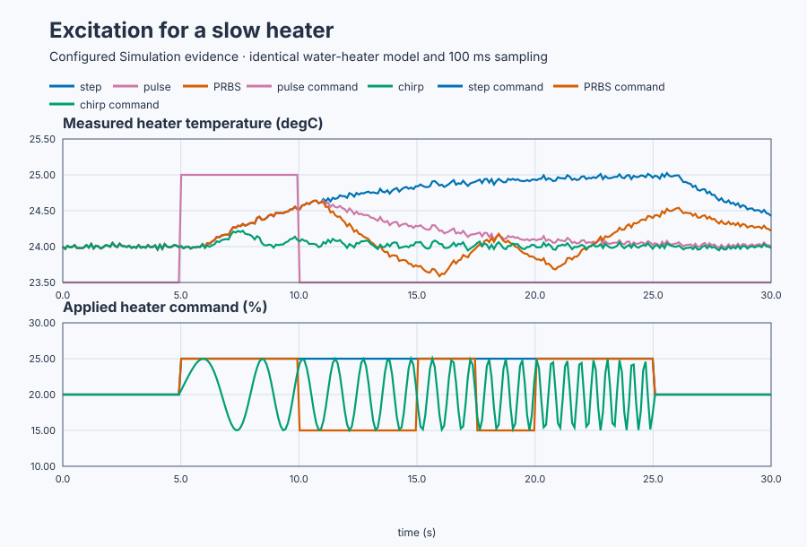
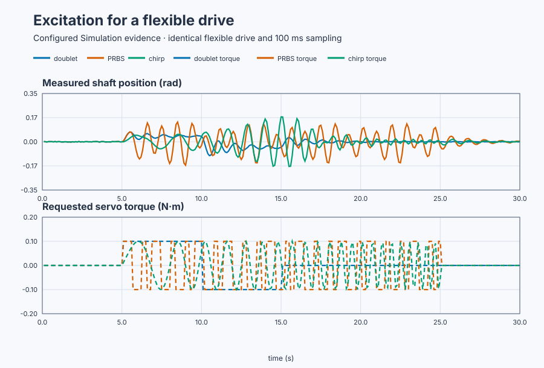

# Match excitation to heater and flexible-drive dynamics

Course position: Lesson 38 of 84. Previous lesson: [Safe heat-exchanger
experiment](../37-safe-heat-exchanger-experiment/README.md). Next lesson:
[model-structure selection](../39-dryer-model-selection/README.md).

**Lesson objective:** Select and validate informative excitation for a slow
thermal process and a lightly damped mechanical process.

**Evidence class:** Simulation evidence, not physical-plant evidence. The
slow water heater and the resonant flexible-drive servo test stand both run
on the shipped simulator.

## The problem

The water heater has a one-sided 0-to-100-percent heating actuator. It operates
at 20 percent and 24 degrees Celsius. Near that point, 1 percentage point of
extra heat eventually raises temperature by 0.2 degrees Celsius. Its time
constant is 5 seconds and its dead time is 1 second — the same gain, lag, and
dead time validated in Lessons 16 through 18.

The flexible drive has a bidirectional torque actuator limited to plus or minus
0.2 newton metres. Shaft position is measured in radians. Its lightly damped
flexible mode has natural frequency 6 radians per second and damping ratio
0.08; a torque command produces shaft motion through a gain of 0.4 rad/(N·m).
This is a new test stand, so all three values are its configured teaching
parameters (`lesson.json` → `plant.parameters`), not yet measured facts.
Both plants use 100-millisecond sampling and deterministic measurement noise.

Lesson 37 used a step to expose the slow gain, delay, and lag of a heat
exchanger. A step concentrates most input variation at low frequency. It can
leave a flexible shaft ringing without deliberately separating its resonance,
while a long thermal step can consume unnecessary operating range. The
excitation must match the dynamics we need to observe.

## What we need

We need to choose an excitation whose amplitude and frequency content reveal
the required dynamics without exceeding the heat exchanger's operating limits.

## The new idea

**Excitation** is a deliberate bounded input variation used to make plant
dynamics visible above normal measurement variation. **Amplitude** is the
largest intended departure from the baseline input. **Frequency content** is
the range of change rates present in that input.

A **step** is one sustained input change. Its strong low-frequency content is
useful for gain, delay, and dominant lag. A **pulse** is a step followed by
restoration. It spends less time away from the operating point but can end
before a slow response becomes clear. A **doublet** uses equal positive and
negative pulses. Its approximately zero net input area reduces lasting
displacement and reveals directional differences.

**Relay excitation** is feedback-dependent switching between two levels to
create an oscillation. It requires the limit-cycle safeguards introduced in
Lesson 43, so this open-loop lesson explains it and then proves that selection
is rejected. A timed square wave is not renamed relay feedback.

A **pseudo-random binary sequence (PRBS)** is a deterministic pattern of two
input levels. The irregular switching spreads information across a chosen
frequency band. **Dwell time** is how long each binary level is held. A slow
plant needs longer dwell than a fast plant; switching faster does not create
useful information when the plant cannot respond.

A **chirp** is a sinusoidal input whose frequency changes continuously from a
declared start to a declared end. Its changing frequency maps how strongly and
how late the plant responds across a band.

**Persistent excitation** means that the input contains enough independent
temporal content for every parameter in the chosen model structure. It does
not mean merely collecting more samples.

The heater amplitude is 5 percentage points (keeping temperature inside its
20-to-30-degree region); the servo amplitude is 0.1 newton metres. Pulse and
doublet segments each hold 5 seconds; the heater step holds 20 seconds. The
expected output change caused by the experiment is the signal amplitude
($A_{\mathrm{signal}}$). The declared root-mean-square measurement variation is the noise
amplitude ($A_{\mathrm{noise}}$). Their dimensionless ratio is the signal-to-noise ratio
($SNR$):

$SNR = A_{\mathrm{signal}} / A_{\mathrm{noise}}.$

For the heater, its gain predicts
$A_{\mathrm{signal}}=(0.2\,^\circ\mathrm C/\%)(5\%)=1$ °C. With 0.02 °C RMS
noise, $SNR=1/0.02=50$. High SNR does not make a
clipped or out-of-region experiment valid.

The heater PRBS dwell is 2.5 seconds, half its 5-second thermal lag. This gives
the temperature several scans to begin responding to each level instead of
turning the heater input into mostly attenuated rapid switching. The servo
PRBS dwell is 0.3 second, exactly three 100-millisecond task scans — short
because the flexible mode's own period is close to 1 second, so a much longer
dwell would waste scans holding one level past where the shaft already
reversed direction. The servo chirp sweeps from 0.2 to 2 hertz in 20 seconds.
It crosses the 0.95-hertz flexible mode because angular frequency and
ordinary frequency obey $\omega=2\pi f$, so $f_n=6/(2\pi)=0.955$ Hz.

For the linear chirp, frequency at sweep time $t$ is

$f(t)=f_0+\frac{f_1-f_0}{T_s}t.$

Phase is the accumulated angle, so
$\phi(t)=2\pi\int_0^t f(\xi)d\xi$. The program approximates that integral each
100 ms scan by adding $2\pi f(t)\Delta t$, then commands
$\sin\phi$. This explains why merely changing the displayed frequency without
integrating phase would not generate the intended chirp.

Before a method runs, the project checks it against five numbered reasons:
reason 1 is unsafe amplitude, reason 2 is insufficient duration, reason 3 is
an invalid chirp band, reason 4 is relay feedback (always rejected in this
open-loop lesson), and reason 5 is an ineligible plant-method pairing.

## Prediction

Before running, classify each method by whether it has sustained offset,
returns to baseline, changes sign, has approximately zero signed input area,
and covers low or broad frequency content.

Predict that the heater step gives the clearest final gain while the fast chirp
is attenuated by thermal lag. Predict that the servo doublet has nearly zero
signed torque area: $(+0.1)(5)+(-0.1)(5)=0$ N·m·s. Predict that the chirp's largest position response occurs near
0.95 hertz. Predict relay reason code 4 and no plant movement.

## Implementation

There is no feedback controller and no fitted model. The actual Structured Text
generates the waveform selected by the learner:

```st
CASE MethodSelection OF
    1: (* bounded step *)
        IF (ElapsedSeconds >= LREAL#5.0) AND
           (ElapsedSeconds < LREAL#25.0) THEN
            NormalizedExcitation := LREAL#1.0;
        END_IF;
    6: (* bounded chirp *)
        ChirpPhase := ChirpPhase +
            LREAL#6.283185307179586 * InstantFrequencyHz * LREAL#0.1;
        NormalizedExcitation := SIN(ChirpPhase);
END_CASE;
```

Requested and applied excitation remain separate. The program rejects unsafe
amplitude, insufficient duration, an invalid chirp band, relay feedback, or an
ineligible plant-method pairing before either applied input moves.

## Experiment in Control Studio

Control Studio exposes the selected servo chirp. Test writes one reviewed
Boolean, `P1.ExperimentEnabled`, for 30.1 seconds. The project owns plant 1,
method 6, amplitude scale 1, the 0.2-to-2 Hz sweep, and restoration to zero
torque. Fresh native runs own the heater step/chirp, both PRBS dwell cases,
the servo doublet, and relay rejection so every comparison starts from the same
state and seed. The deterministic Simulation seed is 20260829.

### Control Studio actions

1. **Monitor** — Start the **Simulator**, then open **truST sidebar → Control Studio → Monitor → Response**.
   - **Baseline check:** Wait until the header shows **Simulation**, **Running**, and current data. Confirm Heater temperature (PV, degC) and Servo shaft position (PV, rad); Heater requested command (MV, %) and Heater applied command (MV, %), including units, limits, mode, and quality. The initial operating point is Plant selection = 0 (dimensionless), Method selection = 1 (dimensionless), Heater temperature = 24 degC, Heater requested command = 20 %, Heater applied command = 20 %, Servo shaft position = 0 rad, Servo requested torque = 0 N m, Servo applied torque = 0 N m. The unresolved baseline problem is: One sustained low-frequency input does not expose every time scale or resonant mode efficiently.
   - **Decision before action:** Read **Prediction** above, then state what should move first and in which direction. Use this decision rule: Choose waveform, amplitude, duration, dwell, and frequency band from the plant dynamics and intended model parameters, because a step alone cannot separate the servo's resonance from its low-frequency gain.
   - **Successful evidence:** The Response plot advances, the displayed values are finite and current, and **Start recording** is enabled. Select **Start recording** only after those conditions are visible.
   - **Recovery:** If recording is disabled or the plot reports unavailable or stale samples, stop the Simulator, correct the displayed runtime or binding problem, restart it, and repeat the baseline check.
   - **Record:** Write down the initial heater temperature, heater requested/applied command, servo shaft position, servo requested/applied torque, and your predicted 0.955 Hz peak.

2. **Test** — Open **truST sidebar → Control Studio → Test**.
   - **Baseline check:** Confirm **Experiment** = **Observe without excitation**, **Amplitude** = **0** (disabled), and **Maximum duration (s)** = **30.1**. The reviewed authority is **Experiment authority** (`P1.ExperimentEnabled`). It starts false and must restore false. Confirm servo requested/applied torque = 0 N·m.
   - **Decision before action:** Before selecting **Review test**, predict a response maximum near the 0.955 Hz mode and confirm project-owned torque remains within ±0.2 N·m and shaft position within ±0.35 rad, because Review test is the last checkpoint before the servo moves. Compare only qualified records; do not Identify, Tune, or Apply.
   - **Successful evidence:** Select **Review test**, verify Boolean authority, timeout, false restoration, and stop conditions, then **Confirm and start**. Keep **Abort test** available. Observe five seconds at baseline, the 20-second chirp, five seconds restored, and a final zero torque.
   - **Recovery:** Abort for stale, invalid, nonfinite, or out-of-range data. Confirm authority false and requested/applied torque zero before retrying.
   - **Record:** Retain terminal state, restoration, requested/applied torque, shaft position, instantaneous frequency, peak frequency, bounds, and seed **20260829**.

## Evidence and decision

### Measures and comparison

Compare the slow heater and flexible drive separately. The same waveform name
does not imply the same dwell time or useful frequency content on both plants.



[Heater samples](figures/excitation-heater-comparison-trace.csv) ·
[Heater decisions](figures/excitation-heater-comparison-summary.csv)



[Servo samples](figures/excitation-servo-comparison-trace.csv) ·
[Servo decisions](figures/excitation-servo-comparison-summary.csv) ·
[All seven executed comparisons and the rejected relay](figures/excitation-methods-evidence.json)

**Input total variation** is the sum of absolute successive applied-input
changes. Its unit is percentage points for the heater and newton metres for the
servo. **Signed input area** is the sampled sum of input deviation multiplied
by sample interval, in percentage-point-seconds or newton-metre-seconds.

**Output span** is maximum minus minimum measured output, in degrees Celsius or
radians. **Return error** is the absolute final applied-input deviation from
baseline. **Heater information ratio** is temperature span divided by declared
temperature-noise amplitude. **Servo resonance peak frequency** is the chirp
frequency at the largest qualified shaft-position amplitude.

Each measure retains its signal, unit, sample interval, window, and
qualification state. A rejected or clipped run is `Not qualified`.

### Validation

The focused executable simulation measured:

| Evidence | Result |
|---|---:|
| Heater step output span | 1.065 degrees Celsius |
| Heater chirp output span | 0.274 degrees Celsius |
| Heater PRBS internal transitions | 5 at 2.5-second dwell |
| Servo PRBS internal transitions | 45 at 0.3-second dwell |
| Servo doublet signed torque area | 0.0000 newton-metre-seconds |
| Servo chirp peak | 1.091 hertz at 0.180 radians |
| Relay request | Rejected with reason code 4 and zero input departure |

The heater step is within 0.10 degree Celsius of its 1-degree prediction, while
the chirp span is less than 60 percent of the step span. The doublet area is
within 0.01 newton-metre-seconds of zero. The servo peak is within 0.15 hertz
of 0.95 hertz. Torque remains inside plus or minus 0.2 newton metres and
position inside plus or minus 0.35 radians.

## Conclusion

The heater behaves as a low-pass process: it follows sustained low-frequency
input but attenuates rapid reversals. The servo stores energy in its flexible
mode, so an input crossing that frequency produces a larger response. PRBS
dwell and chirp sweep band are therefore engineering choices, not cosmetic
settings. Useful information depends on plant response, SNR, limits, and model
validity together—not on waveform complexity.

## Reason for the next lesson

Excitation must match the parameters, time scales, frequency band,
directionality, constraints, and evidence quality of the plant and candidate
model. No waveform is universally best.

Lesson 39 compares model structures because informative excitation still does
not decide whether a plant is first-order, delayed, second-order, or
integrating.
