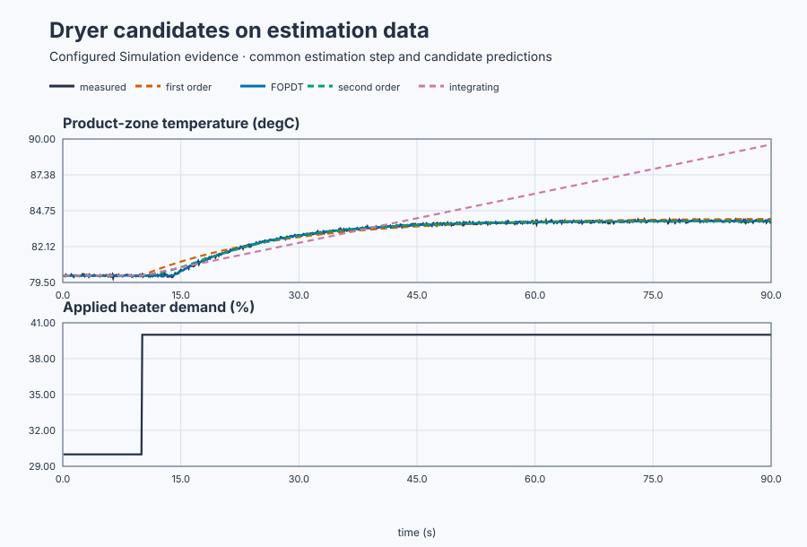
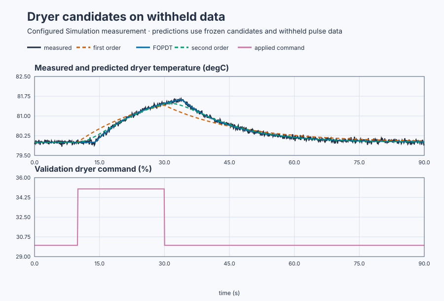
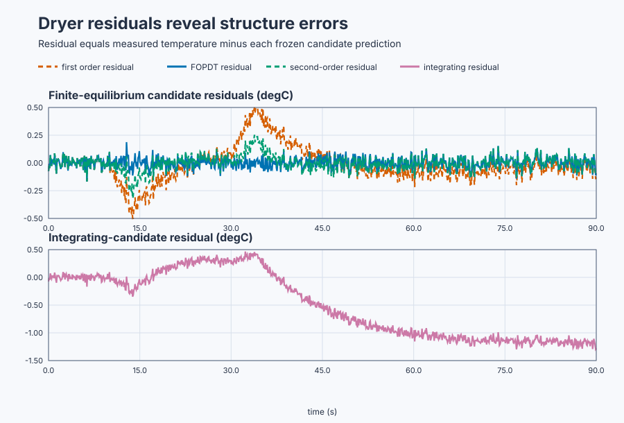

# Select the simplest useful dryer model

Course position: Lesson 39 of 84. Previous lesson: [Plant-matched excitation
methods](../38-excitation-methods/README.md). Next lesson:
[inadequate and biased identification data](../40-poor-excitation/README.md).

**Lesson objective:** Fit and independently validate first-order,
first-order-plus-dead-time (FOPDT), second-order, and integrating candidates for
a conveyor dryer, then select or reject by predeclared evidence gates.

**Equipment:** Continuous conveyor drying tunnel with heated-air demand and
product-zone temperature measurement.

This lesson produces simulation evidence, not physical-plant evidence.

## The problem

A conveyor carries wet product through a heated-air drying tunnel. Heater
demand is the manipulated input in percent. Product-zone temperature is the
measured output in degrees Celsius. Air transport and sensor location delay the
measurement after heater demand changes.

The normal operating point is 30 percent heater and 80 degrees Celsius. The
local simulated response has gain 0.4 degrees Celsius per percentage point,
time constant 12 seconds, and dead time 4 seconds. Measurement noise has a
deterministic 0.05-degree-Celsius root-mean-square amplitude. The local region
is 20–50 percent heater and 75–90 degrees Celsius.

Lesson 38 created qualified, plant-matched excitation. Informative data still
do not name the model structure. Several structures can reduce error on the
same noisy record. Extra freedom can follow accidental noise or imitate a
delay without predicting another experiment.

## What we need

We need to compare candidate dryer models on independent prediction evidence,
not reward a model merely for fitting the data that selected its parameters.

## The new idea

A **model structure** is the chosen form and number of dynamic relationships
before numerical parameters are estimated. A **parameter estimate** is a
numerical value chosen from data inside that structure. An **estimation
dataset** contains samples used to choose parameters. A **validation dataset**
is an independent experiment withheld from that choice.

The measured output ($y_{\mathrm{measured}}$) is dryer temperature. The model-predicted
output ($y_{\mathrm{predicted}}$) is the temperature calculated by a candidate. Both use
degrees Celsius. The residual ($r$) is measured minus predicted output:

\[
r_k=y_{\mathrm{measured},k}-y_{\mathrm{predicted},k}.
\]

The root-mean-square prediction error ($RMSE$) is the square root of the mean
squared residual over a declared window:

\[
RMSE=\sqrt{\frac{1}{N}\sum_{k=1}^{N}r_k^2}.
\]

Squaring prevents positive and negative residuals from cancelling and
penalizes large misses. Dividing by sample count makes records of different
length comparable, and the square root returns the result to degrees Celsius.

**Residual bias** is $\bar r=(1/N)\sum r_k$; it exposes a consistent
overprediction or underprediction that RMSE cannot sign. At lag one,
**residual autocorrelation** compares $r_k-\bar r$ with
$r_{k-1}-\bar r$ across the record. Large correlation means adjacent errors
carry repeatable structure rather than independent noise. Small RMSE with
bias or correlation means repeatable dynamics remain unexplained.

**Model complexity** is the number and freedom of estimated dynamic parameters,
not equation length. **Underfit** means a structure is too simple for
repeatable behavior. **Overfit** means it follows estimation noise or a
disturbance instead of repeatable plant dynamics. The **bias-variance trade-off**
means too little flexibility creates systematic error, while unnecessary
flexibility makes estimates vary between equally valid datasets.

A **first-order candidate** has one gain and one lag with no delay, so it begins
responding immediately. A **first-order-plus-dead-time (FOPDT) candidate** has
one gain, one lag, and one delay. A **second-order candidate** has one gain plus
two modes described by natural frequency and damping; this comparison gives it
no explicit delay. An **integrating candidate** makes output rate proportional
to input change, so a sustained nonzero change does not approach a finite new
equilibrium.

**Parameter uncertainty** is the range of values consistent with the data and
noise assumptions. Compare fits on early and late estimation subsets and
report their parameter spread; one optimiser result is not exact plant truth.

Before looking at results, define **material validation improvement**. Relative
improvement from a simpler candidate $s$ to a more complex candidate $c$ is
$100(RMSE_s-RMSE_c)/RMSE_s$. Extra complexity is justified only when this is at
least 10%, a repeatable residual feature disappears, and every added parameter
remains physically plausible and sufficiently certain.

## Prediction

A 10-percentage-point step from 30 to 40 percent predicts
$\Delta T=K\Delta u=0.4(10)=4$ °C, from 80 to 84 °C. For the FOPDT candidate,

\[
T(t)=80+4\left(1-e^{-(t-4)/12}\right),\qquad t\ge4\ \mathrm s.
\]

The first four seconds contain no heater-attributable response. At 16 seconds,
one time constant after the delay, the prediction is
$80+4(1-e^{-1})=82.528$ °C; late in the run it approaches 84 °C.

Predict that a first-order model creates early residual bias, an integrating
model fails the finite equilibrium, and FOPDT explains the delay, monotonic lag,
and equilibrium. A second-order model may bend two modes to lower estimation
error, but it must satisfy the predeclared independent-improvement rule before
its extra dynamics are accepted.

## Implementation

There is no feedback controller. The actual Structured Text routes the reviewed
manual request through the declared heater envelope:

```st
IF ExperimentInput < LREAL#20.0 THEN
    ManipulatedValue := LREAL#20.0;
ELSIF ExperimentInput > LREAL#50.0 THEN
    ManipulatedValue := LREAL#50.0;
ELSE
    ManipulatedValue := ExperimentInput;
END_IF;
```

The simulator produces the unknown-to-the-learner dryer response. Candidate
predictions, residuals, and scores come from retained samples in Control Studio;
the Structured Text contains no hidden candidate score or accepted answer.

## Experiment in Control Studio

Control Studio exposes the estimation step. Test writes one reviewed Boolean,
`P1.ExperimentEnabled`, for 90.1 seconds. The project owns the 30-to-40% heater
request and restoration to 30%. A fresh native run owns the independent
5-point validation pulse and all frozen-candidate scoring; otherwise the
validation record would no longer be withheld from fitting. The deterministic
Simulation seed is 20260829.

### Control Studio actions

1. **Monitor** — Start the **Simulator**, then open **truST sidebar → Control Studio → Monitor → Response**.
   - **Baseline check:** Wait until the header shows **Simulation**, **Running**, and current data. Confirm Product-zone temperature (PV, degC); Applied heater demand (MV, %), including units, limits, mode, and quality. The initial operating point is Requested heater demand = 30 %, Applied heater demand = 30 %, Product-zone temperature = 80 degC. The unresolved baseline problem is: Training error alone can reward missing physics or unnecessary parameter freedom.
   - **Decision before action:** Read **Prediction** above, then state what should move first and in which direction. Use this decision rule: Select the least complex physically plausible candidate that passes residual and independent-prediction gates.
   - **Successful evidence:** The Response plot advances, the displayed values are finite and current, and **Start recording** is enabled. Select **Start recording** only after those conditions are visible.
   - **Recovery:** If recording is disabled or the plot reports unavailable or stale samples, stop the Simulator, correct the displayed runtime or binding problem, restart it, and repeat the baseline check.
   - **Record:** Write down the initial SP, PV, requested/applied MV where available, controller mode, and your predicted response before opening Test.

2. **Test** — Open **truST sidebar → Control Studio → Test**.
   - **Baseline check:** Confirm **Experiment** = **Observe without excitation**, **Amplitude** = **0** (disabled), and **Maximum duration (s)** = **90.1**. The only writable signal is `P1.ExperimentEnabled`; it starts false and must restore false. Confirm requested/applied heater = 30% and temperature = 80 °C.
   - **Decision before action:** Before selecting **Review test**, predict no attributable response for four seconds, then a monotonic rise toward 84 °C. Confirm the project-owned input remains inside 20–50% and temperature inside 75–90 °C.
   - **Successful evidence:** Select **Review test**, verify Boolean authority, timeout, false restoration, and stop conditions, then **Confirm and start**. Keep **Abort test** available. Observe the 40% request, delayed rise, retained estimation recording, and 30% restoration.
   - **Recovery:** Abort for stale, invalid, nonfinite, clipped, confounded, or out-of-range data. Confirm authority false and requested/applied heater 30% before retrying.
   - **Record:** Retain terminal state, restoration, estimation samples, timing, onset, input/output units, quality, seed, and the prediction made before the run.

There is no separate shared Identify or disabled Validate stage in this lesson.
Native executable evidence owns fitting the four frozen candidates and testing
them on the withheld pulse. The retained tables report that native result; they
are not a substitute for a newly executed run.

## Evidence and decision

### Measures and comparison

The first plot compares every frozen candidate on the withheld pulse. The
second plot shows why a single RMSE number is insufficient: delay error and
failure to return to equilibrium have recognizable residual shapes.



[Estimation samples](figures/dryer-model-estimation-trace.csv) ·
[Estimation decisions](figures/dryer-model-estimation-summary.csv)



[Prediction samples](figures/dryer-model-comparison-trace.csv) ·
[Candidate decisions](figures/dryer-model-comparison-summary.csv)



[Residual samples](figures/dryer-model-residual-trace.csv) ·
[Residual decisions](figures/dryer-model-residual-summary.csv) ·
[Estimation, validation, candidate, uncertainty, and provenance evidence](figures/dryer-model-selection-evidence.json)

For each candidate retain parameter count, estimates, uncertainty ranges,
estimation RMSE, validation RMSE, residual bias, lag-one residual
autocorrelation, stability, equilibrium behavior, and physical plausibility.

**Delay-window absolute bias** is the absolute mean residual during the first 4
seconds after the input step. **Parameter subset spread** is the maximum minus
minimum estimate across the early and late qualified fits.

Use `Not applicable`, `Not identifiable`, or `Rejected` when a metric's
prerequisite is absent. Do not invent a score to keep every row numeric.

### Validation

The focused executable fit and independent pulse validation measured:

| Evidence | Result |
|---|---:|
| Qualified response onset | 4.30 seconds |
| Final estimation-window temperature | 83.995 degrees Celsius |
| Selected FOPDT gain | 0.40 degrees Celsius per percentage point |
| Selected FOPDT time constant | 12.0 seconds |
| Selected FOPDT dead time | 4.0 seconds |
| FOPDT validation RMSE | 0.0508 degrees Celsius |
| FOPDT validation residual bias | -0.0004 degrees Celsius |
| First-order validation RMSE | 0.1635 degrees Celsius |
| First-order delay-window bias | -0.2233 degrees Celsius |
| Second-order validation RMSE | 0.0729 degrees Celsius |
| Integrating-model restoration error | 1.200 degrees Celsius |

The FOPDT gain is within 0.03, time constant within 1.5 seconds, and dead time
within 0.5 second of the retained plant evidence. Its validation RMSE is below
0.10 degree Celsius and residual bias below 0.03 degree Celsius. First-order
fails delay-window bias, integrating fails equilibrium, and second-order does
not improve independent RMSE by 10 percent. FOPDT is therefore the simplest
adequate candidate for this operating region.

## Conclusion

The first-order residual comes from missing transport delay. The integrating
candidate contradicts the observed finite equilibrium. The second-order
candidate has extra flexibility, but independent data do not justify it.

FOPDT is selected from independent prediction and residual behavior—not because
its name matches the simulator configuration or because it has the lowest
training error.

## Reason for the next lesson

More parameters do not automatically produce a better control model. Select
the simplest structure that preserves repeatable behavior needed for the
engineering decision and predicts independent data inside its declared region.

Lesson 40 shows why even correct structures are unidentifiable when excitation
is inadequate or closed-loop correlation biases the evidence.
