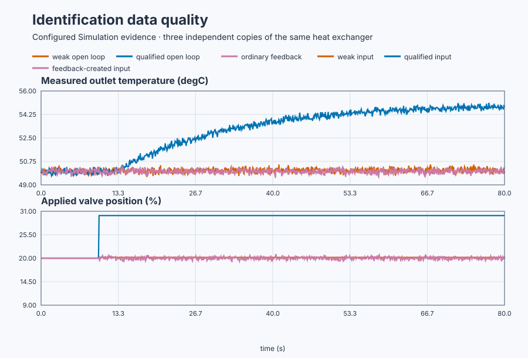

# Decide whether heat-exchanger data can identify a model

Course position: Lesson 40 of 84. Prerequisite: `control-dryer-model-selection`. Next lesson: `control-independent-model-validation`.

This produces **Simulation evidence**, not physical-plant approval.

**Lesson objective:** Compare weak open-loop, qualified open-loop, and ordinary feedback records and retain a deterministic qualification decision for each.

## The problem

The equipment in this lesson is Plate heat exchanger with three independent simulated experiment copies.

A plate heat exchanger transfers energy from hot water into a product stream. The hot-water valve is the actuator. Its requested and applied positions are measured in percent. The outlet-temperature sensor is the process measurement in degrees Celsius.

The lesson runs three independent copies of the same plate heat exchanger. Each starts at 20% applied valve position and 50.0 °C outlet temperature. Each has a local steady gain of 0.5 °C per percentage point, a 20 s time constant, a 3 s dead time, and 0.15 °C root-mean-square measurement noise. They use the same physical parameters, distinct deterministic noise streams, and a 100 ms task interval.

The valves are limited to 0–100%. Physical testing additionally requires
reviewed hazards, protections, procedure, and immediate approval.

Lesson 39 assumed its record distinguished candidate parameters. A fitting
program can still return plausible numbers from nearly constant or feedback-
dependent input; numbers alone do not prove sufficient information.

## What we need

We need a qualification rule that can distinguish a merely long recording from one whose input actually reveals the heat exchanger's response. Weak open-loop, bounded open-loop, and ordinary feedback records must be judged by the same information and safety criteria.

## The new idea

### Information in a record

**Identifiability** means that the available input and output data, under stated assumptions, can distinguish the parameters being estimated. An **identifiable parameter** is one for which different plausible values produce measurably different predictions. An **unidentifiable parameter** is one for which several values or model structures remain indistinguishable inside the measurement noise and experiment bandwidth.

**Input span** is the maximum applied input minus the minimum applied input, measured here in percentage points. **Expected response amplitude ($A_{\mathrm{response}}$)** is the predicted repeatable temperature change in degrees Celsius. **Measurement-noise amplitude ($A_{\mathrm{noise}}$)** is the declared ordinary sensor variation in degrees Celsius. The **response-to-noise ratio ($SNR$)** compares those two amplitudes:

$SNR = \frac{A_{\mathrm{response}}}{A_{\mathrm{noise}}}$

For this lesson, data qualification requires SNR at least 5, input span at least 5 percentage points, valid finite samples, no clipping or saturation, and a response window of at least 63 seconds. The 63 seconds cover the 3-second dead time plus three 20-second time constants.

Persistent excitation means that the applied input contains enough independent variation for the selected model order. **Collinearity** means that explanatory signals change in nearly the same pattern, so their separate effects cannot be determined reliably. Fast sampling adds rows, not independent information.

### Why ordinary feedback data are different

An **exogenous excitation** is a reviewed input change selected independently of current measurement noise. An **endogenous input** is partly produced in response to the measured output, as occurs in feedback.

**Measurement noise ($n$)** is the sensor variation added to the underlying outlet temperature. **Controller-used temperature ($PV_{\mathrm{used}}$)** is the exact noisy temperature sample used to calculate the next valve request. **Valve deviation ($\Delta MV$)** is applied valve position minus its 20-percent baseline.

The third experiment uses 2 percentage points of valve request per degree Celsius of temperature error:

$\Delta MV = 2\left(50 - PV_{\mathrm{used}}\right)$

Measurement noise inside the controller-used temperature therefore also appears in the valve deviation. The **correlation coefficient ($\rho$)** is centered-signal covariance divided by the product of their standard deviations. It ranges from minus one to plus one. A magnitude near one means strong association, not causation.

Here the controller itself creates strong negative correlation between controller-used temperature and valve deviation. An ordinary open-loop estimator that assumes input is independent of measurement noise is biased on this record. Closed-loop identification requires a method and excitation designed for that dependency.

### Deterministic qualification decisions

Before fitting, reason 1 means insufficient response-to-noise ratio or input span; reason 2 means missing independent excitation or disallowed closed-loop correlation; reason 3 means invalid data or duration; and reason 0 means every required check passed. Invalid data include clipping, saturation, gaps, drift, bad quality, and nonfinite samples.

A rejected record remains available as evidence, but it has no accepted model or parameter estimate.

## Prediction

The poor applied-input step is 0.2 percentage points. Multiplying it by the local gain predicts a 0.1 degree Celsius (0.1 °C) response. Dividing that response by 0.15 °C noise predicts SNR 0.67. It must fail with reason 1.

The qualified 10-percentage-point step predicts 5 degrees Celsius (5.0 °C) of equilibrium movement and SNR 33.33. At the minimum 63-second window, the first-order response has completed about 95% of that change, so predict approximately 4.75 °C measured movement. This is a dynamic-window check, not a claim that the noisy response has fully settled. It should pass with reason 0 if all other checks remain valid.

The ordinary feedback record has no independent excitation. The implemented equation should produce a correlation magnitude of at least 0.95 between controller-used temperature and valve deviation. The ordinary open-loop route must reject it with reason 2.

## Implementation

The actual Structured Text keeps requested and applied commands separate. It directly exposes the simple feedback law rather than hiding it in a PID block:

```st
ClosedMeasurementUsed := ClosedTemperature;

IF ExperimentEnabled THEN
    PoorRequested := LREAL#20.2;
    QualifiedRequested := LREAL#30.0;
    ClosedRequested := 20.0 + 2.0 * (50.0 - ClosedMeasurementUsed);
ELSE
    PoorRequested := LREAL#20.0;
    QualifiedRequested := LREAL#20.0;
    ClosedRequested := LREAL#20.0;
END_IF;
```

Each requested value then passes through its own 0–100% valve clamp to produce the applied plant input. No model parameter estimate, candidate fit, score, or accepted answer exists in the program.

## Experiment in Control Studio

This procedure tests one declared lesson change under controlled conditions. Apply deterministic data qualification before the ordinary open-loop fitting route and retain every accepted or rejected record. The declared event lasts 70 seconds. It restores Qualified applied valve position to 20 % afterward. The deterministic Simulation seed is 20260829.

### Control Studio actions

1. **Monitor** — Start the **Simulator**, then open **truST sidebar → Control Studio → Monitor → Response**.
   - **Baseline check:** Wait until the header shows **Simulation**, **Running**, and current data. Confirm Poor outlet temperature (PV, degC) and Qualified outlet temperature (PV, degC); Poor applied valve position (MV, %) and Qualified applied valve position (MV, %), including units, limits, mode, and quality. The initial operating point is Poor applied valve position = 20 %, Qualified applied valve position = 20 %, Feedback applied valve position = 20 %, Poor outlet temperature = 50 degC, Qualified outlet temperature = 50 degC, Feedback outlet temperature = 50 degC. The unresolved baseline problem is: Finite fitted values can look credible even when weak excitation or feedback correlation makes their interpretation invalid.
   - **Decision before action:** Read **Prediction** above, then state what should move first and in which direction. Use this decision rule: Retain every record but allow the ordinary open-loop identification route only when amplitude, duration, quality, and independence checks pass.
   - **Successful evidence:** The Response plot advances, the displayed values are finite and current, and **Start recording** is enabled. Select **Start recording** only after those conditions are visible.
   - **Recovery:** If recording is disabled or the plot reports unavailable or stale samples, stop the Simulator, correct the displayed runtime or binding problem, restart it, and repeat the baseline check.
   - **Record:** Write down the initial SP, PV, requested/applied MV where available, controller mode, and your predicted response before opening Test.

2. **Test** — Open **truST sidebar → Control Studio → Test**.
   - **Baseline check:** Set **Experiment** = **Manual output step**, **Amplitude** = **10 %**, and **Maximum duration (s)** = **70**. The affected signal is **Qualified applied valve position**; it starts at 20 % and must restore to 20 %.
   - **Decision before action:** Before selecting **Review test**, predict the response direction and confirm the requested change remains inside Poor applied valve position 0 % to 100 %; Qualified applied valve position 0 % to 100 %; Feedback applied valve position 0 % to 100 %; Qualified outlet temperature 40 degC to 60 degC.
   - **Successful evidence:** Select **Review test**, verify the signal, requested bound, duration, restoration, and stop conditions, then select **Confirm and start**. The state changes to **Running**, **Abort test** remains available, and the terminal state confirms completion and restoration while Response shows the measured SP/PV/MV sequence.
   - **Recovery:** For a rejected, stale, unsafe, unavailable, failed, or aborted state, read the displayed reason, restore Qualified applied valve position to 20 %, wait for current data, and review a new test.
   - **Record:** Compare the response with your prediction and retain the terminal state, restoration result, and deterministic seed **20260829**.

3. **Identify** — After **Stop recording**, open **truST sidebar → Control Studio → Identify**.
   - **Baseline check:** Use **Qualify recording** to inspect sample count, duration, timing, excitation, and clipping. **Model selection**, **Fit estimation run**, and **Accept model for design** are the shared low-order model workflow; they do not replace the project-owned **ExcitationQualificationExperiment** model and must not be accepted as this lesson's design authority. Retain requested and applied input separately and use the controller-used measurement when deciding whether feedback has removed independent excitation.
   - **Decision before action:** Decide whether the recording contains the input/output change needed for **Data identifiability and closed-loop correlation qualification** before fitting anything.
   - **Successful evidence:** A qualified recording has current, finite, sufficiently excited data. Use the project-owned model described under **Implementation** and **Evidence and decision**, and record its assumptions, units, validity range, and rejection rule.
   - **Recovery:** If qualification reports stale, clipped, poorly excited, or insufficient data, return to Test and repeat the bounded experiment; never force or relabel a rejected fit.
   - **Record:** State which model is retained or rejected and why, explicitly identifying the runnable project as the model authority.

## Evidence and decision

### Measures and comparison

Compare the three synchronized records. Only the qualified open-loop record
has sufficient independent excitation.



[Retained records](figures/poor-excitation-comparison-trace.csv) ·
[Qualification decisions](figures/poor-excitation-comparison-summary.csv) ·
[Reproducible records](figures/poor-excitation-evidence.json)

Define every decision measure before reading the result:

| Measure | Calculation and source | Unit and window | Validity and preferred result |
|---|---|---|---|
| Applied-input span | Maximum applied valve minus minimum applied valve | percentage points, complete record | finite and unclipped; at least 5 |
| Output span | Maximum measured temperature minus minimum measured temperature | °C, complete record | valid quality; larger than ordinary noise |
| Expected response | Local gain times applied-input span | °C, before the run | inside operating region |
| Response-to-noise ratio | Expected response divided by 0.15 °C | dimensionless, before fitting | at least 5 |
| Observation duration | Last timestamp minus step timestamp | s, post-step record | at least 63 s |
| Late slope | Linear temperature slope | °C/s, final 10 s | near zero before an equilibrium claim |
| Feedback correlation | Correlation of controller-used temperature and valve deviation | dimensionless, enabled record | magnitude below the method's declared independence limit |

Also retain gaps, clipping, saturation, drift, quality, exogenous-input status, and the estimator assumption. Report parameter-sensitivity spread across noise-consistent resamples only after basic qualification passes.

### Validation

The executable acceptance result is:

| Record | Applied-input span | Predicted response | Predicted SNR | Independence | Decision |
|---|---:|---:|---:|---|---|
| Poor open loop | 0.2 percentage points | 0.1 °C | 0.67 | Exogenous | Rejected, reason 1 |
| Qualified open loop | 10.0 percentage points | 5.0 °C equilibrium; about 4.75 °C at 63 s | 33.33 | Exogenous | Qualified, reason 0 after 63 s |
| Ordinary feedback | Measured from record | Not used by open-loop route | Not sufficient alone | Endogenous; correlation magnitude at least 0.95 | Rejected, reason 2 |

No rejected path may create a model, expose tuning, or discard its raw evidence. A finite fit returned from a rejected record is not an accepted result.

## Conclusion

The poor record fails because its entire expected response is smaller than ordinary sensor noise. More samples of essentially the same weak change cannot make gain, time constant, and delay distinguishable.

The feedback record fails because the controller makes valve input respond to measured temperature and noise. This violates the open-loop estimator's independence assumption. Fit percentage, faster sampling, or model complexity cannot repair missing independent information.

The qualified step passes because its amplitude, duration, operating region, sample quality, and independence match the declared estimator assumptions.

## Reason for the next lesson

The correct engineering outcome may be **Data inadequate**, with retained samples and a precise reason, rather than a model. On another plant, improve the experiment or choose a method qualified for the way the data were collected. Never tune from evidence that cannot identify the required parameters.

Lesson 41 starts with data that pass these gates and asks a different question: does the fitted model predict independent amplitudes, disturbances, and operating points, and how uncertain is that prediction?
