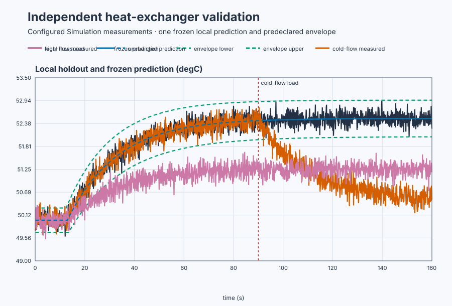
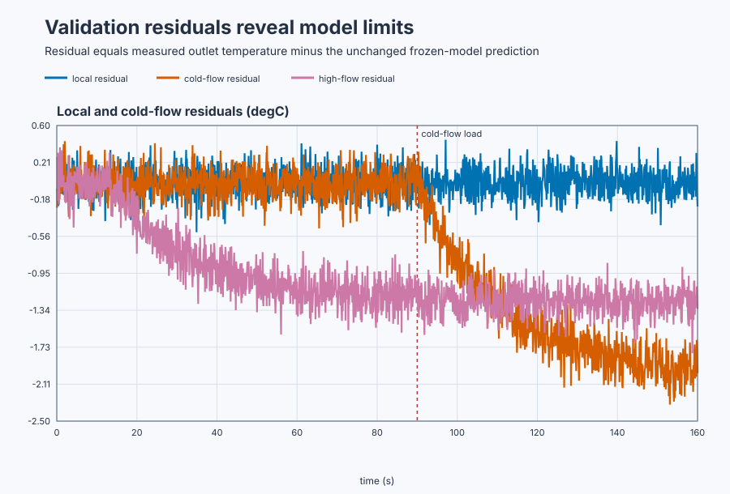

# Validate a heat-exchanger model on evidence it has not seen

Course position: Lesson 41 of 84. Previous lesson:
[data qualification](../40-poor-excitation/README.md). Next lesson:
[manual and historical tuning](../../06-pid-tuning-methods/42-heat-exchanger-tuning-methods/README.md).

This produces **Simulation evidence**, not physical-plant approval.

**Lesson objective:** Classify one frozen model as accepted, restricted, or rejected on independent amplitude, disturbance, and operating-point evidence.

## The problem

Lesson 40 produced qualified data for a plate heat exchanger near 20% hot-water valve position and 50.0 °C outlet temperature. The fitted first-order-plus-dead-time candidate has gain 0.5 °C per percentage point, time constant 20 s, and dead time 3 s. The identification result also reports gain interval 0.47–0.53 °C per percentage point, time-constant interval 18–22 s, and dead-time interval 2.5–3.5 s at a declared 95% confidence level.

Three independent copies of the plate heat exchanger receive the same new 20-to-25% valve step. The local copy preserves the fitted condition. The cold-flow copy receives an unmodelled load at 90 s. The high-flow copy has lower heat-transfer gain at another operating point. Each has independent 0.15 °C measurement noise and 100 ms sampling.

Lesson 40 proved that the estimation record could distinguish model parameters. It did not prove that the fitted model predicts a new amplitude, an omitted disturbance, or another operating point. Reusing estimation samples or changing parameters after seeing validation errors would repeat fitting, not test prediction.

## What we need

We need to freeze the identified model, test it on independent conditions, and
carry parameter and prediction uncertainty into a purpose-limited verdict.

## The new idea

### Separate fitting from testing

**Estimation data** select model structure and parameters. **Validation data** come from a different immutable recording and are excluded from fitting. A **frozen model** has structure, parameters, intervals, initial-state rule, and preprocessing that cannot change after validation begins. A **holdout experiment** obtains new data under a predeclared condition and acceptance rule.

The **measured outlet temperature ($PV_{\mathrm{measured}}$)** is the recorded plant value in degrees Celsius. The **model-predicted outlet temperature ($PV_{\mathrm{predicted}}$)** is the frozen model output for the recorded applied valve position. The **sample number ($k$)** identifies one update. The **residual ($r_{k}$)** is measured minus predicted temperature:

\[
r_k=PV_{\mathrm{measured},k}-PV_{\mathrm{predicted},k}.
\]

The **root-mean-square prediction error** is
$RMSE=\sqrt{(1/N)\sum r_k^2}$ in a declared window. **Residual bias** is
$\bar r=(1/N)\sum r_k$. **Lag-one residual autocorrelation** applies the
ordinary centered correlation formula to $(r_k,r_{k-1})$. RMSE measures typical
error, bias exposes persistent offset, and autocorrelation exposes repeated
time structure. A small RMSE alone cannot show which kind of error remains.

### Express finite evidence honestly

A **parameter uncertainty interval** is a range supported by the identification method and its assumptions. The **confidence level** describes the long-run coverage of the interval-producing procedure; it is not a guarantee that this realized interval contains the physical truth.

The **prediction uncertainty envelope** is the minimum and maximum frozen-model
prediction from all declared parameter-interval corners, expanded by the
±0.30 °C measurement-noise allowance. At equilibrium for the 5-point step, the
gain interval alone predicts $5(0.47)=2.35$ to $5(0.53)=2.65$ °C movement; the
noise expansion makes that 2.05 to 2.95 °C. During the transient, time-constant
and delay corners also change the bounds. **Envelope coverage** is
$N_{inside}/N_{qualified}$. A narrow envelope is credible only if independent
data achieve its declared coverage.

**Interpolation** predicts between conditions represented by qualified evidence. **Extrapolation** predicts beyond tested input, disturbance, or operating conditions. **Model mismatch** is repeatable plant behavior absent from the candidate. The **validity region** names the inputs, outputs, disturbances, modes, and operating points supported by validation.

An **accepted** verdict means every declared measure passes for a stated purpose and region. A **restricted** verdict means a useful subset passes but another required condition fails; both uses must be named. A **rejected** verdict means the model fails its declared purpose even though the validation record and calculation are valid.

## Prediction

The new 5-percentage-point step and frozen gain predict
$0.5(5)=2.5$ °C equilibrium movement. One 20-second time constant after the
3-second delay, the first-order response predicts
$2.5(1-e^{-1})=1.580$ °C movement.

Cold flow later lowers equilibrium by 2 °C. Because the frozen model has no cold-flow input, predict approximately minus-2-degree-Celsius residual bias. At high flow, the actual gain is 0.25 °C per percentage point, so the plant moves 1.25 degrees Celsius while the local model predicts 2.5 degrees Celsius. Predict a late residual near minus 1.25 degrees Celsius outside the local envelope.

## Implementation

The actual Structured Text produces the holdout inputs without containing a model or expected answer:

```st
IF ExperimentEnabled THEN
    LocalRequested := LREAL#25.0;
    LoadRequested := LREAL#25.0;
    HighFlowRequested := LREAL#25.0;
ELSE
    LocalRequested := LREAL#20.0;
    LoadRequested := LREAL#20.0;
    HighFlowRequested := LREAL#20.0;
END_IF;
```

Requested and applied valve positions remain separate. Each applied command is clamped from 0 through 100 percent and restored to 20 percent when disabled. The program contains no PID, fitted model, prediction, residual, envelope, score, or verdict; Control Studio derives those from retained evidence.

## Experiment in Control Studio

Control Studio exposes the common 5-point holdout input. Test writes one
reviewed Boolean, `P1.ExperimentEnabled`, for 160.1 seconds. The project owns
all three 20-to-25% requests and restoration to 20%. Native evidence owns the
frozen-model replay, interval-corner envelope, exact 90-second load timing, and
accepted/restricted/rejected verdicts. This keeps validation arithmetic and
time-zero conditions reproducible. The deterministic Simulation seed is
20260829.

### Control Studio actions

1. **Monitor** — Start the **Simulator**, then open **truST sidebar → Control Studio → Monitor → Response**.
   - **Baseline check:** Wait until the header shows **Simulation**, **Running**, and current data. Confirm Local measured outlet temperature (PV, degC) and Load measured outlet temperature (PV, degC); Local applied valve position (MV, %) and Load applied valve position (MV, %), including units, limits, mode, and quality. The initial operating point is Local applied valve position = 20 %, Load applied valve position = 20 %, High-flow applied valve position = 20 %, Local measured outlet temperature = 50 degC, Load measured outlet temperature = 50 degC, High-flow measured outlet temperature = 50 degC. The unresolved baseline problem is: Estimation fit and interval width cannot establish prediction on unseen amplitude, disturbance, or operating-point data.
   - **Decision before action:** Read **Prediction** above, then state what should move first and in which direction. Use this decision rule: Issue separate accepted, restricted, and rejected purpose-and-region verdicts without refitting or averaging incompatible windows.
   - **Successful evidence:** The Response plot advances, the displayed values are finite and current, and **Start recording** is enabled. Select **Start recording** only after those conditions are visible.
   - **Recovery:** If recording is disabled or the plot reports unavailable or stale samples, stop the Simulator, correct the displayed runtime or binding problem, restart it, and repeat the baseline check.
   - **Record:** Write down the initial SP, PV, requested/applied MV where available, controller mode, and your predicted response before opening Test.

2. **Test** — Open **truST sidebar → Control Studio → Test**.
   - **Baseline check:** Confirm **Experiment** = **Observe without excitation**, **Amplitude** = **0** (disabled), and **Maximum duration (s)** = **160.1**. The only writable signal is `P1.ExperimentEnabled`; it starts false and must restore false. Confirm all requested/applied valves = 20% and all temperatures near 50 °C.
   - **Decision before action:** Before selecting **Review test**, record the local 2.5 °C equilibrium prediction, 1.580 °C one-time-constant prediction, −2 °C load residual, and −1.25 °C high-flow residual. Confirm all commands and temperatures remain inside declared bounds. Do not refit, Tune, or Apply from validation evidence.
   - **Successful evidence:** Select **Review test**, verify Boolean authority, timeout, false restoration, and stop conditions, then **Confirm and start**. Keep **Abort test** available. Observe the common applied input and three different temperature responses, followed by 20% restoration.
   - **Recovery:** Abort for stale, invalid, nonfinite, gapped, clipped, altered-model, reused-estimation, or out-of-range evidence. Confirm authority false and all valves 20% before retrying.
   - **Record:** Retain terminal state, restoration, all raw samples, model identity and intervals, predictions, residuals, envelope, operating conditions, seed, and predeclared verdict rules.

There is no shared Identify or disabled Validate stage. Native executable
evidence replays the unchanged model and calculates the three separate
verdicts; the UI run only exposes the reviewed holdout inputs and responses.

## Evidence and decision

### Measures and comparison

The response plot applies the same frozen model and uncertainty envelope to all
three holdouts. The residual plot then separates random local error from the
systematic errors caused by an omitted disturbance and a changed operating
point.



[Response samples](figures/heat-exchanger-validation-response-trace.csv) ·
[Response decisions](figures/heat-exchanger-validation-response-summary.csv)



[Residual samples](figures/heat-exchanger-validation-residual-trace.csv) ·
[Residual decisions](figures/heat-exchanger-validation-residual-summary.csv) ·
[Frozen-model provenance and complete validation runs](figures/heat-exchanger-validation-evidence.json)

For each record calculate RMSE, residual bias, lag-one residual autocorrelation, envelope width, envelope coverage, sample quality, gaps, clipping, saturation, late slope, and operating-region membership. Every measure retains its source, unit, sample window, validity rule, and preferred direction.

Use 20 to 80 seconds for the local and cold-flow pre-load comparison. Use 130 to 160 seconds for the post-load and high-flow decisions. Do not average a passing region and failing region into one reassuring score.

### Validation

The local fixed-flow record is **accepted** for 20-to-25% command prediction near 50 °C when RMSE is at most 0.20 °C, absolute bias at most 0.05 °C, absolute lag-one correlation at most 0.20, and envelope coverage at least 90%.

The cold-flow record must first pass the same pre-load gates. Post-load bias magnitude from 1.8 to 2.1 °C makes the model **restricted**: accepted for fixed-flow command prediction and rejected for cold-flow disturbance prediction.

High-flow late bias magnitude at least 0.9 °C and local-envelope coverage at most 20% make the model **rejected** for that operating point. The result does not invalidate its accepted local use.

Retain record and model identities, parameters, intervals, predictions, envelope, residuals, metrics, verdict, supported purpose, validity region, failed criteria, seed, and Simulation label.

## Conclusion

The local holdout passes because gain, lag, delay, and disturbance assumptions match the estimation region. The load case exposes missing disturbance structure. The high-flow case exposes operating-point-dependent gain. A confident local estimate does not justify extrapolation. Any refit starts a new identification cycle with new estimation data; it never occurs inside validation.

## Reason for the next lesson

Only a validated model may support tuning, prediction, or robustness claims, and only inside its recorded purpose and validity region. Carry restrictions and rejected regions into every later design decision.

Lesson 42 uses the accepted local command model while keeping the cold-flow and high-flow limitations visible when candidate controller tunings are compared.
