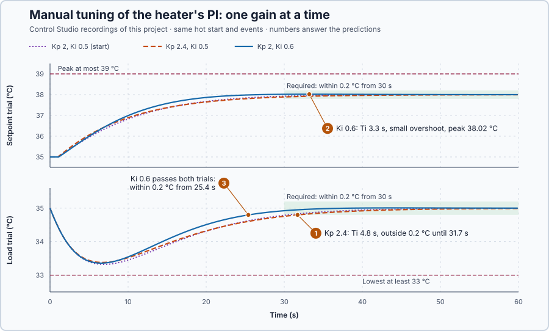

# 11. Manual PI tuning

In this lesson, you will improve the heater's PI controller by changing one gain at a time, predicting each change and keeping it only if both trials still pass. You will see why raising the proportional gain alone makes the load recovery slower.

## The problem

Lesson 10 checked the measurement, the heater and its capacity during the load trial: the reading matched the reference at every sample, and the heater peaked at 90.0% without ever reaching its limit. So the slow recovery, with the water still more than 0.2 °C from 35 °C at 30.4 s, comes from the PI settings, $K_p$ = 2 percentage points per °C and $K_i$ = 0.5 percentage points per °C per second. We have no method yet for changing them.

We will change one gain at a time, predict what each change does, and keep it only if both trials still meet their requirements.

## What we need

We need to:

1. know what each gain does to the response;
2. predict the effect of a change before running it; and
3. compare candidates fairly: the same start, the same events and the same requirements.

## The new idea

**Manual tuning** changes one setting at a time, predicts what will happen, runs the same test again, and keeps the change only if every requirement still passes. For this heater the settings are the PI controller's two gains, $K_p$ and $K_i$, and the test is the pair of trials used so far.

**In words.** Manual tuning is a loop with four parts:

1. **Change one setting.** If two settings change together, you cannot tell which one caused the difference.
2. **Predict.** Write down what the change will do before running it. A surprise shows that your picture of the controller is wrong, and your next change would be a guess.
3. **Run the same test again.** The same starting state, the same events at the same times and the same requirements. A difference between two such matched runs can only come from the changed setting.
4. **Keep or reject.** Keep the change only if every requirement still passes, in both trials. A better result in one trial does not excuse a failure in the other.

In PLC terms, it is how you change the program of a running machine: one change, the same test sequence as before, and the change stays only if every acceptance check still passes. For this heater the requirements stay as they were:

| Trial | Requirement through 60 s |
| --- | --- |
| Setpoint 35 → 38 °C | Peak ≤ 39 °C; within ±0.2 °C of 38 °C by 30 s and from then on |
| Setpoint 35 °C, extra loss 30 kW | Lowest ≥ 33 °C; within ±0.2 °C of 35 °C by 30 s and from then on |

To predict a change, you must know what each gain does. $K_p$ acts on the present error: the larger the error now, the larger P's share of the command now, and when the error is gone, so is P's share. $K_i$ acts through time: the integral, a totalizer kept from scan to scan, adds a little at every update in proportion to the error and keeps what it has added. The **integral time** says how fast the integral catches up with P: it is how long the integral needs to add as much as P gives at once, if the error stayed constant. It depends on the ratio of the two gains, not on either gain alone.

For this heater, that pace decides the end of the load trial. Under the extra 30 kW loss the heater must give 90% instead of 75%. When the water is back at 35 °C, P gives nothing, so all 15 extra points must then come from the integral, and the integral grows only while the water is below 35 °C. The water can therefore return to 35 °C and stay there only after the integral has added those 15 points: the end of the recovery is set by how fast the integral takes over from P.

A short integral time has a risk. The integral keeps adding while any error remains, but the heat it orders reaches the water 1 s later and then warms it gradually. When the water reaches the setpoint, the integral can already hold more than the holding power, and the water rises past the setpoint: an overshoot.

**The formula.** The PI controller and its integral time:

$$
u = K_p\,e + I, \qquad \Delta I = K_i\,e\,\Delta t, \qquad T_i = \frac{K_p}{K_i} .
$$

- $u$ is the heater command, in percent of full power;
- $e$ is the error $SP - PV$, in °C;
- $K_p$ is the proportional gain, in percentage points per °C, so $K_p\,e$ is P's share of the command;
- $I$ is the integral, the stored part of the command, in percent;
- $K_i$ is the integral gain, in percentage points per °C per second;
- $\Delta t$ is the time between updates, 0.1 s, and $\Delta I$ what the integral adds in one update, in percentage points;
- $T_i$ is the integral time, in seconds.

$T_i$ follows from its definition. For a constant error $e$, P gives $K_p\,e$ at once and the integral adds $K_i\,e$ every second, so after $T_i$ seconds it has added $K_i\,e\,T_i$. Setting $K_i\,e\,T_i = K_p\,e$ gives $T_i = K_p / K_i$. Two consequences hold for any error, constant or not:

$$
\text{integral growth per second} = K_i\,e = \frac{K_p\,e}{T_i}, \qquad I_{end} - I_{start} = K_i \times \text{error area} .
$$

- The first says that every second the integral grows by P's present share divided by $T_i$, in percentage points per second. A longer $T_i$ means a slower takeover.
- In the second, $I_{start}$ and $I_{end}$ are the integral at the start and at the end of a run, in percent, and the error area is the area under the error–time curve, in °C·s: all the updates $K_i\,e\,\Delta t$ added up.

**Example: the heater's baseline gains.** With $K_p$ = 2 and $K_i$ = 0.5:

1. $T_i = 2 / 0.5 = 4$ s. With the water 1 °C low, P gives 2 points at once, while the integral adds 0.5 point per second and needs 4 s to add the same 2 points.
2. The setpoint step from 35 to 38 °C starts with the integral at 75%. The first update requests $75 + 2 \times 3 + 0.5 \times 3 \times 0.1 = 81.15\%$: 6 points from P at once, only 0.15 point from the integral. Raising $K_p$ to 2.4 would add $0.4 \times 3 = 1.2$ points at once, 82.35%; raising $K_i$ to 0.6 would add only $0.1 \times 3 \times 0.1 = 0.03$ point in that update, 81.18%, but would keep adding for as long as the error lasts.
3. The load trial needs $90 - 75 = 15$ more points from the integral, so its error area must be $15 / 0.5 = 30$ °C·s: for example 1.5 °C for 20 s, or 0.5 °C for 60 s. The recorded baseline run reaches 29.99 °C·s by 60 s (calculated from the recorded run).
4. Follow the takeover in the recorded baseline load trial:
   - at 7 s the water is lowest, 1.68 °C low: P gives 3.36 points, and the integral grows by $3.36 / 4 = 0.84$ point per second;
   - at 20 s it is 0.69 °C low: P gives 1.37 points, and the integral grows by 0.34 point per second;
   - at 30 s it is 0.21 °C low: P gives 0.42 point, and the integral grows by only 0.11 point per second.

   The closer the water gets to 35 °C, the smaller P's share and the slower the integral grows: the last part of a recovery is the slowest, and $T_i$ sets its pace.

**The limitation.** Manual tuning is slow, and it finds a passing candidate, not the best one. This lesson's three settings need six runs of 60.1 s, about 6 minutes; trying five values of each gain would need $5 \times 5 \times 2 = 50$ runs, about 50 minutes, and on a real plant every trial disturbs the process. Gains that were never tried remain unknown.

**Teaching choice.** Each candidate below changes one gain by 20%: large enough to see, small enough to stay safe.

## Prediction

Before running, answer these questions:

1. $K_p$ 2 → 2.4 with $K_i$ = 0.5: what is $T_i$? Will the load recovery end sooner or later?
2. $K_i$ 0.5 → 0.6 with $K_p$ = 2: what is $T_i$? Which requirement could this change break?
3. Which candidate do you expect to pass both trials?

| Candidate | $K_p$ | $K_i$ | $T_i$ | First request, setpoint trial |
| --- | ---: | ---: | ---: | ---: |
| Baseline | 2 | 0.5 | 4 s | 81.15% |
| Candidate 1 | 2.4 | 0.5 | 4.8 s | 82.35% |
| Candidate 2 | 2 | 0.6 | 3.3 s | 81.18% |

## Implementation

Open [`src/Main.st`](src/Main.st). It runs the heater's `Control.PID` as PI with anti-windup, output 0–100%, updated every 0.1 s. The gains are the `ProportionalGain` and `IntegralGain` fields of the `Parameters` initializer. `TrialKind` selects the trial: 0 steps the setpoint to 38 °C, 1 starts the 30 kW loss. `ObservedKp` and `ObservedKi` record the gains the controller actually used. Change values with the simulator stopped; a restart returns to the hot state, 35 °C with 75% and the integral at 75%. Gains outside the practice bounds, $K_p$ 1–4 and $K_i$ 0.2–1, or a temperature outside 0–80 °C latch `SafetyAbort`, which removes heat and load.

**Exercise.** Change `ProportionalGain := LREAL#2.0,` to `LREAL#2.4,`. Before running, calculate the first request of the setpoint trial by hand: $75 + 2.4 \times 3 + 0.5 \times 3 \times 0.1 = 82.35\%$. After the run, check that `ObservedKp` shows 2.4.

## Experiment in Control Studio

1. Open this lesson's project and start **Simulator**. The heater holds 35 °C with 75% and the integral at 75%. In the **truST** side bar, select **Control Studio**.
2. On **Identify**, choose **Project experiment** from **Method**. **Signals** already shows `P1.SetpointC · Setpoint (°C)`, `P1.TemperatureC · Process value (°C)` and `P1.AppliedPowerPct · Applied output (%)`; add `P1.ObservedKp · state (percentage-point/°C)`, `P1.ObservedKi · state (percentage-point/(°C·s))` and `P1.DisturbanceKw · disturbance (kW)`.
3. Answer the predictions before starting.
4. Select **Review project test** and check the declared **60.1 s** duration.
5. Select **Confirm and start**; this is time zero, and the setpoint steps to 38 °C. This is the baseline setpoint trial.
6. After the run, hover the peak and the last time the water is more than 0.2 °C from 38 °C, and check the two observed gains. Right-click the plot and choose **Save recording…**.
7. Stop the simulator, set `TrialKind := 1;`, start **Simulator** again and run the load trial the same way. Hover the lowest temperature and the last time the water is more than 0.2 °C from 35 °C.
8. Candidate 1: set `ProportionalGain := LREAL#2.4,` and repeat both trials. Candidate 2: return it to `LREAL#2.0,`, set `IntegralGain := LREAL#0.6,` and repeat both trials.
9. At the end of each run, Control Studio shows **Project test completed. Outputs restored.**

Select **Abort test** to stop early. Restart the simulator before every trial so each starts from the same hot state.

## Evidence and decision

The numbered marks answer the predictions with the same numbers. From the six recorded runs:

| Gains | $T_i$ | Setpoint: peak | Setpoint: last outside 0.2 °C | Load: lowest | Load: last outside 0.2 °C |
| --- | ---: | ---: | ---: | ---: | ---: |
| $K_p$ 2, $K_i$ 0.5 | 4 s | 38.00 °C | 23.4 s | 33.32 °C | 30.4 s, fails |
| $K_p$ 2.4, $K_i$ 0.5 | 4.8 s | 38.00 °C | 24.8 s | 33.38 °C | 31.7 s, fails |
| $K_p$ 2, $K_i$ 0.6 | 3.3 s | 38.02 °C | 18.4 s | 33.36 °C | 25.4 s |

1. Raising $K_p$ lengthened $T_i$ to 4.8 s. The dip under load was 0.06 °C smaller, but the tail was slower: the water returned within 0.2 °C 1.3 s later, at 31.7 s. Reject it.
2. Raising $K_i$ shortened $T_i$ to 3.3 s. The setpoint trial overshot by 0.02 °C, to 38.02 °C, far inside the 39 °C limit.
3. Candidate 2 settled both trials well before 30 s, at 18.4 s and 25.4 s, with the lowest temperature 0.36 °C above its limit. It passes both trials.

The gain that helped was the one that shortened the integral time; its cost is a tiny overshoot. Keep $K_i$ = 0.6. These are simulation results for this heater at this operating point; they do not show that no other gains pass.

## Conclusion

Manual tuning changes one gain at a time and judges it against unchanged requirements in matched trials. $K_p$ acts on the present error and $K_i$ through time; their ratio, the integral time $T_i = K_p / K_i$, paces how fast the integral takes over from P, and with it the end of a recovery.

For this heater, raising $K_p$ alone slowed the load recovery to 31.7 s, while raising $K_i$ to 0.6 brought it to 25.4 s and both trials passed.

## Check yourself

1. **What is the integral time for $K_p$ = 3 and $K_i$ = 0.75?**
   $T_i = 3/0.75 = 4$ s, the same as the baseline: P is stronger, but the integral takes over at the same pace.
2. **Why did raising $K_p$ alone make the load recovery end later?**
   It lengthened $T_i$ from 4 to 4.8 s. The end of the recovery is paced by how fast the integral takes over from P,
   and a longer $T_i$ makes that slower.
3. **Candidate 2 peaked at 38.02 °C in the setpoint trial. What is the overshoot, and does it pass?**
   (38.02 − 38) / 3 = 0.7% of the step. It passes: the limit is 39 °C.

## Reason for the next lesson

Every trial so far ran the whole loop: the controller kept changing the heater's power, so the temperature trace mixes the heater's own behaviour with the controller's. It does not show how the heater itself responds to a change of power.

[Process dynamics](../../01-feedback-foundations-and-temperature-control/13-process-response-classes/README.md) looks at the heater alone, with no controller acting.
