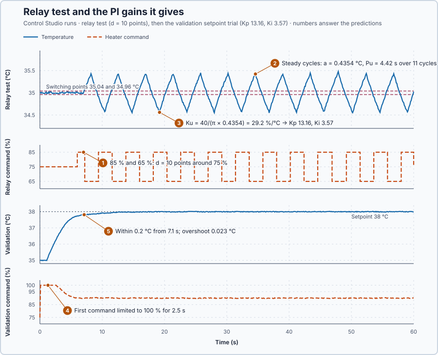

# 20. Relay tuning

In this lesson, you will let Control Studio switch the heater between two power levels until the temperature oscillates steadily, and calculate PI gains from the size and period of that oscillation, without a model. You will then see what the resulting high gains cost.

## The problem

Lesson 19 calculated $K_p$ 4.17 and $K_i$ 0.833 from the validated model and a 5 s response time, and the heater program reached 63.2% of a 3 °C step at 6.1 s. Those gains are only as good as the model: an error in its gain or time constant goes straight into them, and there is only this one model-based candidate.

We will find a second candidate without a model, from a short test on the heater itself.

## What we need

We need to:

1. make the heater show its own speed in a short, safe test;
2. turn the test's result into PI gains; and
3. check those gains on the actual heater program.

## The new idea

**Relay tuning** switches the heater between two levels whenever the temperature crosses the target. The loop then oscillates steadily, and the size and period of that oscillation tell us how to set the PI. For this heater, the relay switches the same number of points above and below the 75% holding command, and the 1 s delay makes the temperature overshoot every switch.

**In words.** The test is ON/OFF control with a small hysteresis, used on purpose to measure the heater. It has four parts:

1. **Switch at the target.** Below the target the heater gets the high level, above it the low level. Two switching points just outside the measurement noise keep the relay from chattering, as hysteresis did in the cold room.
2. **Let the delay make a steady cycle.** After each switch, the old power is still arriving for 1 s, so the temperature runs past the switching point before it turns. The loop settles into a cycle of fixed size and period.
3. **Read the cycle.** Its size says how far the temperature swings for the relay's push; its period says how fast the loop can go round once. Together they give the **ultimate gain**: the proportional gain at which the loop would keep oscillating, neither growing nor dying away. The cycle's period is the **ultimate period**.
4. **Turn them into PI gains.** An empirical rule takes a safe fraction of the ultimate gain and an integral time from the period.

In PLC terms, the relay is a two-position output with a deadband, switched by a comparison in every scan. It needs no model: the heater shows its own speed in a test of about a minute, with the temperature held close to the target.

**The formula.** A square wave switching by ±$d$ contains a sine wave at the cycle frequency with amplitude $4d/\pi$: averaging it against a sine over one cycle gives $\frac{2}{\pi}\int_0^\pi d\sin\phi\,d\phi = 4d/\pi$. The heater smooths the faster parts, so the temperature swings almost like that sine. For this sine, the relay acts like a proportional controller with gain $(4d/\pi)/a$, the gain at which the loop neither grows nor decays:

$$
K_u \approx \frac{4d}{\pi a}, \qquad K_p = 0.45K_u, \qquad T_i = \frac{P_u}{1.2}, \qquad K_i = \frac{K_p}{T_i}.
$$

- $d$ is the relay amplitude, in percentage points above and below the holding command;
- $a$ is half the peak-to-peak temperature swing, in °C, and $P_u$ the period of one full cycle, in s;
- $K_u$ is the ultimate gain, in % per °C;
- $K_p$, $T_i$ and $K_i$ are the PI settings, as in Lesson 19; the factors 0.45 and 1.2 are the empirical rule of Ziegler and Nichols.

**Example: a 5-point relay.** Calculated with the model of Lesson 19, $K$ 0.2 °C per %, $\tau$ 5 s and $L$ 1 s, and Control Studio's switching points 35.04 and 34.96 °C, just outside the ±0.02 °C measurement noise. Follow one half cycle:

1. The temperature rises through 35.04 °C, and the relay switches from 80% to 70%.
2. For the 1 s delay, the heater still delivers 80%, whose final temperature is 36 °C. The temperature keeps rising, by $(1 - 0.04)(1 - e^{-1/5}) = 0.17$ °C, to a peak of 35.21 °C.
3. Then it falls toward 34 °C, the final temperature at 70%, and reaches 34.96 °C after $5\ln\frac{1 + 0.214}{1 - 0.04} = 1.17$ s: the peak was 0.214 °C above 35 °C, the final value 1 °C below it.
4. The relay switches back, and the lower half mirrors the upper: $a \approx 0.214$ °C and $P_u \approx 2 \times (1 + 1.17) = 4.35$ s.
5. $K_u = 4 \times 5/(\pi \times 0.214) = 29.7$ % per °C: for this sine, the relay pushes 29.7 points per degree of swing.
6. $K_p = 0.45 \times 29.7 = 13.4$ % per °C, $T_i = 4.35/1.2 = 3.62$ s and $K_i = 13.4/3.62 = 3.7$ % per (°C·s).

**Teaching choice.** This lesson's relay uses $d$ = 10 points. With 5 points the swing is only about 0.2 °C, and the ±0.02 °C noise would shift single cycles by about 10%.

**The limitation.** The rule knows nothing about the requirements or the command limits. Such high gains also pass the ±0.02 °C noise on to the command multiplied by $K_p$: with $K_p$ = 13.4, about $0.02 \times 13.4 = 0.27$, roughly ±0.3 points.

## Prediction

Before running, answer these questions:

1. Which two commands will the relay apply?
2. What half amplitude $a$ and period $P_u$ do you expect?
3. Which $K_u$, $K_p$ and $K_i$ follow?
4. Will the first command after a 3 °C setpoint step fit within 100%?
5. Will the relay gains meet the same requirements as the model-based gains?

| Quantity | Predicted |
| --- | ---: |
| Relay commands | 85% and 65% |
| $a$ and $P_u$ | 0.40 °C and 4.0 s |
| $K_u$ | 31.8 % per °C |
| $K_p$, $T_i$, $K_i$ | 14.3, 3.33 s, 4.3 |
| First command, $75 + 14.3 \times 3$ | 118%: limited to 100% |

## Implementation

Open [`src/Main.st`](src/Main.st). The relay rule is a function:

```st
IF MeasuredTemperature >= CenterTemperature + HysteresisHalfWidth THEN
    Lesson29RelayHighState := FALSE;
ELSIF MeasuredTemperature <= CenterTemperature - HysteresisHalfWidth THEN
    Lesson29RelayHighState := TRUE;
ELSE
    Lesson29RelayHighState := CurrentHighState;
END_IF;
```

Between the switching points it returns the previous state. `Lesson29RelayOutput` then commands $75 + d$% in High and $75 - d$% in Low; the tests in `src/tests.st` check both functions.

The relay record at the top of `Main` holds `RelayAmplitudePct` ($d$), `CycleAmplitudeC` ($a$), `CyclePeriodS` ($P_u$), `RelayDataValid` and `RelayRevision`; revision 0 is a provided illustration. Before the controller first runs, the program calculates `KuPctPerC`, `KpPctPerC`, `TiS` and `KiPctPerCs` with the rule above, after checking the record; with an invalid record the gains stay zero and the heater stays in Manual at 75%. The real `Control.PID` runs the controller, Control Studio replaces its complete `Parameters` record when it applies gains, and `SafetyAbort` removes heat on an invalid measurement.

**Exercise.** After the experiment, stop the simulator, set the record to your measurement, $d$ = 10, $a$ = 0.4354, $P_u$ = 4.42 and `RelayRevision` = 1, and calculate by hand: $K_u$ = 29.24, $K_p$ = 13.16, $T_i$ = 3.68 s and $K_i$ = 3.57. Start the simulator and compare with the variables view.

## Experiment in Control Studio

1. Start **Simulator**: the heater holds 35 °C with 75% output in Manual. Open **Control Studio**.
2. On **Identify**, choose **Feedback relay** from **Method** and select **Identify plant**. Control Studio holds 75% for 6 s to measure the noise, switches between 85% and 65% for at most 60 s, and restores 75%. It then shows the **Relay cycle** line with $d$, $a$, $P_u$ and $K_u$.
3. On **Tune**, choose **P1.Controller · PI** and set **Tuning method** to **Relay rule (Ziegler–Nichols PI)**, available after a relay test.
4. Select **Requirements…**, enter Setpoint change 3 °C, Maximum steady-state error 0.2 °C, Maximum settling time 30 s, Settling band 0.1 °C and Validation duration 60 s, and select **Done**.
5. Select **Tune controller** and read $K_p$ and $K_i$.
6. On **Validate**, select **Validate controller** and read every row: the setpoint trial, 35 → 38 °C, and the load trial with 30 kW of extra heat loss.
7. If every row passes, select **Apply**; Control Studio reports **Applied**.

## Evidence and decision



The numbered marks answer the predictions with the same numbers. From Control Studio:

| Quantity | Result |
| --- | ---: |
| Relay cycle | **Relay cycle (11 cycles): d = 10 %, a = 0.4354 °C, Pu = 4.42 s, Ku = 4d/(πa) = 29.24 %/°C** |
| $K_p$, $T_i$, $K_i$ | 13.16 % per °C, 3.68 s, 3.57 % per (°C·s) |
| Maximum settling time | 7.1 s |
| Overshoot, setpoint trial | 0.023 °C |
| Steady-state error, setpoint and load trials | 0.024 °C |
| Operating range, load trial | 34.12–35.02 °C |

1. 85% and 65%.
2. $a$ = 0.4354 °C and $P_u$ = 4.42 s, about 10% more than calculated. The relay switches one 0.1 s sample after each crossing, which acts like extra delay; with 1.1 s, the same four steps give 0.43 °C and 4.3 s.
3. $K_u$ = 29.24, $K_p$ = 13.16 and $K_i$ = 3.57: lower than predicted, because $a$ was larger.
4. No: the command stayed at its 100% limit for the first 2.5 s.
5. Yes: every row passed, including the model agreement, 1.52%. The temperature stayed within 0.2 °C of 38 °C from 7.1 s, and the load pulled it only to 34.12 °C.

The relay candidate was applied, and a model-free candidate now exists. Its cost is a hard-working heater: the command saturates at a setpoint change, and it jitters by about ±0.3 points with the noise. A repeated relay test gave $K_p$ 12.98 and $K_i$ 3.44, within 4%. These are simulation results.

## Conclusion

Relay tuning makes the loop oscillate steadily by switching the command at the target. The cycle's half amplitude gives the ultimate gain, $K_u \approx 4d/(\pi a)$, its period the ultimate period, and an empirical rule turns both into PI gains without a model.

For this heater, a 10-point relay produced cycles of 0.4354 °C and 4.42 s, so $K_u$ = 29.24 % per °C and the PI gains 13.16 and 3.57. They settled a 3 °C step within 7.1 s, at the price of a saturated, noisier command.

## Check yourself

1. **$d$ = 5 points, $a$ = 0.25 °C and $P_u$ = 6 s: what are $K_u$, $K_p$ and $K_i$?**
   $K_u = 20/(\pi \times 0.25) = 25.5$ % per °C, $K_p$ = 11.5 % per °C, $T_i$ = 5 s and $K_i$ = 2.3 % per (°C·s).
2. **Why does the temperature keep rising after the relay switches to 65%?**
   The heater's 1 s delay: the 85% power commanded before the switch is still arriving.
3. **Why does a larger $a$ give a smaller $K_u$?**
   The relay's push, $4d/\pi$, is fixed, so a larger swing for the same push means a smaller gain.

## Reason for the next lesson

There are now three candidates: the manual gains, the model-based gains and the relay gains. Neither calculated candidate is proven suitable just because its calculation is complete, and the relay gains work the heater much harder.

[Tuning comparison](../31-tuning-method-comparison/README.md) tests every candidate in the same experiment against requirements written down in advance.
