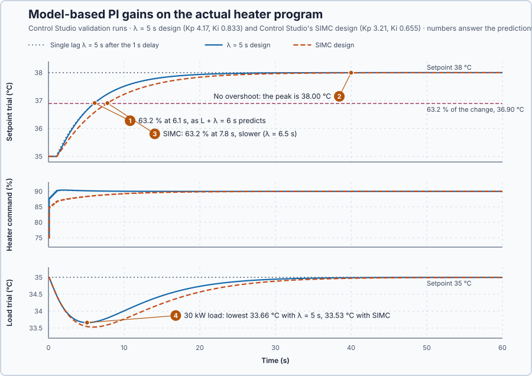

# 19. Model-based PI tuning

In this lesson, you will calculate PI gains from the validated heater model and a response time you choose, and run them on the actual heater program. You will then compare them with Control Studio's own model-based design and see what the faster choice costs.

## The problem

Lesson 18 validated the heater model, gain 0.1999 °C per %, delay 1 s and time constant 5 s, on three new records to within 0.002 °C. The model predicts the heater, but the PI gains are not yet derived from it. Gains found by trial must be searched for again for every new heater or requirement.

We will calculate the gains from the model and a chosen response time, test them on the actual heater program, and compare them with Control Studio's design.

## What we need

We need to:

1. choose how quickly the temperature should follow a setpoint change;
2. calculate the PI gains from that choice and the model; and
3. check the calculated gains on the actual heater program.

## The new idea

**Model-based tuning** calculates the PI settings from the model and the speed we want. We choose how quickly the temperature should follow a change, and the formula gives the gains. For this heater, the model says how strongly and how slowly the water answers the heater, and so how hard the controller must push for a chosen speed.

**In words.** It replaces trial and error with a calculation, the way an engineer sizes a pump from the required flow instead of trying pumps until one is big enough. The method has three parts:

1. **Choose the speed.** The **response time**, written $\lambda$, is how long the temperature should take, once the delay has passed, to cover 63.2% of a setpoint change. It is the only design choice.
2. **Let the integral cancel the water's slowness.** The water warms slowly because it stores heat. The integral keeps adding heat while an error remains. If the integral time equals the water's time constant, the integral rebuilds the push at the same pace as the stored heat holds the temperature back. The two cancel, and what remains is a simple loop.
3. **Set the strength for that speed.** The proportional gain is then chosen so that the loop follows the setpoint with the chosen response time. A process that answers weakly, with a small gain, needs a stronger push. A long delay needs a gentler one, because part of the push is based on an error that is already out of date.

For this heater, the validated model supplies the gain, the time constant and the delay; only $\lambda$ is chosen.

**The formula.** The rule is

$$
K_p = \frac{\tau}{K(\lambda + L)}, \qquad T_i = \tau, \qquad K_i = \frac{K_p}{\tau}.
$$

- $K$, $\tau$ and $L$ are the model's gain in °C per %, time constant in s and delay in s;
- $\lambda$ is the chosen response time, in s;
- $K_p$ is the proportional gain, in % per °C, $T_i$ the integral time in s, and $K_i$ the integral gain in % per (°C·s).

**Why it works.** Follow the loop after a setpoint change, with $e$ the error, setpoint minus temperature, and $x$ the temperature's change, both in °C:

1. Let $z$ be the error summed over time, so its rate of change is $e$. The PI command change is $K_p(e + z/\tau) = (K_p/\tau)(\tau\,dz/dt + z)$. The water's temperature change obeys $\tau\,dx/dt + x$ = $K$ times the command change, delayed by $L$. Both equations contain the same lag, so from rest $x = (KK_p/\tau)\,z(t-L)$, and
   $$
   \frac{dx}{dt} = \frac{K K_p}{\tau}\,e(t-L) = \frac{e(t-L)}{\lambda + L}.
   $$
2. One delay earlier the error was larger by about $L\,dx/dt$: $e(t-L) \approx e + L\,dx/dt$. Substituting gives $\lambda\,dx/dt = e$.
3. This is Lesson 13's single lag, with time constant $\lambda$ instead of the water's.

Control Studio uses the same rule under the name **SIMC**, simple internal model control. When you do not choose $\lambda$, it chooses one from the model, and its gains show which: $\lambda = \tau/(KK_p) - L$.

**Example: this heater.** With $K$ = 0.2 °C per %, $\tau$ = 5 s, $L$ = 1 s and $\lambda$ = 5 s:

1. $K_p = 5/(0.2 \times (5 + 1)) = 4.17$ % per °C: each degree of error adds 4.17 points at once.
2. $T_i$ = 5 s, so $K_i = 4.17/5 = 0.833$ % per (°C·s).
3. For a 3 °C setpoint step the command jumps at once by $4.17 \times 3 = 12.5$ points.
4. One delay later, the temperature rises at $3/(5 + 1) = 0.5$ °C/s, by step 1 of the walk-through.
5. A faster choice, $\lambda$ = 2.5 s, gives $K_p = 5/(0.2 \times 3.5) = 7.14$ and $K_i = 1.43$: the same 3 °C step makes the command jump $7.14 \times 3 = 21.4$ points. A shorter $\lambda$ means larger gains and a faster but harder push.

**Teaching choice.** $\lambda$ = 5 s, as fast as the heater on its own.

**The limitation.** Step 2 of the walk-through needs the delay to be short compared with $\lambda$. For $\lambda$ = 5 s, a share $L/(\lambda + L) = 1/6$ of the push comes from an out-of-date error; for $\lambda$ = 0.5 s it is $2/3$, and a small step overshoots by about 21% (calculated) instead of following a single lag. The gains are also only as good as the model: a model gain 20% too low, 0.16 instead of 0.2, gives $K_p = 5/(0.16 \times 6) = 5.21$ instead of 4.17, 25% too high.

## Prediction

Before running, answer these questions:

1. When will the temperature reach 63.2% of a 35 → 38 °C change, 36.90 °C?
2. Will it overshoot 38 °C?
3. Control Studio's SIMC design gives $K_p$ 3.21 and $K_i$ 0.655 for its model, $K$ 0.2, $\tau$ 4.9 s, $L$ 1.1 s. Which $\lambda$ is that, and when will it reach 63.2%?
4. Under a 30 kW load, which design lets the temperature fall further?

| Design | $K_p$ (% per °C) | $K_i$ (% per (°C·s)) | $\lambda$ | 63.2% reached |
| --- | ---: | ---: | ---: | ---: |
| Your design | 4.17 | 0.833 | 5 s | 6 s |
| SIMC | 3.21 | 0.655 | $4.9/(0.2 \times 3.21) - 1.1 = 6.5$ s | 7.6 s |

## Implementation

Open [`src/Main.st`](src/Main.st). The model record at the top of `Main` holds `ProcessGainCPerPoint`, `TimeConstantS`, `DelayS`, `DesiredResponseS`, `ModelDataValid` and `ModelRevision`; revision 0 is the provided nominal model. The program calculates its startup gains once, before the controller first runs:

```st
IF ModelGainsUsable THEN
    KpPctPerC := TimeConstantS / (ProcessGainCPerPoint * (DesiredResponseS + DelayS));
    KiPctPerCs := KpPctPerC / TimeConstantS;
```

`ModelGainsUsable` checks the model before dividing. With an invalid record the gains stay zero, and the program keeps the heater in Manual at 75% even if automatic mode is requested.

The real `Control.PID` runs the controller from the hot state: SP = PV = 35 °C with 75% output, limited to 0–100%. When Control Studio applies new gains, it replaces the complete `Parameters` record between scans, and the program never overwrites it. `SafetyAbort` removes heat and the test load on an invalid measurement.

**Exercise.** With the simulator stopped, set the model record to Lesson 18's gain 0.1999 and `ModelRevision` to 1. Calculate the gains for $\lambda$ = 5 s and 10 s: 4.17 and 0.834, then $5/(0.1999 \times 11) = 2.27$ and 0.455. Start the simulator and check `KpPctPerC` and `KiPctPerCs` in the variables view.

## Experiment in Control Studio

1. Start **Simulator**: the heater holds 35 °C with 75% output in Manual. Open **Control Studio**.
2. On **Identify**, keep **Method: Automatic** and select **Identify plant**. Control Studio steps the heater and shows `G(s) = (0.2) / (4.9s +1) · e^(−1.1s)`: its compact way of writing gain 0.2, time constant 4.9 s and delay 1.1 s.
3. On **Tune**, choose **P1.Controller · PI** from **Controller**, set **Tuning method** to **Manual** and enter $K_p$ 4.17 and $K_i$ 0.833.
4. Select **Requirements…**, enter these values and select **Done**:

   | Requirement | Value |
   | --- | --- |
   | Setpoint change | 3 °C |
   | Maximum steady-state error | 0.2 °C |
   | Maximum settling time | 30 s |
   | Settling band | 0.1 °C |
   | Validation duration | 60 s |

5. Select **Tune controller** and compare the predicted response with your predictions.
6. On **Validate**, select **Validate controller**. Control Studio checks the model against a fresh recording, then runs the actual `Main.st` with your gains from the hot state: a setpoint trial, 35 → 38 °C for 60 s, and a load trial, 30 kW of extra heat loss at 35 °C. Read every row.
7. If every row passes, select **Apply**: Control Studio writes the gains into the running `Control.PID`, checks the response and reports **Applied**. **Restore previous settings** undoes the change.
8. Return to **Tune**, set **Tuning method** to **Simple internal model control (SIMC)**, select **Tune controller**, read its gains, and repeat step 6.

## Evidence and decision



The numbered marks answer the predictions with the same numbers. From Control Studio's **Validate** page:

| Row | Your design | SIMC |
| --- | ---: | ---: |
| Maximum settling time | 14.4 s | 18.8 s |
| Maximum overshoot, setpoint trial | 0 °C | 0 °C |
| Maximum steady-state error, setpoint trial | 0.0091 °C | 0.034 °C |
| Maximum steady-state error, load trial | 0.054 °C | 0.114 °C |
| Operating range, load trial | 33.66–35 °C | 33.53–35 °C |

Every row passed for both, including the model agreement, 0.29%, and 86 range, state and transfer checks. **Maximum settling time** is when the temperature last left the 0.2 °C error limit; the trace stays within ±0.1 °C from 17.9 s.

1. 6.1 s, one sample after the predicted 6 s.
2. No: the peak was 38.00 °C. The command jumped from 75 to 87.8% and settled at the 90% that holds 38 °C.
3. $\lambda$ = 6.5 s; it reached 63.2% at 7.8 s.
4. SIMC: its lower gains let the load pull the temperature to 33.53 °C instead of 33.66 °C.

Your design was applied. Its benefit is speed and a stronger answer to load. Its cost is a harder push, a 12.5-point jump instead of SIMC's 9.6, and less room for model error. These are simulation results.

## Conclusion

Model-based tuning turns a model and a chosen response time into PI gains: $K_p = \tau/(K(\lambda + L))$ and $T_i = \tau$. The integral time cancels the process lag, and the loop then follows a setpoint change like a single lag of time constant $\lambda$ after the delay, as long as the delay is short compared with $\lambda$.

For this heater, $\lambda$ = 5 s gave $K_p$ 4.17 and $K_i$ 0.833, and the actual program reached 63.2% of a 3 °C step at 6.1 s without overshoot; Control Studio's SIMC chose a slower 6.5 s.

## Check yourself

1. **$K$ = 0.4 °C per %, $\tau$ = 8 s, $L$ = 2 s, $\lambda$ = 6 s: what are $K_p$ and $K_i$?**
   $K_p = 8/(0.4 \times 8) = 2.5$ % per °C and $K_i = 2.5/8 = 0.31$ % per (°C·s).
2. **Why does a longer $\lambda$ give smaller gains?**
   $K_p$ is inversely proportional to $\lambda + L$: a slower response needs a gentler push.
3. **Why is 63.2% reached at $L + \lambda$ and not at $\lambda$?**
   Nothing responds during the 1 s delay; after it, the loop behaves like a single lag of time constant $\lambda$.

## Reason for the next lesson

These gains depend on the model: an error in $K$ or $\tau$ goes straight into $K_p$ and $K_i$. A candidate found without a model would be a useful check.

[Relay tuning](../29-relay-tuning/README.md) finds PI gains from a steady oscillation of the heater itself, without a model.
