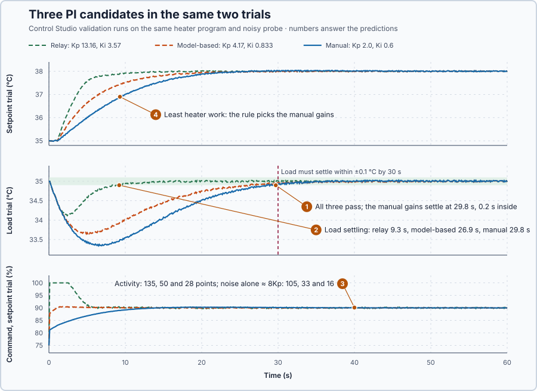

# 21. Tuning comparison

In this lesson, you will run the manual, model-based and relay PI candidates in the same two trials, against requirements and a selection rule written down before looking at any result. You will see that candidates can all pass and still differ greatly in what they ask of the heater.

## The problem

Lesson 20's relay test gave $K_p$ 13.16 and $K_i$ 3.57, which settled a 3 °C step within 7.1 s but held the command at its 100% limit for 2.5 s. With the manual gains, $K_p$ 2.0 and $K_i$ 0.6, and the model-based gains, 4.17 and 0.833, there are now three candidates. Each was checked separately, in a different project and against different requirements, so the candidates have not been compared fairly.

We will test all three in the same experiment, against requirements and a selection rule written down before looking at any result.

## What we need

We need to:

1. test every candidate in the same experiment, from the same state;
2. write down the requirements and the selection rule before looking at any result; and
3. measure what each candidate asks of the heater, not only how well it controls.

## The new idea

**Tuning comparison** tests every candidate in the same experiment against requirements written down before looking at any result, and picks the simplest that passes, or none. For this heater, the three PI candidates run the same setpoint trial and the same load trial on the actual heater program, with the same noisy probe.

**In words.** It works like choosing between quotes against a written specification: a quote that misses any line is out however good the rest is, the cheapest of the remaining quotes wins, and if none meets the specification you buy none. The comparison has four parts:

1. **The same experiment for every candidate.** The same starting state, the same events at the same times and the same probe, so that any difference comes from the gains.
2. **Requirements and a selection rule written down first.** A rule chosen after seeing the results tends to favour the result one already likes.
3. **Qualify.** A candidate qualifies only if it passes every requirement in both trials. A failure in one cannot be averaged out by a good result elsewhere.
4. **Choose.** Among the qualified candidates, take the simplest. All three are PI controllers of the same form, so the simplest is the one that asks least of the heater. If none qualifies, keep the current settings and design again: "none qualifies" is a valid result.

What a candidate asks of the heater is its **command activity**: the total movement of the applied heater command, like the distance a valve travels. For this heater much of that movement is not control at all. The probe's noise passes straight into the P part, so the command jitters with every sample, and the water, which needs seconds to respond, cannot follow it: the movement only works the heater.

The requirements, written down first:

- **Setpoint trial**, 35 → 38 °C for 60 s: overshoot at most 1 °C, error at most 0.2 °C at the end, and within 0.2 °C of 38 °C by 30 s.
- **Load trial**, 30 kW of extra heat loss at 35 °C for 60 s: never below 33 °C, error at most 0.2 °C from 30 to 60 s, and within ±0.1 °C of 35 °C by 30 s.

**The formula.** The command activity adds up every change of the applied command:

$$
A = \sum_k |u_k - u_{k-1}| .
$$

- $u_k$ is the applied command at sample $k$, in %, and $|u_k - u_{k-1}|$ the size of its change from the sample before, whatever its sign;
- $A$ is the activity, in percentage points. It measures movement, not energy.

The noise's share can be estimated. Each new sample changes P by $K_p$ times the change in the noise. For noise spread evenly over ±0.02 °C, two independent samples differ on average by $2 \times 0.02/3 = 0.013$ °C. Over the $N$ samples of a trial, the noise alone therefore adds about

$$
A_{noise} \approx N \times 0.013\ \text{°C} \times K_p ,
$$

in percentage points, with $K_p$ in % per °C.

**Example: scoring and choosing.** Calculated, with candidates and results that are not this lesson's:

1. A command that goes 75 → 77 → 76 → 76 → 79% has $A = 2 + 1 + 0 + 3 = 6$ points: the step that does not change adds nothing, and the fall counts as much as a rise.
2. A 60 s trial at 0.1 s has $N$ = 600 samples, so the noise changes the error by about $600 \times 0.013 = 8$ °C in total. A candidate with $K_p$ = 5 % per °C would move the command by about $8 \times 5 = 40$ points from noise alone.
3. A candidate that settles the setpoint trial in 12 s but the load trial only at 31 s does not qualify: the load requirement is 30 s, and the fast setpoint result cannot make up for it.
4. Of two qualifying candidates with activities of 50 and 120 points, the rule picks the one with 50: it reaches the same requirements while working the heater less.

**Teaching choice.** Ranking by command activity is this lesson's rule, not a universal law: another purpose might rank speed or margin first.

**The limitation.** Qualifying is pass or fail. A candidate 0.1 s inside a 30 s limit, 0.3% of the allowance, qualifies as fully as one 20 s inside, although a small change in the plant could push the first past the limit.

## Prediction

Before running, answer these questions:

1. Which candidates will pass both trials?
2. Rank the candidates by their worse settling time.
3. Rank them by command activity, and estimate the noise share with $8K_p$.
4. Which candidate does the rule pick, and what does that choice cost?

| Candidate | $K_p$ (% per °C) | Noise share, $8K_p$ |
| --- | ---: | ---: |
| Manual | 2.0 | 16 points |
| Model-based | 4.17 | 33 points |
| Relay | 13.16 | 105 points |

## Implementation

`Main.st` runs the real `Control.PID`; Control Studio writes each candidate's gains into `Parameters`. The program also sums the command activity from the 75% holding command:

```st
CommandActivityPoints := CommandActivityPoints + ABS(AppliedPowerPct - PreviousAppliedPct);
PreviousAppliedPct := AppliedPowerPct;
```

**Exercise.** Start the simulator (Manual, 75%), set `P1.ManualOutput` to 80, then to 78. `P1.CommandActivityPoints` reads 5, then 7. Restart the simulator before the experiment.

## Experiment in Control Studio

1. Start **Simulator**: the heater holds 35 °C with 75% output in Manual. Open **Control Studio**.
2. On **Identify**, select **Identify plant**.
3. On **Tune**, choose **P1.Controller · PI**, set **Tuning method** to **Manual** and enter the manual candidate's $K_p$ 2.0 and $K_i$ 0.6.
4. Select **Requirements…**, enter Setpoint change 3 °C, Maximum steady-state error 0.2 °C, Maximum settling time 30 s, Settling band 0.1 °C and Validation duration 60 s, and select **Done**. They stay for the other candidates; the project adds the load-trial requirements and the activity rows.
5. Select **Tune controller**. On **Validate**, select **Validate controller** and record every row, including **Command activity** for both trials.
6. Repeat steps 3 and 5 for the model-based candidate, 4.17 and 0.833, and the relay candidate, 13.16 and 3.57.

## Evidence and decision



The numbered marks answer the predictions with the same numbers. From Control Studio's **Validate** page:

| Requirement | Manual | Model-based | Relay |
| --- | ---: | ---: | ---: |
| Overshoot, setpoint trial ≤ 1 °C | 0.040 °C | 0.020 °C | 0.021 °C |
| Error at the end, setpoint trial ≤ 0.2 °C | 0.040 °C | 0.026 °C | 0.023 °C |
| Within 0.2 °C, setpoint trial ≤ 30 s | 18.6 s | 14.8 s | 7.2 s |
| Lowest temperature, load trial ≥ 33 °C | 33.34 °C | 33.65 °C | 34.12 °C |
| Error 30–60 s, load trial ≤ 0.2 °C | 0.086 °C | 0.066 °C | 0.023 °C |
| Within ±0.1 °C, load trial ≤ 30 s | 29.8 s | 26.9 s | 9.3 s |
| Command activity, setpoint / load trial | 28.3 / 26.1 | 49.7 / 42.6 | 135.2 / 122.6 |

All three also passed the model agreement, below 0.5%, and 86 range, state and transfer checks.

1. All three, the manual gains only just: their load trial settled at 29.8 s of the allowed 30 s.
2. By the worse of the two settling times: relay 9.3 s, model-based 26.9 s, manual 29.8 s, all in the load trial.
3. Manual 28.3, model-based 49.7, relay 135.2 points in the setpoint trial. The noise accounts for about 16, 33 and 105 of them: most of the relay's extra movement is amplified noise.
4. The manual gains: they qualify with the least heater work, about a fifth of the relay's. The cost is the slowest response and no margin: 0.2 s inside the load limit.

Had the load trial required settling within 9 s, no candidate would have qualified, the relay's 9.3 s included; the right decision would then be to keep the current settings and design again. These are simulation results.

## Conclusion

A tuning comparison runs every candidate in the same experiment, against requirements and a selection rule written down in advance. Qualifying needs every requirement in every trial; among the qualified, the rule decides, and command activity shows what each candidate asks of the actuator.

For this heater, all three PI candidates qualified. The relay gains were fastest but moved the command five times as much, mostly amplified noise; the manual gains asked least of the heater and were kept, with only 0.2 s to spare.

## Check yourself

1. **The command goes 75, 78, 76, 79%. What is the command activity?**
   $3 + 2 + 3 = 8$ points.
2. **Why does the relay candidate have by far the largest activity?**
   Its $K_p$ of 13.16 multiplies the probe's noise: about $8 \times 13.16 = 105$ of its 135 points.
3. **Why can "none qualifies" be the correct result?**
   Picking the least bad candidate would accept a failed requirement; keeping the current settings and designing again does not.

## Reason for the next lesson

The rule kept the manual gains, only 0.2 s inside the 30 s load requirement. Every changed requirement means designing and comparing again by hand: with settling required within 15 s, the manual gains, at 18.6 s, would fail.

[Tuning to requirements](../85-tuning-to-requirements/README.md) states the requirements and lets Control Studio design a controller that meets them, or say that none can.
