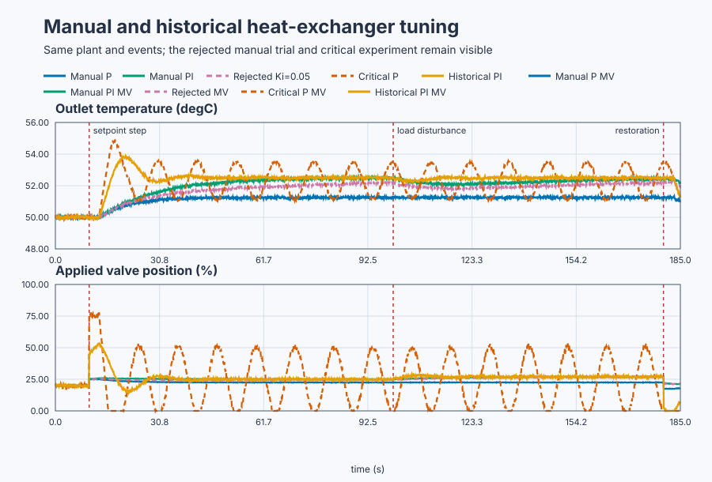

# Tune a heat exchanger deliberately

Course position: Lesson 42 of 84. Previous lesson: [validate a heat-exchanger
model on unseen conditions](../../05-experiments-identification-and-validation/41-heat-exchanger-validation-uncertainty/README.md).
Next lesson: [estimate critical behavior with a bounded relay test](../43-relay-autotuning/README.md).

**Equipment:** Plate heat exchanger with four independent simulated controller
copies.

**Lesson objective:** Tune proportional and integral action one term at a time, reproduce a historical critical-cycle PI tuning, and select the least aggressive candidate that satisfies the declared requirements.

## The problem

A steam valve controls the outlet temperature of a
plate heat exchanger with four independent simulated controller copies. The
four independent copies compare manual proportional-only, manual
proportional-integral, critical proportional-only, and historical
proportional-integral control in one operating region.

Each copy begins at 50 degrees Celsius with the valve at 20 percent —
Lesson 41's accepted operating point. The plant is Lesson 41's validated
model, inherited unchanged: gain 0.5 degrees Celsius per valve percentage
point, 20-second time constant, 3-second dead time. The controller runs
every 0.1 seconds against independent 0.05-degree-Celsius measurement noise,
configured for this comparison. The valve is limited to 0 through 100
percent; the evidence is Simulation evidence, not physical-plant evidence.

A valid model still does not decide how fast the loop should respond, how
much overshoot is acceptable, or how much valve movement is justified. This
lesson first makes those choices visible through manual tuning, then compares
them with an intentionally aggressive historical rule.

## What we need

We need to compare all four candidates under equivalent heat-exchanger
conditions and explain what each added term changes physically and
numerically.

## The new idea

The setpoint ($SP$) is the desired outlet temperature, in degrees Celsius. The
measured outlet temperature ($PV$) is the sensor value, also in degrees Celsius.
The control error ($e$) is setpoint ($SP$) minus measured outlet temperature ($PV$).
A positive error means the product is colder than desired.

$e=SP-PV.$

The operating-point bias is the valve position needed to hold 50 degrees
Celsius at zero error — 20 percent here. The proportional gain ($K_p$)
states how many requested valve percentage points are added per degree
Celsius of present error: immediate action that reduces offset and speeds
response, though a delayed process can begin another correction before
earlier valve movement reaches the sensor.

The integral contribution ($I$) represents accumulated past error as a valve
command, in percentage points. The integral gain ($K_i$) states how many
valve percentage points per degree Celsius per second accumulate; too much
causes overshoot, oscillation, saturation, and difficult recovery. The
integral time ($T_i$) is proportional gain divided by integral gain:

$T_i=\frac{K_p}{K_i}.$

The derivative gain ($K_d$) has units of valve percentage-point seconds per
degree Celsius; the derivative time ($T_d$) is derivative gain divided by
proportional gain. Derivative action adds damping by responding to measured
rate but also amplifies measurement noise; this slow loop already meets its
requirements with proportional-integral control, so the lesson does not add
derivative action merely to make a three-term controller.

This lesson writes the control law in its ideal parallel form: bias, the
present-error contribution, the accumulated-error contribution, and the
measured-rate contribution combine into one requested command. In symbolic
form:

$MV_{\mathrm{requested}}=Bias+K_pe+I-K_d \cdot d(PV)/dt,\qquad \frac{dI}{dt}=K_ie.$

Manual P and critical P calculate this law directly each scan (Lesson 26's
positional realization). Manual PI and historical PI run inside
`Control.PID`, which Lesson 26 showed switches to the incremental realization
once integral gain is nonzero: the same three terms are summed by adding one
increment per scan instead of recomputing the whole command.

The applied manipulated variable ($MV_{\mathrm{applied}}$) is the command
after the controller's 0-to-100-percent limit; saturation means the requested
command cannot be applied completely, so requested and applied values must
not be confused.

Manual tuning changes one term at a time: establish bias, adjust proportional
action, add integral only when error persists, and add derivative only when
damping evidence justifies its noise cost.

The ultimate gain ($K_u$) is the proportional-only gain that produces an
approximately constant-amplitude oscillation in one declared experiment. The
ultimate period ($P_u$) is the time between equivalent peaks. A lagging,
delayed plant under proportional-only feedback sustains that oscillation
where accumulated phase lag reaches half a turn; $K_u$ is the reciprocal of
the plant's own gain there. Finding that frequency is a frequency-response
calculation taught in Lessons 47 and 48; here the values are reported as
configured, checkable numbers, not derived from first principles:
$K_u = 22.24$ percentage points per degree Celsius and $P_u = 11.35$ seconds.

Ziegler and Nichols published this rule in 1942 from closed-loop industrial
experiments; 0.45 and 1.2 are their empirically fitted constants, not
derived. The Ziegler-Nichols historical proportional-integral rule
calculates $K_p = 0.45 \cdot K_u$, $T_i = P_u/1.2$, and $K_i = K_p/T_i$. Its
quarter-amplitude-decay objective expects one idealized deviation peak to
shrink toward one quarter of the preceding peak. This is aggressive and is
not a modern default; limits, noise, uncertainty, and actual requirements
still govern acceptance.

## Prediction

Manual proportional control uses a 20% bias and $K_p=2.0$, chosen so the
plant's 2.5-degree-Celsius setpoint step requests about 5 valve percentage
points of proportional action ($K_p \times 2.5=5$) — enough authority to move
the valve without saturating it. Let $\Delta y$ be
the final temperature rise. The plant gives
$\Delta y=K_{\mathrm{plant}}\Delta MV=0.5(2e)=e$, while
$e=\Delta SP-\Delta y=2.5-\Delta y$. Solving
$\Delta y=2.5-\Delta y$ gives $\Delta y=1.25$ °C and $e=1.25$ °C. This derives
the proportional offset instead of merely observing it.

At 100 seconds a common load strikes the manual PI and historical PI copies:
their equilibrium outlet temperature shifts down 1 degree Celsius, as if
colder feedwater lowered the exchanger's steady output at the same valve
position. The first manual PI trial keeps $K_p = 2.0$ and uses $K_i = 0.05$,
giving a deliberately slow $T_i = 40$ seconds — about twice the plant's
20-second time constant — for a first, cautious trial. Predict that it will
miss the 0.10-degree-Celsius recovery requirement after the load. Change only
integral gain to $K_i = 0.10$, giving $T_i = 20$ seconds, for the second
manual candidate.

Using $K_u = 22.24$ and $P_u = 11.35$ (above), the historical PI candidate is
$K_p = 10.01$ %/°C, $T_i = 9.46$ s, and $K_i = 1.06$ %/(°C·s). Predict a much
faster response and substantially more valve movement than manual PI.

## Implementation

The shipped Structured Text uses explicit proportional laws for manual P and
critical P, and one real `Control.PID` each for manual PI and historical PI.
The essential manual configuration is:

```st
ManualPiParameters.ProportionalGain := LREAL#2.0;
ManualPiParameters.IntegralGain := LREAL#0.10;
ManualPiParameters.DerivativeGain := LREAL#0.0;
ManualPiParameters.Bias := LREAL#20.0;
ManualPiController.Configure(Parameters := ManualPiParameters);

ManualPiInput.Setpoint := Setpoint;
ManualPiInput.ProcessValue := ManualPiTemperature;
ManualPiInput.CycleTime := LREAL#0.1;
ManualPiApplied := ManualPiController.Update(Input := ManualPiInput);
```

The historical instance differs only in its proportional and integral gains;
both share the same limits, anti-windup, cycle time, and initial state.

## Experiment in Control Studio

Control Studio exposes the four-candidate comparison. Test writes one reviewed
Boolean, `P1.ExperimentEnabled`, for 180.1 seconds: a common 10-second
baseline at 50 °C precedes the setpoint step, the common 100-second load
follows on schedule, and every copy runs through 180 seconds before restoring
50 °C. Native evidence owns exact setpoint and load timing, the separately
compiled $K_i=0.05$ trial, peak/period calculation, and candidate decision. No
candidate is applied; seed 20260829 is deterministic.

### Control Studio actions

1. **Monitor** — Start the **Simulator**, then open **truST sidebar → Control Studio → Monitor → Response**.
   - **Baseline check:** Wait until the header shows **Simulation**, **Running**, and current data. Confirm Common outlet-temperature setpoint (SP, degC); Manual proportional outlet temperature (PV, degC) and Manual PI outlet temperature (PV, degC); Manual proportional applied valve position (MV, %) and Manual PI applied valve position (MV, %), including units, limits, mode, and quality. The initial operating point is Common outlet-temperature setpoint = 50 degC, Manual proportional applied valve position = 20 %, Manual PI applied valve position = 20 %, Critical proportional applied valve position = 20 %, Historical PI applied valve position = 20 %, Manual proportional outlet temperature = 50 degC, Manual PI outlet temperature = 50 degC, Critical proportional outlet temperature = 50 degC. The unresolved baseline problem is: Proportional-only control retains offset, while the first deliberately slow integral setting does not recover from the common load inside the declared time.
   - **Decision before action:** All four copies begin at the identical 20 %
     valve position and 50 degC reading, so any visible drift before Test
     starts means the baseline is not safe to trust; write down your
     predicted 1.25 degC manual-P offset and historical-PI gains now, because
     comparing them against the live traces afterward is what proves the
     calculation. Use this decision rule: Prefer the least aggressive candidate that meets final accuracy and overshoot requirements while retaining every failed trial and actuator-use trade-off.
   - **Successful evidence:** The Response plot advances, the displayed values are finite and current, and **Start recording** is enabled. Select **Start recording** only after those conditions are visible.
   - **Recovery:** If recording is disabled or the plot reports unavailable or stale samples, stop the Simulator, correct the displayed runtime or binding problem, restart it, and repeat the baseline check.
   - **Record:** Write down the initial SP, PV, requested/applied MV where available, controller mode, and your predicted response before opening Test.

2. **Test** — Open **truST sidebar → Control Studio → Test**.
   - **Baseline check:** Confirm **Experiment** = **Observe without excitation**, **Amplitude** = **0** (disabled), and **Maximum duration (s)** = **180.1**. The reviewed authority is **Experiment authority** (`P1.ExperimentEnabled`). It starts false and must restore false. Confirm common setpoint = 50 °C and every applied valve near 20%.
   - **Decision before action:** Before selecting **Review test**, record the 1.25 °C proportional offset and the derived manual/historical PI gains. Confirm every valve remains within 0–100% and every temperature within 40–60 °C. Do not run this on a physical plant or Apply a result.
   - **Successful evidence:** Select **Review test**, verify Boolean authority, timeout, false restoration, and stop conditions, then **Confirm and start**. Keep **Abort test** available. Observe all four responses under the common setpoint and the restored 50 °C setpoint.
   - **Recovery:** Abort for stale, invalid, nonfinite, mismatched, or out-of-range data. Confirm authority false, setpoint 50 °C, and safe valve outputs before retrying.
   - **Record:** Retain terminal state, restoration, all SP/PV/MV traces, gains, timing, noise, events, peak/period
     measures, response measures, valve travel, seed, and candidate state. The deterministic seed is
     **20260829**. The decision this run supports is: Prefer the least aggressive candidate that
     meets final accuracy and overshoot requirements while retaining every failed trial and
     actuator-use trade-off.
## Evidence and decision

Define every decision measure and its pass direction before reading the
result:

- Proportional late error is mean absolute setpoint-minus-temperature error
  from 80 to 100 seconds, in degrees Celsius.
- Rise time is the first 10-to-90-percent crossing duration, in seconds.
- Overshoot is peak temperature above the final setpoint divided by the
  setpoint change, in percent; required at most 5 percent for manual PI.
- Settling time is the elapsed time from the setpoint change until
  temperature enters and stays inside plus or minus 0.10 degrees Celsius for
  at least 5.0 continuous seconds, checked before the 100-second load; a run
  that never qualifies is `Not settled`, and its last sample is not
  steady-state error.
- Load integral absolute error ($IAE$) is sampled absolute error accumulated from
  100 to 180 seconds, in degree-Celsius seconds.
- Cumulative valve movement is total variation: the sum of absolute
  successive applied-command changes, in percentage points, which can exceed
  100 since it measures travel, not position. Historical PI is expected to
  move the valve at least twice as much as manual PI — a confirmatory floor,
  not a cap.
- The critical experiment is qualified only if it supplies at least six
  alternating peaks with a measured period inside 9 to 14 seconds.

Accepted PI candidates must reach at most 0.10 degrees Celsius final error;
this lesson then prefers whichever uses less valve movement.



The figure and its [complete retained trace](figures/manual-historical-tuning-comparison-trace.csv)
come from the executable simulation. The [decision summary](figures/manual-historical-tuning-comparison-summary.csv)
retains the exact gains, assumptions, results, and unapplied decisions.

The executable simulation gives these decision results:

| Case | Qualified result |
|---|---|
| Manual P | 1.25 degrees Celsius late offset |
| Rejected manual PI, $K_i = 0.05$ | 0.34 degrees Celsius error at 180 seconds |
| Critical P | 14 alternating peaks; measured period 11.55 seconds; no accepted tuning |
| Manual PI, $K_i = 0.10$ | 0.08 degrees Celsius final error; 4.13 percent overshoot; 219.40 percentage points valve movement |
| Historical PI | 0.01 degrees Celsius final error; 3.00-second rise; 1,102.27 percentage points valve movement |

Both accepted PI candidates meet the final-error limit. Historical PI's valve
movement is more than five times manual PI's, past the
confirmatory floor, while the critical experiment clears its
peak-count and period gates (at least six alternating peaks, 9 to 14 seconds)
though proportional-only control is never accepted alone. Manual PI meets
the overshoot limit with much lower actuator activity, so it is preferred
over the historical candidate. No candidate is applied
automatically.

## Conclusion

The slow first manual integral setting proves that removing offset eventually
is not enough; recovery must meet a time requirement. Raising only integral
gain makes that causal change visible. The historical tuning responds quickly
because it inherits an aggressive objective from operation near the critical
oscillation. Its valve travel exposes the cost. One tuning formula is therefore
not a guarantee or a universal recommendation.

## Reason for the next lesson

Choose the least aggressive controller that satisfies declared accuracy,
response, robustness, and actuator requirements on retained evidence. The
critical gain and period belong to this plant, operating point, sampling,
limits, and experiment. Lesson 43 replaces sustained manual operation near
instability with a bounded relay experiment, while still requiring review and
leaving the resulting candidate unapplied.
