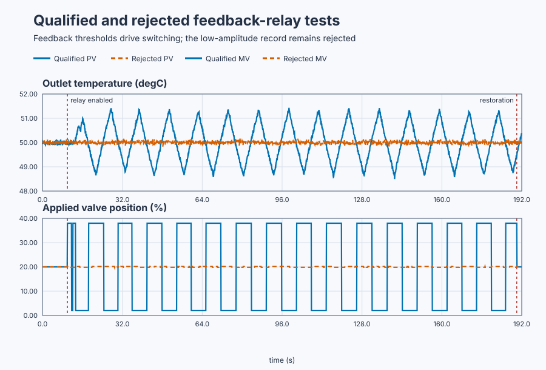

# Estimate critical behavior with feedback relay

Course position: Lesson 43 of 84. Previous lesson:
[deliberate manual and historical heat-exchanger tuning](../42-heat-exchanger-tuning-methods/README.md).
Next lesson: [model-based tuning with an explicit robustness-speed target](../44-model-based-tuning/README.md).

**Equipment:** Plate heat exchanger with qualified and deliberately weak
feedback-relay copies.

**Lesson objective:** Execute and qualify a bounded feedback-relay experiment, reject an uninformative record, and derive one explicitly unapplied PI candidate.

## The problem

A steam valve controls the outlet temperature of the same plate heat exchanger
used in Lessons 40 through 42. Two independent simulated copies begin at 50
degrees Celsius (°C) with the valve at 20 percent (%). Each local plant has gain 0.5
degrees Celsius per valve percentage point, time constant 20 seconds, dead time
3 seconds, 0.1-second sampling, and deterministic 0.05-degree-Celsius sensor
noise.

The qualified copy moves the valve 18 percentage points above or below its
holding position. The deliberately weak copy moves only 0.20 percentage
points. The evidence is Simulation evidence. This lesson does not authorize a
physical heat-exchanger experiment.

Lesson 42 found the gain that sustained oscillation by changing proportional
gain manually. That is useful for understanding, but repeatedly moving a real
loop toward instability is imprecise and hazardous. A feedback relay creates a
bounded oscillation automatically. It is not a time-driven square wave: the
measured outlet temperature decides every switch.

## What we need

We need a bounded relay experiment that creates measurable oscillation only
under qualified conditions and converts its period and amplitude into an
unapplied tuning candidate.

## The new idea

The relay bias is the valve position that holds the initial operating point,
in percent. It is 20 percent here. The relay amplitude ($d$) is the positive
distance from bias to either relay output, in valve percentage points. The high
output is bias plus amplitude, and the low output is bias minus amplitude. A
18-point amplitude therefore gives 38 percent and 2 percent.

The relay center is the outlet temperature around which switching occurs, in
degrees Celsius. It is 50 degrees Celsius here. The hysteresis half-width
($\varepsilon$) is the temperature distance from the center to either switching
threshold, in degrees Celsius. A 0.08-degree-Celsius half-width gives an upper
threshold of 50.08 degrees Celsius and a lower threshold of 49.92 degrees
Celsius.

The relay retains its present output while temperature remains inside the
band. At the upper threshold it selects the low output. At the lower threshold
it selects the high output. Hysteresis prevents measurement noise from causing
rapid false switching; it does not prescribe a switching period.

A limit cycle is a repeatable closed-loop oscillation sustained by the feedback
relay. The measured process amplitude ($a$) is half the difference between the
qualified upper and lower temperature extrema, in degrees Celsius. The measured
relay period ($P_u$) is the mean time between equivalent-direction threshold
crossings, in seconds, after initial transient cycles are discarded.

For cycle amplitudes $a_i$ with mean $\bar a$, amplitude variation is
$\max|a_i-\bar a|/\bar a$. Period variation applies the same formula to
periods $P_i$. At least six complete evaluation cycles are
required, and amplitude and period variation must each be no more than 10
percent.

The oscillation signal-to-noise ratio compares measured process amplitude with
the sensor-noise standard deviation. It must be at least 5. The measured
amplitude must also exceed four hysteresis half-widths. Those two checks stop
noise and the switching band from being mistaken for plant response.

The ideal symmetric-relay describing-function approximation estimates the
critical gain ($K_u$), in valve percentage points per degree Celsius. After relay
amplitude and measured process amplitude have been defined, its relationship
is:

\[
K_u=\frac{4d}{\pi a}.
\]

The describing-function approximation assumes a stable repeatable limit cycle,
small hysteresis relative to its amplitude, adequate sampling, an undistorted
actuator, and relevant plant dynamics. It estimates one point at the induced
frequency; it is not a complete model or a universal plant constant. This
method originates in Åström and Hägglund's feedback-relay autotuning work; the
[1984 publication record](https://lup.lub.lu.se/record/8496536) provides its
historical source.

Only a qualified record may reuse the historical proportional-integral rule
from Lesson 42. Proportional gain becomes 0.45 times the estimated critical
gain. Integral time becomes measured period divided by 1.2. Integral gain is
proportional gain divided by integral time. The calculation produces a
candidate, not permission to apply it.

## Prediction

For the qualified copy, predict 38-percent and 2-percent valve levels and
50.08-degree-Celsius and 49.92-degree-Celsius switching thresholds. Its period
should be near Lesson 42's 11.35 seconds, while its critical-gain estimate
should be in the same engineering region as 22.24 percentage points per degree
Celsius.

For the measured strong-cycle amplitude 1.293 °C, the later calculation should
give $K_u=4(18)/(\pi(1.293))=17.72$ %/°C. With measured period 11.938 s, the
historical PI rule then gives $K_p=0.45K_u=7.98$ %/°C,
$T_i=11.938/1.2=9.95$ s, and $K_i=K_p/T_i=0.80$ %/(°C·s).

The weak record's measured amplitude is 0.085 °C, so its
$SNR=0.085/0.05=1.7<5$ and its amplitude is also below
$4\varepsilon=4(0.08)=0.32$ °C. Predict that its retained record will be rejected and report
`No tuning candidate`, even if a calculation could return a finite number.

## Implementation

The shipped Structured Text stores one Boolean high-or-low state for each
relay. Switching reads measured temperature; elapsed time is used only to stop
and restore the bounded experiment.

```st
IF QualifiedTemperature >= LREAL#50.08 THEN
    QualifiedRelayHigh := FALSE;
ELSIF QualifiedTemperature <= LREAL#49.92 THEN
    QualifiedRelayHigh := TRUE;
END_IF;

IF QualifiedRelayHigh THEN
    QualifiedRelayApplied := LREAL#38.0;
ELSE
    QualifiedRelayApplied := LREAL#2.0;
END_IF;
```

The program contains no controller gain estimate, cycle metric, qualification
decision, or candidate. Control Studio derives those from the retained record.

## Experiment in Control Studio

Control Studio exposes both relay copies. Test writes one reviewed Boolean,
`P1.ExperimentEnabled`, for 180.1 seconds. The project owns the 18-point strong
relay request, both feedback-dependent switching laws, the weak 0.20-point
comparison, the timeout, and restoration to 20%. Native evidence owns cycle
qualification, the describing-function calculation, rejection, and the
unapplied candidate. The deterministic Simulation seed is 20260829.

### Control Studio actions

1. **Monitor** — Start the **Simulator**, then open **truST sidebar → Control Studio → Monitor → Response**.
   - **Baseline check:** Wait until the header shows **Simulation**, **Running**, and current data. Confirm Qualified relay outlet temperature (PV, degC) and Weak relay outlet temperature (PV, degC); Qualified relay applied valve position (MV, %) and Weak relay applied valve position (MV, %), including units, limits, mode, and quality. The initial operating point is Qualified relay applied valve position = 20 %, Weak relay applied valve position = 20 %, Qualified relay outlet temperature = 50 degC, Weak relay outlet temperature = 50 degC. The unresolved baseline problem is: Repeated manual gain changes near sustained oscillation are imprecise and potentially hazardous on physical equipment.
   - **Decision before action:** Read **Prediction** above, then state what should move first and in which direction. Use this decision rule: Derive a candidate only when feedback-dependent cycles satisfy amplitude, noise, repeatability, limit, quality, and restoration criteria.
   - **Successful evidence:** The Response plot advances, the displayed values are finite and current, and **Start recording** is enabled. Select **Start recording** only after those conditions are visible.
   - **Recovery:** If recording is disabled or the plot reports unavailable or stale samples, stop the Simulator, correct the displayed runtime or binding problem, restart it, and repeat the baseline check.
   - **Record:** Write down the initial SP, PV, requested/applied MV where available, controller mode, and your predicted response before opening Test.

2. **Test** — Open **truST sidebar → Control Studio → Test**.
   - **Baseline check:** Confirm **Experiment** = **Observe without excitation**, **Amplitude** = **0** (disabled), and **Maximum duration (s)** = **180.1**. The only writable signal is `P1.ExperimentEnabled`; it starts false and must restore false. Confirm both applied valves = 20% and temperatures near 50 °C.
   - **Decision before action:** Before selecting **Review test**, record the 2/38% strong levels, 19.8/20.2% weak levels, 49.92/50.08 °C thresholds, and all qualification gates. Confirm valves remain within 0–100% and temperature within 40–60 °C. Do not run this on a physical plant or Apply a result.
   - **Successful evidence:** Select **Review test**, verify Boolean authority, timeout, false restoration, and stop conditions, then **Confirm and start**. Keep **Abort test** available. Verify valve changes occur after temperature threshold crossings—not on a fixed clock—and both valves restore to 20%.
   - **Recovery:** Abort for stale, forced, invalid, nonfinite, mismatched, or out-of-range data. Confirm authority false and both applied valves 20% before retrying.
   - **Record:** Retain terminal state, restoration, thresholds, applied transitions, extrema, crossing times, cycle measures, SNR, failed criteria, seed, and candidate state.

There is no shared Tune stage. Native executable evidence qualifies the strong
record, rejects the weak record, derives the candidate, and leaves it unapplied.

## Evidence and decision

### Measures and comparison

For each record retain the applied high and low valve levels, every transition
and threshold-crossing time, upper and lower temperature extrema, measured
process amplitude, mean period, amplitude variation, period variation,
signal-to-noise ratio, saturation duration, invalid samples, stop reason, and
restoration result. Units and evaluation windows belong with each value.

The qualified record requires at least six complete cycles, no more than 10
percent amplitude or period variation, signal-to-noise ratio at least 5,
amplitude greater than 0.32 degrees Celsius, no limit or quality violation, and
confirmed restoration. An unqualified record retains its data and failed
criteria but exposes no gain or tuning candidate.



The [complete retained trace](figures/relay-autotuning-comparison-trace.csv)
preserves both experiments. The [decision summary](figures/relay-autotuning-comparison-summary.csv)
records qualification inputs, rejection, restoration, and the explicitly
unapplied candidate.

### Validation

Accept the strong record only if it switches because temperature crosses the
declared thresholds, applies exactly 38 and 2 percent, restores exactly 20
percent, measures a 9-to-14-second period, satisfies both repeatability checks,
and estimates critical gain within 20 percent of Lesson 42's independent
critical experiment, with the declared 1-percentage-point numerical tolerance.

The retained executable run produced:

| Decision measure | Qualified relay | Weak relay |
|---|---:|---:|
| Complete cycles | 16 | Not qualified |
| Measured process amplitude | 1.293 degrees Celsius | 0.085 degrees Celsius |
| Mean period | 11.938 seconds | Not qualified |
| Amplitude variation | 4.5 percent | Not qualified |
| Period variation | 5.3 percent | Not qualified |
| Signal-to-noise ratio | 25.85 | 1.69 |
| Critical-gain estimate | 17.73 percentage points per degree Celsius | No tuning candidate |
| Restoration | 20.0 percent confirmed | 20.0 percent confirmed |

The qualified estimate is 20.27 percent below the independent Lesson 42 value,
inside the 20-percent gate plus its declared 1-percentage-point tolerance. The
historical rule therefore gives proportional gain 7.98 percentage points per
degree Celsius, integral time 9.95 seconds, and integral gain 0.80 percentage
points per degree Celsius per second. These values remain an unapplied
Simulation candidate.

Reject the 0.20-point relay amplitude when its measured oscillation fails the
amplitude-to-hysteresis or signal-to-noise requirement. Its decision must read
`No tuning candidate`. Its samples remain evidence of why the experiment was
rejected rather than disappearing from the record.

## Conclusion

Process lag and dead time keep temperature moving after each valve switch, so
feedback-dependent switching can sustain a cycle. The cycle reveals one
frequency-domain point without fitting a complete model. Hysteresis suppresses
noise-driven chatter but also affects the induced phase, which is why it must
be small relative to measured amplitude and why the estimate has an explicit
tolerance rather than claiming exact equality with Lesson 42.

## Reason for the next lesson

Relay autotuning automates an experiment and candidate calculation. It does not
automate plant eligibility, hazard review, data qualification, controller
choice, validation, or application. Lesson 44 instead uses validated models to
choose an explicit robustness-speed trade-off without deliberately creating a
critical oscillation.
