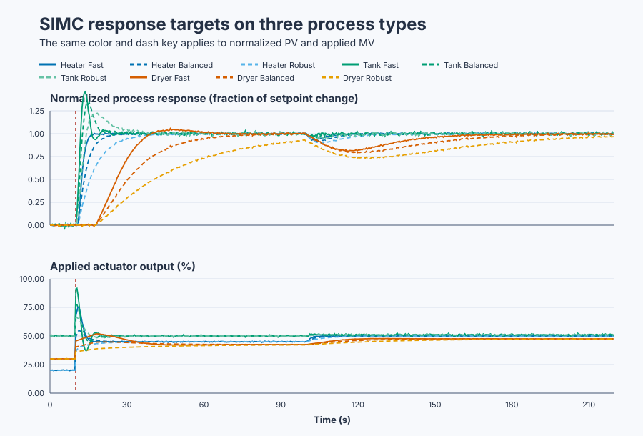

# Choose model-qualified PI response targets

Course position: Lesson 44 of 84. Previous lesson: [qualified feedback-relay
autotuning](../43-relay-autotuning/README.md).
Next lesson: [prove an overhead-crane stability interval](../../07-classical-stability-and-frequency-design/45-crane-routh-stability/README.md).

**Equipment:** Recirculating water heater, buffer tank, and continuous belt dryer.

**Lesson objective:** Calculate and validate Fast, Balanced, and Robust PI candidates from eligible models while keeping every candidate unapplied.

## The problem

This lesson controls three simulated pieces of industrial equipment with the
same shipped `Control.PID` function block: a recirculating water heater, a
buffer tank, and a continuous belt dryer. The heater and dryer settle after a
fixed input. The tank level keeps changing while inlet and outlet flow differ.

The controlled quantities are heater temperature in degrees Celsius, tank
level in percent, and dryer product dryness in percent. Their manipulated
variables are heater power, inlet-valve position, and dryer heater command,
each limited from 0 to 100 percent. This is Simulation evidence, not physical
plant evidence.

Lesson 43 estimated one critical point with a feedback relay. That evidence is
useful, but it does not tell us how deliberately choosing a slower response can
increase tolerance to model error. A validated process model lets us make that
speed-versus-robustness choice explicitly. It also prevents us from applying a
self-regulating formula blindly to an integrating tank.

## What we need

We need to derive PI gains from an eligible plant model — self-regulating or
integrating, with stated provenance — and an explicit closed-loop response
target, then qualify robustness before applying anything.

## The new idea

The desired closed-loop time ($\lambda$) is the response-speed target in seconds.
A smaller value asks for a faster response and usually leaves less tolerance
for modelling error. A larger value asks for a slower, more robust response.

Self-regulating plant gain ($K$) is the steady output change divided by the
steady input change. The dominant time constant ($T$), in seconds,
describes the main response lag. Effective dead time ($L$), in seconds, describes
delay before the useful response appears. Lesson 18 derived, from an
internal-model cancellation of the plant's own dynamics, exactly this
self-regulating proportional gain:

$K_p=\frac{T}{K(\lambda+L)}.$

The integral time ($T_i$) is the time in seconds used to scale integral action.
For a general eligible first-order model, SIMC uses
$T_i=\min(T,4(\lambda+L))$. For the three response ranges here this minimum is
$T$, preventing integral action from becoming faster than the dominant plant
lag. The parallel integral gain ($K_i$) used by `Control.PID` is then

$K_i=\frac{K_p}{T_i}.$

An integrating process never reaches a new steady output while net input
stays nonzero. Its integrating rate gain ($K'$) is output change per unit
input per second, not a steady-state gain. Repeating Lesson
18's internal-model cancellation with the plant's transfer function replaced
by $K'/s$ gives the matching integrating-process rule, this time with no
finite plant time constant to cap integral time against. For the tank, the
eligible equations are

$K_p=\frac{1}{K'(\lambda+L)},\qquad T_i=4(\lambda+L).$

and again $K_i = K_p / T_i$.

SIMC means internal-model-control-inspired tuning of an ordinary feedback PI
controller, named and published by Sigurd Skogestad in 2003; it is not
model-predictive control, since no online optimizer predicts a future input
sequence here.

## Prediction

For a self-regulating model the Fast target is $\max(L,T/3)$ — no closed
loop can usefully respond faster than the plant's own dead time allows, and
pushing much faster than a third of the lag demands excessive gain for
little real gain in speed. Balanced backs off to twice Fast and Robust to
four times Fast: this lesson's configured numeric steps for trading response
speed
against tolerance to modelling error. The water heater, inherited from
Lesson 16's step identification and Lesson 18's SIMC derivation, has
$K=0.20$ °C/%, $T=5.0$ s, and $L=1.0$ s, so Fast is $\max(1,5/3)=1.667$ s.
The targets are therefore 1.667, 3.333, and 6.667 s; every one keeps
$4(\lambda+L)$ above $T=5$ s (Fast: $4(1.667+1)=10.67$), confirming
$T_i=T$ throughout. For Balanced,
$K_p=5/[0.2(3.333+1)]=5.769$, $T_i=5$ s, and
$K_i=5.769/5=1.154$. The complete `(Kp, Ki)` pairs are $(9.375, 1.875)$,
$(5.769, 1.154)$, and $(3.261, 0.652)$.

For an integrating model Fast equals its positive effective delay. The buffer
tank has integrating rate gain $K'=0.05$ level-%/(valve-%·s) and effective
dead time $L = 0.5$ s. A short secondary lag behaves, for tuning purposes,
much like added dead time; this lesson applies the common half rule, which
treats half of a short secondary time constant as extra effective delay and
discards the rest. Half of the inlet valve's 1.0-second valve lag gives that
0.5-second effective delay. $K'$, $T$, and $L$ are configured teaching values
for this lesson, distinct from the tank in Lessons 31 and 33 (which used
centimetres and litres per second); on the real valve and tank they would
come from a level-percent step test read the same way. Fast, Balanced, and
Robust use lambda values of 0.5, 1.0, and 2.0 seconds. Balanced gives
$K_p=1/[0.05(1+0.5)]=13.333$, $T_i=4(1.5)=6$ s, and
$K_i=13.333/6=2.222$. Their pairs are $(20.000, 5.000)$, $(13.333, 2.222)$,
and $(8.000, 0.800)$.

The dryer has $K = 0.40$ dryness-percent per heater-percent, $T = 20.0$ s,
and $L = 8.0$ s — a configured teaching value for this lesson measuring
product dryness, distinct from Lesson 39's temperature-based dryer model; on
the real dryer they would come from a dryness-sensor step test using Lesson
39's own identification method. Here Fast is $\max(8,20/3)=8$ s. Balanced
gives $K_p=20/[0.4(16+8)]=2.083$, $T_i=20$ s, and $K_i=0.104$. Its lambda
values are 8.0, 16.0, and 32.0 seconds. Its pairs are $(3.125, 0.156)$,
$(2.083, 0.104)$, and $(1.250, 0.063)$.

Predict that Fast will normally have the shortest 10-to-90-percent rise time,
while Robust will move the actuator more gently and tolerate model error
better. This is a prediction to test, not a winner embedded in the PLC.

## Implementation

The shipped Structured Text uses three instances of the same controller. This
excerpt shows the heater path; tank and dryer use their own gains, bias,
setpoint, process value, requested output, and applied output.

```st
HeaterParameters.ProportionalGain := HeaterKp;
HeaterParameters.IntegralGain := HeaterKi;
HeaterController.Configure(Parameters := HeaterParameters);

HeaterInput.Setpoint := HeaterSetpoint;
HeaterInput.ProcessValue := HeaterTemperature;
HeaterInput.Mode := PIDMode#Auto;
HeaterInput.CycleTime := LREAL#0.1;
HeaterRequested := HeaterController.Update(Input := HeaterInput);
HeaterApplied := MAX(MIN(HeaterRequested, LREAL#100.0), LREAL#0.0);
```

Requested output is the bounded controller request. Applied output is the
command delivered to the simulated actuator. They are retained separately so
later actuator limitations cannot be hidden.

## Experiment in Control Studio

Control Studio exposes the Balanced candidate already declared in the project.
Test writes one reviewed Boolean, `P1.ExperimentEnabled`, for 220.1 seconds.
The project owns the heater 20-to-25 °C setpoint, the linked tank and dryer
setpoints, and restoration of all three baselines. Fresh native runs change
only the response target while holding the same plant, initial state,
events, sample interval, and seed constant, so all nine plant/target
combinations and the gain/delay variations start from an equivalent state.
Every candidate remains unapplied. The deterministic Simulation seed is
20260829.

### Control Studio actions

1. **Monitor** — Start the **Simulator**, then open **truST sidebar → Control Studio → Monitor → Response**.
   - **Baseline check:** Wait until the header shows **Simulation**, **Running**, and current data. Confirm Heater temperature setpoint (SP, degC) and Tank level setpoint (SP, %); Heater temperature (PV, degC) and Tank level (PV, %); Heater applied power (MV, %) and Tank applied inlet valve (MV, %), including units, limits, mode, and quality. The initial operating point is Heater applied power = 20 %, Tank applied inlet valve = 50 %, Dryer applied heater command = 30 %, Heater temperature = 20 degC, Tank level = 50 %, Dryer dryness = 40 %. The unresolved baseline problem is: A critical-point estimate does not expose a deliberate closed-loop speed-versus-robustness target or distinguish self-regulating from integrating tuning equations.
   - **Decision before action:** The project links all three setpoints to one
     heater command: raising heater SP to 25 degC also raises tank SP to 52 %
     and dryer SP to 45 %, so one authority write drives three simultaneous,
     comparable step responses. Use this decision rule: Retain all
     model-qualified candidates and validation evidence for review; do not
     select or apply a winner in the PLC program.
   - **Successful evidence:** The Response plot advances, the displayed values are finite and current, and **Start recording** is enabled. Select **Start recording** only after those conditions are visible.
   - **Recovery:** If recording is disabled or the plot reports unavailable or stale samples, stop the Simulator, correct the displayed runtime or binding problem, restart it, and repeat the baseline check.
   - **Record:** Write down the initial SP, PV, requested/applied MV where available, controller mode, and your predicted response before opening Test.

2. **Test** — Open **truST sidebar → Control Studio → Test**.
   - **Baseline check:** Confirm **Experiment** = **Observe without excitation**, **Amplitude** = **0** (disabled), and **Maximum duration (s)** = **220.1**. The reviewed authority is **Experiment authority** (`P1.ExperimentEnabled`). It starts false and must restore false. Confirm heater/tank/dryer setpoints = 20 °C/50%/40% and applied outputs = 20%/50%/30%.
   - **Decision before action:** Before selecting **Review test**, independently calculate all three Balanced gain sets and predict their response directions. Confirm every project-owned output remains within 0–100% and every PV within its declared limit. Do not Apply a candidate.
   - **Successful evidence:** Select **Review test**, verify Boolean authority, timeout, false restoration, and stop conditions, then **Confirm and start**. Keep **Abort test** available. Observe heater temperature move toward 25 degC, tank level toward 52 %, and dryer dryness toward 45 % together, then all three baselines restored when authority ends.
   - **Recovery:** Abort for stale, forced, invalid, nonfinite, mismatched-model, or out-of-range data. Confirm authority false and all three setpoints restored before retrying.
   - **Record:** Retain terminal state, restoration, model parameters, target, gains, SP/PV/requested/applied MV traces, response metrics, events, seed, and unapplied state.

## Evidence and decision

Define every measure and its gate before looking at the results:

- **Rise time** is the time from the first 10-percent crossing to the first
  90-percent crossing after the setpoint step, in seconds.
- **Settling** requires the process value to enter and remain inside a band
  of 2 percent of the setpoint step (0.10 degrees Celsius for the heater,
  0.04 percentage points for the tank, 0.10 percentage points for the dryer)
  for at least 5.0 continuous seconds, checked between the 10-second setpoint
  step and the 100-second load event. If it does not, report `Not settled`;
  do not use a final sample as steady-state evidence.
- **Final-window absolute error** is the mean absolute setpoint-minus-process-
  value difference from 210 through 220 seconds; the declared tolerance is at
  most 0.25 (degrees Celsius for the heater, percentage points for the tank
  and dryer).
- **Cumulative applied-output movement** is actuator activity. Calculate the
  sum of absolute changes between consecutive applied-output samples and
  report it in percentage points.

At 100 seconds each plant receives its own load: the heater's steady output
falls 1 degree Celsius, the tank's inflow rises 1 percent, and the dryer's
steady output falls 2 percent, all against independent 0.02-degree-or-percent
measurement noise. Compare the nominal model, 20 percent more plant gain, and
50 percent more effective delay; a response that is unstable, saturated,
aborted, or Not settled is ineligible for ranking by steady-state error. The
gain and delay variation cases verify only that outputs stay finite and
within declared limits — they do not report settling, rise time, overshoot,
or final-window error, so this evidence cannot by itself show whether Robust
tolerates modelling error better than Fast; it shows only that all three
candidates stay safe under it.



The figure normalizes each process-value change so speed can be compared
without pretending the plants share physical units. The [complete nominal
trace](figures/model-based-tuning-comparison-trace.csv) retains every process
response and applied actuator command. The [decision summary](figures/model-based-tuning-comparison-summary.csv)
retains gains, rise times, uncertainty cases, and `applied: false`.

The nine nominal combinations gave:

| Plant | Target | Settling | Rise time | Overshoot | Final-window error | Movement |
|---|---|---|---:|---:|---:|---:|
| Heater | Fast | 5.8 s | 3.1 s | 1.32% | 0.015 degC | 549.5 pp |
| Heater | Balanced | 14.4 s | 6.9 s | 1.35% | 0.015 degC | 328.0 pp |
| Heater | Robust | 27.9 s | 14.0 s | 1.36% | 0.015 degC | 185.0 pp |
| Tank | Fast | 28.2 s | 1.3 s | 46.94% | 0.017 pp | 1107.0 pp |
| Tank | Balanced | 22.8 s | 1.8 s | 34.46% | 0.017 pp | 724.7 pp |
| Tank | Robust | 78.8 s | 3.0 s | 23.26% | 0.016 pp | 428.1 pp |
| Dryer | Fast | 51.7 s | 15.2 s | 5.59% | 0.019 pp | 177.8 pp |
| Dryer | Balanced | 68.9 s | 31.5 s | 0.56% | 0.029 pp | 117.6 pp |
| Dryer | Robust | Not settled | 65.5 s | 0.00% | 0.170 pp | 71.0 pp |

Every combination meets the 0.25 final-window-error tolerance, including
Robust dryer, which never satisfies the settling band and dwell inside the
100-second window even though its late error is small. Rise time falls from
Fast to Robust in every case, confirming the prediction. Overshoot does not:
the tank's Fast gain produces 46.94 percent overshoot and does not settle
until 28.2 s, later than Balanced's 22.8 s despite Balanced's slower nominal
rise time, so peak speed and settling speed are not the same thing. Fast
also moves its actuator far more than Balanced or Robust in every case. The
gain and delay variation cases (18 further runs) stay finite and within
limits for all three targets on all three plants; they do not by themselves
show a robustness ranking. The selected settings remain unapplied.

## Conclusion

Fast uses more feedback gain because its desired closed-loop time is shorter;
Robust uses less gain because its larger response target allows more time for
unmodelled lag and delay. The integrating tank needs a rate-gain formula:
treating its rate gain as a static gain would produce a dimensionally wrong
controller. The tank's Fast candidate shows that speed and settling are not
the same thing: its aggressive gain settles later than Balanced's despite a
much faster rise, because its 46.94 percent overshoot must ring back down
first. The gain and delay variation runs confirm all three targets stay
bounded and within limits under 20 percent more gain and 50 percent more
delay, but since those runs report no settling or error, they cannot by
themselves rank the targets by robustness.

## Reason for the next lesson

You can now decide whether a validated self-regulating or integrating model is
eligible for SIMC PI tuning, calculate transparent response-target candidates,
and test them without silently applying gains. A model-derived tuning is still
not proof of stability under every uncertainty. Lesson 45 introduces explicit
stability reasoning before any physical application can be considered.
