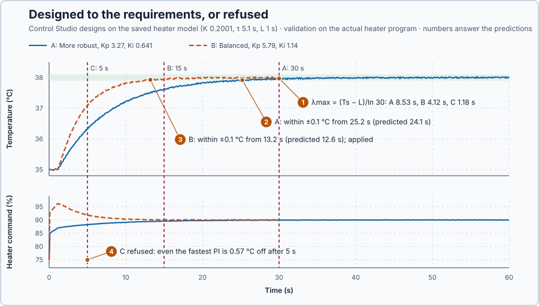

# 22. Tuning to requirements

In this lesson, you will state what the heater loop must achieve and let Control Studio design a PI that meets it, for three different settling times. You will see one requirement set refused, and predict that refusal from the model.

## The problem

Lesson 21 compared three PI candidates and kept the manual gains, which moved the heater command least, 28 points, but settled the load trial only 0.2 s inside its 30 s limit. Each new requirement needs a new design and a new comparison by hand: with a 15 s settling time, the manual gains, which need 18.6 s, would fail, and nothing says in advance whether any PI could meet a still shorter time.

We will state the requirements and let Control Studio design a controller that meets them, or tell us that none can.

## What we need

We need to:

1. state what the loop must achieve as numbers;
2. turn those numbers into the response the controller must give; and
3. know, before validating, whether any PI can give it.

## The new idea

**Tuning to requirements** means stating what the loop must achieve (how big the change is, how close the temperature must get, and by when) and letting Control Studio design a controller that meets it, or tell you that none can. For this heater, the change is a 3 °C setpoint step, and the temperature must come within 0.1 °C of 38 °C within 30, 15 or 5 s.

**In words.** In Lesson 19 you chose the speed and calculated the gains. Now you state the requirement, like ordering a pump by its duty point instead of by its model number, and the tool sizes the controller, or reports that no controller of this kind fits. The method has four parts:

1. **State the requirement as numbers.** How big the change is, how large an error is accepted once settled, how closely the temperature must stay at its final value, and by when.
2. **Turn it into the slowest acceptable response.** A response time that settles exactly in time; any slower response settles too late.
3. **Know the fastest possible response.** A response time short compared with the delay makes the push depend on an out-of-date error, so the delay and the time constant limit how fast a PI can be.
4. **Choose or refuse.** Pick the gentlest response that meets every requirement. If even the fastest one cannot, refuse: the refusal is a result about the plant and the requirements, not a failed tuning.

The requirements are four numbers:

- $\Delta r$, the setpoint change: 3 °C;
- the **allowed error** $e_{\max}$, the largest error accepted once settled: 0.2 °C, Control Studio's **Maximum steady-state error**;
- the **settling band** $b$, how closely the temperature must stay at its final value: 0.1 °C. With a PI the final value is the target, so the band is the tighter condition; and
- the settling time $T_s$: by when.

**The formula.** Lesson 19's rule, $K_p = \tau/(K(\lambda + L))$ with $T_i = \tau$, makes the loop follow a setpoint change like a single lag of time constant $\lambda$ after the delay $L$: the error falls as $\Delta r\,e^{-(t-L)/\lambda}$. It is down to $b$ when $\Delta r\,e^{-(t-L)/\lambda} = b$, at

$$
t = L + \lambda\ln\frac{\Delta r}{b}.
$$

For $\lambda$ = 5 s and $L$ = 1 s: $t = 1 + 5 \times \ln 30 = 1 + 5 \times 3.40 = 18.0$ s. Setting $t = T_s$ gives the slowest response that still settles in time:

$$
\lambda_{\max} = \frac{T_s - L}{\ln(\Delta r/b)}.
$$

- $t$ is the time after the setpoint change, $T_s$ the settling time, $L$ the delay and $\lambda$ the response time, all in s;
- $\Delta r$ and $b$ are in °C, so their ratio has no unit;
- $\lambda_{\max}$ is the longest response time that settles by $T_s$, in s.

Control Studio designs from the heater model saved from its step test, `heater-model.json`: $K$ 0.2001 °C per %, $\tau$ 5.1 s and $L$ 1.0 s. The saved model makes the design repeatable: identifying the heater again gives slightly different numbers each run, because the measurement noise during the step differs. Its fastest response uses $\lambda = \max(L, \tau/3)$, its balanced response twice that and its more robust response four times that:

| Response | $\lambda$ | $K_p$ (% per °C) | $K_i$ (% per (°C·s)) |
| --- | ---: | ---: | ---: |
| More robust | 6.8 s | 3.27 | 0.641 |
| Balanced | 3.4 s | 5.79 | 1.14 |
| Faster | 1.7 s | 9.44 | 1.85 |

Here $\max(1.0, 5.1/3) = 1.7$ s, and for the more robust response $K_p = 5.1/(0.2001 \times (6.8 + 1.0)) = 3.27$. With **Automatic** tuning, Control Studio chooses as follows:

1. It predicts the more robust response on the model.
2. If the prediction meets every requirement, it keeps it: smaller gains tolerate more model error and move the heater less.
3. Otherwise it tries the balanced, then the faster response.
4. If none meets the requirements, it refuses and says what even its fastest response misses.

**Example: a 2 °C step that must stay within ±0.05 °C by 20 s.** Calculated with the formula, not one of this lesson's sets:

1. $\ln(\Delta r/b) = \ln(2/0.05) = \ln 40 = 3.69$.
2. $\lambda_{\max} = (20 - 1.0)/3.69 = 5.15$ s: any response slower than 5.15 s settles too late.
3. The more robust response, $\lambda$ = 6.8 s, is slower than that: it would reach the band only at $1 + 6.8 \times 3.69 = 26.1$ s.
4. The balanced response, $\lambda$ = 3.4 s, is faster: it reaches the band at $1 + 3.4 \times 3.69 = 13.5$ s. Following the Automatic steps, it is kept, with $K_p$ 5.79 and $K_i$ 1.14.
5. If the same step had to settle by 6 s, $\lambda_{\max}$ would be $(6 - 1.0)/3.69 = 1.36$ s, shorter than the fastest response, 1.7 s: no PI response from this design could meet it.

**Teaching choice.** The three requirement sets, A, B and C, differ only in the settling time.

**The limitation.** The prediction depends on the model, and the formula assumes Lesson 19's single-lag behaviour, which becomes rough when $\lambda$ is not long compared with the delay: for the faster response, a share $L/(\lambda + L) = 1/2.7 = 37\%$ of the push comes from an out-of-date error. This is one reason Control Studio predicts each response on the full model, and then validates it on the actual program, instead of relying on the formula.

## Prediction

Before running, answer these questions:

1. What is $\lambda_{\max}$ for A, B and C?
2. Which response will Control Studio choose for A, and when will the temperature stay within 0.1 °C?
3. Which response will it choose for B, and when?
4. What will happen with C?

| Set | $T_s$ | $\lambda_{\max}$ | Expected response | Within ±0.1 °C |
| --- | ---: | ---: | --- | ---: |
| A | 30 s | 8.53 s | More robust, $\lambda$ 6.8 s | $1 + 6.8 \times 3.40 = 24.1$ s |
| B | 15 s | 4.12 s | Balanced, $\lambda$ 3.4 s | 12.6 s |
| C | 5 s | 1.18 s | none: the fastest needs 1.7 s | — |

## Implementation

The program is the heater of the previous lessons with the actual `Control.PID`; Control Studio writes the designed gains into `Parameters`. `Main.st` holds the two calculations as functions:

```st
SlowestResponseTimeS := (SettlingTimeS - DelayS) / LN(ReferenceChange / SettlingBand);
ModelRuleProportionalGain := TimeConstantS / (ProcessGain * (ResponseTimeS + DelayS));
```

**Exercise.** Open [src/tests.st](src/tests.st) and run its tests from the **Testing** view: they expect $\lambda_{\max}$ 8.53, 4.12 and 1.18 s and, for the round values $K$ 0.2 and $\tau$ 5 s, $K_p$ 3.26, 5.77 and 9.38. Then change the delay in the test for C to 0.5 s and predict the new value: $(5 - 0.5)/\ln 30 = 1.32$ s. Restore 1.0.

## Experiment in Control Studio

1. Start **Simulator**: the heater holds 35 °C with 75% output in Manual. Open **Control Studio**.
2. On **Identify**, choose **Supplied plant model** in **Method**, select **Open model…** and open `heater-model.json`. Control Studio shows `G(s) = (0.2001) / (5.1s +1) · e^(−1s)`: gain 0.2001, time constant 5.1 s and delay 1 s, the model it identified for this heater from its step test.
3. On **Tune**, choose **P1.Controller · PI** and keep **Tuning method** at **Automatic**. Select **Requirements…**, enter set A and select **Done**:

   | Requirement | A | B | C |
   | --- | --- | --- | --- |
   | Setpoint change | 3 °C | 3 °C | 3 °C |
   | Maximum steady-state error | 0.2 °C | 0.2 °C | 0.2 °C |
   | Maximum settling time | 30 s | 15 s | 5 s |
   | Settling band | 0.1 °C | 0.1 °C | 0.1 °C |
   | Validation duration | 60 s | 30 s | 10 s |

4. Select **Tune controller** and read the gains; the response they belong to is $\lambda = \tau/(KK_p) - L$. On **Validate**, select **Validate controller** and read **Maximum settling time**.
5. Repeat steps 3 and 4 with set B, then select **Apply**; Control Studio reports **Applied**.
6. Enter set C, select **Tune controller** and read the message.

## Evidence and decision



The numbered marks answer the predictions with the same numbers. From Control Studio:

| Set | Gains $K_p$, $K_i$ | $\lambda = \tau/(KK_p) - L$ | **Maximum settling time** | Within ±0.1 °C |
| --- | ---: | ---: | ---: | ---: |
| A, 30 s | 3.27, 0.641 | 6.8 s: more robust | 19.9 s | 25.2 s |
| B, 15 s | 5.79, 1.14 | 3.4 s: balanced | 9.9 s | 13.2 s |
| C, 5 s | refused | — | — | — |

**Maximum settling time** is when the error last left the 0.2 °C allowed error; the last column is read from the trace.

1. 8.53, 4.12 and 1.18 s: the saved model's delay is 1.0 s.
2. A got the more robust response. The temperature stayed within ±0.1 °C from 25.2 s, against 24.1 s predicted; every row passed.
3. B got the balanced response: within ±0.1 °C from 13.2 s, against 12.6 s predicted. Every row passed, and B was applied.
4. C was refused: **Tuning failed: PI cannot meet the requirements on the model: even its fastest response is up to 0.57 °C from the target after 5 s, where 0.2 °C is allowed. Allow a longer settling time or a larger error.** The fastest response, $\lambda$ = 1.7 s, is slower than the 1.18 s that C needs.

B's speed costs a harder push: its $K_p$ is 1.8 times A's, so the command jumped by 17.7 points at the setpoint change, to 92.7%, instead of 10 points. C needs a plant with a shorter delay or a looser requirement, not another tuning. A fresh identification in an earlier run gave $\tau$ = 4.9 s and $L$ = 1.1 s, because the noise during its step differed, and set B $K_p$ = 5.61, which met the same requirements; the saved model keeps the numbers the same each time. These are simulation results.

## Conclusion

Stated requirements fix the slowest acceptable response, $\lambda_{\max} = (T_s - L)/\ln(\Delta r/b)$, and the delay fixes the fastest. Control Studio designs on the model, predicts before validating, validates on the actual program, and refuses when even its fastest response cannot meet the requirements: a refusal is a result about the plant and the requirements.

For this heater, 30 s gave the more robust PI, 3.27 and 0.641, and 15 s the balanced PI, 5.79 and 1.14, which was applied; 5 s was refused, because the 1 s delay and 5.1 s time constant allow no PI response faster than 1.7 s.

## Check yourself

1. **$\Delta r$ = 2 °C, $b$ = 0.1 °C, $L$ = 1 s and $T_s$ = 13 s: what is $\lambda_{\max}$?**
   $(13 - 1)/\ln 20 = 12/3.0 = 4.0$ s.
2. **Why was set C refused?**
   It needs $\lambda \le 1.18$ s, but the fastest response the delay and time constant allow is 1.7 s.
3. **Why did set A get the more robust response, although the balanced one would also have met it?**
   Control Studio keeps the first response that meets every requirement, starting from the more robust one: smaller gains tolerate more model error and move the heater less.

## Reason for the next lesson

The balanced PI met its requirements, but at the setpoint change its P part pushed the command from 75 to 92.7% at once. A PI that meets the requirements can still kick the heater hard when the target changes.

[Setpoint weighting](../../01-feedback-foundations-and-temperature-control/10-proportional-setpoint-weighting/README.md) lets the P part react only partly to a change of target, while it still reacts fully to the measured temperature.
