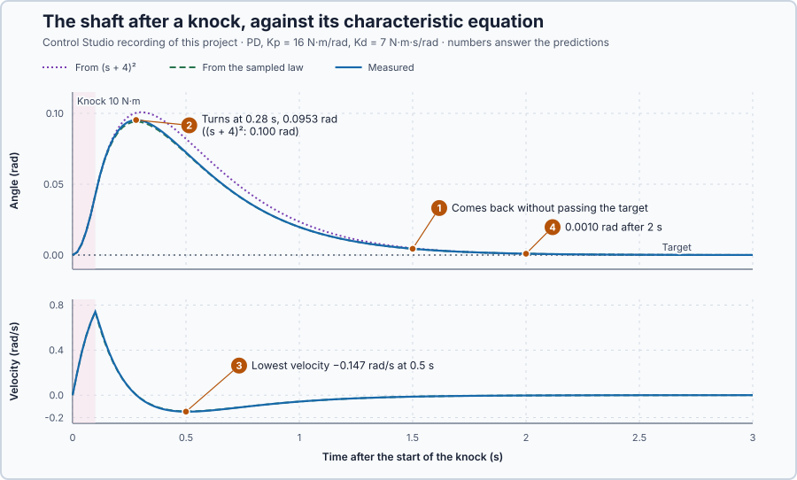

# 50. Characteristic equations

In this lesson, you will derive one equation that contains every natural motion of a connected plant and controller, and check its roots on the shaft after a knock.

## The problem

Lesson 49 read the shaft's motion from its poles: a first peak at 1.62 s and one swing every 3.24 s. It also showed that one fraction can hide a mode. In the PI-controlled heater, the setpoint response $0.1/(s + 0.1)$ had lost the pole $-0.2$, while the disturbance response still showed it. The poles of a fraction written for one input are not necessarily all the poles of the loop.

We will derive the loop's poles from the connected equations of plant and controller, with everything the controller stores, and check them on the shaft after a knock.

## What we need

We need to:

1. find one equation whose roots are all the natural motions of the connected plant and controller, before any cancellation;
2. include every quantity the controller stores; and
3. use the feedback signs, and the timing, as the program applies them.

## The new idea

**The characteristic equation** is the equation whose roots are the closed loop's poles. It comes from the plant and the controller together, and it tells whether every natural motion of the complete loop dies away. Each natural motion is called a **mode**.

**In words.** A transfer function written for one input can lose a mode: in Lesson 49's PI loop, the controller's zero cancelled the water's pole from the setpoint response. The complete loop still has every mode, one for each quantity it stores: the heat in the water, the angle and the speed of a shaft, and the controller's own stored values, such as its integral. The characteristic equation is built from all the connected equations at once, before anything is divided out, so no mode can hide. It takes three steps:

1. **Write each part as it is applied:** the plant's equation and the control law, with the feedback signs as they are wired.
2. **Count what is stored.** Each stored quantity gives one root: two stored quantities, an equation of second degree.
3. **Eliminate** every signal but one, and try a mode $e^{st}$. What remains is one equation in $s$.

In PLC terms, the stored quantities are like the variables a program keeps from one scan to the next. The controller's integral is such a variable, and the loop's behaviour depends on it as much as on the water's heat. An equation that leaves it out describes a different program.

For the shaft under PD control, angle and speed are stored, so the loop has two modes; whether they swing or die away smoothly depends on both gains.

**The formula.** With no input, a linear loop reduces to one equation in one signal $z$:

$$
a_n\,z^{(n)} + \dots + a_1\,\dot z + a_0\,z = 0 \quad\Longrightarrow\quad a_n s^n + \dots + a_1 s + a_0 = 0 .
$$

Let:

- $z$ be the deviation of the controlled quantity from its target, for example in rad;
- $z^{(n)}$ be its $n$th derivative, $a_0 \dots a_n$ the constant coefficients of the connected equations; and
- $s$ be a root, in 1 per second, one for each stored quantity.

The trial $z = A\,e^{st}$ turns every derivative into a factor $s$, which is why the second equation follows from the first. Every root with a negative real part gives a mode that dies away. A root that appears twice gives only one exponential, $e^{st}$; the second mode is then $t\,e^{st}$.

For the shaft $J\ddot\theta + B\dot\theta = u$ under PD control, $u = K_p\,(r - \theta) - K_d\,\dot\theta$, and with $z = \theta - r$ for a fixed target:

$$
J\ddot z + (B + K_d)\,\dot z + K_p\,z = 0, \qquad J s^2 + (B + K_d)\,s + K_p = 0 ,
$$

where $J$ is the inertia in kg·m², $B$ the friction and $K_d$ the derivative gain in N·m·s/rad, and $K_p$ the proportional gain in N·m/rad. The derivative gain acts like extra friction.

**Example 1: the heater and its integral.** Measure the temperature from 35 °C, $x = T - 35$, and let $i$ be the controller's integral, in percent above 75 %. With $K_p = 2.5$ and $K_i = 0.5$, and without the delay:

$$
5\dot x + x = 0.2\,v, \qquad v = -2.5\,x + i, \qquad \dot i = -0.5\,x .
$$

1. **Two stored quantities, two equations.** Putting $v$ into the first: $\dot x = -0.3\,x + 0.04\,i$, and $\dot i = -0.5\,x$.
2. **Eliminate $i$.** Differentiating the first and replacing $\dot i$: $\ddot x = -0.3\,\dot x - 0.02\,x$.
3. **Try $e^{st}$:**

$$
s^2 + 0.3\,s + 0.02 = (s + 0.1)(s + 0.2) = 0 .
$$

Both roots are negative, so every motion dies away, and the $-0.2$ that cancelled from the setpoint response is back. The integral matters: raise the water by 0.1 °C with the integral unchanged, and the solution is $x = -0.1\,e^{-0.1t} + 0.2\,e^{-0.2t}$. It starts at $-0.1 + 0.2 = 0.1$ °C and crosses 0 when $e^{0.1t} = 2$, after $10 \ln 2 = 6.9$ s: the water falls below 35 °C, because the integral fell while the water was warm. Leave the integral out and the equation is $s + 0.3 = 0$, a single decay that never crosses.

**Example 2: the shaft under PD.** With $J = 1$ kg·m², $B = 1$ N·m·s/rad, $K_p = 16$ N·m/rad and $K_d = 7$ N·m·s/rad:

1. The equation is $s^2 + 8s + 16 = (s + 4)^2 = 0$: the root $-4$ per second, twice. Both modes die away, with a time constant of $1/4 = 0.25$ s.
2. **Signs matter.** With D added the wrong way, $B - K_d = -6$ and the equation is $s^2 - 6s + 16 = 0$, with the roots $3 \pm j2.65$: a growing swing.
3. **The repeated root's motion.** From a displacement $z_1$ and a velocity $v_1$ at time 0, the two modes $e^{-4t}$ and $t\,e^{-4t}$ combine into

$$
z(t) = \big(z_1 + (v_1 + 4\,z_1)\,t\big)\,e^{-4t}, \qquad \dot z(t) = \big(v_1 - 4\,(v_1 + 4\,z_1)\,t\big)\,e^{-4t} .
$$

4. **A push.** Suppose a push leaves the shaft on its target moving away at $v_1 = 0.5$ rad/s, so $z_1 = 0$ and $z(t) = 0.5\,t\,e^{-4t}$. The factor $t$ lets it rise first, then $e^{-4t}$ wins. The velocity is zero when $0.5 - 2t = 0$, at 0.25 s, where the shaft has gone $0.5 \times 0.25 \times e^{-1} = 0.046$ rad. It comes back fastest at 0.5 s, at $(0.5 - 1.0)\,e^{-2} = -0.068$ rad/s, and after 2 s it is $0.5 \times 2 \times e^{-8} = 0.0003$ rad from the target.
5. **No swing back.** Real roots cannot make the shaft swing to and fro: $z(t)$ can change sign at most once. Here $z_1 = 0$ and $v_1 + 4\,z_1 = 0.5$, neither negative, so $z(t)$ never changes sign: the shaft returns without passing back through the target.

**The limitation.** The equation is only as good as the equations it came from: it assumes the law acts continuously and exactly as written, and that the torque stays inside the drive's ±20 N·m. The program calculates the torque every 20 ms and holds it in between. For modes with a time constant of 0.25 s, 20 ms is 8 % of that time, enough to show; the evidence shows how much.

## Prediction

The shaft rests on its target when a knock pushes it with 10 N·m for 0.1 s. When the knock ends, the shaft is 0.0424 rad from the target and moving away at 0.740 rad/s. Before running, answer these questions, with times counted from the start of the knock:

1. Will the shaft swing back through its target?
2. When does it stop and turn back, and how far has it gone?
3. How fast does it come back at most?
4. How far from the target is it 2 s after the start of the knock?

| From $(s + 4)^2$ | Value |
| --- | ---: |
| Turning point | 0.101 rad, 0.30 s after the start |
| Lowest velocity | −0.148 rad/s, 0.55 s after the start |
| 2 s after the start | 0.0009 rad |

## Implementation

Open [`src/Main.st`](src/Main.st). The program runs the shaft under `Control.PID` as PD, $K_p = 16$ N·m/rad and $K_d = 7$ N·m·s/rad on the angle, within ±20 N·m, every 20 ms. When the project experiment starts, a knock of 10 N·m pushes the shaft for 0.1 s. At the knock's end the program stores the measured angle and velocity and writes two predictions from them: `ModeAngleRad` from $(s + 4)^2$, and `SampledModeAngleRad` from the equation of the law as it is applied, explained in the evidence below.

**ST practice.** Find `DampingCoefficientOf` and `StiffnessCoefficientOf`. For $K_p = 16$ and $K_d = 7$ they give $a_1 = 8$ and $a_0 = 16$, and $a_1^2 - 4a_0 = 0$: one repeated root. Calculate the roots for $K_p = 4$: $s = (-8 \pm \sqrt{48})/2$, that is −0.54 and −7.46 per second. The tests in [`src/tests.st`](src/tests.st), run from the **Testing** view, check these coefficients and roots.

## Experiment in Control Studio

1. Open this lesson's project and start **Simulator**. The shaft rests on its 0 rad target. In the **truST** side bar, select **Control Studio**.
2. On **Identify**, choose **Project experiment** from **Method**. **Signals** already shows `P1.SetpointRad · Setpoint (rad)`, `P1.AngleRad · Process value (rad)` and `P1.TorqueNm · Applied output (N·m)`; add `P1.VelocityRadS · state (rad/s)`, `P1.KnockTorqueNm · disturbance (N·m)`, `P1.ModeAngleRad · state (rad)` and `P1.SampledModeAngleRad · state (rad)`.
3. Answer the predictions before starting.
4. Select **Review project test** and check the declared **5.1 s** duration: 2 s at rest, then 3 s from the knock.
5. Select **Confirm and start**. After 2 s the knock pushes the shaft for 0.1 s.
6. After the run, hover the angle's peak, its value 0.5 s and 2 s after the knock's start, and the lowest velocity.
7. At completion, Control Studio shows **Project test completed. Outputs restored.**

Select **Abort test** to stop early. To repeat, stop and restart **Simulator**.

## Evidence and decision

The numbered marks answer the predictions with the same numbers. From the recorded run, times after the start of the knock:

| Time | Angle | From $(s + 4)^2$ | From the sampled law |
| ---: | ---: | ---: | ---: |
| 0.28 s, peak | 0.0953 rad | 0.1003 rad | 0.0942 rad |
| 0.5 s | 0.0725 rad | 0.0820 rad | 0.0719 rad |
| 1 s | 0.0198 rad | 0.0235 rad | 0.0198 rad |
| 2 s | 0.0010 rad | 0.0009 rad | 0.0010 rad |

1. The shaft returned to its target without passing it, as $z(t)$ requires: real roots, and $z_1$ and $v_1 + 4\,z_1$ both positive.
2. It turned at 0.28 s, at 0.0953 rad, slightly earlier and lower than the 0.101 rad that $(s + 4)^2$ predicts.
3. Its lowest velocity was −0.147 rad/s at 0.5 s; $(s + 4)^2$ predicts −0.148 rad/s at 0.55 s.
4. After 2 s it was 0.0010 rad from the target.

The shape follows $(s + 4)^2$, but the angle stayed up to 0.0096 rad below it during the first second. The feedback actually applied is sampled: each torque is held for 20 ms, so P acts on average 10 ms late, and D uses the angle change over the last update, so it acts 20 ms late. With a delay $\tau$ multiplying a term by about $1 - s\tau$:

$$
s^2 + s + 16\,(1 - 0.01s) + 7s\,(1 - 0.02s) = 0.86\,s^2 + 7.84\,s + 16 = 0 ,
$$

with the roots −3.08 and −6.03 per second: the repeated root has split in two. The prediction from these roots followed the shaft within 0.0012 rad and 0.016 rad/s, and the torque stayed between −5.64 and 0.12 N·m, far from its limits. The characteristic equation must describe the feedback law as applied, delays included. These are simulation results.

## Conclusion

The characteristic equation comes from the connected equations of plant and controller, with every stored quantity and the signs and delays of the law as applied. Its roots are all the loop's modes; a mode that cancels from one transfer function is still among them.

For the shaft under PD, the real roots predicted a return without swinging through the target; the sampled law's split roots matched the recorded motion within 0.0012 rad.

## Check yourself

1. **What are the shaft's roots for $K_p = 4$ and $K_d = 7$, and which one decides how long a disturbance lasts?**
   $s^2 + 8s + 4 = 0$ gives −0.54 and −7.46 per second. The slower root, −0.54, decides: $e^{-0.54t}$ still
   leaves a third after 2 s.
2. **Why must the controller's integral be in the heater's characteristic equation?**
   It is a stored quantity that changes with the error. Leaving it out removes a mode and wrongly predicts that a
   raised water temperature never falls below 35 °C.
3. **With D added the wrong way, the roots are $3 \pm j2.65$. What does the shaft do?**
   The positive real part makes the motion grow: the shaft swings with growing amplitude, once every
   $2\pi/2.65 = 2.37$ s.

## Reason for the next lesson

We checked one choice of gains, $K_p = 16$. To choose gains, we need to know how the loop's poles move when a gain changes; one equation for one gain does not show that.

[Root locus](../45-root-locus/README.md) follows the shaft's poles while one gain varies and everything else stays fixed.
