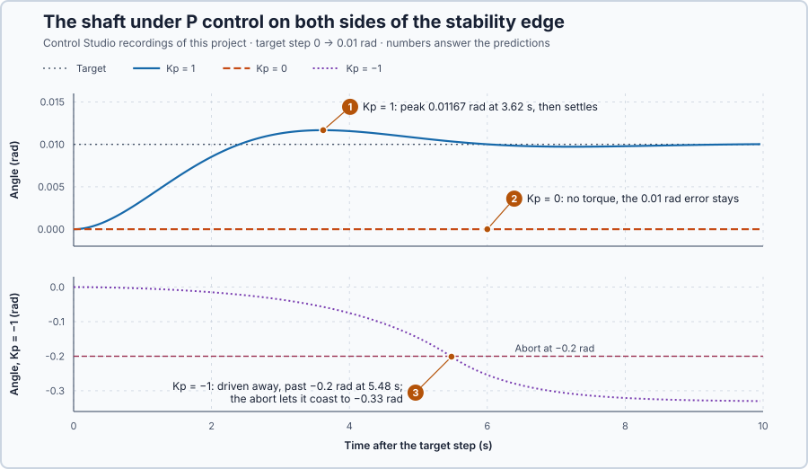

# 52. Routh–Hurwitz stability

In this lesson, you will find every proportional gain for which the shaft's disturbances die away, from the coefficients of its characteristic equation alone, and test gains on both sides of that range.

## The problem

Lesson 51's root locus placed the shaft's poles for every $K_p$ from 0 to 20 N·m/rad, and the test kept $K_p = 16$, within 0.02 rad of the target from 1.46 s. The plot shows the gains we drew. It does not state exactly which gains keep the loop stable, or what happens at the edge of that range.

We will find the stable range from the coefficients of the characteristic equation, without solving for the poles, and test gains on both sides of its edge.

## What we need

We need to:

1. decide from the characteristic equation's coefficients whether every pole is on the stable side;
2. turn that decision into a range of gains; and
3. know what happens at the edge of the range.

## The new idea

**The Routh–Hurwitz test** tells, from the coefficients of the characteristic equation alone, whether every pole is on the stable side, and for which gains.

A mode $e^{st}$ dies away when the real part of $s$ is negative, grows when it is positive, and stays when it is zero. A loop is **asymptotically stable** when every pole's real part is strictly negative, so every disturbance dies away. A pole with a positive real part is a **right-half-plane pole**, because it lies to the right of the vertical axis in the root-locus picture.

**In words.** To find the poles you must solve the characteristic equation. That is easy for a second-degree equation with numbers, hard for a third-degree one, and impossible to read off when a gain is still a letter. Stability needs much less than the poles themselves: only whether any of them lies on the right-hand side. The Routh–Hurwitz test answers exactly that, without solving anything:

1. **Arrange the coefficients** of the characteristic equation in a small table of rows.
2. **Calculate the further rows** from the two rows above each one, by the same cross-multiplication every time.
3. **Read the signs down the first column.** Every change of sign counts one right-half-plane pole; no change means every pole is on the stable side.
4. **Leave the gain as a letter**, and the sign conditions become a range of gains.

It works like a plausibility check on a parameter set in a PLC: a few comparisons decide whether the settings are acceptable, without running the machine.

For the shaft, we remove the braking to see the edge of the stable range clearly: under P control alone, the table gives the range of $K_p$ in one line.

**The formula.** For a characteristic equation $a_n s^n + a_{n-1}s^{n-1} + \dots + a_0 = 0$, write the coefficients alternately into two rows, $[a_n, a_{n-2}, \dots]$ and $[a_{n-1}, a_{n-3}, \dots]$, filling with zeros. Each further row $C$ follows from the two rows above it, $A$ and $B$:

$$
C_j = \frac{B_0\,A_{j+1} - A_0\,B_{j+1}}{B_0} .
$$

Let:

- $a_n \dots a_0$ be the coefficients of the characteristic equation;
- $A$ and $B$ be the two rows above the new one, with $A_0$ and $B_0$ their first entries; and
- $C_j$ be entry $j$ of the new row, counted from 0.

The table has $n + 1$ rows. The rule: as long as no entry of the first column is zero, the number of sign changes down it equals the number of right-half-plane poles. For a second-degree equation $a_2s^2 + a_1s + a_0$, the rows are $[a_2, a_0]$, $[a_1, 0]$ and $[a_0, 0]$, so the test reduces to: all three coefficients have the same strict sign.

A zero in the first column needs care. When the last entry is zero, the constant term is zero, so $s = 0$ is a root: a pole at the origin. Its mode $e^{0t} = 1$ neither grows nor dies away; whatever displacement it carries stays. Asymptotic stability excludes it.

**Example 1: the shaft under P control.** Without the braking, $J\ddot\theta + B\dot\theta = K_p\,(r - \theta)$ with $J = 1$ kg·m² and $B = 1$ N·m·s/rad. The characteristic equation is

$$
s^2 + s + K_p = 0 .
$$

1. **The rows** are $[1, K_p]$ and $[1, 0]$. The third row starts with $(1 \times K_p - 1 \times 0)/1 = K_p$. The first column is $1, 1, K_p$.
2. **$K_p = 4$**, Lesson 49's gain: the column is $1, 1, 4$, with no sign change, so no right-half-plane pole. Lesson 49 found the poles $-0.5 \pm j1.936$: the test agrees without solving anything.
3. **$K_p = -2$**: the column is $1, 1, -2$, with one sign change, so one right-half-plane pole. Indeed $s^2 + s - 2 = (s + 2)(s - 1)$, with the pole $+1$: a deviation grows as $e^{t}$, doubling every $\ln 2 = 0.69$ s.

**Example 2: the same shaft under PI control**, where the table needs all its rows. With the error $e = r - \theta$ and $u = K_p e + K_i \int e\,dt$, the integral is one more stored quantity, so the equation is of third degree: $s^3 + s^2 + K_p s + K_i = 0$.

1. The rows are $[1, K_p]$ and $[1, K_i]$. The third row starts with $(1 \times K_p - 1 \times K_i)/1 = K_p - K_i$; the fourth with $\big((K_p - K_i)\,K_i - 1 \times 0\big)/(K_p - K_i) = K_i$. The first column is $1, 1, K_p - K_i, K_i$.
2. $K_p = 4$, $K_i = 2$: the column is $1, 1, 2, 2$, all positive: stable. Solving shows the poles $-0.53$ and $-0.23 \pm j1.92$.
3. $K_p = 4$, $K_i = 6$: the column is $1, 1, -2, 6$, two sign changes: two right-half-plane poles. Solving shows $0.17 \pm j2.11$, a growing swing.

These PI gains are teaching values; the experiment uses P control.

**The limitation.** Stability says that the modes die away, not how fast or how smoothly. A zero entry in the middle of the first column, or a whole zero row, needs extra steps, which Control Studio completes and explains.

## Prediction

Before running, answer these questions for a target step from 0 to 0.01 rad, from rest:

1. $K_p = 1$: what does the shaft do, and when is its peak?
2. $K_p = 0$: what does the shaft do?
3. $K_p = -1$: what does the shaft do?
4. For which gains is the loop stable?

| $K_p$ | First column | Expected |
| ---: | --- | --- |
| 1 | +, +, + | swings to 0.0116 rad at 3.63 s and settles |
| 0 | +, +, 0 | no torque; the 0.01 rad error stays |
| −1 | +, +, − | driven away, growing |

## Implementation

Open [`src/Main.st`](src/Main.st). The program applies $u = K_p\,(r - \theta)$ every 20 ms within ±20 N·m, with the gain set by the `Kp` initializer, 1 N·m/rad. When the project experiment starts, the target steps to 0.01 rad. If the angle reaches ±0.2 rad or the velocity ±2 rad/s, the program latches `SafetyAbort`, returns to Manual and commands zero torque; the shaft then coasts. The program calculates no Routh table: Control Studio calculates it from the model $1/(s\,(s + 1))$ with the controller $K_p$, declared in `control-loop.json`.

**ST practice.** Write a function `SecondOrderStable` with the inputs `A2`, `A1` and `A0` that returns `TRUE` when all three coefficients have the same strict sign. For the shaft, call it with 1, 1 and `Kp`, and check `Kp` = 1 (`TRUE`), 0 (`FALSE`) and −1 (`FALSE`). For a second-order equation this sign rule is exactly the Routh–Hurwitz test.

## Experiment in Control Studio

1. Open this lesson's project and start **Simulator**. The shaft rests at 0 rad. In the **truST** side bar, select **Control Studio**.
2. On **Tune**, choose **Routh–Hurwitz** in **Tuning method**, enter 1 in **Kp (N·m/rad)** and select **Calculate Routh–Hurwitz**. Expand **Calculation details** to see the table and the first-column signs. Repeat with 0 and −1.
3. On **Identify**, choose **Project experiment** from **Method**. **Signals** already shows `P1.Setpoint · Setpoint (rad)`, `P1.Angle · Process value (rad)` and `P1.AppliedTorque · Applied output (N·m)`; add `P1.Velocity · state (rad/s)`.
4. Answer the predictions. Select **Review project test**, check the declared **10 s** duration, and select **Confirm and start**; the target steps to 0.01 rad at once.
5. After the run, hover the angle's peak and its end value. At completion, Control Studio shows **Project test completed. Outputs restored.**
6. Stop the simulator, set `Kp := 0.0` in `src/Main.st`, start **Simulator** again and repeat steps 3–5. Then do the same with `Kp := -1.0`.

Select **Abort test** to stop early.

## Evidence and decision

The numbered marks answer predictions 1–3. Control Studio's Routh–Hurwitz results answer prediction 4, with **Stable interval: (0, ∞).** each time:

| $K_p$ | Rows | First column | Control Studio |
| ---: | --- | --- | --- |
| 1 | [1, 1], [1, 0], [1, 0] | +, +, + | no right-half-plane poles; asymptotically stable |
| 0 | [1, 0], [1, 0], [0, 0] | last entry zero | an origin pole excludes strict stability |
| −1 | [1, −1], [1, 0], [−1, 0] | +, +, − | one right-half-plane pole |

At 0, **Calculation details** explains that the $s^0$ row is all zero, how the table was completed exactly, and that the origin pole excludes asymptotic stability.

1. $K_p = 1$: the first torque was 0.01 N·m. The angle passed the target, peaked at 0.01167 rad after 3.62 s, as the poles predict, and ended at 0.01003 rad.
2. $K_p = 0$: angle and torque stayed at 0 for all 10 s; the 0.01 rad error remained.
3. $K_p = -1$: the first torque was −0.01 N·m. The angle moved away, −0.015 rad after 2 s and −0.147 rad after 5 s. At 5.48 s it passed −0.2 rad, the program removed the torque, and the shaft coasted to −0.33 rad.
4. The loop is stable exactly for $K_p > 0$.

The coefficients predicted all three: positive gains make the modes die away, zero leaves one that stays, negative gains make one grow. The trials only illustrate this; the range comes from the coefficients, without solving for a single pole. These are simulation results.

## Conclusion

The Routh–Hurwitz test turns stability into sign conditions on the coefficients of the characteristic equation: for $s^2 + s + K_p$, all first-column entries positive means $K_p > 0$. At the edge, $K_p = 0$, a pole at the origin leaves any displacement in place, so the edge is excluded.

For the shaft under P control, every positive gain is stable; $K_p = 1$ settled after one small swing, while $K_p = -1$ drove the shaft away until the abort.

## Check yourself

1. **The braking is put back, so the equation is $s^2 + 8s + K_p = 0$. For which gains is it stable?**
   The first column is $1, 8, K_p$, so again exactly for $K_p > 0$.
2. **Why is $K_p = 0$ not counted as stable, although nothing grows?**
   It has a pole at 0: a displacement neither grows nor dies away. Asymptotic stability needs every mode to die
   away.
3. **With $K_p = -1$, how much does a deviation grow in 2 s?**
   By $e^{0.618 \times 2} = 3.4$ times.

## Reason for the next lesson

Stability tells us that disturbances die away. It does not tell us how strongly the loop answers a command or a disturbance that keeps repeating, at slow and at fast rates.

[Periodic excitation](../../05-experiments-identification-and-validation/22-excitation-for-dynamics/README.md) drives the heater with repeating inputs of known size and rate.
