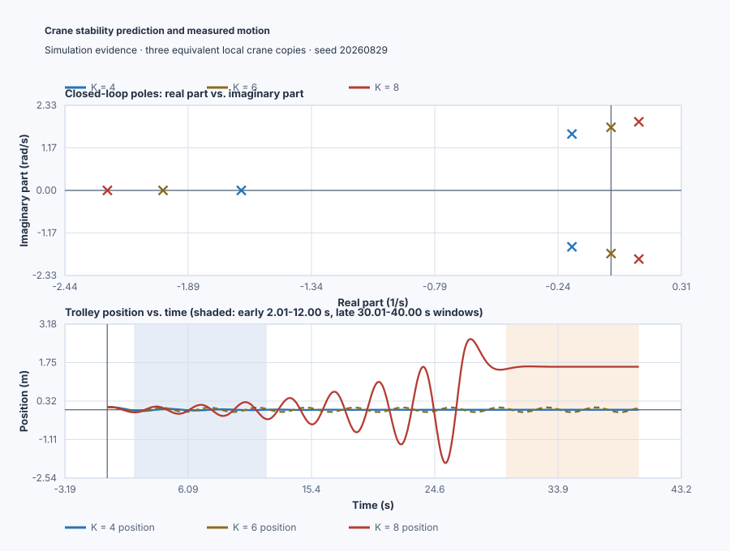

# Prove an overhead-crane stability interval

Course position: Lesson 45 of 84. Previous lesson:
[model-qualified PI tuning](../../06-pid-tuning-methods/44-model-based-tuning/README.md).
Next lesson: [servo root locus](../46-servo-root-locus/README.md).

**Equipment:** Overhead travelling crane trolley with suspended load.

**One clear objective:** derive the complete gain interval and predict stable,
marginal, and unstable crane responses before executable confirmation.

## The problem

An overhead travelling crane moves a trolley while a suspended load introduces
oscillatory mechanical dynamics. The trolley-position setpoint and measured
trolley position use metres. Requested and applied motor force use percent of
the reviewed bidirectional drive range, from -100 to 100 percent.

The simulator contains three independent copies of the same local crane model.
They start from the same 0.1-metre trolley displacement and differ only in
proportional gain. This is Simulation evidence, not physical-plant evidence.

Lesson 44 ran selected tunings against nominal and perturbed process models.
Those finite experiments cannot prove stability for every gain between or
beyond the tested values. Deliberately searching for instability on a physical
crane would also be unsafe. We therefore need an algebraic stability test
before trying gains.

## What we need

We need an algebraic stability boundary for crane gain before simulation so a
stable-looking finite trace cannot substitute for a proof about all poles.

## The new idea

The characteristic equation is the equation whose roots are the closed-loop
poles. A closed-loop pole is a natural response mode of the controlled system.
Its location is described with the complex frequency variable ($s$). The
symbol $j$ is the imaginary unit, defined by $j^2=-1$.

The left half-plane contains poles with negative real part; their natural
responses decay. The imaginary axis contains poles with zero real part. The
right half-plane contains poles with positive real part; their responses grow.
Asymptotic stability means every natural response decays. Marginal stability
means a mode persists without decay or growth. Instability means at least one
mode grows.

A polynomial coefficient multiplies one power of $s$. The Routh array
rearranges polynomial coefficients into rows. Sign changes down its first
column equal the number of right-half-plane poles, so we can count unstable
modes without first solving every root.

Two special cases matter. A zero first-column element is replaced temporarily
by a positive epsilon before taking the limit while counting signs. If a
complete zero row appears, form the auxiliary polynomial from the row above
and use its derivative to continue. A complete zero row indicates symmetric
roots and can expose an imaginary-axis boundary.

### Where the crane equation comes from

A complete crane model begins with Newton's laws for the trolley and suspended
load. Trolley force accelerates both masses, rope angle couples load swing back
into trolley motion, and friction removes motion. Linearizing those balances
around a fixed load, rope length, small swing angle, and stationary trolley
produces coupled linear equations. This lesson uses a reduced local modal model
of those equations; it does not claim that a complete crane has only three
states.

The trolley-position deviation ($x$) is measured in metres. Its first, second,
and third time derivatives are velocity in metres per second, acceleration in
metres per second squared, and acceleration-change rate in metres per second
cubed. The applied drive command ($MV_{\mathrm{applied}}$) is measured in
percent. The scaled plant input ($u$) converts that percentage into
acceleration-change rate; its configured conversion is one metre per second
cubed per percentage point.

The local equation says that acceleration-change rate equals the scaled drive
input minus a velocity-dependent term and an acceleration-dependent term:

$\frac{d^3x}{dt^3}=-2\frac{d^2x}{dt^2}-3\frac{dx}{dt}+u.$

The coefficient 2 has unit inverse seconds and the coefficient 3 has unit
inverse seconds squared, so every term has unit metres per second cubed. These
numbers are configured teaching values. On a physical crane, an engineer would
calculate an initial model from trolley mass, suspended mass, rope length, and
friction, then estimate the observable modal rates from a guarded small-force
test and validate them on unused motions at the same load and rope length.

With zero initial deviations, taking the Laplace transform changes each time
derivative into multiplication by the complex frequency variable $s$. The
Laplace-domain position ($X(s)$) and scaled input ($U(s)$) therefore satisfy

$(s^3+2s^2+3s)X(s)=U(s).$

Dividing output by input gives the reduced open-loop transfer function
($G(s)$), which is the position response per unit scaled input when feedback is
not yet closed:

$G(s)=\frac{X(s)}{U(s)}=\frac{1}{s(s^2+2s+3)}.$

The pole at the origin represents unrestrained trolley position: a constant
position has zero velocity and needs no restoring input in this reduced model.
The quadratic factor represents the damped suspended-load mode. The model
assumes small motion, fixed mechanics, ideal sensing and drive conversion, and
no structural flexibility or actuator delay. Simulation can verify the
configured equation; it cannot establish these coefficients for a real crane.

## Prediction

The proportional gain ($K$) converts position error in metres into scaled plant
input; numerically it combines the percent-per-metre gain used by the
Structured Text with the configured plant-input conversion. The position
reference ($r$) is measured in metres. Under negative proportional feedback,
$u=K(r-x)$. Natural motion is the response with $r=0$, so substituting
$u=-Kx$ into the derived plant equation adds $KX(s)$ to the left side. The
characteristic polynomial ($p(s)$) is the denominator whose roots are the
closed-loop poles:

$p(s)=s^3+2s^2+3s+K.$

Place alternating coefficients into the first two rows: the $s^3$ row is
$[1,3]$ and the $s^2$ row is $[2,K]$. The first element of the next row
($b_1$) is formed by cross-multiplying the two rows above, subtracting, and
dividing by the leading value 2:

$b_1=\frac{2(3)-1(K)}{2}=\frac{6-K}{2}.$

The $s^0$ row contains $K$. Thus the first column is
$[1,2,(6-K)/2,K]$.

Every first-column element must be positive for asymptotic stability. The last
element requires $K>0$ and the preceding element requires $6-K>0$, or $K<6$.
Their intersection gives the complete interval $0<K<6$.

For $K = 4$, the first column is $[1, 2, 1, 4]$: zero sign changes predict a
stable response. For $K=6$, the $s^1$ row becomes zero. The auxiliary
polynomial comes from the row above: $2s^2+6=2(s^2+3)$. Its derivative $4s$
continues the array, while $s^2+3=0$ reveals the imaginary-axis pair
$s=\pm j\sqrt3$. The full polynomial factors as
$(s+2)(s^2+3)$, giving one decaying pole and two
imaginary-axis poles. For $K = 8$, $[1, 2, -1, 8]$ has two sign changes and
predicts two unstable poles.

## Implementation

The actual Structured Text uses three explicit positional proportional paths:

```st
StableRequested := StableGain * (StableSetpoint - StablePosition);
MarginalRequested := MarginalGain * (MarginalSetpoint - MarginalPosition);
UnstableRequested := UnstableGain * (UnstableSetpoint - UnstablePosition);
```

The gains are 4, 6, and 8. Each request is limited into its applied motor force.
The program stops an individual case if position leaves the two-metre local
range or requested force exceeds the drive range. It contains no precomputed
pole, array, stability, or response-envelope answer.

## Experiment in Control Studio

Control Studio exposes the three equivalent natural responses. Test writes one
reviewed Boolean, `P1.ExperimentEnabled`, for 40.1 seconds; it injects no
second process event. Authority false commands zero motor force. Native
evidence owns the Routh table, numerical roots, exact initial-state runs, and
classification. The deterministic Simulation seed is 20260829.

### Control Studio actions

1. **Monitor** — Start the **Simulator**, then open **truST sidebar → Control Studio → Monitor → Response**.
   - **Baseline check:** Wait until the header shows **Simulation**, **Running**, and current data. Confirm Stable trolley setpoint (SP, m) and Marginal trolley setpoint (SP, m); Stable trolley position (PV, m) and Marginal trolley position (PV, m); Stable applied motor force (MV, %) and Marginal applied motor force (MV, %), including units, limits, mode, and quality. The initial operating point is Stable trolley setpoint = 0 m, Marginal trolley setpoint = 0 m, Unstable trolley setpoint = 0 m, Stable applied motor force = 0 %, Marginal applied motor force = 0 %, Unstable applied motor force = 0 %, Stable trolley position = 0.1 m, Marginal trolley position = 0.1 m. The unresolved baseline problem is: A finite response at selected gains cannot prove the complete stability interval or expose a weakly excited unstable mode.
   - **Decision before action:** Read **Prediction** above, then state what should move first and in which direction. Use this decision rule: Use the Routh first-column signs and independent numerical roots as authority; use equivalent time traces only as confirmation.
   - **Successful evidence:** The Response plot advances, the displayed values are finite and current, and **Start recording** is enabled. Select **Start recording** only after those conditions are visible.
   - **Recovery:** If recording is disabled or the plot reports unavailable or stale samples, stop the Simulator, correct the displayed runtime or binding problem, restart it, and repeat the baseline check.
   - **Record:** Write down the initial SP, PV, requested/applied MV where available, controller mode, and your predicted response before opening Test.

2. **Test** — Restart the **Simulator** from the declared initial state, then open **truST sidebar → Control Studio → Test**.
   - **Baseline check:** Confirm **Experiment** = **Observe without excitation**, **Amplitude** = **0** (disabled), and **Maximum duration (s)** = **40.1**. The reviewed authority is **Experiment authority** (`P1.ExperimentEnabled`). It starts false and must restore false.
   - **Decision before action:** Before selecting **Review test**, predict the response to Identical 0.1-metre initial displacement on each crane copy. Confirm the live values are current and the reviewed plan stays inside Stable applied motor force -100 % to 100 %; Marginal applied motor force -100 % to 100 %; Unstable applied motor force -100 % to 100 %; Stable trolley position -2 m to 2 m; Marginal trolley position -2 m to 2 m; Unstable trolley position -2 m to 2 m.
   - **Successful evidence:** Select **Review test**, verify Boolean authority, timeout, false restoration, and stop conditions, then select **Confirm and start**. Keep **Abort test** available. The stable motion must decay, marginal motion persist, and unstable case grow or abort safely.
   - **Recovery:** For a rejected, stale, unsafe, unavailable, failed, or aborted state, read the displayed reason, stop and restart the Simulator, correct that cause, restore the initial state, and review a new test.
   - **Record:** Compare the observed event with your prediction and retain the terminal state, restoration result, and deterministic seed **20260829**.

There is no shared Tune or disabled Validate stage. The proportional paths and
gains are project-owned; native executable evidence performs the algebra/root
checks and correlates them with the retained traces.

## Evidence and decision

### Measures and comparison

Change only proportional gain. Hold the crane model, initial displacement,
zero setpoint, sample schedule, 40-second duration, limits, and seed equal.

Define the measures before seeing results:

- **First-column sign-change count** is the integer number of changes in the
  ordered Routh first column.
- **Position-envelope ratio** is the largest absolute position in the declared
  late window divided by the largest absolute position in the declared early
  window. Values below one show decay; values near one show persistence; values
  above one show growth.
- **Force travel** is actuator activity, calculated as the sum of absolute
  changes between consecutive applied-force samples, in percentage points.

Also retain peak position, peak requested and applied force, limit contact,
stop reason, polynomial, gain, windows, sample interval, and evidence class.

### Validation

First use an independent numerical root oracle. It must find no right-half-
plane roots for $K = 4$, two imaginary-axis roots for $K = 6$, and two right-
half-plane roots for $K = 8$. Then compare the time traces.

The stable trace must decay. The marginal trace must persist and be reported
as `Not settled`, never asymptotically stable. The unstable trace must grow or
reach its safe simulation abort. The time trace confirms the prediction; it
does not replace the Routh calculation or numerical root oracle. A short quiet
prefix or convenient final sample cannot override the pole classification.

Never test the unstable gain on a physical crane from this simulation result.
Physical work requires a separately reviewed plant model, topology, limits,
interlocks, operating procedure, authorised roles, and explicit approval.

### Retained evidence

The pole plot records the Routh-Hurwitz prediction beside the measured crane
motion. Use the decision summary for the engineering verdict and the complete
trace when you want to reproduce every plotted point.



[Complete trace](figures/crane-routh-evidence-trace.csv) ·
[Decision summary](figures/crane-routh-evidence-summary.csv)

## Conclusion

At gain 4, every first-column term is positive, so all natural modes decay. At
gain 6, the imaginary-axis pair keeps oscillating and cannot satisfy
asymptotic settling. At gain 8, the first-column sequence changes sign twice,
so two modes grow even if their early motion looks small. Initial conditions
and duration affect how clearly a mode appears in a plot, but not where the
closed-loop poles actually are.

## Reason for the next lesson

You can now establish a polynomial stability interval before hazardous trials
and distinguish stable, marginal, and unstable evidence. Routh-Hurwitz does not
show how poles move as gain changes or whether a stable response has acceptable
damping. Lesson 46 introduces root locus to show pole motion and why gain alone
may not meet a servo requirement.
